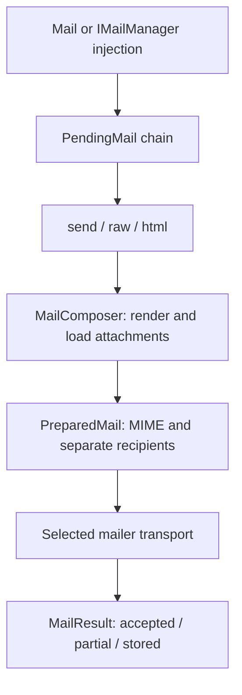

Orionis composes MIME messages from reusable `Mailable` classes, plain text, HTML or views. Send through SMTP or save complete `.eml` files for local inspection.

## Prepare and inspect your first message

Start with the file transport. Set these application environment values before startup:

```dotenv
MAIL_MAILER=file
MAIL_FROM_ADDRESS=notifications@example.com
MAIL_FROM_NAME="Example App"
MAIL_FILE_PATH=storage/mail
```

The directory must be writable and its filesystem must support hard links. A standard application needs its mail, view and storage providers; importing `Mail` in an external script does not initialize them.

Save this controller in `app/http/controllers/welcome_mail_controller.py`. Import the facade from its public module and explicitly select the file transport:

```python
from orionis.http import JSONResponse
from orionis.support.facades import Mail


class WelcomeMailController:
    async def __call__(self) -> JSONResponse:
        result = await (
            Mail.mailer("file")
            .to("ana@example.com", "Ana")
            .subject("Welcome")
            .raw("Welcome, Ana.")
        )
        return JSONResponse({
            "message_id": result.message_id,
            "status": result.status.value,
        })
```

Register a route in the configured API route file:

```python
from app.http.controllers.welcome_mail_controller import WelcomeMailController
from orionis.support.facades import Route

Route.post("/mail-preview", WelcomeMailController)
```

The result has status `stored` and `file_path` points to the complete `.eml`. Open it in a mail client or inspect its content. This transport does not deliver to the recipient. Every message needs a sender and at least one recipient; configure the example's global sender before booting.

To deliver mail, configure [SMTP](/en/mail/transports-and-extensions) and change the chain to `.mailer("smtp")`. Alternatively, remove the explicit selection and use `MAIL_MAILER=smtp` as the default. Server acceptance does not confirm delivery to a mailbox.

## Delivery flow



Fluent options are synchronous and return a new chain. Terminal methods are asynchronous and prepare content before creating the transport. Bcc recipients remain in the transport envelope and are absent from MIME headers. SMTP acceptance confirms the server's acceptance, not receipt in a mailbox.

The native `MailProvider` registers the manager and composer as singletons and pins the facade during boot. The composer uses view and Storage services even if a particular operation only contains plain text. You do not need to register these services again in a standard application.

## Documentation path

- [Configuration](/en/mail/configuration): every property, environment variable and validation.
- [Transports and extensions](/en/mail/transports-and-extensions): SMTP, files and custom drivers.
- [Mailable classes](/en/mail/composing-mail): creating a class, declaring its data and sending an instance or class.
- [Content and views](/en/mail/content-and-views): text, HTML, alternatives and template variables.
- [Storage attachments](/en/mail/attachments): paths, disks, filenames, MIME and file loading.
- [Sending and results](/en/mail/sending-and-results): complete chain API, callbacks and outcomes.
- [Facade and injection](/en/mail/manager-and-injection): controllers, services and mailable constructor dependencies.
- [Technical reference](/en/mail/api-reference): composer, contracts, helpers, exceptions and inventory.

For work that must survive process restarts, use a [persistent job](/en/queues) that reconstructs and sends the message. Sending mail and confirming a database transaction are separate effects.
