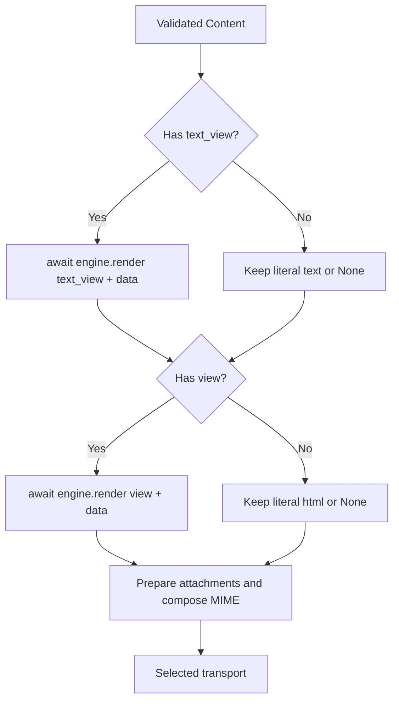

`Content` declares the bodies of an email. It can hold literal text, literal HTML, an HTML view, a text view, or an HTML/text combination. The composer turns this declaration into MIME parts before using the transport. Constructing it neither returns an HTTP response nor processes templates.

For a reusable notification, return `Content` from [`Mailable.content()`](/en/mail/composing-mail#mailable-content). You can also pass `Content` directly to `send()`; its variants and callbacks are covered in [sending and results](/en/mail/sending-and-results).

<a id="content"></a>
## Complete Content declaration

All arguments are optional and keyword-only, but at least one body must be declared:

```text
Content(
    *,
    view: str | None = None,
    html: str | None = None,
    text: str | None = None,
    text_view: str | None = None,
    data: Mapping[str, object] | None = None,
)
```

`Content` is an immutable dataclass. It has no factory methods: construct it directly with these five properties. `None` means that source is undeclared. Bodies and identifiers must be strings; they do not accept `bytes`, `Response`, response schemas, or pending view objects.

<a id="content-text"></a>
### `text`: literal text

Use it for plain-text messages and straightforward alternatives that need no template. It is preserved literally, without interpreting Jinja or escaping HTML:

```python
from orionis.mail import Content

content = Content(text="Your report is ready. Reference: REPORT-1042.")
assert content.text == "Your report is ready. Reference: REPORT-1042."
literal = Content(text="The marker {{ name }} is literal text.")
assert "{{ name }}" in literal.text
```

An empty string `""` is a valid, empty body. A message with only `text` is composed as `text/plain`.

<a id="content-html"></a>
### `html`: literal HTML

Use it when you already have the final HTML. It is not rendered with Jinja and receives no `data` values. When interpolating external data manually, escape values intended as HTML text:

```python
from html import escape
from orionis.mail import Content

name = "Ana & Luis"
content = Content(
    html=f"<p>Welcome, {escape(name)}.</p>",
    text=f"Welcome, {name}.",
)
assert "Ana &amp; Luis" in content.html
assert "Ana & Luis" in content.text
```

Only `html` produces `text/html`; `html` together with `text` produces `multipart/alternative`. The framework does not automatically derive a text version from HTML.

<a id="content-view"></a>
### `view`: view for the HTML alternative

The composer asks the view engine to render the identifier with `data`. The result becomes the HTML body:

```python
from orionis.mail import Content

content = Content(
    view="emails.welcome",
    text="Welcome, Ana.",
    data={"name": "Ana"},
)
assert content.view == "emails.welcome"
```

With the default Jinja engine, `emails.welcome` resolves to `emails/welcome.html` within the configured view paths. Do not combine `view` with `html`: both define the same alternative and the constructor raises `MailCompositionException`, even when literal HTML is `""`.

<a id="content-text_view"></a>
### `text_view`: view for the text alternative

Use it for plain text with conditions, loops, or more content than is convenient in a Python string:

```python
from orionis.mail import Content

content = Content(
    view="emails.welcome",
    text_view="emails/welcome.txt",
    data={"name": "Ana", "features": ["Projects", "Reports"]},
)
assert content.text_view == "emails/welcome.txt"
```

`text_view` can be used alone or with `view` or `html`. It cannot be combined with `text`. Both views receive the same `data`; the composer renders `text_view` first and then `view`.

To preserve an extension other than `.html`, use a path containing `/`: `emails/welcome.txt`. When an identifier contains no `/`, the normalizer replaces its dots with separators; `emails.welcome.txt` would look for `emails/welcome/txt.html`. Empty strings are invalid for both `view` and `text_view`.

<a id="content-data"></a>
### `data`: explicit view context

Accepts a `Mapping[str, object]`. `None` becomes an empty mapping. Every top-level key must be a string. Context does not apply to literal `text` or `html`.

```python
from orionis.mail import Content

features = ["Projects"]
data = {"name": "Ana", "features": features}
content = Content(view="emails.welcome", data=data)
features.append("Reports")
data["name"] = "Luis"
assert content.data["name"] == "Ana"
assert content.data["features"] == ("Projects",)
```

The constructor recursively copies and freezes owned mappings, lists, tuples, and sets: read-only mappings, tuples for sequences, and `frozenset` for sets. It rejects cycles between these containers. Opaque objects retain their identity; the internal state of models, services, and other instances is not frozen. For stable context, extract the required values beforehand instead of passing entities that continue to change.

A `Mailable`'s attributes are not implicitly added. Explicit context keys take precedence over Jinja globals with the same name. Do not depend on an available HTTP `Request`: mail can also be composed from services or commands.

## Create the templates

With default configuration, views belong in `resources/views`. You can use inheritance, blocks, includes, filters, and globals from the [view engine](/en/views). For example, create these three files.

`resources/views/emails/layout.html`:

```html
<!doctype html>
<html lang="en">
    <head>
        <meta charset="utf-8">
        <title>Example App</title>
    </head>
    <body>
        <main></main>
        <footer>Example App</footer>
    </body>
</html>
```

`resources/views/emails/welcome.html`:

```html


Welcome


    <h1>Welcome, {{ name }}.</h1>
    <p>These features are available:</p>
    <ul>
        
            <li>{{ feature }}</li>
        
    </ul>

```

`resources/views/emails/welcome.txt`:

```jinja

Welcome, {{ name }}.

These features are available:

- {{ feature }}


```

The engine uses `view.autoescape`, enabled by default for `.txt` files too; the extension does not disable escaping. The `` block in this example belongs only to the `text/plain` alternative, preserving characters such as `&`. Keep escaping enabled in the HTML template. Do not mark external data `safe` to bypass escaping.

Internal Jinja identifiers, such as the `extends` target, are loader paths (`emails/layout.html`), not Orionis's normalized dotted entry notation. When multiple paths are configured, they are searched in order. Directories, caching, globals, and extensions are managed in [view configuration](/en/views/configuration-and-cache).

## Return both views from a Mailable

Save this class in `app/notifications/welcome_templates_mail.py` and use the templates above:

```python
from orionis.mail import Content, Envelope, Mailable


class WelcomeTemplatesMail(Mailable):
    __slots__ = ("recipient", "name", "features")

    def __init__(self, recipient: str, name: str) -> None:
        self.recipient = recipient
        self.name = name
        self.features = ("Projects", "Reports")

    def envelope(self) -> Envelope:
        return Envelope(subject="Welcome", to=self.recipient)

    def content(self) -> Content:
        return Content(
            view="emails.welcome",
            text_view="emails/welcome.txt",
            data={"name": self.name, "features": self.features},
        )
```

Send an instance with `send(WelcomeTemplatesMail(...))`, following the [complete controller example](/en/mail/composing-mail#mailable-construction). When passing `Content` directly to `send()`, do not add a `data` argument: it already belongs to the declaration. The `send("emails.welcome", data)` form builds an HTML view declaration; it does not interpret the string as literal HTML or add a text alternative automatically.

## Composition flow



The composer uses `await IViewEngine.render(template, context)` and requires a `str` result. Views do not generate HTTP responses. A missing template, rendering error, or result of another type prevents reaching the transport and becomes `MailCompositionException`; engine failures retain their original exception as the cause.

The configured Jinja uses `Undefined`, not `StrictUndefined`: a missing simple variable may render empty. Do not use rendering as a substitute for validating notification data.

<a id="view-rendering"></a>
## Generate a preview without sending

To obtain only HTML, inject `IViewEngine` into a controller. This example uses the mailable's own `Content`:

```python
from app.notifications.welcome_templates_mail import WelcomeTemplatesMail
from orionis.http import HTMLResponse
from orionis.view.contracts.engine import IViewEngine


class MailPreviewController:
    async def __call__(self, view: IViewEngine) -> HTMLResponse:
        content = WelcomeTemplatesMail("ana@example.com", "Ana & Luis").content()
        assert content.view is not None
        html = await view.render(content.view, dict(content.data or {}))
        return HTMLResponse(html)
```

The HTTP flow injects the engine into the action. You can also receive it in an asynchronous service's constructor. This preview sends no mail and does not validate the envelope, attachment reads, or transport. Direct engine errors retain their view exception types; conversion to `MailCompositionException` happens during mail composition. To prepare the complete MIME message without sending, see [`MailComposer.prepare()`](/en/mail/api-reference#composer-prepare).

## Combinations and limits

| Declaration | Resulting bodies |
| --- | --- |
| `text` or `text_view` | One `text/plain` part. |
| `html` or `view` | One `text/html` part. |
| One text source and one HTML source | `multipart/alternative`, text first and HTML second. |
| Any of the above with attachments | Body parts are preserved and attachments are added to `multipart/mixed`. |

`Content()` without a body, duplicate sources for an alternative, incorrect value types, and invalid context raise `MailCompositionException` during declaration. There is no automatic Markdown processing, CSS inlining, or HTML-to-text conversion. Prepare such results beforehand and declare them as compatible strings or views.
