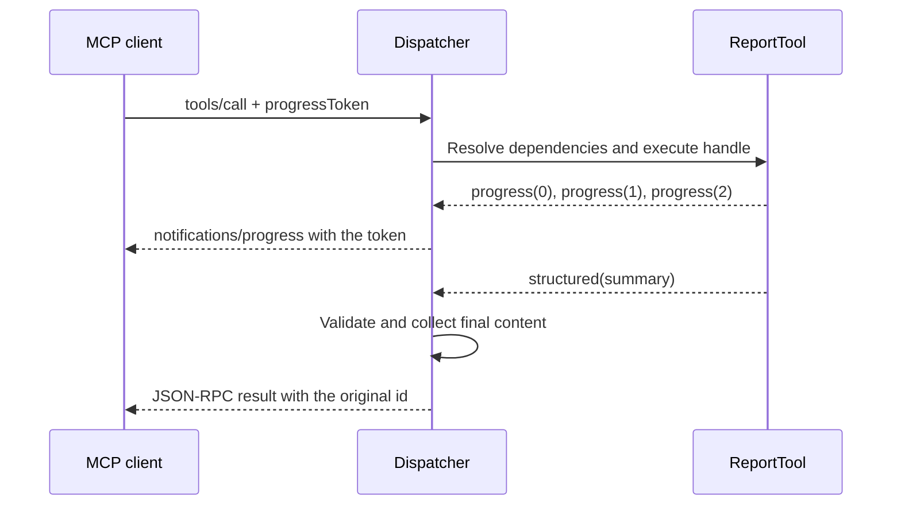

An MCP call can report progress, request additional input or keep a change subscription open. These flows preserve the stateless model: each operation carries its own capabilities and data. A subscription maintains an open stream, but does not create a business session shared by later calls.

Before using these examples, register each `Server` on an MCP route as described in [servers and routes](/en/mcp/servers-and-routes). Send this page's JSON requests by `POST` to that server's URL with `Content-Type: application/json` and `Accept: application/json, text/event-stream`. They include the protocol version and client capabilities in `params._meta`; see the complete exchange in [HTTP and clients](/en/mcp/http-and-clients).

## Progress and the final result

A tool can implement `handle()` as an asynchronous generator. Each `yield McpResponse.progress(...)` reports advancement; other values are collected into the final response.

```python
from collections.abc import AsyncIterator

from orionis.mcp import McpResponse, Server, Tool


class ReportSource:
    async def collect(self) -> list[dict[str, object]]:
        return [{"order_id": 42, "status": "ready"}]


class ReportTool(Tool):
    name = "build-report"
    description = "Collect report rows and return a summary."

    def __init__(self, source: ReportSource) -> None:
        self.source = source

    async def handle(self) -> AsyncIterator[McpResponse]:
        yield McpResponse.progress(0, total=2, message="Collecting orders")
        rows = await self.source.collect()
        yield McpResponse.progress(1, total=2, message="Preparing summary")
        summary = {"count": len(rows), "rows": rows}
        yield McpResponse.progress(2, total=2, message="Completed")
        yield McpResponse.structured(summary)


class ReportsServer(Server):
    name = "reports"
    tools = (ReportTool,)
```

`ReportSource` is a constructor dependency resolved by the container. Replace its sample rows with a real asynchronous query. To receive progress, the client provides a token identifying this call:

```json
{
  "jsonrpc": "2.0",
  "id": "report-42",
  "method": "tools/call",
  "params": {
    "name": "build-report",
    "arguments": {},
    "_meta": {
      "io.modelcontextprotocol/protocolVersion": "2026-07-28",
      "io.modelcontextprotocol/clientCapabilities": {},
      "progressToken": "report-42-progress"
    }
  }
}
```

The HTTP transport returns SSE for this generator. `notifications/progress` notifications contain `progressToken`, `progress` and any supplied `total`/`message`. The final JSON-RPC result retains `id="report-42"`.



Observe these rules:

- Without `progressToken`, progress updates are suppressed; the tool still executes and returns its final result.
- Progress must strictly increase and numbers must be finite. Do not repeat a value merely to change its message.
- Ordinary content blocks are not emitted as separate partial results: they accumulate until the final result is normalized. Only one structured value is allowed.
- Accumulated content and the final response are subject to `MCP_MAX_RESPONSE_SIZE`.
- Disconnection or cancellation closes the generator. Release resources with `try/finally` and allow cancellation to propagate.

## Requesting input and continuing

A tool, resource or prompt can return `InputRequiredResult` instead of its final result. It contains `inputRequests` and/or `requestState` and is identified by `resultType="input_required"`.

The client handles the inputs and repeats the original method with `inputResponses` and the received `requestState`. This is a **new request**: Orionis constructs the component and executes its handler again; it does not retain a suspended controller in memory.

### Example: confirming an export preparation

This example requests confirmation before returning an export preparation. It does not write or export data: its output describes a validated selection. For an actual operation, also enforce access policies and job idempotency before producing effects.

`McpState` requires a valid application key and `app.cipher` configured as `AES-128-GCM` or `AES-256-GCM`. For example, `APP_CIPHER=AES-256-GCM` requires a stable `APP_KEY` normalized to 32 bytes. Every worker handling continuations must use the same key and cipher. See [encryption and key management](/en/cryptography/encryption/encrypting-values) before enabling this example, especially if the application already stores encrypted data.

```python
from collections.abc import Mapping

from orionis.mcp import (
    InputRequiredResult,
    McpRequest,
    McpResponse,
    McpState,
    Server,
    Tool,
)
from orionis.schemas import Schema


class ConfirmExportInput(Schema):
    report_id: int


class ConfirmExportTool(Tool[ConfirmExportInput]):
    name = "confirm-export"
    description = "Confirm an export preparation without exporting data."

    async def handle(
        self,
        payload: ConfirmExportInput,
        request: McpRequest,
        state: McpState,
    ) -> McpResponse | InputRequiredResult:
        if not request.input_responses:
            return InputRequiredResult(
                inputRequests={
                    "confirmation": {
                        "method": "elicitation/create",
                        "params": {
                            "mode": "form",
                            "message": f"Prepare export for report {payload.report_id}?",
                            "requestedSchema": {
                                "type": "object",
                                "properties": {
                                    "approved": {"type": "boolean"},
                                },
                                "required": ["approved"],
                            },
                        },
                    },
                },
                requestState=state.seal(
                    request, {"report_id": payload.report_id}, ttl=300,
                ),
            )

        saved = state.open(request)
        answer = request.input_responses.get("confirmation")
        if not isinstance(answer, Mapping):
            return McpResponse.error("The confirmation response is missing.")
        if answer.get("action") != "accept":
            return McpResponse.text("Export preparation cancelled.")

        content = answer.get("content")
        if not isinstance(content, Mapping) or content.get("approved") is not True:
            return McpResponse.error("Explicit approval is required.")
        if not isinstance(saved, dict) or saved.get("report_id") != payload.report_id:
            return McpResponse.error("The export context is invalid.")

        return McpResponse.structured({
            "report_id": saved["report_id"],
            "approved": True,
        })


class ExportServer(Server):
    name = "exports"
    tools = (ConfirmExportTool,)
```

`payload` contains validated arguments. `request` and `state` are method dependencies resolved by Orionis; clients do not send them inside `arguments`. `McpRequest` mappings are read-only snapshots, so the example checks them against `Mapping`.

The first call advertises form support:

```json
{
  "jsonrpc": "2.0",
  "id": 1,
  "method": "tools/call",
  "params": {
    "name": "confirm-export",
    "arguments": {"report_id": 42},
    "_meta": {
      "io.modelcontextprotocol/protocolVersion": "2026-07-28",
      "io.modelcontextprotocol/clientCapabilities": {
        "elicitation": {"form": {}}
      }
    }
  }
}
```

The client must retain `result.requestState` exactly as received. After obtaining the user's answer, send a second request; replace the marker with that opaque value:

```json
{
  "jsonrpc": "2.0",
  "id": 2,
  "method": "tools/call",
  "params": {
    "name": "confirm-export",
    "arguments": {"report_id": 42},
    "requestState": "<requestState from the first response>",
    "inputResponses": {
      "confirmation": {
        "action": "accept",
        "content": {"approved": true}
      }
    },
    "_meta": {
      "io.modelcontextprotocol/protocolVersion": "2026-07-28",
      "io.modelcontextprotocol/clientCapabilities": {
        "elicitation": {"form": {}}
      }
    }
  }
}
```

`inputResponses` contains input results without additional JSON-RPC envelopes. To decline or cancel, use `{"action": "decline"}` or `{"action": "cancel"}` without `content`. Acceptance does not replace server authorization: also verify identity and domain rules.

### What state validation checks

`state.seal(request, value, ttl=300)` encrypts and authenticates its value. It binds the token to the registered server, method, arguments, URI, identity, guard and credential, as well as its expiry. TTL must be a positive integer.

`state.open(request)` verifies these details before exposing the value and rejects absent, modified, expired or mismatched state. Changing the JSON-RPC `id` does not change the bound operation. Handler instance variables cannot replace this state: a continuation may run on another worker.

This mechanism does not provide general replay prevention for effects. If an export or purchase must execute only once, record and check an idempotency key in domain storage.

### Supported inputs and capabilities

| Method inside `inputRequests` | Advertised client capability | Purpose |
| --- | --- | --- |
| `elicitation/create` with `mode="form"` | `{"elicitation": {"form": {}}}` | Request form fields. |
| `elicitation/create` with `mode="url"` | `{"elicitation": {"url": {}}}` | Direct the user to an application-declared URL. |
| `sampling/createMessage` | `{"sampling": {}}`; `context`/`tools` when used | Request generation from the client through the supported input format. |
| `roots/list` | `{"roots": {}}` | Request client-declared roots with `file://` URIs. |

The implementation retains sampling and roots formats identified as deprecated by their internal types; wire support does not imply automatic model or filesystem access. Inputs are carried by the interim result rather than spontaneous server-to-client JSON-RPC calls.

Forms support flat objects with string, number, integer, boolean and string-selection array/enum fields. Arbitrary nested objects are not supported. Orionis checks the structure of `inputResponses`, but handlers must verify the requested key and operation-specific content conditions. A missing required capability produces error `-32021` with `requiredCapabilities`.

## Change subscriptions

Subscriptions report changes; clients then perform a new listing or read. They do not automatically transmit complete resources.

Save this declaration, for example, in `app/mcp/servers/status_server.py` and register it on an MCP route:

```python
from orionis.mcp import McpResponse, Resource, Server


class ReportStatusResource(Resource):
    name = "report-status"
    uri = "reports://status"
    mime_type = "application/json"

    async def handle(self) -> McpResponse:
        return McpResponse.structured({"status": "ready"})


class StatusServer(Server):
    name = "report-status"
    resources = (ReportStatusResource,)
    list_changed = True
    resource_subscriptions = True
```

`list_changed=True` advertises change notifications for the server's existing catalogs. `resource_subscriptions=True` permits subscriptions to specific resources. The client opens a long-lived `POST`:

```json
{
  "jsonrpc": "2.0",
  "id": "status-listener",
  "method": "subscriptions/listen",
  "params": {
    "notifications": {
      "resourcesListChanged": true,
      "resourceSubscriptions": ["reports://status"]
    },
    "_meta": {
      "io.modelcontextprotocol/protocolVersion": "2026-07-28",
      "io.modelcontextprotocol/clientCapabilities": {}
    }
  }
}
```

The first event is `notifications/subscriptions/acknowledged`. Its `notifications` field reflects the filters actually accepted, and `params._meta["io.modelcontextprotocol/subscriptionId"]` contains `"status-listener"`. Requesting a capability the server does not advertise does not activate it.

After committing an actual storage change, notify listeners from application code:

```python
from app.mcp.servers.status_server import StatusServer
from orionis.support.facades import Mcp


async def notifyReportStatusChanged() -> None:
    await Mcp.resourceUpdated(StatusServer, "reports://status")
```

The class must be registered with the application's manager. The `notifications/resources/updated` notification includes the URI; clients use `resources/read` to retrieve current content. Publishing an event neither modifies nor recompiles the resource.

| Application operation | Listener filter | Notification |
| --- | --- | --- |
| `await Mcp.toolsChanged(ServerClass)` | `toolsListChanged` | `notifications/tools/list_changed` |
| `await Mcp.promptsChanged(ServerClass)` | `promptsListChanged` | `notifications/prompts/list_changed` |
| `await Mcp.resourcesChanged(ServerClass)` | `resourcesListChanged` | `notifications/resources/list_changed` |
| `await Mcp.resourceUpdated(ServerClass, uri)` | `resourceSubscriptions` containing that URI | `notifications/resources/updated` |

Resource access is checked when admitting its subscription. The stream filters events by server and URI; it does not rerun authorization for every event. If permissions change, design how to close or renew affected subscriptions. New reads follow the normal access flow.

The default event bus is process-local. It maintains a bounded buffer per listener and coalesces identical pending notifications. Buffer overflow closes the listener to prevent unbounded memory growth. It provides neither cross-worker delivery, durable storage nor replay. A multi-worker deployment needs a shared bus compatible with `IMcpEventBus` to distribute events across processes.

HTTP streams send SSE keepalive comments during idle periods. Disconnecting releases the listener; this flow does not use a separate `resources/unsubscribe` call. In tests, use `McpTestClient.stream()` and close it in `finally`; `request()` expects a finite exchange. See [MCP testing](/en/mcp/testing).

## Large tool catalogs

`ToolCatalog` avoids publishing every schema on each `tools/list`. Instead it exposes two tools: `search_tools` to discover tools and `execute_tools` to run them.

```python
from orionis.mcp import McpResponse, Server, Tool, ToolCatalog
from orionis.schemas import Schema


class ProductSearchInput(Schema):
    query: str


class SearchProductsTool(Tool[ProductSearchInput]):
    name = "search-products"
    description = "Search the product catalog."

    async def handle(self, payload: ProductSearchInput) -> McpResponse:
        return McpResponse.structured({
            "query": payload.query,
            "products": [{"id": 42, "name": "Notebook"}],
        })


class CatalogServer(Server):
    name = "catalog"
    tools = (ToolCatalog(SearchProductsTool),)
```

Send this search to the catalog server:

```json
{
  "jsonrpc": "2.0",
  "id": 1,
  "method": "tools/call",
  "params": {
    "name": "search_tools",
    "arguments": {"query": "products", "limit": 5},
    "_meta": {
      "io.modelcontextprotocol/protocolVersion": "2026-07-28",
      "io.modelcontextprotocol/clientCapabilities": {}
    }
  }
}
```

`result.structuredContent.tools` contains metadata and schemas for accessible matches. Search is lexical over the compiled metadata index, including names, titles and descriptions; it does not perform model-based semantic search.

To execute a discovered tool:

```json
{
  "jsonrpc": "2.0",
  "id": 2,
  "method": "tools/call",
  "params": {
    "name": "execute_tools",
    "arguments": {
      "calls": [
        {"name": "search-products", "arguments": {"query": "notebook"}}
      ]
    },
    "_meta": {
      "io.modelcontextprotocol/protocolVersion": "2026-07-28",
      "io.modelcontextprotocol/clientCapabilities": {}
    }
  }
}
```

The result collects executions in `structuredContent.results`, with `name` and `result` for each tool. Validation, availability and authorization are reapplied to each execution.

Rename the operations with `ToolCatalog(ToolA, ToolB, search_name="find_operations", execute_name="run_operations")`. Visible, internal catalog and synthetic names must not collide. Catalog tools are omitted from the general listing, but once their names are known they can also be invoked directly through `tools/call`, preserving validation and policies.

Batch calls execute **sequentially** and stop on an `isError` result; they are not a transaction. If a tool needs additional input, use an individual direct call or `execute_tools` with one entry. A multi-entry batch encountering that condition may already have completed earlier effects; do not replay the entire batch. The dispatcher limits matches, call count and output bytes through `MCP_TOOL_SEARCH_MAX_RESULTS`, `MCP_TOOL_SEARCH_MAX_CALLS` and `MCP_TOOL_SEARCH_MAX_OUTPUT_BYTES`.

## Protocol extensions

`McpExtension` adds methods with typed parameters without replacing standard methods. Every method requires an explicit decoder and a namespaced extension identifier.

```python
import msgspec

from orionis.mcp import McpExtension, McpRequest, Server
from orionis.mcp.protocol.requests import RequestParams
from orionis.mcp.protocol.results import CompleteResult


class EchoParams(RequestParams, frozen=True):
    value: str


class EchoResult(CompleteResult, frozen=True):
    value: str


async def echo(request: McpRequest, params: EchoParams) -> EchoResult:
    return EchoResult(value=params.value)


class ExtendedServer(Server):
    name = "extended"
    extensions = (
        McpExtension(
            identifier="example.org/echo",
            capabilities={"echo": {}},
            methods={"example.org/echo": echo},
            decoders={"example.org/echo": msgspec.json.Decoder(EchoParams)},
        ),
    )
```

`RequestParams` retains `_meta`, while `CompleteResult` supplies `resultType="complete"` and result metadata. These types belong to their protocol modules; ordinary component classes are imported from `orionis.mcp`.

Clients advertise the extension in **this** request:

```json
{
  "jsonrpc": "2.0",
  "id": 1,
  "method": "example.org/echo",
  "params": {
    "value": "Hello",
    "_meta": {
      "io.modelcontextprotocol/protocolVersion": "2026-07-28",
      "io.modelcontextprotocol/clientCapabilities": {
        "extensions": {"example.org/echo": {}}
      }
    }
  }
}
```

The response contains `result.value="Hello"`. Without negotiation, it returns `-32021`. Extension handlers are invoked directly with `(request, params)`; additional parameters do not receive automatic injection as `handle()` methods on Tools, Resources and Prompts do.

Optional `schema_hook(metadata)` runs when component metadata is compiled. It can attach extension metadata, but cannot change compiled standard names, titles, descriptions, icons, annotations, schemas, URI, MIME, size or arguments. It also cannot overwrite reserved protocol keys. Extension identifiers must be unique, methods must not collide with each other or core methods, and `decoders` keys must exactly match `methods` keys.

## Choosing a mechanism and understanding its limits

| Need | Mechanism |
| --- | --- |
| Display advancement of a call | Generator using `McpResponse.progress()` and `progressToken`. |
| Request client input and continue later | `InputRequiredResult`, per-request capabilities and validated state. |
| Report future changes | `subscriptions/listen` and event publication. |
| Reduce the initial tool catalog | `ToolCatalog` and its search/execution tools. |
| Add a method with explicit negotiation | `McpExtension` with a decoder and typed result. |

Transport does not add business transactions, durable subscriptions or idempotent effects. Size limits and the event bus for your deployment, then verify full exchanges with [HTTP and clients](/en/mcp/http-and-clients) and [MCP testing](/en/mcp/testing).
