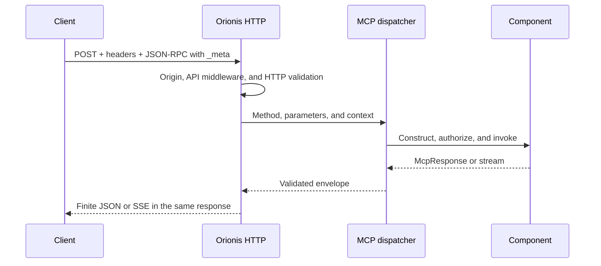

This guide uses `DemoServer` and the `/mcp/demo` endpoint from [Servers and routes](/en/mcp/servers-and-routes). Register that server and start Orionis with `orionis serve` or `python -B reactor serve`. Examples use `http://localhost:8000`; adjust the host and port to your application's console output.

## One endpoint, several MCP methods

Send every operation as **POST to the same endpoint**. Listing tools does not create `/mcp/demo/tools` or use GET: send `method: "tools/list"` in the JSON-RPC body.

| Operation | MCP method | Parameters besides `_meta` |
| --- | --- | --- |
| Discover the server | `server/discover` | None. |
| List tools | `tools/list` | Optional `cursor`. |
| Invoke a tool | `tools/call` | `name` and `arguments`. |
| List fixed resources | `resources/list` | Optional `cursor`. |
| List URI templates | `resources/templates/list` | Optional `cursor`. |
| Read a resource | `resources/read` | `uri`. |
| List prompts | `prompts/list` | Optional `cursor`. |
| Get a prompt | `prompts/get` | `name` and `arguments` with string values. |
| Complete an argument | `completion/complete` | `ref`, `argument`, and optional `context`; see [resources](/en/mcp/resources) and [prompts](/en/mcp/prompts). |
| Listen for changes | `subscriptions/listen` | `notifications`; see [subscriptions](/en/mcp/advanced-workflows). |

`server/discover` inspects capabilities but does not initialize a session or need to precede each operation. Orionis implements only [MCP `2026-07-28`](/en/mcp#supported-protocol-revision).

## Required headers and metadata

| Element | Value and purpose |
| --- | --- |
| `Content-Type` | A single `application/json` header; its charset parameter is accepted. |
| `Accept` | Explicitly include `application/json, text/event-stream` with positive quality for both. `*/*` does not replace them. |
| `MCP-Protocol-Version` | `2026-07-28`, identical to the revision in `params._meta`. |
| `MCP-Method` | The same string as `method` in the envelope. |
| `MCP-Name` | For `tools/call` and `prompts/get`, the `name`; for `resources/read`, the complete `uri`. Not needed for lists. |
| `params._meta` | Include `io.modelcontextprotocol/protocolVersion` and `io.modelcontextprotocol/clientCapabilities` in every request. |

Tools whose schema declares `x-mcp-header` also require those arguments to be mirrored in their declared headers. The transport checks values before executing the handler. Do not send an MCP session header: every request is processed independently.

### Browser origins

MCP checks a present `Origin` against the exact entries in `allowed_origins` and returns HTTP `403` if it does not match. Origins must contain only an HTTP(S) scheme, host, and optional port, without a path or trailing slash. There are no wildcards or implicit same-origin exceptions. An empty list rejects every present `Origin`; a request without that header passes the origin check.

Since 1.0.16, the editable `config/mcp.py` supplies `["https://inspector.orionis-framework.com"]` when `CORS_ALLOW_ORIGINS` is unset; core `McpConfig` retains `[]` as its fallback. A defined environment value replaces the editable default, including an explicit `[]`. Browser clients also need the appropriate HTTP CORS response headers and a successful `OPTIONS` preflight: passing MCP's origin check alone does not configure those. See [browser testing](/en/mcp/testing#inspect-an-http-server-in-the-browser) and [MCP configuration](/en/mcp/stdio-and-configuration).

### First query with curl

Save this UTF-8 body as `discover.json`:

```json
{
  "jsonrpc": "2.0",
  "id": "discover-1",
  "method": "server/discover",
  "params": {
    "_meta": {
      "io.modelcontextprotocol/protocolVersion": "2026-07-28",
      "io.modelcontextprotocol/clientCapabilities": {}
    }
  }
}
```

Run from the directory containing the file. On Windows, use the `curl.exe` executable; on other systems change its name to `curl`:

```shell
curl.exe --request POST http://localhost:8000/mcp/demo --header "Content-Type: application/json" --header "Accept: application/json, text/event-stream" --header "MCP-Protocol-Version: 2026-07-28" --header "MCP-Method: server/discover" --data-binary "@discover.json"
```

The response retains `id: "discover-1"` and includes `result.supportedVersions`, `result.capabilities`, and the server identity in `result._meta["io.modelcontextprotocol/serverInfo"]`. Completed responses include `resultType: "complete"`; cacheable operations also include `ttlMs` and `cacheScope`.

Send a string or integer `id` for requests expecting a result. A notification without `id` receives HTTP `202` with no body; it does not replace a `tools/call` request that must execute and return a result.

## Complete JavaScript queries

To test finite operations from Node.js with `fetch` available, create `mcp-http.mjs` and copy this function. Append the query blocks to the same file and run `node mcp-http.mjs`:

```javascript
const endpoint = process.env.MCP_URL || "http://localhost:8000/mcp/demo";
let nextId = 1;

async function rpc(method, params = {}) {
    const id = nextId++;
    const headers = {
        "Content-Type": "application/json",
        "Accept": "application/json, text/event-stream",
        "MCP-Protocol-Version": "2026-07-28",
        "MCP-Method": method,
    };
    if (["tools/call", "prompts/get", "resources/read"].includes(method)) {
        headers["MCP-Name"] = method === "resources/read" ? params.uri : params.name;
    }

    const response = await fetch(endpoint, {
        method: "POST",
        headers,
        signal: AbortSignal.timeout(15000),
        body: JSON.stringify({
            jsonrpc: "2.0",
            id,
            method,
            params: {
                ...params,
                _meta: {
                    "io.modelcontextprotocol/protocolVersion": "2026-07-28",
                    "io.modelcontextprotocol/clientCapabilities": {},
                },
            },
        }),
    });

    if (!response.headers.get("content-type")?.startsWith("application/json")) {
        await response.body?.cancel();
        throw new Error("Expected a finite JSON response");
    }
    const envelope = await response.json();
    if (!response.ok || envelope.error) {
        throw new Error(JSON.stringify({ status: response.status, error: envelope.error }));
    }
    if (envelope.id !== id) {
        throw new Error("Unexpected response ID");
    }
    return envelope.result;
}
```

The function mirrors method and name/URI headers, adds metadata, and checks HTTP, JSON-RPC, and response identity. It uses the example's ASCII identifiers and handles finite JSON responses. Adapt the transport for tools requiring custom headers or SSE streams.

### Discover capabilities and identity

```javascript
const server = await rpc("server/discover");
console.log(server.supportedVersions); // ["2026-07-28"]
console.log(server.capabilities);
console.log(server._meta["io.modelcontextprotocol/serverInfo"]);
```

Metadata describes client capabilities for each call. The empty object declares no additional capabilities; it does not enable elicitation or subscriptions by itself.

### List and invoke tools

```javascript
const tools = await rpc("tools/list");
console.log(tools.tools);

const greeting = await rpc("tools/call", {
    name: "greet",
    arguments: { name: "Ada" },
});
console.log(greeting.structuredContent); // Hello, Ada!
console.log(greeting.isError === true);
```

`tools/list` returns descriptions and schemas without executing tools. `tools/call` executes `greet` with its validated payload. A business result with `isError: true` differs from `envelope.error`: inspect both as appropriate. See [Tools](/en/mcp/tools).

### List and read resources

```javascript
const resources = await rpc("resources/list");
console.log(resources.resources);

const templates = await rpc("resources/templates/list");
console.log(templates.resourceTemplates);

const content = await rpc("resources/read", {
    uri: "demo://greetings/Ada",
});
console.log(content.contents);
```

In the basic example, `GreetingResource` declares a template: it appears in `resourceTemplates` and the fixed resource list may be empty. `resources/read` receives the concrete URI, rather than `demo://greetings/{name}`. A resource is not an HTTP URL to open in a browser and does not grant filesystem access. See [Resources](/en/mcp/resources).

### List and get prompts

```javascript
const prompts = await rpc("prompts/list");
console.log(prompts.prompts);

const prompt = await rpc("prompts/get", {
    name: "greeting",
    arguments: { name: "Ada" },
});
console.log(prompt.messages);
```

`prompts/list` describes names and arguments; `prompts/get` returns messages with their roles and content blocks. Getting a prompt does not execute a model. Argument values are strings even when their text represents a number. See [Prompts](/en/mcp/prompts).

### Read every page

Add this helper when a catalog has more entries than fit in one page:

```javascript
async function listAll(method, field) {
    const entries = [];
    let cursor;
    do {
        const page = await rpc(method, cursor === undefined ? {} : { cursor });
        entries.push(...page[field]);
        cursor = page.nextCursor;
    } while (cursor !== undefined);
    return entries;
}

console.log(await listAll("tools/list", "tools"));
```

`nextCursor` is opaque: return it unchanged to the same server and method while retaining credentials. Page size comes from `default_page_size`; requests do not offer `limit` or `page_size`. Restart listing if catalog or access changes invalidate a cursor.

## JSON, SSE, and the HTTP lifecycle

Finite operations return JSON. Tool progress or a subscription can keep the **same POST response** open and emit JSON-RPC messages over SSE. Select a reader from the actual `Content-Type`; the helper above targets finite results.

`GET` does not open a separate MCP SSE channel, and `EventSource` cannot perform these POST calls. There is no session identified by `Mcp-Session-Id` or DELETE endpoint to close it. The kernel handles `OPTIONS` as HTTP introspection, rather than an MCP method. See [Advanced workflows](/en/mcp/advanced-workflows) for progress and cancellation.



## Configure Hermes Agent and other clients

The `/mcp/demo` and `/mcp/support` endpoints are registered in the [multiple-server example](/en/mcp/servers-and-routes). Each client must point to its server's complete URL.

For a client or importer using the JSON `mcpServers` format, use:

```json
{
  "mcpServers": {
    "DEMO_MCP": {
      "url": "http://localhost:8000/mcp/demo",
      "protocol": "stateless",
      "supports_parallel_tool_calls": true
    },
    "SUPPORT_MCP": {
      "url": "http://localhost:8000/mcp/support",
      "protocol": "stateless",
      "supports_parallel_tool_calls": true
    }
  }
}
```

Replace `localhost:8000` with a host reachable from the agent process. `DEMO_MCP` and `SUPPORT_MCP` are client labels, rather than STDIO handles, route names, or required `Server.name` values.

For **Hermes Agent**, the native format is `mcp_servers` in `~/.hermes/config.yaml`. Its equivalent is:

```yaml
mcp_servers:
  DEMO_MCP:
    url: "http://localhost:8000/mcp/demo"
    protocol: stateless
    supports_parallel_tool_calls: true
  "SUPPORT_MCP":
    url: "http://localhost:8000/mcp/support"
    protocol: stateless
    supports_parallel_tool_calls: true
```

`protocol: stateless` tells Hermes to start with `server/discover`, appropriate for this revision; `supports_parallel_tool_calls: true` allows the client to overlap calls. It does not configure Orionis limits or make a tool safe for concurrent execution. These options are documented in the [official Hermes reference](https://github.com/NousResearch/hermes-agent/blob/main/website/docs/reference/mcp-config-reference.md); its [official guide](https://github.com/NousResearch/hermes-agent/blob/main/website/docs/user-guide/features/mcp.md) explains the mapping between root keys.

After changing configuration, use `/reload-mcp` inside Hermes to reload servers. The client must support MCP `2026-07-28`; choosing `stateless` does not guarantee support for every advanced capability.

### Private endpoints

When the registration uses token authentication middleware, include credentials in client headers. This is one server entry:

```json
{
  "url": "https://api.example.com/mcp/demo",
  "protocol": "stateless",
  "supports_parallel_tool_calls": true,
  "headers": {
    "Authorization": "Bearer YOUR_TOKEN"
  }
}
```

Use a valid token issued by your application. Endpoint authentication and tool authorization are separate controls; the latter can reject an operation even with a valid token. [Server registration](/en/mcp/servers-and-routes) shows how to protect the endpoint.

## Diagnose a query

| Symptom | Check |
| --- | --- |
| HTTP `405` | Use POST to the registered endpoint; GET and DELETE do not execute MCP operations. |
| HTTP `406` | Explicitly include both `Accept` types without assigning `q=0`. |
| HTTP `415` | Send one `Content-Type: application/json` header and a JSON body. |
| HTTP `403` for an origin | A present `Origin` must exactly match `allowed_origins`. Check whether `CORS_ALLOW_ORIGINS` replaced the inspector default. An absent origin passes the check; `[]` rejects every present origin. |
| Error `-32020` | A mirrored header is missing, duplicated, or disagrees with the body. Check version, method, and name/URI. |
| Error `-32022` | Unsupported revision: inspect `error.data.supported`. |
| Error `-32601` | An unknown method, such as `initialize` or `ping`. |
| Error `-32602` | Invalid parameters, cursor, or primitive; denied authorization can also use it with HTTP `403`. |
| HTTP `413` or `503` | Request size or active capacity exceeded. An open stream retains its slot until closed. |
| Empty `resources/list` | Check templates in `resources/templates/list` and visibility hooks. |

For limits and origins, see [STDIO and configuration](/en/mcp/stdio-and-configuration). For business errors and results, see [MCP responses](/en/mcp/responses-and-content).
