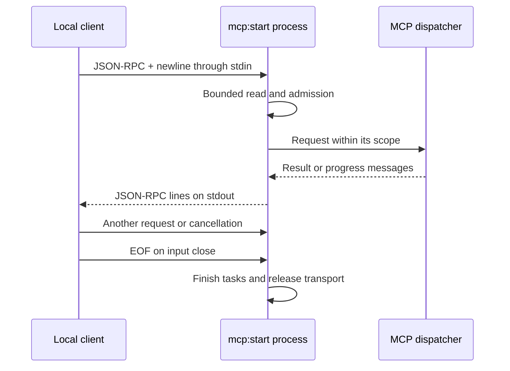

STDIO connects a client to a local Orionis process: the client writes requests to stdin and reads responses from stdout. It uses the same compiled server, schemas, hooks, and container as [HTTP](/en/mcp/http-and-clients), without opening an HTTP port.

## Register a local server

In your application's configured AI file, usually `routes/ai.py`, register an explicit handle:

```python
from app.mcp.servers.demo_server import DemoServer
from orionis.support.facades import Mcp

Mcp.local("demo", DemoServer)
```

If this registration already exists from [Servers and routes](/en/mcp/servers-and-routes), keep it only once. Load the file with `ai="routes/ai.py"` in the existing `app.withRouting(...)` call in `bootstrap/app.py`, before `app.create()`; retain its other arguments.

`Mcp.local()` receives a handle and a **class** inheriting `Server`. It does not accept an instance or a module path supplied by a client. Handles must be unique and match `[A-Za-z0-9][A-Za-z0-9_.-]{0,127}`: between 1 and 128 characters, starting with a letter or digit. `demo` and `support.internal` are valid; a name containing spaces is not.

The local handle is independent of `Server.name` and the HTTP address. You can register the same class using `Mcp.web("/mcp/demo", DemoServer)` and `Mcp.local("demo", DemoServer)`. Each registration publishes its own transport; creating one does not automatically create the other.

## Inventory and execution

From the project root, either alternative lists registered HTTP and STDIO servers:

```shell
orionis mcp:list
python -B reactor mcp:list
```

The table shows transport, endpoint or handle, and server class. It does not open ports or start the transport. To execute the local server, use **one** alternative:

```shell
orionis mcp:start demo
```

```shell
python -B reactor mcp:start demo
```

| Command | Own arguments | Result |
| --- | --- | --- |
| `mcp:list` | None. | Displays registered servers. |
| `mcp:start name` | Required `name`: local handle. | Runs STDIO until input closes or the transport terminates. |
| `mcp:start --help` | `--help`. | Describes the local argument without starting a server. |

An unknown handle writes a diagnostic to stderr and exits with code 1. `mcp:start` does not discover classes from arbitrary names. [Component generators](/en/mcp/servers-and-routes) create files; they do not replace `Mcp.local()` registration.

## STDIO message contract

Each message is **one UTF-8 JSON-RPC object on a single line**, terminated by a newline. Do not send a pretty-printed multiline JSON document or an array of calls. This message discovers the server:

```json
{"jsonrpc":"2.0","id":"discover-1","method":"server/discover","params":{"_meta":{"io.modelcontextprotocol/protocolVersion":"2026-07-28","io.modelcontextprotocol/clientCapabilities":{}}}}
```

The response uses the same `id` and returns the same `server/discover` contract as HTTP. Do not send HTTP headers through stdin: the revision and capabilities live in `params._meta`. There is no `initialize` step; only [MCP `2026-07-28`](/en/mcp#supported-protocol-revision) is supported.

The reader keeps accepting input while requests execute within the configured budget. Each request has its own scope; correlate concurrent responses by `id` without depending on their order. A `notifications/cancelled` notification with `params.requestId` can cancel an active STDIO request. EOF or transport I/O failure cancels active requests and waits for cleanup; delivery of pending responses is not guaranteed. An ordinary JSON-RPC error returns its error without terminating other requests.

**stdout is reserved for protocol messages.** Orionis separates its console output from the MCP channel, but your components must also avoid writing diagnostics or non-JSON-RPC data there. Use logging or stderr for diagnostics. This matters when converting an example containing `print()` into an MCP tool.



## Context and access

Use `McpRequest` for the call's method, arguments, and metadata. Services inject into constructors and methods as in the [tool examples](/en/mcp/tools#services-in-the-constructor-and-method). An HTTP `Request` exists only in HTTP transport; do not request it for a tool that must also work over STDIO.

HTTP middleware and `Authorization` headers do not execute over stdin. Primitive `shouldRegister` and `authorize` hooks still apply. Define a trust policy for the local process rather than treating client metadata as an authenticated identity.

## Application configuration

The `McpConfig` entity validates options. Configure them from `bootstrap/app.py` using the existing `app` instance, **before `app.create()`**:

```python
app.withConfigMcp(
    max_request_size=1024 * 1024,
    max_concurrent_requests=32,
    default_page_size=50,
    max_page_size=100,
    allowed_origins=["https://agent.example.com"],
)
```

Specify only options you intend to change. Remaining fields use entity defaults and environment variables. If your project already has MCP configuration, integrate values there rather than maintaining two sources. When using compiled bootstrap, follow the [cache and restart procedure](/en/application/paths-and-caching) after changes.

### Requests, responses, and pagination

| Field | Environment variable | Default |
| --- | --- | --- |
| `max_request_size` | `MCP_MAX_REQUEST_SIZE` | `HTTP_MAX_BODY_SIZE` or 1 MiB; maximum input bytes. |
| `max_concurrent_requests` | `MCP_MAX_CONCURRENT_REQUESTS` | `HTTP_MAX_CONCURRENT_REQUESTS` or 32 active requests. |
| `max_response_size` | `MCP_MAX_RESPONSE_SIZE` | 4 MiB; serialized response budget. |
| `max_metadata_size` | `MCP_MAX_METADATA_SIZE` | 64 KiB of serialized metadata. |
| `default_page_size` | `MCP_DEFAULT_PAGE_SIZE` | 50 entries per page. |
| `max_page_size` | `MCP_MAX_PAGE_SIZE` | 100; validation ceiling for `default_page_size`. |

MCP pagination accepts an opaque cursor, rather than a client-provided page size. `max_page_size` does not enable an RPC `limit` argument. Concurrency limits apply per transport instance; each HTTP endpoint has its own. The HTTP kernel can impose an additional request limit.

### Subscriptions and tool catalogs

| Field | Environment variable | Default |
| --- | --- | --- |
| `subscription_buffer_size` | `MCP_SUBSCRIPTION_BUFFER_SIZE` | 64 events in each subscription buffer. |
| `max_subscriptions` | `MCP_MAX_SUBSCRIPTIONS` | 1024 listeners in the event bus. |
| `max_resource_subscriptions` | `MCP_MAX_RESOURCE_SUBSCRIPTIONS` | 64 resource URIs per listener. |
| `subscription_keepalive` | `MCP_SUBSCRIPTION_KEEPALIVE` | 15 seconds between keepalives. |
| `tool_search_max_results` | `MCP_TOOL_SEARCH_MAX_RESULTS` | 20 results per catalog search. |
| `tool_search_max_calls` | `MCP_TOOL_SEARCH_MAX_CALLS` | 5 calls per catalog execution. |
| `tool_search_max_output_bytes` | `MCP_TOOL_SEARCH_MAX_OUTPUT_BYTES` | 256 KiB of catalog output. |

Open streams retain an admission slot until they finish. Limits and the in-memory bus belong to the process; they are not distributed quotas shared between workers. See [Advanced workflows](/en/mcp/advanced-workflows) for subscriptions, grouped tools, and their requirements.

### Allowed HTTP origins

| Field | Environment variable | Default |
| --- | --- | --- |
| `allowed_origins` | `CORS_ALLOW_ORIGINS` | Empty list. |

A request **without `Origin`** is accepted. When present, the header must exactly match a configured HTTP(S) origin, such as `https://agent.example.com`. Wildcards, paths, and an implicit same-origin exception are not accepted. An empty list rejects every present `Origin`.

This option validates MCP origins; browser integrations also need CORS configured in the [HTTP flow](/en/http/routing). An agent running as a remote process is not necessarily a browser and need not send `Origin`.

Integer budgets must be positive; `subscription_keepalive` must be finite and greater than zero, and `default_page_size` cannot exceed `max_page_size`. Invalid configuration is rejected while creating the entity, before serving requests.
