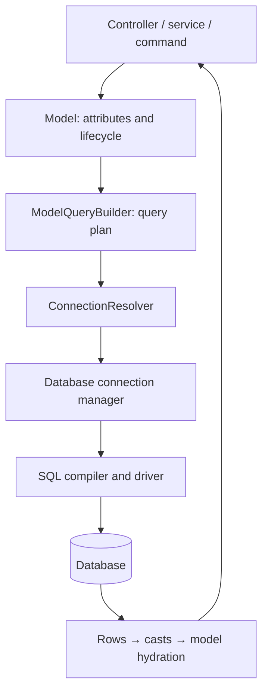

The ORM implements Active Record: a class describes a table and an instance represents a row. It combines attributes, casts, queries, relationships and events. [Database](/en/database) manages connections, drivers, SQL and transactions; the ORM builds plans on that same infrastructure.

## Architecture and lifecycle

When a class is declared, `ModelMeta` collects columns, resolves the table and primary key, and prepares casts, accessors, scopes and listeners. **Declaring a model never creates or alters tables**: use [migrations](/en/database/migrations).

1. `Article({...})` builds a new in-memory instance and applies mass assignment rules.
2. `await article.save()` generates an INSERT, maintains declared timestamps, adopts the generated identity and synchronizes original state.
3. `await Article.find(id)` retrieves a row, applies casts and creates a persisted instance. It returns `None` when absent.
4. Attribute changes are tracked against the original snapshot. Another `save()` writes those differences through UPDATE.
5. `delete()` removes the row or stamps its [soft delete](/en/orm/soft-deletes) column.

Declarations and builders are synchronous; terminals accessing data are asynchronous. Use these examples from a controller, service, command or task after application boot. The Database provider installs `ConnectionResolver`; querying before that setup raises `OrmConfigurationException`.

## Choosing an API

| Need | API |
| --- | --- |
| Row with attribute policy, state and events | A `Model` instance |
| Entity and relationship queries | `Article.query()` or a delegated entry such as `Article.where(...)` |
| Table rows, aggregates and writes without an entity lifecycle | `DB.table(...)` |
| Connections, SQL and transactions | Database and `DB` |

`DB.table()` does not run model casts, accessors, events or scopes. A model builder hydrates entities, but its mass writes also skip each instance's lifecycle. Choose deliberately when a rule depends on events.

## Learning path

- [Models and attributes](/en/orm/models-and-attributes): generator, columns, configuration and serialization.
- [Persistence and state](/en/orm/model-api): the complete class and instance API.
- [Queries](/en/orm/querying): fluent language, aggregates and mass operations.
- [Relationships](/en/orm/relationships), [operations](/en/orm/relationship-operations) and [N+1](/en/orm/eager-loading).
- [Scopes](/en/orm/scopes), [events](/en/orm/events) and [soft deletes](/en/orm/soft-deletes).
- [Collections and pagination](/en/orm/collections-and-pagination).
- [Factories and testing](/en/orm/factories) and [schema types](/en/orm/schema-and-type-reference).

The ORM uses `database` configuration; it has no separate connection file. A model operation does not automatically make several actions transactional: define the unit with [transactions](/en/database/transactions). Python state is not automatically reverted by an SQL rollback; retrieve a fresh instance after rolling back.

A scope constrains a query, an event wraps an instance operation, and soft deletion changes deletion writes and visibility. These mechanisms do not replace authorization or SQL constraints. Verify their interactions with [ORM tests](/en/orm/testing).
