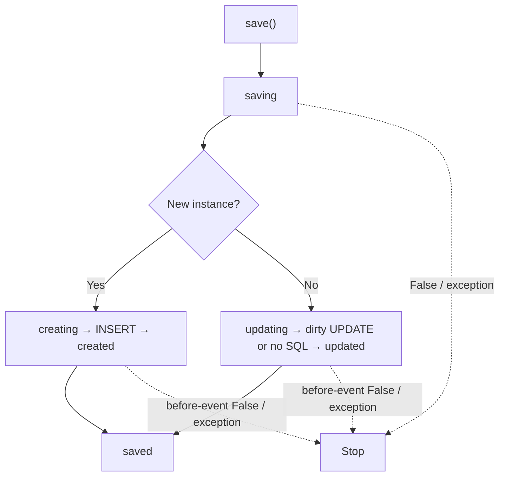

Events normalize attributes, veto operations or react to entity lifecycle stages. They are registered per class with synchronous or asynchronous callbacks. This guide uses the `Document` from [scopes](/en/orm/scopes), with its table migrated.

## Every event and its order

The public `MODEL_EVENTS: tuple[str, ...]` catalog in `orionis.orm.metaclass` contains the eleven names in this table. It defines recognized events; it does not mean every event runs in one operation or replace the creation, update, deletion and restoration flows.

| Event | Timing | Can veto? |
| --- | --- | --- |
| `retrieved` | After hydrating each row, before eager relations load | No |
| `saving` | Before deciding INSERT/UPDATE | Yes |
| `creating` | Before INSERT | Yes |
| `created` | After INSERT and state synchronization | No |
| `updating` | Before evaluating/writing existing instance differences | Yes |
| `updated` | After UPDATE attempt or no-change path | No |
| `saved` | After `created`/`updated` | No |
| `deleting` | Before physical or soft deletion | Yes |
| `deleted` | After deletion attempt | No |
| `restoring` | Before clearing the deletion stamp | Yes |
| `restored` | After restoration attempt | No |



A veto requires **exactly `False`**; `None`, `0` and an empty string are not identity-equal vetoes. Before-event vetoes skip SQL and later events. `save`, `delete` and `restore` return `False`; `create` still returns its model even when no INSERT happened.

## Registration, observers and dispatch


<a id="eventsmixin-registerevent"></a>

### `registerEvent`

```text
def registerEvent(cls, event: str, listener: Callable[..., Any]) -> type
```

Appends a listener to the event and returns the class; accepts a sync or async function receiving the model. Unknown names raise `OrmException`. Registering the same callable twice creates two registrations; no deduplication occurs.

```python
def require_title(document: Document):
    return bool((document.title or "").strip())


Document.registerEvent("saving", require_title)
```

<a id="eventsmixin-observe"></a>

### `observe`

```text
def observe(cls, observer: Any) -> type
```

Registers event-named methods from an observer and returns the class. A supplied class is instantiated without arguments; no DI constructs it. Create/resolve an instance yourself when dependencies are required. Missing methods are skipped.

```python
class DocumentObserver:
    async def saving(self, document: Document):
        document.title = (document.title or "").strip()

    def deleting(self, document: Document):
        return document.status != "locked"


Document.observe(DocumentObserver())
```

<a id="eventsmixin-flushevents"></a>

### `flushEvents`

```text
def flushEvents(cls, event: str | None=None) -> None
```

Removes listeners for `event`, or all when `None`; returns `None`. Unknown names are ignored. Useful for test isolation; it changes the whole class registry.

```python
Document.flushEvents("saving")
Document.flushEvents()
```

<a id="eventsmixin-fireevent"></a>

### `fireEvent`

```text
async def fireEvent(self, event: str) -> bool
```

Dispatches listeners sequentially in registration order, awaiting awaitable results. Returns `False` at the first exact `False` veto for a haltable event; otherwise `True`. Does not issue SQL or validate unknown names: no listeners returns `True`. Exceptions propagate and stop subsequent listeners.

```python
async def check_registered_policy(document: Document) -> bool:
    return await document.fireEvent("saving")
```

Register listeners once during startup, for example in a provider's `boot()`. Do not re-register them in every HTTP action. Subclasses copy listeners at creation; later parent changes do not rebuild the child registry. Registration identities prevent inherited diamond duplication, but explicitly registering the same callback twice runs it twice.

## Persistence, errors and transactions

Saving an unchanged existing instance emits `saving → updating → updated → saved` without UPDATE. An UPDATE affecting zero rows returns `False`, yet still emits `updated` and `saved`. Post-deletion/restoration events likewise follow the attempt. Do not treat an after-event as independent proof of affected rows.

Listeners run within the call, with no automatic queue or `afterCommit` phase. `created` follows INSERT **before commit** of an outer transaction. An after-listener failure outside a transaction can leave the write persisted even while the action raises. Inside a transaction, propagate the error so the context can roll back; the Python object is not reverted.

Decide when to publish email, notifications and external effects after commit and how to retry them. Mass writes (`query().update/delete/restore/forceDelete`, `destroy`) and pivot mutations do not run per-entity events. `hasOne/hasMany.create` does reach model `create`. No separate transactional observer API is implemented here.

Test success, veto, listener exceptions and rollback independently; see [ORM testing](/en/orm/factories).
