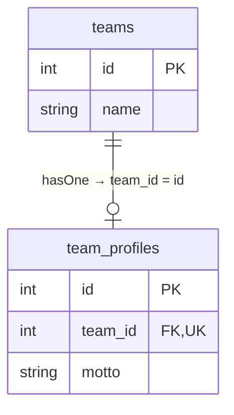
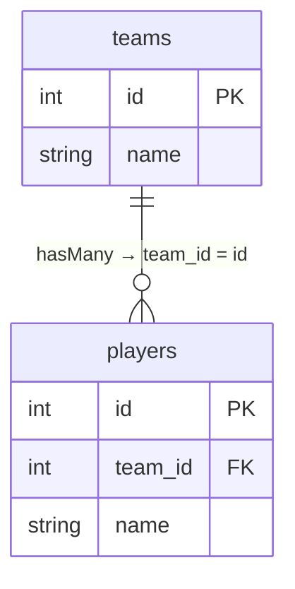
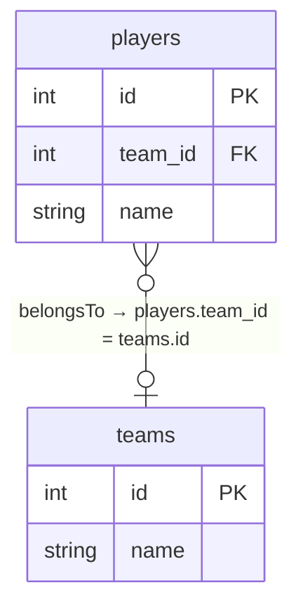
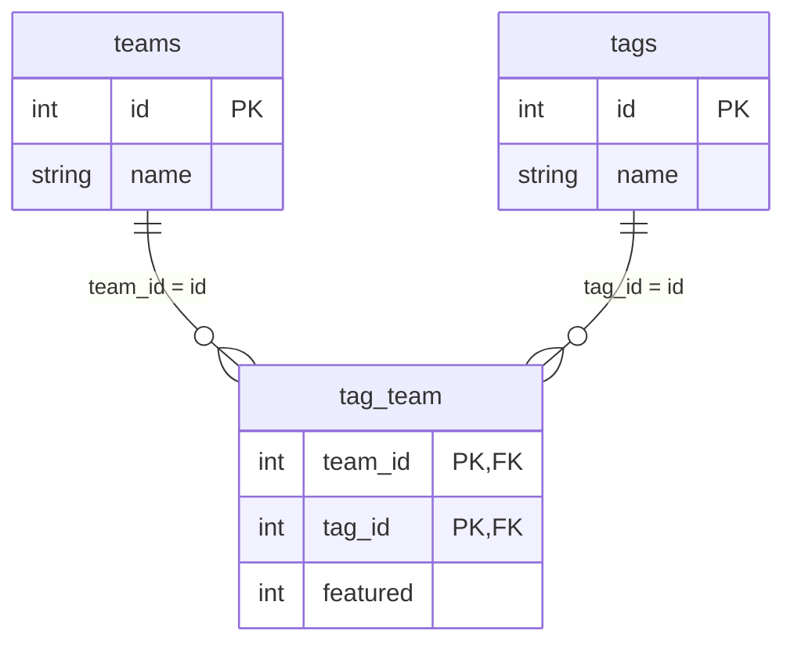

A relationship is a **synchronous instance method returning a specialized builder**. Calling it does not load data; `await` executes the query. Orionis implements exactly four relationship kinds: `hasOne`, `hasMany`, `belongsTo` and `belongsToMany`. Polymorphic, `hasManyThrough` and `hasOneThrough` relationships are not implemented.

## Complete example models

```python
from typing import ClassVar
from orionis.orm import Integer, Model, String


class Team(Model):
    id = Integer().primary().autoIncrement()
    name = String(120)
    timestamps = False
    fillable: ClassVar[list[str]] = ["name"]

    def profile(self):
        return self.hasOne(TeamProfile, foreign_key="team_id")

    def players(self):
        return self.hasMany(Player)

    def tags(self):
        return self.belongsToMany(Tag)


class TeamProfile(Model):
    id = Integer().primary().autoIncrement()
    team_id = Integer().foreign("teams.id").unique()
    motto = String(180)
    timestamps = False
    fillable: ClassVar[list[str]] = ["team_id", "motto"]

    def team(self):
        return self.belongsTo(Team)


class Player(Model):
    id = Integer().primary().autoIncrement()
    team_id = Integer().foreign("teams.id").nullable()
    name = String(120)
    timestamps = False
    fillable: ClassVar[list[str]] = ["team_id", "name"]

    def team(self):
        return self.belongsTo(Team)


class Tag(Model):
    id = Integer().primary().autoIncrement()
    name = String(80)
    timestamps = False
    fillable: ClassVar[list[str]] = ["name"]

    def teams(self):
        return self.belongsToMany(Team)
```

Store these in application modules and import the classes needed by controllers. References resolve when the method runs, which allows a class to be declared later. Do not declare `players = hasMany(Player)` in the class body.

Migrate `teams`, `team_profiles`, `players`, `tags` and pivot `tag_team` before querying. Declare pivot `team_id`, `tag_id`, `featured` (integer default `0`), foreign keys to both tables and composite PK/UNIQUE `(team_id, tag_id)`. Declaring a relationship does not create those tables or constraints. The diagram represents pivot uniqueness, not a composite `Model` identity.

## One-to-one: team profile



<a id="relationsmixin-hasone"></a>

### `hasOne`

```text
def hasOne[TRelated: 'Model'](self, related: type[TRelated], foreign_key: str | None=None, local_key: str | None=None) -> HasOneRelation[TRelated]
```

One-to-one: `related` is the target class; `foreign_key=None` derives from the parent class snake case + `_id`, and `local_key=None` uses its PK. Returns `HasOneRelation`; `await relation`/`getResults` returns a model or `None`. The related table owns the FK. SQL UNIQUE is needed to enforce one-to-one.

```python
async def show_profile(team_id: int):
    team = await Team.findOrFail(team_id)
    profile = await team.profile()
    return profile.toDict() if profile is not None else None
```

`hasOne` retrieves the first match; the unique profile column enforces that only one can exist. Write with `await team.profile().create({"motto": "Build together"})`; the relationship supplies `team_id` and does not automatically replace an existing profile.

## One-to-many: players



<a id="relationsmixin-hasmany"></a>

### `hasMany`

```text
def hasMany[TRelated: 'Model'](self, related: type[TRelated], foreign_key: str | None=None, local_key: str | None=None) -> HasManyRelation[TRelated]
```

One-to-many with the FK in the related table. Key defaults match `hasOne`. Returns `HasManyRelation`; `await relation`/`getResults` returns a `Collection`, empty for a parent without a key.

```python
async def list_players(team_id: int):
    team = await Team.findOrFail(team_id)
    return (await team.players().orderBy("id").get()).serialize()
```

Retrieving a team then its players runs a query per operation. Avoid accessing each team's relationship in a large loop: use [eager loading](/en/orm/eager-loading). `await team.players().create({"name": "Ada"})` supplies the FK; other relationship read filters are not copied into the new record.

## Inverse relationship: a player's team



<a id="relationsmixin-belongsto"></a>

### `belongsTo`

```text
def belongsTo[TRelated: 'Model'](self, related: type[TRelated], foreign_key: str | None=None, owner_key: str | None=None) -> BelongsToRelation[TRelated]
```

Inverse relationship: the current instance owns `foreign_key`, defaulting to **the related class** snake case + `_id`. `owner_key=None` uses the related PK. Returns `BelongsToRelation`; result is a model or `None`. With a null FK, `getResults` skips SQL.

```python
async def show_team(player_id: int):
    player = await Player.findOrFail(player_id)
    team = await player.team().getResults()
    return team.toDict() if team is not None else None
```

Associate/reassociate a player by assigning `player.team_id = team.id` then calling `await player.save()`. Set `None` and save to unlink; this is why the example FK is nullable. This relation has no `associate()`/`dissociate()` methods. Deleting a team does not automatically change all players: that depends on SQL constraints or transactional application logic.

## Many-to-many: tags



<a id="relationsmixin-belongstomany"></a>

### `belongsToMany`

```text
def belongsToMany[TRelated: 'Model'](self, related: type[TRelated], table: str | None=None, foreign_pivot_key: str | None=None, related_pivot_key: str | None=None, parent_key: str | None=None, related_key: str | None=None) -> BelongsToManyRelation[TRelated]
```

Many-to-many through a pivot. `table=None` alphabetically joins both snake case class names without pluralization. `foreign_pivot_key` and `related_pivot_key` derive from parent/related class names + `_id`; `parent_key`/`related_key` use their PKs. All those arguments accept `None` for defaults. Returns `BelongsToManyRelation`. Keys are single columns; pivot and related table are queried separately.

```python
async def list_tags(team_id: int):
    team = await Team.findOrFail(team_id)
    return (await team.tags().orderBy("name").get()).serialize()
```

Reads resolve ids from `tag_team`, then query `tags`. Results are `Tag` models, without a hydrated `pivot` object or extra attributes. Values such as `featured` support [pivot filtering and writes](/en/orm/relationship-operations). Query `DB.table("tag_team")` explicitly to read them.

## Customizing keys

```python
def players_by_owner(self):
    return self.hasMany(Player, foreign_key="team_id", local_key="id")


def team_by_owner(self):
    return self.belongsTo(Team, foreign_key="team_id", owner_key="id")


def tags_by_owner(self):
    return self.belongsToMany(
        Tag,
        table="tag_team",
        foreign_pivot_key="team_id",
        related_pivot_key="tag_id",
        parent_key="id",
        related_key="id",
    )
```

These are alternative methods to add to Team, Player and Team respectively. Referenced keys must exist, be loaded and have compatible types. Each relation uses the **related model's** connection; pivot operations use that same connection. Keep participating tables on a coherent connection; this does not implement distributed transactions.

Continue with [queries and writes](/en/orm/relationship-operations) and [eager loading](/en/orm/eager-loading).
