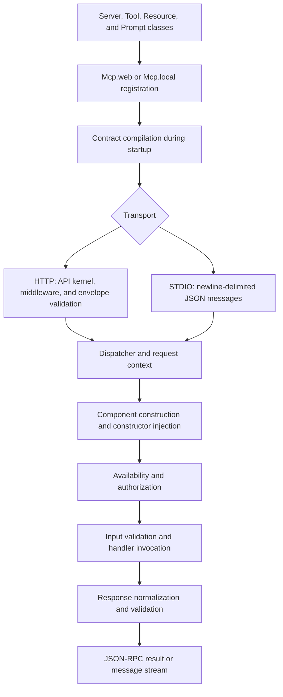

**MCP (Model Context Protocol)** lets a client discover an application's capabilities and use them through JSON-RPC messages. Orionis implements the server: it exposes your business services as tools, resources, and prompts, validates their contracts, and executes their components through the dependency container.

Declare the classes, assemble them in a `Server`, and register their transports. Orionis handles the protocol; you do not need a JSON-RPC parser, an HTTP controller for each tool, or a STDIO loop.

## Choosing a component

| Component | Responsibility | Example |
| --- | --- | --- |
| `Server` | Assembles the capabilities published by a server. | An operations server and a support server, each with its own endpoint. |
| `Tool` | Executes an operation with declared input and output. | Query an order or create a support ticket. |
| `Resource` | Returns content identified by a fixed URI or a template. | Read `orders://reports/daily` or `orders://items/{order_id}`. |
| `Prompt` | Builds reusable messages for the client. | Prepare instructions for summarizing an order. |

A tool can modify data if you implement that operation. A resource provides content and a prompt returns messages: Orionis does not automatically call an AI model to resolve them. Classes must belong to a registered server; existing in a directory does not publish them.

## Supported protocol revision

Orionis supports **only MCP `2026-07-28`**: it is the value of `MCP_PROTOCOL_VERSION` and the sole entry in `SUPPORTED_VERSIONS` in `orionis/mcp/protocol/constants.py`. It is the [current revision published by MCP](https://modelcontextprotocol.io/docs/2026-07-28/learn/versioning).

Requests are self-contained: they include the revision and client capabilities in `params._meta`. A client can call `server/discover` to learn about the server; there is no preceding `initialize` step or MCP session to retain. Earlier revisions, `initialize`, and `ping` are not implemented as core methods. Clients limited to earlier handshake protocols need support for this protocol before connecting.

The **protocol** revision differs from `Server.version`, which identifies your own server. Changing `Server.version` does not select an MCP revision. See [HTTP and clients](/en/protocols/mcp/http-and-clients) for the header and request contract.

## Getting started

1. [Create a server and register its routes](/en/protocols/mcp/servers-and-tools): includes a complete greeting example and several independent servers.
2. Create [tools](/en/protocols/mcp/tools), [resources](/en/protocols/mcp/resources-and-prompts), and [prompts](/en/protocols/mcp/prompts) with their CLI generators and contracts.
3. Choose the appropriate [responses and content blocks](/en/protocols/mcp/responses-and-content).
4. [Query the server over HTTP and configure Hermes or another client](/en/protocols/mcp/http-and-clients), or use [STDIO and its configuration](/en/protocols/mcp/transports-and-configuration) for a local process.
5. Add [progress, continuation, subscriptions, and extensions](/en/protocols/mcp/advanced-workflows) when needed.
6. [Test capabilities within the process](/en/testing/mcp-testing) before connecting an agent.

Add the examples to an Orionis application that is already [installed](/en/getting-started/installation). MCP uses native schemas and the application's container; its handlers do not need another container or event loop.

## Execution flow

Startup loads registrations from `routes/ai.py` and compiles declarations, schemas, and invocation plans. The same compiled server can be published over HTTP and STDIO.

The diagram shows a primitive invocation; discovery and list operations inspect the compiled catalog. Services can be injected into constructors and methods of `Tool`, `Resource`, and `Prompt`, separately from client payloads. See the [injection examples](/en/protocols/mcp/tools#services-in-the-constructor-and-method) and the [container](/en/architecture/service-container/bindings-and-invocation).

## Access and isolation

Each request has an independent context. An API MCP route does not require credentials by itself: add authentication middleware for private endpoints and use authorization hooks to control operations. An annotation such as `readOnlyHint` describes the tool; it does not grant or restrict permissions.

HTTP MCP endpoints use the protocol's error policy: failures return JSON-RPC rather than HTML exception pages. Both transports share contracts and execution, but only HTTP provides a native HTTP request. The component guides explain the context available in each case.
