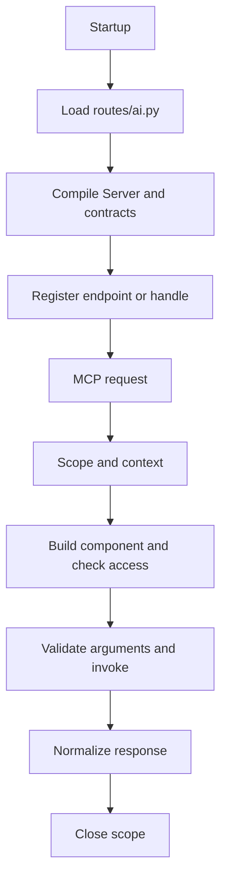

An MCP server declares the tools, resources and prompts that your application offers to a client. Orionis compiles that declaration and publishes it over HTTP or STDIO. The server does not run a language model: the client discovers its capabilities and decides which operations to request.

## Generate a server declaration

From the project root, use either alternative:

```bash
orionis make:mcp-server demo
python -B reactor make:mcp-server demo
```

These run the same generator; execute one. It creates `app/mcp/servers/demo_server.py` with the `DemoServer` class. This is the actual generated template:

```python
from orionis.mcp import Server

class DemoServer(Server):
    """Expose application tools, resources and prompts through MCP."""

    name = "DemoServer"
    version = "1.0.0"
    instructions = "Describe the capabilities of this server."
    tools = ()
    resources = ()
    prompts = ()
```

`name` identifies the implementation to clients; `version` is **your server's** version, not the MCP protocol revision. `instructions` explains how to use its capabilities. The tuples contain component classes, not instances or string import paths. Generating the file does not register it automatically.

The `name` argument is required. This generator has no transport, authentication or overwrite flags; `-h`/`--help` displays help. The other generators share these naming rules:

| Command | Default destination | Class and file suffix |
| --- | --- | --- |
| `make:mcp-server demo` | `app/mcp/servers/demo_server.py` | `DemoServer` / `_server.py` |
| `make:mcp-tool greet` | `app/mcp/tools/greet_tool.py` | `GreetTool` / `_tool.py` |
| `make:mcp-resource greeting` | `app/mcp/resources/greeting_resource.py` | `GreetingResource` / `_resource.py` |
| `make:mcp-prompt greeting` | `app/mcp/prompts/greeting_prompt.py` | `GreetingPrompt` / `_prompt.py` |

These destinations use the configured MCP application paths. Nested names are supported: `make:mcp-tool support/find_ticket` creates `app/mcp/tools/support/find_ticket_tool.py` and `FindTicketTool`. Directories are created automatically. Filenames are lowercased and class names are formed from underscore-separated words; CamelCase input is not automatically converted to snake_case. An existing matching suffix is not added twice. Absolute paths, empty segments, `.` and `..`, and components incompatible with a module name are rejected. Existing files produce an error and are preserved; there is no `--force` option.

## A complete first MCP application

To check the entire flow in one file, replace `app/mcp/servers/demo_server.py` with this example. You can move the classes into component directories afterwards:

```python
from orionis.mcp import McpResponse, Prompt, PromptArgument, Resource, Server, Tool
from orionis.schemas import Schema


class GreetInput(Schema):
    name: str


class GreetTool(Tool[GreetInput, str]):
    name = "greet"
    description = "Return a greeting."

    async def handle(self, payload: GreetInput) -> McpResponse:
        return McpResponse.structured(f"Hello, {payload.name}!")


class GreetingResource(Resource):
    name = "greeting"
    uri_template = "demo://greetings/{name}"
    mime_type = "text/plain"

    async def handle(self, name: str) -> McpResponse:
        return McpResponse.text(f"Hello, {name}!")


class GreetingPrompt(Prompt):
    name = "greeting"
    arguments = (PromptArgument(name="name", required=True),)

    async def handle(self, name: str) -> McpResponse:
        return McpResponse.text(f"Greet {name} in a friendly way.").asUser()


class DemoServer(Server):
    name = "Demo"
    instructions = "Use the greeting components to welcome a user."
    tools = (GreetTool,)
    resources = (GreetingResource,)
    prompts = (GreetingPrompt,)
```

The `greet` tool receives `{"name": "Ada"}` and returns the JSON value `"Hello, Ada!"`. Read the resource at `demo://greetings/Ada`. The `greeting` prompt produces a user message asking to greet Ada. Tool, resource and prompt names belong to separate catalogs.

### Register the server

In `routes/ai.py`:

```python
from app.mcp.servers.demo_server import DemoServer
from orionis.support.facades import Mcp

Mcp.web("/mcp/demo", DemoServer)
Mcp.local("demo", DemoServer)
```

In the existing `bootstrap/app.py` configuration, include `ai="routes/ai.py"` in `app.withRouting(...)` before `app.create()`. For example, add the argument to your existing call while preserving other route files:

```python
app.withRouting(
    ai="routes/ai.py",
    api="routes/api.py",
    web="routes/web.py",
    console="routes/console.py",
)
```

`Mcp.web()` creates a **POST** route with API semantics and returns a fluent route. `Mcp.local()` registers a STDIO handle and does not create a URL. Always import `Mcp` from `orionis.support.facades`. MCP registration uses `Mcp.web()`, not a `Route.mcp()` method.

For HTTP, run the development server with `orionis serve` or `python -B reactor serve`; the endpoint is `http://localhost:8000/mcp/demo` when using the default address. [HTTP and clients](/en/protocols/mcp/http-and-clients) explains the required headers and JSON-RPC: opening that URL with a browser GET does not list tools.

For STDIO, use `orionis mcp:start demo` or `python -B reactor mcp:start demo`. The client must launch the process and communicate through its standard input and output; see [STDIO and configuration](/en/protocols/mcp/transports-and-configuration).

## Multiple servers in one application

Each endpoint or handle explicitly binds to a `Server` class. To add another catalog, create `app/mcp/servers/support_server.py`:

```python
from app.mcp.servers.demo_server import GreetTool
from orionis.mcp import Server


class SupportServer(Server):
    name = "Support"
    instructions = "Welcome users contacting support."
    tools = (GreetTool,)
```

In `routes/ai.py`, replace the earlier registrations with:

```python
from app.mcp.servers.demo_server import DemoServer
from app.mcp.servers.support_server import SupportServer
from orionis.support.facades import Mcp

Mcp.web("/mcp/demo", DemoServer).name("mcp.demo")
Mcp.web("/mcp/support", SupportServer).name("mcp.support")

Mcp.local("demo", DemoServer)
Mcp.local("support", SupportServer)
```

`/mcp/demo` publishes the three example components; `/mcp/support` publishes only the tool. A client's `DEMO_MCP` and `SUPPORT_MCP` labels do not need to match `Server.name` or a STDIO handle. Reusing a tool class in different servers is supported; each server retains its catalog and context. The `demo` and `support` local handles are independent of the HTTP URLs.

Endpoints must be fixed paths: they cannot contain `{...}` parameters, query strings or fragments. To separate servers, use `/mcp/demo` and `/mcp/support`, for example, instead of a parameterized `/mcp/{server}` endpoint. Duplicate HTTP addresses or STDIO handles fail at registration. Handles contain 1–128 characters, start with a letter or digit, and accept only letters, digits, dots, `_` and `-`.

To separate registrations by domain, create the files and configure a list instead of `ai="routes/ai.py"`:

```python
app.withRouting(
    ai=["routes/mcp/demo.py", "routes/mcp/support.py"],
)
```

Each file imports its classes and registers its own servers. Creating a directory does not automatically discover its contents: the `withRouting()` list determines which modules are loaded.

## Inspect registration and organize components

```bash
orionis mcp:list
python -B reactor mcp:list

orionis route:list
python -B reactor route:list
```

`mcp:list` shows the transport, endpoint or handle, and server class; it does not start transports or list internal tools. `route:list` shows HTTP routes, including MCP POST routes. STDIO handles appear only in the MCP inventory. You can also request `--help` for each command.

When splitting the example, place each class in its component's generated file and update the declaration:

```python
from app.mcp.prompts.greeting_prompt import GreetingPrompt
from app.mcp.resources.greeting_resource import GreetingResource
from app.mcp.tools.greet_tool import GreetTool
from orionis.mcp import Server


class DemoServer(Server):
    name = "Demo"
    instructions = "Use the greeting components to welcome a user."
    tools = (GreetTool,)
    resources = (GreetingResource,)
    prompts = (GreetingPrompt,)
```

`GreetInput` can stay next to `GreetTool`. The [Tools](/en/protocols/mcp/tools), [Resources](/en/protocols/mcp/resources-and-prompts) and [Prompts](/en/protocols/mcp/prompts) guides develop those files, hooks and contracts. Do not register duplicate declarations from both the single-file example and the separate component organization.

## Server and request lifecycle



The manager compiles once per server class. It validates names, URIs, contracts and metadata, then retains immutable catalogs rather than mutable tool instances between calls. Each operation runs in a scope opened before dispatch by the HTTP kernel, STDIO transport or test client. The dispatcher builds the component through the container, evaluates `shouldRegister()` and `authorize()` when present, validates arguments and invokes the handler. Streaming requests retain their scope until completion or cancellation.

Components are also built when evaluating their visibility in listings. Constructors should therefore prepare collaborators and avoid business side effects such as sending emails or writing domain records.

### Services in the constructor and method

Injection applies to `Tool`, `Resource` and `Prompt` classes, both in `handle()` and in their typed hooks. `Server` is the static declaration grouping them. See the [complete injection example](/en/protocols/mcp/tools#services-in-the-constructor-and-method), including resource and prompt variants. `McpRequest` represents the MCP call; an HTTP `Request` dependency is available only on the HTTP transport.

## Server metadata and capabilities

| Attribute | Purpose |
| --- | --- |
| `name`, `version` | Implementation name and version; both must be nonempty. |
| `title`, `description`, `website_url`, `icons` | Server presentation. Icons are `Icon` declarations; sources accept HTTPS or `data:` URIs. |
| `instructions` | Usage instructions returned during discovery. |
| `tools`, `resources`, `prompts` | Tuples of classes forming the catalogs. |
| `list_changed = False` | Set to `True` to advertise changes to present catalogs. It does not automatically detect data changes. |
| `resource_subscriptions = False` | Set to `True` to enable resource subscriptions. Corresponding notifications must be published explicitly. |
| `cache` | Default `CacheHint()`: zero TTL and private scope. Declares freshness to clients; it does not cache server results. |
| `extensions` | Explicit `McpExtension` declarations; receiving an extension name from a client does not enable arbitrary extensions. |

Only capabilities backed by registered components are advertised. A resource or prompt `complete()` method enables completions. Notifications, extensions and grouped catalogs are covered by [advanced workflows](/en/protocols/mcp/advanced-workflows).
