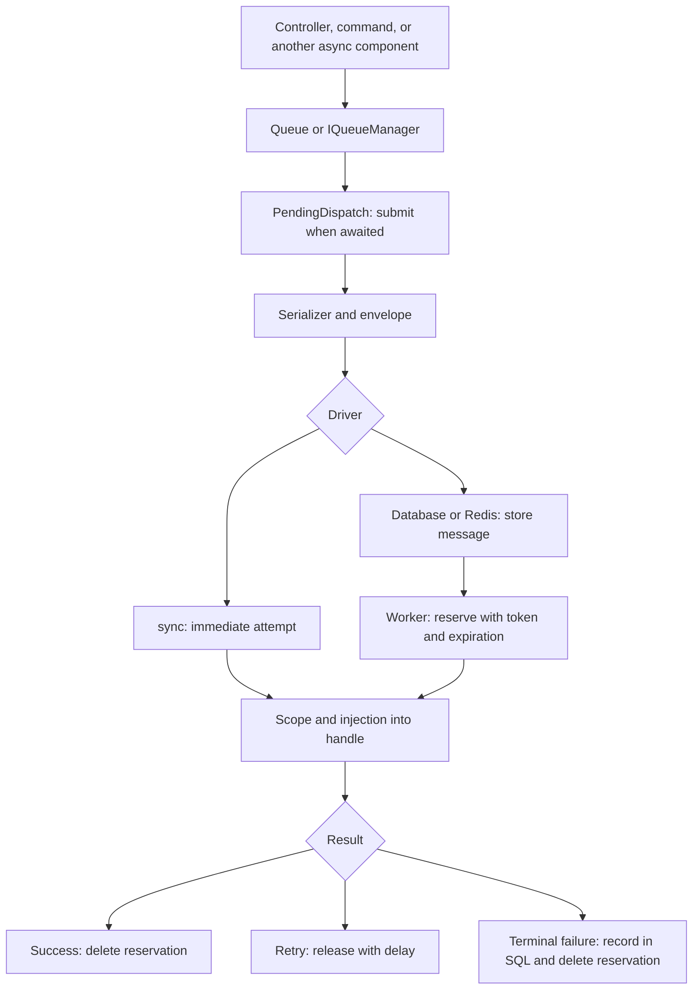

A **job** represents a task with serializable data and an async `handle()` method. A **queue** retains pending messages so a worker can reserve and execute them. Use them to prepare files, process records, or integrate services without keeping the originating request open.

Orionis offers three drivers: `sync`, `database`, and `redis`. The default, `sync`, runs inside the producer's own `await`. Database and Redis separate submission from execution. The `Queue` facade and injected `IQueueManager` access the same service.



## 1. Select persistence

To process jobs in another terminal, configure `.env` before application startup:

```dotenv
QUEUE_CONNECTION=database
DB_CONNECTION=sqlite
```

Check SQLite's location and permissions in `config/database.py`. The driver creates the message table when needed; the SQL failure repository creates its own table when used. Both locations require table-creation permissions. You can choose another SQL connection or use Redis for messages; terminal failures still use SQL. See [drivers](/en/queues/drivers-and-configuration) and [configuration](/en/queues/configuration).

Queue, SQLite, and Redis libraries are included in the framework's normal dependencies. A reachable Redis server is required only when selecting that driver. You do not need to install a queue extra through `packages`.

## 2. Generate and complete a job

From the project root, use either alternative:

```shell
orionis make:job process_record
```

```shell
python -B reactor make:job process_record
```

Complete `app/jobs/process_record_job.py` with this example. It receives an ID and generates a small file using the Storage service:

```python
from orionis.queues import BaseJob
from orionis.storage.contracts.manager import IStorageManager


class ProcessRecordJob(BaseJob):
    __slots__ = ("record_id",)
    record_id: int
    tries = 3
    timeout = 30.0
    backoff = (1.0, 5.0)

    def __init__(self, record_id: int) -> None:
        self.record_id = record_id

    async def handle(self, storage: IStorageManager) -> None:
        await storage.disk("local").put(
            f"records/{self.record_id}.txt",
            f"Processed record {self.record_id}\n",
            visibility="private",
        )
```

Keep the class at module scope and importable by both producer and consumer. The job retains only `record_id`; the container supplies Storage to `handle()`. Reconstructing a job does not execute `__init__` or inject services into it.

Repeating this example replaces the same file with the same contents. That design allows an attempt to repeat without accidentally creating another file. For business operations with other effects, define an appropriate idempotency strategy. The [jobs guide](/en/queues/jobs-and-dispatch) explains the template, allowed types, and policies.

## 3. Submit from a controller

Save this class in `app/http/controllers/record_controller.py`:

```python
from app.jobs.process_record_job import ProcessRecordJob
from orionis.http import JSONResponse
from orionis.support.facades import Queue


class RecordController:
    async def store(self, record_id: int) -> JSONResponse:
        job_id = await Queue.dispatch(ProcessRecordJob(record_id))
        return JSONResponse({"job_id": job_id}, status_code=202)
```

Register the action in `routes/api.py`:

```python
from app.http.controllers.record_controller import RecordController
from orionis.support.facades import Route

Route.post("/records/{record_id:int}/process", [RecordController, "store"])
```

`await` is mandatory: creating and discarding a `PendingDispatch` submits nothing. With Database, the ID confirms submission; the file may still be pending. With `sync`, the action waits for complete execution. To choose a channel or delay work, use the [dispatch options](/en/queues/jobs-and-dispatch#pending-construction).

## 4. Run the consumer

In another terminal, using the same code and configuration, choose one alternative:

```shell
orionis queue:work database --queue default
```

```shell
python -B reactor queue:work database --queue default
```

When the route is invoked, the worker executes the job and Storage writes `records/<record_id>.txt` to the `local` disk with private visibility. Leave the process running to receive new messages. See [workers and signals](/en/queues/workers) to stop it, limit processing, or configure concurrency.

A worker reserves messages for a limited time; an interruption can let another consumer recover them. Persistence does not guarantee that an external effect happens exactly once. [Retries and failures](/en/queues/failures-and-retries) explain exceptions, timeouts, and expired reservations.

## Documentation guide

| Need | Guide |
| --- | --- |
| Compare storage and requirements | [Drivers and persistence](/en/queues/drivers-and-configuration) |
| Configure connections, channels, and policies | [Queue configuration](/en/queues/configuration) |
| Create classes and prepare payloads | [Write and dispatch jobs](/en/queues/jobs-and-dispatch) |
| Choose immediate execution or consumers | [Execution modes](/en/queues/execution-modes) |
| Run processes and manage reservations | [Workers](/en/queues/workers) |
| Recover from errors and requeue failures | [Retries and exceptions](/en/queues/failures-and-retries) |
| Use all manager methods and DI | [Facade and injection](/en/queues/manager-and-injection) |
| Look up contracts, drivers, and utilities | [Technical reference](/en/queues/api-reference) |

[Background tasks after a response](/en/queues/background-tasks) and [task scheduling](/en/console/task-scheduling) have different execution lifecycles. They can dispatch jobs, but do not replace a persistent queue consumer.
