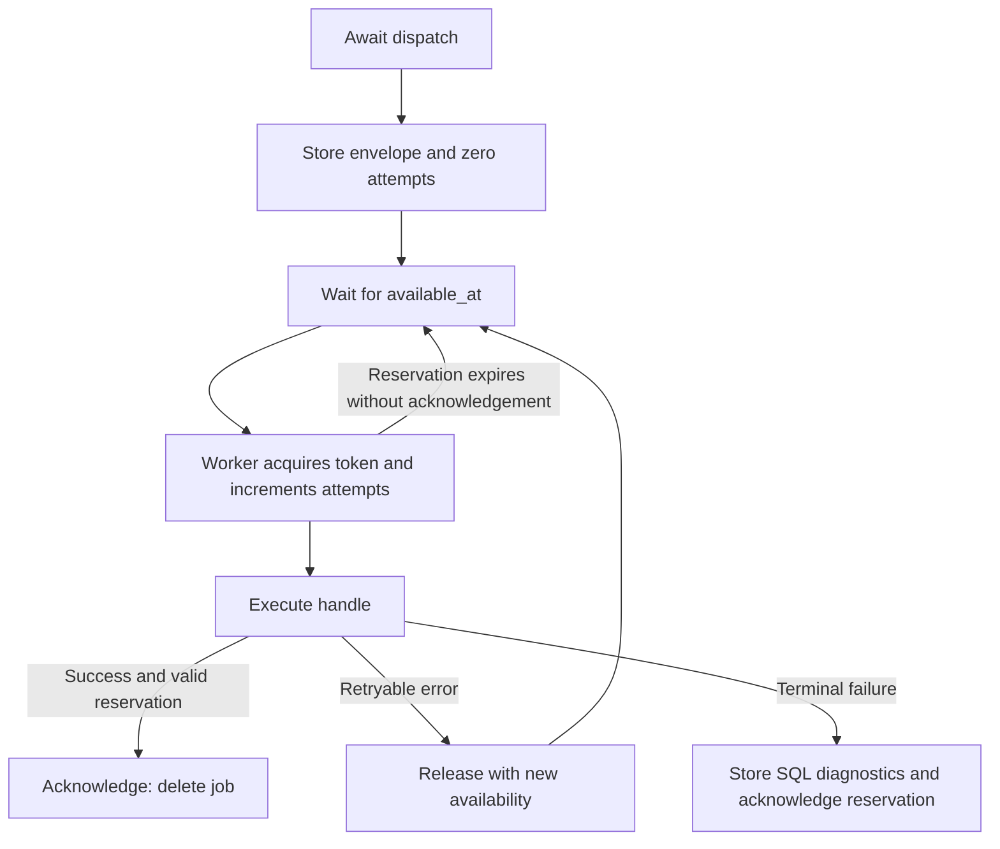

Orionis includes three queue drivers: `sync`, `database`, and `redis`. A **queue connection** selects a driver and its settings; a **queue** is a logical channel inside that connection, such as `reports` or `notifications`. Multiple queues can share a backend.

The default connection is `sync`: awaiting a dispatch runs the job in that same process. To submit work to an independent consumer, use `database` or `redis` and run a [worker](/en/queues/workers).

## Compare drivers

| Driver | Storage | When execution happens | Uses and considerations |
|---|---|---|---|
| `sync` | No pending-job storage. | While awaiting the dispatch. | Useful when execution must finish before the producer continues, or to exercise the pipeline without a consumer. The producer incurs execution time; delay and persistent retries are unavailable. |
| `database` | A table in a [Database](/en/database) connection. | When a worker reserves an available row. | Reuses SQL infrastructure and can insert the job in the same transaction as business data. Queries, writes, and reservations add load to that database. |
| `redis` | Sorted sets and hashes in Redis. | When a worker reserves an available job. | Uses atomic Lua transitions and separates transport from the business database. Requires a Redis server and persistence settings appropriate for your needs. |

The [configuration guide](/en/queues/configuration) covers every field, environment variable, and named connection.

## Included dependencies

Orionis already includes the Python clients required by these drivers: `redis[hiredis]`, `msgspec`, `sqlalchemy[asyncio]`, and `aiosqlite` are core dependencies. No queue extra is needed for Redis or SQLite.

A **reachable Redis server** is required for `redis`. For `database`, configure a project SQL connection; if its engine requires an optional driver, follow the [Database drivers guide](/en/database/drivers). The included Redis client does not install or start a Redis server.

Terminal failures are stored in SQL through `failed`, including when jobs use `sync` or `redis`. That connection resolves when the failure repository is needed; see [failures and retries](/en/queues/failures-and-retries).

<a id="driver-sync"></a>

## `sync`: immediate execution

`SyncQueueDriver.push()` serializes the envelope, creates a reservation with `attempts=1`, and uses the same execution pipeline as workers. The producer waits for `handle()` to finish; the identifier is returned after successful execution. If the job fails, dispatch propagates its original exception after failure handling.

```dotenv
QUEUE_CONNECTION=sync
QUEUE_SYNC_QUEUE=default
QUEUE_SYNC_RETRY_AFTER=90.0
QUEUE_WORKER_TIMEOUT=60.0
```

This backend has these characteristics:

- `delay` must be zero; another value raises `QueueDispatchError`.
- Only one immediate attempt runs, even if the job declares multiple attempts. There is no pending storage from which a worker could retrieve a retry.
- `reserve()` returns `None`; `size()` and `clear()` return `0`.
- `release()` always raises `QueueDispatchError`; `delete()` acknowledges execution by returning `True`.
- `close()` requests that its internal worker stop; it does not close application services or wait for a running job to finish.

Do not create a worker for a `sync` connection: `Queue.worker()` rejects it with `QueueConfigurationError`.

<a id="driver-database"></a>

## `database`: SQL persistence

This driver uses a connection from the Database service. `QUEUE_DB_CONNECTION` names that **SQL connection**, whereas `database` is the default name of the **queue connection**.

```dotenv
QUEUE_CONNECTION=database
QUEUE_TABLE=jobs
QUEUE_DB_QUEUE=default
QUEUE_DB_RETRY_AFTER=90.0
QUEUE_WORKER_TIMEOUT=60.0
```

Omitting `QUEUE_DB_CONNECTION` selects the default SQL connection. Configure Database before submitting or consuming jobs.

### Table creation and compatibility

The table is created lazily, on the first operation requiring its schema (`push`, `reserve`, `size`, or `clear`). You can also prepare it with [`queue:migrate`](#command-migrate). The SQL connection prefix is applied to its logical name when configured. No queue migration file needs to be generated to obtain the included schema; the SQL user needs permission to create it.

If another process creates the table concurrently, the driver checks that all expected columns are queryable. This does not migrate or update an incompatible existing table. When creation happens inside a transaction, the driver does not consider schema readiness definitive while still inside that transaction.

The connection must enforce unique constraints: `DatabaseQueueDriver` rejects a connection whose `supportsUniqueConstraints()` returns `False`, such as Redshift. Included schema and query plans have compilation tests for SQLite, MySQL, PostgreSQL, Oracle, and SQL Server; that does not replace setup and requirements for your chosen engine.

<a id="command-migrate"></a>

### Prepare tables: queue:migrate

Since 1.0.10, run either alternative from the project root:

```shell
orionis queue:migrate
python reactor queue:migrate
```

The command takes no arguments or command-specific options; it supports `-h` / `--help`. It reads the application's queue configuration and creates missing tables with their columns and indexes:

- The jobs table for **every** connection using the `database` driver, even when it is not the default queue connection.
- The central `queue.failed` repository table, even if jobs only use `sync` or `redis`.

It respects each definition's SQL connection, logical table name, and configured prefix. It neither opens Redis clients nor starts workers. Existing tables and records are preserved; repeated calls do not clear jobs or failures. It does not compare or update incompatible older structures or run the application migrations handled by `migrate`. It accepts neither `--database` nor a positional connection: its scope is all configured SQL queue definitions.

The SQL user needs permission to create missing tables, and the backend must enforce unique constraints. Success prints `Queue tables migrated successfully.` and returns `0`. A caught `DatabaseException` or `QueueError` is displayed and returns `1`. The equivalent API is [`await Queue.migrate()`](/en/queues/manager-and-injection#manager-migrate).

<a id="schema-jobs"></a>

### Persisted data

`build_jobs_table(table)` builds this schema:

| Column | Definition | Purpose |
|---|---|---|
| `id` | `String(36)`, primary key. | Dispatch identifier. |
| `queue` | `String(255)`. | Logical channel. |
| `payload` | `LargeBinary()`. | JSON envelope encoded as bytes, including serialized job state and execution settings. |
| `attempts` | `Integer()`. | Number of reservations; initially `0`. |
| `available_at` | `Double()`. | Earliest reservation time, in epoch seconds. |
| `reserved_until` | `Double().nullable()`. | Current reservation expiration. |
| `reservation_token` | `String(32).nullable()`. | Reservation ownership token. |
| `created_at` | `Double()`. | Insertion time. |

A composite index on `queue`, `available_at`, and `reserved_until` accompanies the primary key. Timestamps preserve fractional seconds.

### Reservation, acknowledgement, and transactions

The driver first checks the highest-priority queue supplied to the worker. Within a queue it orders candidates by `available_at`, `created_at`, and `id`. Only available rows whose reservation is absent or expired are eligible.

The initial lookup does not lock the row with `FOR UPDATE`. Ownership is acquired by a conditional `UPDATE` checking the identifier, observed attempt counter, and current eligibility. One winner increments `attempts`, generates a token, and sets expiration; after losing a race the driver searches again, up to 100 rounds per queue in that call.

`delete()` and `release()` only take effect while the identifier and token match and the reservation remains unexpired. They return `False` when ownership was lost. `release()` preserves attempts and sets a new availability time; `delete()` removes the acknowledged row.

An insertion participates in the [task's SQL transaction](/en/database/transactions) when using that same connection: rollback also rolls back the job, and other consumers see it after commit. There is no general `afterCommit` option. Redis and separate connections are outside that transaction.

**Reserving inside an active transaction is prohibited** and raises `QueueStorageError`: execution requires a committed reservation. Closing the driver does not disconnect its shared SQL connection; it only resets the schema readiness check.

<a id="driver-redis"></a>

## `redis`: persistence and atomic transitions

```dotenv
QUEUE_CONNECTION=redis
REDIS_HOST=127.0.0.1
REDIS_PORT=6379
REDIS_DB=0
QUEUE_REDIS_PREFIX=example:queues
QUEUE_REDIS_QUEUE=default
QUEUE_REDIS_RETRY_AFTER=90.0
QUEUE_WORKER_TIMEOUT=60.0
```

Set `REDIS_PASSWORD` when required by your server. Configuration uses separate fields; the queue Redis entity has no `url` field. The driver constructs an asynchronous client with `protocol=2`; network I/O starts when it is used, rather than when the manager is constructed.

For prefix `example:queues` and queue `reports`, these keys are used:

| Key | Redis type | Contents |
|---|---|---|
| `example:queues:{reports}:ready` | Sorted set. | Identifiers ordered by availability, including delayed jobs. |
| `example:queues:{reports}:reserved` | Sorted set. | Identifiers ordered by reservation expiration. |
| `example:queues:{reports}:payloads` | Hash. | Each job's serialized envelope. |
| `example:queues:{reports}:attempts` | Hash. | Each job's reservation count. |
| `example:queues:{reports}:tokens` | Hash. | Each current reservation's owner. |

The `{reports}` hash tag colocates the keys needed for each transition. Prefixes cannot contain `{` or `}`; the driver constructor rejects them with `QueueStorageError`. This key format does not mean the manager configures a Redis Cluster client.

`push`, `reserve`, `release`, and `delete` run Lua scripts with `EVAL`. They verify the five key types before changing state. Your server and permissions must allow the operations used by those scripts. Transport and script errors become `QueueStorageError`, preserving the Redis exception as their cause.

When reserving, the script reclaims up to 100 expired reservations into the available set. That operation prefers an already available job over an expired one being reclaimed. It then increments the counter, assigns a new token, and establishes one job's reservation. Queue selection follows configured priority order; there is no global ordering promise across queues.

A late `release()` or `delete()` returns `False` if its token no longer owns the reservation or its lease expired. Pushing an identifier that already exists in that queue raises `QueueStorageError`.

Jobs remain in Redis until acknowledged or cleared; no TTL is assigned to the envelope. Surviving a **server** restart depends on Redis persistence and memory policy. The driver does not enable AOF, RDB, or an eviction policy.

`close()` closes the client created by the driver itself. When explicitly constructing `RedisQueueDriver` with `client=...` for an integration or a test, that client's lifecycle remains your responsibility.

## Persistent job lifecycle



The reservation protects transport transitions; it does not make external `handle()` effects transactional. If a process dies after performing an action but before acknowledging its job, another consumer may repeat it when the reservation expires. Make those actions tolerate repetition and keep job timeout strictly below `retry_after`. The framework does not renew reservations through a heartbeat.

## Inspect and clear a queue

These methods belong to the **driver** returned by `Queue.connection()`. The included manager has no `Queue.size()` or `Queue.clear()` method.

```python
from orionis.support.facades import Queue


class QueueMonitor:

    async def pending_reports(self) -> int:
        driver = await Queue.connection("database")
        return await driver.size("reports")
```

`size(queue)` counts all persisted jobs in that channel: available, delayed, and reserved. `clear(queue)` returns the number removed and also removes active reservations. It does not stop code already executing inside a job; a later acknowledgement no longer owns a valid reservation. Use it when deliberately discarding that channel's complete contents.

<a id="schema-failed"></a>

## Failure schema and infrastructure API

`build_failed_jobs_table(table)` defines primary key `id`, plus `job_id`, `connection`, `queue`, `payload`, `attempts`, `exception_type`, `exception_message`, `traceback`, and `failed_at`, with an index on `failed_at`. Identifiers use `String(36)`; connection/queue/exception type use `String(255)`; payload uses `LargeBinary`; messages and traceback use `Text`; attempts use `Integer`; timestamp uses `Double`.

The failure repository creates its table lazily; it must differ from the jobs table when using the same configured connection. All queue connections share the application's `failed` repository; there is no native Redis failure repository.

See the [API reference](/en/queues/api-reference) for signatures of `IQueueDriver`, `SyncQueueDriver`, `DatabaseQueueDriver`, and `RedisQueueDriver`. Each exposes asynchronous `push`, `reserve`, `release`, `delete`, `size`, `clear`, and `close`. Implementing `IQueueDriver` alone does not add a driver to the included manager's resolution.

<a id="schema-functions"></a>

### Schema functions

| Function | Result | Validation |
|---|---|---|
| `validate_table_name(table: str) -> str` | Returns the unchanged logical name. | Accepts only an unqualified ASCII SQL identifier such as `jobs` or `report_jobs`; otherwise raises `QueueConfigurationError`. |
| `build_jobs_table(table: str) -> TableDefinition` | Complete job definition with key and index. | Calls `validate_table_name()`. Does not execute DDL itself. |
| `build_failed_jobs_table(table: str) -> TableDefinition` | Complete failure definition with key and index. | Calls `validate_table_name()`. Does not execute DDL itself. |

Import them from `orionis.queues.schema`. They are infrastructure helpers; normal facade usage does not require constructing tables or envelopes manually.

<a id="redis-script-cache"></a>

## Redis script-cache recovery

In **1.1.0**, queue transitions first use `EVALSHA` with the script's digest. If the owning Redis node returns `NOSCRIPT`, the driver retries that transition once with `EVAL`, which executes and caches the same script. The next call returns to `EVALSHA`; Redis restarts and script-cache eviction do not require an application-wide loaded flag.

This recovery applies only to `NOSCRIPT`, where Redis did not execute the missing script. Other transport failures are not converted into an unconditional replay by the driver; the Redis client's configured retry policy still applies. Queue keys, hash tags, reservation tokens and fencing behavior remain unchanged. The digest identifies cached Lua source and is not a security or authentication mechanism.
