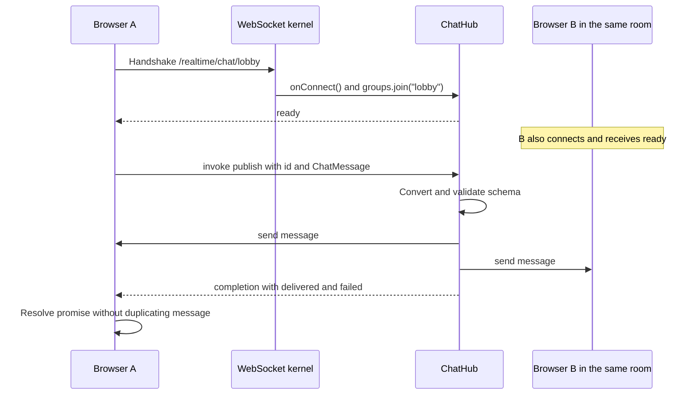

This example connects multiple tabs to a public room, validates messages, and broadcasts them to its participants. It uses `Hub`, Orionis schemas, and the [JavaScript client](/en/realtime/javascript-client) published on npm as `@orionis-framework/realtime-client`, which manages the WebSocket transport.

This is an **anonymous** demonstration: users supply their names and anyone who knows a room URL can join. A private application must resolve identity and authorize room access before joining the group. This example stores no history and does not promise delivery to disconnected users.

## 1. Create the hub

From the project root, generate the hub using either alternative:

```bash
python -B reactor make:realtime-hub chat
```

```bash
orionis make:realtime-hub chat
```

This creates `ChatHub` in `app/realtime/hubs/chat_hub.py`, initially with an `echo` remote method. Replace that file's contents with the following code to add the schema, room, and chat broadcast. If the file already exists, edit it directly: the generator does not overwrite it.

```python
from orionis.realtime import Hub, remote
from orionis.realtime.errors import RPCError
from orionis.schemas import Schema
from orionis.schemas.constraints import MaxLength, MinLength
from orionis.schemas.fields import Field


class ChatMessage(Schema, forbid_unknown_fields=True):

    author: Field[str, MinLength(1), MaxLength(40)]
    text: Field[str, MinLength(1), MaxLength(500)]


class ChatHub(Hub):

    __slots__ = ()

    async def onConnect(self) -> None:
        room = self.context.socket.routeParams()["room"]
        await self.groups.join(room)

    @remote
    async def publish(self, message: ChatMessage) -> dict[str, int]:
        author = message.author.strip()
        text = message.text.strip()
        if not author or not text:
            raise RPCError("empty_message", "Author and text cannot be blank")

        room = self.context.socket.routeParams()["room"]
        delivery = await self.clients.group(room).send(
            "message",
            {
                "room": room,
                "author": author,
                "text": text,
                "sender": self.context.connection_id,
            },
        )
        return {"delivered": delivery.sent, "failed": delivery.failed}
```

The room comes from the handshake URL, not from a client message. `onConnect()` joins the group before announcing `ready`. `publish()` validates the schema, rejects whitespace-only text, and broadcasts the `message` event to that room's members, including the sender.

The return value is an **acknowledgement of transport deliveries**. It does not confirm that every browser displayed the message. The visible message arrives through a `send` event, so the client does not add it again when receiving `completion`.

## 2. Register the socket and page

Register this route in `routes/websocket.py`. If you previously registered the template at `/realtime/echo`, replace that registration with the following one: this version of the hub needs the URL's `room` parameter.

```python
from app.realtime.hubs.chat_hub import ChatHub
from orionis.support.facades import Route

Route.hub("/realtime/chat/{room:slug}", ChatHub).name("realtime.chat")
```

`slug` accepts lowercase ASCII letters, digits, and hyphens. Examples include `lobby` and `python-help`. A room that does not match the converter does not resolve the route.

Add the HTML page in `routes/web.py`:

```python
from orionis.support.facades import Route

Route.view("/chat", "chat").name("chat")
```

Check that the existing `app.withRouting(...)` call includes `web="routes/web.py"` and `websocket="routes/websocket.py"` before `app.create()`. Keep the other routes. [Routes and lifecycle](/en/realtime/routing-and-lifecycle) explains this configuration.

## 3. Create the browser client

Install the client from the project root:

```bash
npm install @orionis-framework/realtime-client
```

Then follow [Serve the module from Orionis](/en/realtime/javascript-client#serve-the-module-from-orionis) to copy `node_modules/@orionis-framework/realtime-client/orionis-realtime.js` and serve it at `/assets/orionis-realtime.js`. This example's HTML loads that URL because it uses native browser modules without a bundler; import the npm package name directly when the frontend uses a bundler.

Save this complete document as `resources/views/chat.html`, the default views directory:

```html
<!doctype html>
<html lang="en">
<head>
    <meta charset="utf-8">
    <meta name="viewport" content="width=device-width, initial-scale=1">
    <title>Orionis Realtime Chat</title>
</head>
<body>
    <h1>Chat: <span id="room"></span></h1>
    <p id="status" role="status">Connecting...</p>
    <form id="chat-form">
        <label>
            Name
            <input id="author" maxlength="40" value="Ada" required>
        </label>
        <label>
            Message
            <input id="text" maxlength="500" required>
        </label>
        <button id="send" disabled>Send</button>
    </form>
    <p id="delivery" aria-live="polite"></p>
    <ul id="messages" aria-live="polite"></ul>

    <script type="module">
        import { RealtimeClient } from "/assets/orionis-realtime.js";

        const room = new URLSearchParams(location.search).get("room") || "lobby";
        const status = document.querySelector("#status");
        const button = document.querySelector("#send");
        const text = document.querySelector("#text");
        const author = document.querySelector("#author");
        const delivery = document.querySelector("#delivery");
        const messages = document.querySelector("#messages");
        document.querySelector("#room").textContent = room;

        const url = new URL("/realtime/chat/" + encodeURIComponent(room), location.href);
        url.protocol = location.protocol === "https:" ? "wss:" : "ws:";
        const client = new RealtimeClient(url);
        let sending = false;
        const errorText = {
            validation_error: "Invalid name or message.",
            empty_message: "Enter a name and a message.",
            busy: "Too many operations; try again later.",
            timeout: "The server did not complete the operation in time.",
        };

        function updateButton() {
            button.disabled = sending || client.state !== "connected";
        }

        client.onState(({ state }) => {
            status.textContent = state === "connected"
                ? "Connected to " + room
                : "State: " + state;
            updateButton();
        });
        client.onError(() => {
            status.textContent = "Connection unavailable. The reconnection policy will apply.";
        });
        client.on("message", ([item]) => {
            if (!item || typeof item.author !== "string" || typeof item.text !== "string") return;
            const row = document.createElement("li");
            row.textContent = item.author + ": " + item.text;
            messages.append(row);
            while (messages.children.length > 200) messages.firstElementChild.remove();
        });

        async function connect() {
            try {
                await client.connect();
            } catch {
                status.textContent = "Connection unavailable. The reconnection policy will apply.";
            }
        }

        document.querySelector("#chat-form").addEventListener("submit", async (event) => {
            event.preventDefault();
            if (sending || client.state !== "connected") return;
            sending = true;
            updateButton();
            const sentText = text.value;
            try {
                const result = await client.invoke("publish", [{
                    author: author.value.trim(),
                    text: sentText.trim(),
                }], { timeoutMs: 8000, serverTimeout: 5 });
                delivery.textContent = "Delivered: " + result.delivered
                    + "; failed: " + result.failed + ".";
                if (text.value === sentText) text.value = "";
                text.focus();
            } catch (error) {
                delivery.textContent = errorText[error.code] || "Delivery could not be confirmed. The message will not be resent automatically.";
            } finally {
                sending = false;
                updateButton();
            }
        });

        window.addEventListener("pagehide", () => { void client.stop(); });
        window.addEventListener("pageshow", (event) => {
            if (event.persisted) void connect();
        });
        await connect();
    </script>
</body>
</html>
```

The client waits for `ready` before enabling sends and reconnects according to its policy. The local deadline is eight seconds and server execution requests five. A timeout or disconnect does not prove that an operation had no effects: messages are not resent automatically, and unconfirmed text is preserved. The visible list keeps the latest 200 messages to bound DOM growth. `pagehide` stops the client and `pageshow` reconnects it when the page returns from the browser cache.

`textContent` displays messages as text without interpreting user input as HTML. The connection uses the page's host and port and selects `wss:` for HTTPS pages.

## 4. Run with one worker

Run from the project root so every tab shares the demonstration's connection registry:

```bash
uv run python -B -m granian --interface asgi --host 127.0.0.1 --port 8000 --workers 1 bootstrap.app:app
```

If the virtual environment is already active, you can run the same command without `uv run`. Granian is installed with Orionis; `bootstrap.app:app` points to the application configured in `bootstrap/app.py`.

The usual `orionis serve` command also supports Realtime, but currently selects one worker on Windows and a CPU-based count on Unix. Its interface does not expose `--workers`. This example therefore invokes Granian directly to select one process. Read [Groups and deployment](/en/realtime/groups-and-deployment) before using multiple workers.

Open two tabs at [http://127.0.0.1:8000/chat?room=lobby](http://127.0.0.1:8000/chat?room=lobby), choose different names, and send messages. Both receive `lobby` events. A third tab at [http://127.0.0.1:8000/chat?room=python-help](http://127.0.0.1:8000/chat?room=python-help) receives only `python-help` events.

Use the same host in every tab. The server checks handshake origins and the default configuration allows the same origin.

## Message flow



Connections in another room are not recipients. Groups are selected by hub class and name: reusing `ChatHub` on another route shares that hub's room namespace. A URL prefix alone does not isolate organizations or users.

## Verify and extend the example

- A valid message appears once in each tab in the room.
- Empty values, invalid types, or lengths outside the schema produce `validation_error`; whitespace-only strings produce `empty_message`.
- Closing a tab cancels its pending calls and removes its groups.
- Reloading creates a new connection, runs `onConnect()`, and rejoins the room. Earlier messages are not recovered.
- If only the sender receives messages across tabs, verify that the server uses one worker and all tabs share the same room and host.

For history, save messages in a domain service and query that history explicitly. For private rooms, check permissions during admission and operations. Broadcasting from another process requires a distributed strategy; configuring Redis in another module does not automatically turn this local registry into a backplane.
