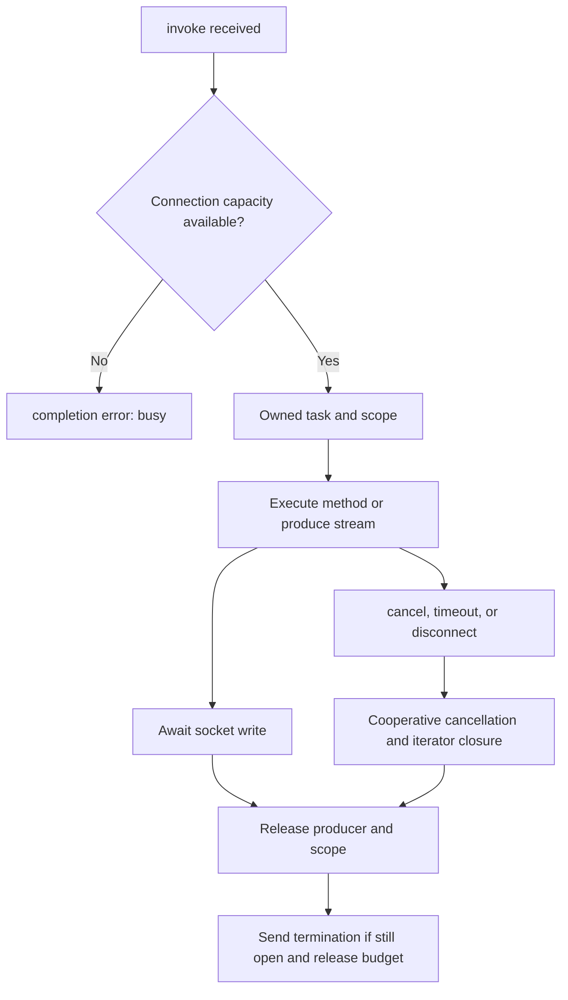

Groups select connections belonging to one hub: chat participants, dashboard viewers, or clients following an operation. They are an in-memory recipient selection, not a permission system or persistent subscription.

The [chat with rooms](/en/realtime/chat) provides a complete example. This chapter covers targeting alternatives and execution conditions.

## Select recipients

Inside a hub method, `self.clients` exposes:

| Selection | Recipients |
|---|---|
| `self.clients.all` | All ready connections in the same hub. |
| `self.clients.caller` | Only the current connection. |
| `self.clients.others` | Other ready connections in the same hub. |
| `self.clients.client(connection_id)` | One identifier in the same hub. |
| `self.clients.clients(connection_ids)` | Multiple identifiers, without duplicates. |
| `self.clients.group(name)` | Ready members of a group in the same hub. |

`all`, `caller`, and `others` are **properties**. `client(...)`, `clients(...)`, and `group(...)` are **methods**. Every selection supports `await target.send(event, *args)` to send an event without awaiting an application-level client response.

For example, save `app/realtime/notification_hub.py` and register `Route.hub("/realtime/notifications", NotificationHub)`:

```python
from orionis.realtime import Hub, remote


class NotificationHub(Hub):

    __slots__ = ()

    @remote
    async def announce(self, text: str) -> dict[str, int]:
        result = await self.clients.others.send(
            "announcement",
            {"text": text, "sender": self.context.connection_id},
        )
        return {"sent": result.sent, "failed": result.failed}
```

This operation notifies other users connected to `NotificationHub`. The sender receives only its `completion` acknowledgement, not the `announcement` event. Handle events as follows inside the client's WebSocket listener:

```javascript
function receiveAnnouncement(message) {
    if (message.type === "send" && message.target === "announcement") {
        const announcement = message.args[0];
        console.log(announcement.sender, announcement.text);
    }
}
```

Event names must be public Python identifiers of at most 128 characters: `announcement` is valid; names containing dots or `:` are not. Up to 64 arguments per event are supported, all serializable by the connection's codec.

`caller` and `client(id)` also support `await target.invoke("method", *args, timeout=...)` to await a browser result. Multiple-recipient targets do not support this because there is no single result to correlate. The [protocol](/en/realtime/protocol-and-streaming) shows both directions.

## Join and leave groups

`await self.groups.join(name)` adds the current connection; repeated joins consume no additional slot. `await self.groups.leave(name)` removes it; repeated leaves are harmless. Names must remain nonempty after stripping whitespace and contain at most 256 characters; Orionis preserves the original name without normalizing it.

A public-room example, separate from the chat whose room is fixed by its URL:

```python
from orionis.realtime import Hub, remote
from orionis.realtime.errors import RPCError


class RoomHub(Hub):

    __slots__ = ()

    @remote
    async def join(self, room: str) -> None:
        if room not in {"lobby", "python-help"}:
            raise RPCError("unknown_room", "Unknown public room")
        await self.groups.join(room)

    @remote
    async def leave(self, room: str) -> None:
        await self.groups.leave(room)
```

Register `Route.hub("/realtime/rooms", RoomHub)`. The client must await the `join` completion before treating membership as established or starting an operation that depends on it; invocations can run concurrently.

Private rooms need identity and resource permission checks **before** `join`. Accepting an arbitrary client-supplied name does not establish authorization. Check permissions when publishing too: group membership does not automatically create an access policy.

Disconnecting removes every membership. Empty groups disappear. Reconnecting obtains a new `connection_id` and application subscriptions must be reconstructed.

## Broadcast from application services

Once the Realtime provider is initialized, send events outside a hub through the public facade:

```python
from app.realtime.hubs.chat_hub import ChatHub
from orionis.support.facades import Realtime


class RoomNotifier:

    async def announce(self, room: str, text: str) -> dict[str, int]:
        result = await Realtime.hub(ChatHub).group(room).send(
            "message",
            {
                "room": room,
                "author": "System",
                "text": text,
                "sender": "system",
            },
        )
        return {"sent": result.sent, "failed": result.failed}
```

This class can be used from a controller or service that has already authorized the operation. It does not expose a public endpoint by itself. It must execute in the **same worker** that owns the connections. A CLI command, queue worker, or separate process normally has another empty registry.

The facade uses the container's `IConnectionManager` singleton. Alternatively, inject the contract into a service:

```python
from app.realtime.hubs.chat_hub import ChatHub
from orionis.realtime.contracts.manager import IConnectionManager


class RoomRefresh:

    def __init__(self, manager: IConnectionManager) -> None:
        self.manager = manager

    async def send(self, room: str) -> int:
        result = await self.manager.hub(ChatHub).group(room).send("refresh")
        return result.sent
```

`Realtime.hub(HubClass)` and `manager.hub(HubClass)` provide the same selections but have no caller: `caller` and `others` need a connection context and raise errors outside one.

## What a broadcast result means

`send(...)` returns `BroadcastResult` with two counters:

- `sent`: recipients whose transport write completed successfully.
- `failed`: recipients that were unavailable or failed delivery.

These are not read receipts or acknowledgements of JavaScript execution. With no recipients, both counters are zero. A connection closing during the broadcast can count as failed.

Selection snapshots identifiers and checks availability again before sending. Every recipient belongs to the namespace of a **hub class**. Registering the same class at two URLs shares its connections and groups; URL prefixes do not create separate namespaces.

## Limit configuration

`config/realtime.py` configures `RealtimeConfig`. The provider validates the configuration entity or mapping and registers an immutable instance.

| Option | Environment variable | Default |
|---|---|---|
| `max_message_size` | `REALTIME_MAX_MESSAGE_SIZE` | `1048576` incoming bytes. |
| `max_concurrent_invocations` | `REALTIME_MAX_CONCURRENT_INVOCATIONS` | `16` per connection. |
| `max_pending_client_invocations` | `REALTIME_MAX_PENDING_CLIENT_INVOCATIONS` | `32` pending client results per connection. |
| `invocation_timeout` | `REALTIME_INVOCATION_TIMEOUT` | `30.0` seconds per ordinary call. |
| `client_result_timeout` | `REALTIME_CLIENT_RESULT_TIMEOUT` | `30.0` seconds for `client.invoke` send and result. |
| `broadcast_concurrency` | `REALTIME_BROADCAST_CONCURRENCY` | `32` simultaneous deliveries per broadcast. |
| `max_groups_per_connection` | `REALTIME_MAX_GROUPS_PER_CONNECTION` | `64` memberships per connection. |

Counts must be positive integers, excluding booleans. Deadlines must be finite positive numbers. None of these timeouts limits the total connection lifetime.

An environment configuration example:

```dotenv
REALTIME_MAX_MESSAGE_SIZE=1048576
REALTIME_MAX_CONCURRENT_INVOCATIONS=16
REALTIME_MAX_PENDING_CLIENT_INVOCATIONS=32
REALTIME_INVOCATION_TIMEOUT=30.0
REALTIME_CLIENT_RESULT_TIMEOUT=30.0
REALTIME_BROADCAST_CONCURRENCY=32
REALTIME_MAX_GROUPS_PER_CONNECTION=64
```

Scalar calls use `invocation_timeout` when the client omits `timeout`. Streams have no default lifetime deadline: an explicit `invoke` timeout does set one, up to `invocation_timeout`. Larger values are rejected with `invalid_arguments`.

WebSocket limits from `config/http.py` also apply: `WEBSOCKET_MAX_MESSAGE_SIZE` and `WEBSOCKET_MAX_CONNECTIONS`, plus the origin policy. Raising the Realtime limit does not raise the transport limit. See [WebSocket](/en/realtime/websocket) for options and adapter differences.

## Concurrency, cancellation, and cleanup



Writes on a connection are serialized and await the transport: a slow client applies backpressure. A stream does not advance to the next item before delivering the previous one. Broadcasts bound concurrent deliveries and reuse encoding per codec.

A write failure marks the connection as closing and cancels its owner task. Disconnecting cancels invocations, fails pending client results, and releases owned work before `onDisconnect()`.

Application shutdown cancels its WebSocket connections and waits up to five seconds for cooperative cleanup. Use `try/finally` for resources opened by generators or methods; do not swallow `CancelledError` or create tasks that outlive a connection without managing them explicitly.

## Workers and deployment

The default `ConnectionManager` only knows connections in the current process/worker. Restarting loses connections, groups, and pending results; there are no offline messages, replay, or automatic client reconnection.

For chat tests using a shared registry, use the [one-worker command](/en/realtime/chat#4-run-with-one-worker). The usual `orionis serve` selection differs between Windows and Unix; an application guide must not assume every connection shares a process.

Session affinity can keep a connection on its worker, but does not itself broadcast to other workers' connections. Distribution requires your own backplane and a compatible `IConnectionManager` implementation, plus the delivery guarantees your application needs. The framework does not activate Redis pub/sub merely because Redis is configured in another module.

The registry is designed for the application's event loop; it is not a global container supporting safe mutation from threads. For production, configure HTTPS/`wss:`, proxy upgrade support, and infrastructure deadlines suitable for long connections; Realtime options do not configure that proxy automatically.
