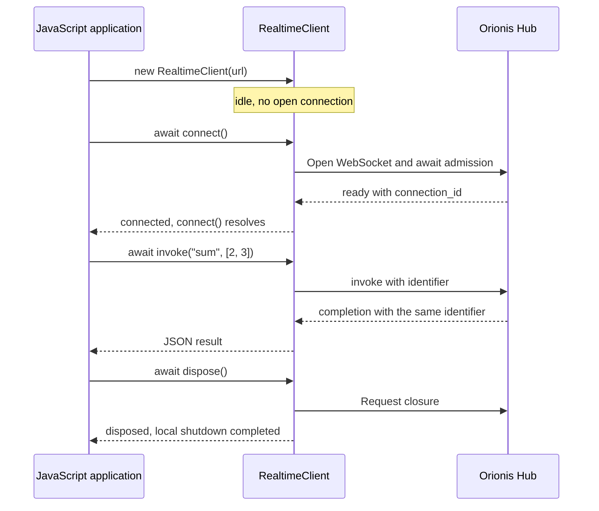

The [`@orionis-framework/realtime-client` npm package](https://www.npmjs.com/package/@orionis-framework/realtime-client) provides `RealtimeClient` for connecting to Orionis `Route.hub(...)` endpoints. It implements the Realtime JSON protocol as an ESM module with no runtime dependencies, TypeScript declarations, and an MIT license. See its [official repository](https://github.com/orionis-framework/realtime-client) for the source, types, and client guides.

This client targets **Realtime hubs**. For `Route.websocket(...)` and SSE, use the APIs described in [WebSocket](/en/realtime/websocket) and [Server-Sent Events](/en/realtime/streaming-and-sse). A `protocol="msgpack"` route requires another codec; this package processes JSON text only.

## Install from npm

From your frontend project, or from the Orionis project root when serving JavaScript directly, install the package:

```bash
npm install @orionis-framework/realtime-client
```

In an application with a bundler, import named exports from the package root:

```javascript
import { RealtimeClient, RemoteError } from "@orionis-framework/realtime-client";
```

The package uses ESM and includes its types; no additional declarations package is needed. It has no default export or CommonJS entry for `require()`. Importing it does not open connections: those begin when `connect()` runs.

Use a modern browser with ESM modules, `WebSocket`, `AbortController`, `TextEncoder`, and async iterators. For Node.js, use an environment satisfying the package's `engines` field and providing those APIs. In a browser, the npm name needs frontend module resolution; HTML without a bundler must import a served file URL, as shown next.

### Serve the module from Orionis

After installing the package from the Orionis root, copy `node_modules/@orionis-framework/realtime-client/orionis-realtime.js` to `storage/app/public/js/orionis-realtime.js`. This is the default root of the `public` disk; adjust the destination if you changed it in `config/filesystems.py`. The package module can be served directly without compiling it.

This command creates the directory and copies the file through Node.js; it works in PowerShell and Unix shells:

```bash
node --input-type=module -e "import { mkdir, copyFile } from 'node:fs/promises'; await mkdir('storage/app/public/js', { recursive: true }); await copyFile('node_modules/@orionis-framework/realtime-client/orionis-realtime.js', 'storage/app/public/js/orionis-realtime.js');"
```

Configuring the disk does not automatically publish its files. The served file is a copy of the installed package: copy it again when updating the dependency.

This registration in `routes/web.py` serves only the client file:

```python
from orionis.http import StreamingResponse, response
from orionis.support.facades import Route, Storage


async def realtime_client_module() -> StreamingResponse:
    module = Storage.disk("public").file("js/orionis-realtime.js")
    await module.size()
    return response.stream(
        module.readStream(),
        media_type="text/javascript",
        headers={
            "Cache-Control": "no-cache",
            "X-Content-Type-Options": "nosniff",
        },
    )


Route.get("/assets/orionis-realtime.js", realtime_client_module)
```

From a view's `<script type="module">`, use the served URL:

```javascript
import { RealtimeClient } from "/assets/orionis-realtime.js";
```

You can also serve the file through your usual static server. This route exposes only the module and accepts no user-provided filenames. Do not expose `node_modules` as a public URL or import the npm subpath `@orionis-framework/realtime-client/orionis-realtime.js`: the exported entry is the package root.

The following examples use npm imports for a frontend with a bundler. When working directly in an HTML view, replace the import source with `/assets/orionis-realtime.js`, as in the [complete chat](/en/realtime/chat).

## Your first complete client

This example uses `MathHub` and the `/realtime/math` route from [Hubs and remote methods](/en/realtime/hubs-and-methods#customize-a-hub-aliases-and-defaults). Its remote method `sum` accepts `first` and `second` and returns their sum.

<!-- realtime-example: connect -->

```javascript
import { RealtimeClient } from "@orionis-framework/realtime-client";

const client = new RealtimeClient("/realtime/math");

try {
    await client.connect();
    console.log("Connection:", client.connectionId);
    const total = await client.invoke("sum", [2, 3]);
    console.log("Total:", total); // 5
} catch (error) {
    console.error("Realtime:", error.code, error.message);
} finally {
    await client.dispose();
}
```

The sequence is:

1. `new RealtimeClient(...)` prepares the instance. It does not open a connection.
2. `connect()` resolves the URL, opens WebSocket, and waits for a valid Realtime `ready` message.
3. `invoke()` sends the call and returns a promise for its JSON result. The client generates and correlates identifiers.
4. `dispose()` permanently closes this instance and releases its registrations.

The example ends after one call. On an interactive screen, keep the client while it is needed and dispose it when unmounting the screen. The [chat with rooms](/en/realtime/chat) demonstrates that continuous use.



## Construct the connection

The signature is `new RealtimeClient(url, options?)`. The first argument accepts a string, a `URL` object, or a function producing either value. The second configures the transport, deadlines, and limits.

### Relative or absolute URL

In a browser, you can use a same-origin path:

```javascript
const client = new RealtimeClient("/realtime/chat/lobby");
```

Relative URLs resolve against `location.href`; `http:` and `https:` become `ws:` and `wss:`. If the frontend and Orionis use different origins, specify the Orionis server explicitly:

```javascript
const client = new RealtimeClient(
    new URL("wss://api.example.com/realtime/chat/lobby"),
);
```

Replace that domain with your application's domain and configure the allowed origin on the server. The client rejects URLs containing a username/password or a `#...` fragment. In Node.js, use an absolute URL because there is no page location.

### Resolve the URL on each attempt

A factory can construct the URL again when connecting or reconnecting. This example selects a room using an application variable:

```javascript
let selectedRoom = "lobby";

const client = new RealtimeClient(({ attempt, signal }) => {
    signal.throwIfAborted();
    console.log("Transport attempt:", attempt);
    return new URL(
        "/realtime/chat/" + encodeURIComponent(selectedRoom),
        location.href,
    );
});

await client.connect();

// Para cambiar de sala, inicia una nueva conexión con la URL actualizada.
await client.stop();
selectedRoom = "python-help";
await client.connect();

// Cuando termine la pantalla:
await client.dispose();
```

The function can also be `async` and return a promise. If it performs cancellable work, it should honor `signal`. `attempt` is `0` for the initial connection and `1` for the first retry; it counts consecutive failures and resets after a successful connection.

The URL stays unchanged during a connection: changing `selectedRoom` does not move an already open connection. In the documented chat, the server joins the new connection to the URL's group through `onConnect()`.

The `connectTimeoutMs` deadline includes factory execution. The client admits at most 32 unfinished factories; a function ignoring cancellation cannot be forcibly stopped.

### Wait for readiness

Call `await client.connect()` before `invoke()` or `stream()`. An open WebSocket can still be waiting for hub admission.

Concurrent `connect()` calls share the pending process. If already connected, the call resolves without opening another transport. When retries are enabled, the original promise remains pending through them: `connectTimeoutMs` limits **each attempt**, not the total time of every attempt combined.

## States and observers

`client.state` exposes the current state. `client.connectionId` contains the server-assigned identity only while `connected`; otherwise, it returns `null`.

| State | Meaning for the application |
|---|---|
| `idle` | No connection is active. You can call `connect()`. |
| `connecting` | Resolving the URL, opening the transport, or waiting for `ready`. |
| `connected` | Invocations and streams can start. |
| `reconnecting` | The transport was lost or an attempt failed, and the client is trying to recover. |
| `stopping` | Completing a requested shutdown. |
| `disposed` | The instance has permanently shut down; create another for a new connection. |

Register observers before connecting:

```javascript
function updateState({ state, previous, attempt }) {
    console.log(previous, "->", state, "attempt:", attempt);
}

console.log("Initial state:", client.state);
const removeState = client.onState(updateState);
const removeError = client.onError((error) => {
    console.error("Transport or callback:", error.code);
});

// Al retirar los observadores:
removeState();
removeError();
```

`onState()` reports changes without automatically emitting an initial state snapshot. Multiple attempts while the state remains `reconnecting` do not produce one event per attempt. Upon receiving `ready`, the counter resets and the `connected` event carries `attempt: 0`; detect recovery using `previous === "reconnecting"`.

Keep observers brief. If they return a promise, notifications are skipped while that same function remains pending; they are not a history. An `onState` failure is reported to `onError`, and a failure in an error observer itself is contained.

## Invoke remote methods

The signature is `client.invoke(target, args?, options?)`, returning `Promise<JsonValue>`.

- `target` is the name exposed by `@remote`. `MathHub` uses `"sum"`, even though its Python method is named `add`.
- `args` is an array of positional arguments. Omitting it is equivalent to `[]`.
- `options.kwargs` is an object containing named arguments. Use the Python parameter names.
- Services injected by Orionis are not included in `args` or `kwargs`.

With a connection to the previous `MathHub`:

```javascript
await client.invoke("sum", [3]); // 5: second conserva su valor predeterminado.
await client.invoke("sum", [2], { kwargs: { second: 3 } }); // 5.
await client.invoke("sum", [], {
    kwargs: { first: 2, second: 3 },
}); // 5.
```

### Keyword-only parameters

The `SearchHub` in the [Hubs](/en/realtime/hubs-and-methods#arguments-and-accepted-values) chapter exposes `search(term, *, limit=10)` at `/realtime/search`. `limit` must be sent in `kwargs`:

<!-- realtime-example: kwargs -->

```javascript
import { RealtimeClient } from "@orionis-framework/realtime-client";

const client = new RealtimeClient("/realtime/search");

try {
    await client.connect();
    const result = await client.invoke("search", ["Orionis"], {
        kwargs: { limit: 5 },
    });
    console.log("Search:", result); // { term: "Orionis", limit: 5 }
} finally {
    await client.dispose();
}
```

Do not repeat a parameter in `args` and `kwargs` or send names the method does not accept. Positional and named arguments each have a maximum of 64 entries. A remote name must be public, nonempty, at most 128 Unicode code points, and must not start with `_`.

The server validates annotations and schemas before executing the method. `invalid_arguments` indicates binding problems; `validation_error` indicates data that does not satisfy types or rules.

### Data you can send and receive

The contract is JSON: `null`, booleans, strings, finite numbers, dense arrays, and plain objects. The client copies arguments when starting the operation; modifying them later does not change the prepared frame.

Explicitly transform values that are not JSON:

```javascript
const data = {
    created_at: new Date().toISOString(),
    external_id: 9007199254740993n.toString(),
    optional_value: null,
};
```

Only send this object to a method whose contract accepts those fields. Do not pass it to the chat's `publish`, which expects its specific message structure.

`undefined`, `Date`, `BigInt`, nonfinite numbers, cycles, getters, sparse arrays, and class instances are rejected. Numbers use `Number` precision; represent integer identifiers outside the safe range as strings.

## Call deadlines and cancellation

These options apply to both `invoke()` and `stream()`:

| Option | Unit and behavior |
|---|---|
| `kwargs` | Named arguments; a JSON object, empty when omitted. |
| `timeoutMs` | Total **local** deadline in milliseconds, including the send queue. Defaults to `invocationTimeoutMs`; `0` disables it. |
| `serverTimeout` | Deadline requested **from the server**, in seconds; positive, and fractional values are allowed. Omitting it retains the server policy. |
| `signal` | The operation's `AbortSignal`. It does not cancel other calls or close the client. |

For example, with a `MathHub` connection:

```javascript
const result = await client.invoke("sum", [2, 3], {
    timeoutMs: 5000,
    serverTimeout: 4,
});
```

These are two independent deadlines. `serverTimeout` must respect Orionis's `REALTIME_INVOCATION_TIMEOUT`; changing it does not alter the local timer. Disabling `timeoutMs` does not disable server controls either.

### Cancel with AbortController

```javascript
const controller = new AbortController();
const pending = client.invoke("sum", [2, 3], {
    signal: controller.signal,
    timeoutMs: 5000,
});

controller.abort("The screen was closed");

try {
    await pending;
} catch (error) {
    console.log(error.code); // aborted
    console.log(error.cause); // Motivo local de cancelación.
}
```

If the signal was already aborted, no work starts. Cancellation before sending removes the call from the queue; if already sent and the connection remains available, the client requests cancellation on the server.

An expired deadline or cancellation **does not undo completed effects**. Neither proves that the operation did not happen. The application must reconcile the outcome of operations with persistent effects.

## Listen to server events

`client.on(target, handler)` receives the hub's `send` events. Its callback receives an **argument array**, even when the event carries just one object.

In the [documented chat](/en/realtime/chat), `publish` is the invoked method and `message` is the broadcast event:

<!-- realtime-example: events -->

```javascript
import { RealtimeClient } from "@orionis-framework/realtime-client";

const client = new RealtimeClient("/realtime/chat/lobby");
const removeMessage = client.on("message", ([message]) => {
    console.log("Message:", message.author, message.text);
});

try {
    await client.connect();
    const delivery = await client.invoke("publish", [{
        author: "Ada",
        text: "Hello Orionis",
    }]);
    console.log("Delivery:", delivery);
} finally {
    removeMessage();
    await client.dispose();
}
```

Register the listener before connecting or invoking actions that can publish events. An event is not the result of the latest invocation and is not correlated by arrival order. The chat displays text when receiving `message`; the `publish` result reports transport deliveries without adding another copy of the text.

You can register multiple different functions for an event. Registering exactly the same function again does not duplicate it: the second registration returns an empty unsubscribe function. Keep the function returned by the original registration.

Unsubscription is idempotent and stops future deliveries. It does not cancel a callback that has already started. Events receive only `args`; the context containing `signal` belongs to `handle()`.

## Respond to server calls

`client.handle(target, handler)` registers a function the hub can invoke in that browser. It does not expose another Python method or register an HTTP route.

[`ConfirmationHub`](/en/realtime/protocol-and-streaming#invoke-a-browser-method) exposes `ask` and requests `confirmAction` from the client:

<!-- realtime-example: callback -->

```javascript
import { RealtimeClient } from "@orionis-framework/realtime-client";

const client = new RealtimeClient("/realtime/confirmation");
const removeConfirmation = client.handle(
    "confirmAction",
    async ([{ question }], { signal, connectionId }) => {
        console.log("Confirmation on:", connectionId);
        if (signal.aborted) return false;
        return window.confirm(question);
    },
);

try {
    await client.connect();
    console.log("Confirmed:", await client.invoke("ask"));
} finally {
    removeConfirmation();
    await client.dispose();
}
```

The handler receives `(args, context)`:

| Value | Purpose |
|---|---|
| `args` | Array of data sent by the server. |
| `context.connectionId` | Identity of the connection on which the callback started. |
| `context.signal` | Signal for cancelling work when `callbackTimeoutMs` expires or that connection ends. |

Return a JSON value or a promise producing it; `undefined` is sent as `null`. The client prepares the response and correlates the result. An exception or a nonserializable result produces a sanitized error response to the server and a local notification.

The example's function returns a promise because it is `async`, but `window.confirm` remains a synchronous, blocking dialog. For longer interactions, use your application's asynchronous interface and honor `signal`; the client cannot interrupt blocking JavaScript.

The local callback deadline and the server's `self.clients.caller.invoke(...)` deadline are independent. A remote deadline expiring does not automatically abort the browser handler. Configure both for the interaction.

Only one handler is allowed per name. Trying to register another without removing the previous one throws `TypeError`. The unsubscribe function prevents future calls; an already running call continues with its own signal and deadline. Throwing `RemoteError` from a handler does not let you arbitrarily choose the code sent to the server: the client's error policy applies.

## Consume streams

Use `client.stream(target, args?, options?)` when a hub method produces an asynchronous sequence. The protocol guide's [`FeedHub`](/en/realtime/protocol-and-streaming#streams-operation-progress) exposes `updates(count)` at `/realtime/feed`.

<!-- realtime-example: stream -->

```javascript
import { RealtimeClient } from "@orionis-framework/realtime-client";

const client = new RealtimeClient("/realtime/feed");

try {
    await client.connect();
    const updates = client.stream("updates", [3], { timeoutMs: 10000 });
    for await (const value of updates) {
        console.log("Update:", value); // 0, 1, 2.
    }
    console.log("Stream finished");
} finally {
    await client.dispose();
}
```

`stream()` starts the invocation **when created**, before the first `next()`. Consume or cancel the iterator; do not create it to keep it indefinitely without reading.

`timeoutMs` limits the stream's total lifetime, not the interval between items. For a deliberately long-lived stream, use `timeoutMs: 0` and keep a signal or reference for cancellation.

### End early with break

Leaving `for await` with `break` calls `return()`: it releases buffered items and requests cancellation of remaining work.

<!-- realtime-example: cancel-stream -->

```javascript
import { RealtimeClient } from "@orionis-framework/realtime-client";

const client = new RealtimeClient("/realtime/feed");

try {
    await client.connect();
    for await (const value of client.stream("updates", [100])) {
        console.log("Update:", value);
        if (value === 2) break;
    }
} finally {
    await client.dispose();
}
```

### Explicit cancellation and manual reads

With a client connected to `FeedHub`:

```javascript
const controller = new AbortController();
const updates = client.stream("updates", [100], {
    signal: controller.signal,
    timeoutMs: 0,
});

try {
    const first = await updates.next();
    if (!first.done) console.log(first.value);
    controller.abort("The user stopped the feed");
    await updates.next(); // Rechaza con AbortError.
} catch (error) {
    console.log(error.code);
} finally {
    await updates.return();
}
```

You can also call `updates.cancel(reason)` without an `AbortController`. It rejects reads with `AbortError` and retains the reason in the local `cause` without transmitting it. `return()` finishes cleanly and releases buffers even after termination. `throw(error)` cancels and returns a promise rejected with that error; also catch that rejection if using it.

Only **one `next()` may be pending per iterator**. Do not use `Promise.all([updates.next(), updates.next()])`: the additional read rejects with `concurrent_next`.

After successful completion, already received items remain available until consumed or released through `return()`. An error termination discards the buffer and rejects reads. If the server rejects operation admission with `completion.error`, the iterator reports that error too.

Each stream limits the items and bytes waiting for the consumer. Exceeding a limit produces `LimitError` and requests cancellation of the producer. The protocol has no consumption credits: these limits bound the application queue without guaranteeing that data has not already reached the browser.

## Handle operation and client errors

Use `try/catch` for each invocation or stream consumption. `onError()` observes transport, protocol, and callback problems; it does not catch rejected promises for you or necessarily emit every individual business error.

This example distinguishes a remote rejection from a local usage error:

<!-- realtime-example: errors -->

```javascript
import {
    RealtimeClient,
    RemoteError,
} from "@orionis-framework/realtime-client";

const client = new RealtimeClient("/realtime/math");

try {
    await client.connect();

    try {
        await client.invoke("missingMethod");
    } catch (error) {
        if (!(error instanceof RemoteError)) throw error;
        console.log("Remote:", error.code); // method_not_found
    }

    try {
        await client.invoke("sum", "invalid");
    } catch (error) {
        if (!(error instanceof TypeError)) throw error;
        console.log("Local:", error.name); // TypeError
    }
} finally {
    await client.dispose();
}
```

`invoke()` is asynchronous: even its preparation errors reject a promise. `stream()` can throw when constructing the iterator; include that creation inside the `try` too.

### Error classes

| Exported class | When to handle it |
|---|---|
| `RemoteError` | The server terminated the operation with an error. Preserves the remote code. |
| `ConnectionError` | The connection is unavailable, the transport failed, or the instance was stopped/disposed. |
| `TimeoutError` | A local operation, send, or callback deadline expired. |
| `AbortError` | The operation was cancelled locally. |
| `LimitError` | An operation, buffer, registration, or work budget was exhausted. |
| `ProtocolError` | An incompatible message arrived or a scalar result was used as a stream, or vice versa. |
| `RealtimeError` | Base class and client failures such as `callback_error` or `concurrent_next`. |
| Native `TypeError` | Invalid arguments or configuration options. |

Import package error classes from `@orionis-framework/realtime-client`. Use `instanceof` to distinguish them: a `RemoteError` with `code === "timeout"` represents a server deadline and is not a local `TimeoutError`.

Client error codes include `not_connected`, `connect_failed`, `connect_timeout`, `connection_lost`, `heartbeat_timeout`, `send_failed`, `send_timeout`, `stopped`, `disposed`, `aborted`, and `limit_exceeded`. A `connect_failed` error can retain the factory or URL error in `cause`.

Remote codes include `method_not_found`, `invalid_arguments`, `validation_error`, `busy`, `unauthorized`, `forbidden`, `timeout`, `cancelled`, `client_error`, and `internal_error`, plus application-defined codes. The server sanitizes messages: provide interface explanations based on codes rather than diagnostic text. [Protocol and streams](/en/realtime/protocol-and-streaming#errors-and-deadlines) explains these rejections.

## Configure reconnection

Configure the policy when constructing the client:

```javascript
const client = new RealtimeClient("/realtime/chat/lobby", {
    reconnect: {
        enabled: true,
        maxAttempts: 5,
        initialDelayMs: 1000,
        maxDelayMs: 15000,
        factor: 2,
        jitter: 0.2,
    },
});
```

`initialDelayMs` sets the first delay; `factor` increases later delays up to `maxDelayMs`. `jitter` adds random variation so multiple connections do not return simultaneously. `maxAttempts` limits retries for consecutive failures, not all reconnections throughout the client's lifetime; the count resets upon receiving another `ready`.

With `reconnect: { enabled: false }`, a loss leaves the instance `idle`, and you decide when to call `connect()` again. `stop()` and `dispose()` always cancel automatic recovery.

Close codes `1001`, `1006`, `1011`, `1012`, `1013`, and `1014` are retried, along with connection, send, and heartbeat failures. Normal closure `1000`, policy rejections, and protocol failures stop automatic reconnection. RSGI may report closures as `1000`; the client can decide only from information provided by the transport.

### Restore application state

JavaScript subscriptions remain registered, but pending calls and streams reject when the connection is lost. **The client does not resend operations**, recover missed messages, or automatically repeat a stream's contents.

Use the state change to start the reconciliation your application needs. With a client connected to `MathHub`:

```javascript
const removeState = client.onState(({ state, previous }) => {
    if (state === "connected" && previous === "reconnecting") {
        void refreshAfterReconnect();
    }
});

async function refreshAfterReconnect() {
    try {
        const total = await client.invoke("sum", [2, 3]);
        console.log("Refreshed:", total);
    } catch (error) {
        console.error("Refresh failed:", error.code);
    }
}
```

In a real application, replace that query with a read operation for your domain. Establish server-side idempotency and reconciliation before repeating writes whose results were lost.

A recovered connection receives another `connectionId`. Its groups belonged to the previous connection: in the chat, `onConnect()` rejoins the room from its URL. Other dynamic groups require your application's own procedure; the client does not provide a generic `join()` method.

## Stop, restart, and dispose

`stop()` stops the transport, cancels retries, and rejects pending operations. It retains registered events, methods, and observers so the client can restart:

<!-- realtime-example: stop-restart -->

```javascript
import { RealtimeClient } from "@orionis-framework/realtime-client";

const client = new RealtimeClient("/realtime/math");

try {
    await client.connect();
    const previousId = client.connectionId;
    console.log("Before stop:", await client.invoke("sum", [2, 3]));

    await client.stop();
    console.log("Stopped:", client.state); // idle

    await client.connect();
    console.log("New connection:", client.connectionId !== previousId);
    console.log("After restart:", await client.invoke("sum", [2, 3]));
} finally {
    await client.dispose();
}
```

`dispose()` is permanent: it clears registrations and ends in `disposed`. Afterward, that instance cannot connect, invoke, or register new handlers. Create another for a new lifecycle.

Both operations have a local wait bounded by `closeTimeoutMs`. The browser WebSocket API cannot force immediate physical TCP termination, and JavaScript cannot forcibly stop a blocking function.

### Integrate with a screen

Use an instance while its screen or component needs it:

- Initialize the interface from `client.state` and listen with `onState`; enable sends only while `connected`.
- Also catch each operation's rejection: a previously checked state does not guarantee the connection remains available.
- Keep and call unsubscribe functions when removing a consumer. Removing a listener does not dispose a shared client.
- Use `AbortController` for that screen's work and abort its calls when removing it.
- If the screen owns the instance, finish with `await client.dispose()`. If another screen shares the client, release only your own subscriptions and operations.
- For a page retained in the browser's page cache, stop on `pagehide` and reconnect on `pageshow`. The [complete chat](/en/realtime/chat) implements this lifecycle without duplicating registrations.

## Use TypeScript

The package includes declarations. `invoke()` returns `Promise<JsonValue>` and a stream yields `JsonValue`. The API provides neither `invoke<T>()` nor a generic client: check result shapes before using them.

```typescript
import {
    RealtimeClient,
    type JsonValue,
} from "@orionis-framework/realtime-client";

function requireNumber(value: JsonValue): number {
    if (typeof value !== "number" || !Number.isFinite(value)) {
        throw new TypeError("Expected a finite number");
    }
    return value;
}

const client = new RealtimeClient("/realtime/math");

try {
    await client.connect();
    const result: JsonValue = await client.invoke("sum", [2, 3]);
    const total = requireNumber(result);
    console.log(total.toFixed(2)); // "5.00"
} finally {
    await client.dispose();
}
```

For an object, check that it is not `null` or an array and that its fields have the expected types. An assertion such as `as MyResult` does not validate data. Types assist the frontend; they do not replace server schemas or authorization.

## Use the client from Node.js

Use an environment satisfying the package's `engines` field and providing native WebSocket. Save the following module as `client.mjs`, install the same package, and run `node client.mjs`. The route belongs to the already registered `MathHub`.

<!-- realtime-example: node -->

```javascript
import { RealtimeClient } from "@orionis-framework/realtime-client";

const endpoint = process.env.ORIONIS_REALTIME_URL
    || "ws://127.0.0.1:8000/realtime/math";
const client = new RealtimeClient(endpoint);

try {
    await client.connect();
    console.log("Total:", await client.invoke("sum", [2, 3]));
} catch (error) {
    console.error("Realtime:", error.code, error.message);
    process.exitCode = 1;
} finally {
    await client.dispose();
}
```

The example accepts another endpoint through `ORIONIS_REALTIME_URL`, an environment variable chosen by this application rather than an automatic package setting. It uses no `location`, `window`, or other page APIs.

## Configuration reference

Options are set in the constructor. The following defaults reflect the implementation; changing options on an existing instance is not a supported API.

### Connection and deadlines

| Option | Default | Purpose |
|---|---|---|
| `connectTimeoutMs` | `10000` | Resolve the URL, open the transport, and complete the handshake for each attempt. |
| `closeTimeoutMs` | `1000` | Local wait for closing. |
| `invocationTimeoutMs` | `30000` | Default local deadline for calls and streams; `0` disables it. |
| `callbackTimeoutMs` | `30000` | Deadline for event callbacks and client methods. |
| `heartbeatIntervalMs` | `30000` | Application `ping` interval; `0` disables heartbeat. |
| `heartbeatTimeoutMs` | `10000` | Wait for `pong` after sending a ping. |
| `sendTimeoutMs` | `10000` | Maximum time a write may remain blocked in the queue. |

Deadlines are finite integer milliseconds, up to `2147483647`. Only the indicated options accept `0` to disable their behavior. Heartbeat checks responsiveness; suspended tabs may delay timers, and recovery requires another handshake.

### Capacity, data, and buffers

| Option | Default | What it limits |
|---|---|---|
| `maxPendingInvocations` | `128` | Active calls and streams combined. |
| `maxConcurrentHandlers` | `32` | Event callbacks and client methods, including across connections. |
| `maxMessageBytes` | `1048576` | Maximum UTF-8 bytes per incoming or outgoing message. |
| `maxQueuedBytes` | `2097152` | Bytes in the local send queue. |
| `maxBufferedAmount` | `262144` | Threshold for pausing further WebSocket writes. Accepts `0`. |
| `maxStreamBufferItems` | `64` | Items waiting for consumption per stream. |
| `maxStreamBufferBytes` | `1048576` | Bytes waiting for consumption per stream. |
| `maxJsonDepth` | `64` | Depth of the JSON structure. |
| `maxJsonNodes` | `100000` | Nodes traversed when validating the JSON structure. |

Limits are finite integers. `maxBufferedAmount` is an admission threshold: an admitted frame can raise the buffer above it by up to that frame's own maximum size. The queue also bounds its entry count.

An operation exceeding its capacity may fail with `LimitError`. If the write buffer does not drain within `sendTimeoutMs`, the transport fails; pending operations reject and the reconnection policy applies.

Events and RPC callbacks share `maxConcurrentHandlers`. A callback ignoring cancellation retains its slot until it actually finishes. When capacity is exhausted, excess events are dropped with an `onError` notification, and server invocations receive `busy`.

There is a maximum of 1024 registrations across events, methods, and observers, plus a maximum of 1024 unfinished asynchronous observers. Unsubscribing an observer releases its registration, but unfinished work retains its slot until it settles.

### Transport and retry policy

| Option | Default | Purpose |
|---|---|---|
| `protocols` | `[]` | WebSocket subprotocols that the endpoint must negotiate. |
| `webSocketFactory` | Native WebSocket | Synchronous function `(url, protocols) => socket`. |
| `reconnect.enabled` | `true` | Automatic transport recovery. |
| `reconnect.maxAttempts` | `10` | Retries for consecutive failures. |
| `reconnect.initialDelayMs` | `500` | Initial delay. |
| `reconnect.maxDelayMs` | `30000` | Maximum delay. |
| `reconnect.factor` | `2` | Exponential factor, at least `1`. |
| `reconnect.jitter` | `0.2` | Random variation between `0` and `1`. |

`maxAttempts` and `initialDelayMs` accept `0`; other values must respect constructor ranges, and `maxDelayMs` cannot be less than `initialDelayMs`. Unknown options or incorrect types cause `TypeError`.

If adapting the transport, return an object compatible with `WebSocketLike` from the package declarations:

```javascript
const client = new RealtimeClient("/realtime/math", {
    webSocketFactory: (url, protocols) => new WebSocket(url, protocols),
});
```

This example reproduces the default factory. An asynchronous factory belongs to the **URL**, not `webSocketFactory`. The transport must provide state, `bufferedAmount`, listeners, and `send`/`close` operations.

`protocols` does not select JSON/MessagePack or add authentication. This package processes JSON, and browser WebSocket cannot add arbitrary HTTP headers. Use `wss:` from HTTPS and configure authentication, allowed origins, and authorization on the server.

## Troubleshoot common problems

| Symptom | What to check |
|---|---|
| The browser cannot resolve the npm name. | Use the frontend bundler or a served module with `<script type="module">`. |
| Invoking produces `not_connected`. | Await `connect()` and handle subsequent losses; there is no offline queue. |
| `method_not_found`. | Check the hub URL, `@remote`, and the method's public alias. |
| `invalid_arguments` or `validation_error`. | Review `args`/`kwargs`, names, types, and the method schema. |
| An event seems to lack `author` or `text`. | The callback receives `[message]`, not `message` directly. |
| A stream stops because of capacity. | Consume without accumulating reads; review its limits and cancel when no longer needed. |
| A dialog or callback remains active after a remote timeout. | Honor its `signal` and configure the local deadline; the server timeout does not propagate as UI cancellation. |
| The connection recovers without earlier messages. | Restore state through your application; the client provides no history or replay. |
| Connecting produces `ProtocolError`. | Verify a JSON `Route.hub` endpoint and a proxy that preserves WebSocket. |

The [complete chat](/en/realtime/chat) combines events, send acknowledgements, and interface state. [Protocol and streams](/en/realtime/protocol-and-streaming) explains the messages, while [groups and deployment](/en/realtime/groups-and-deployment) covers worker-local scope and server limits.
