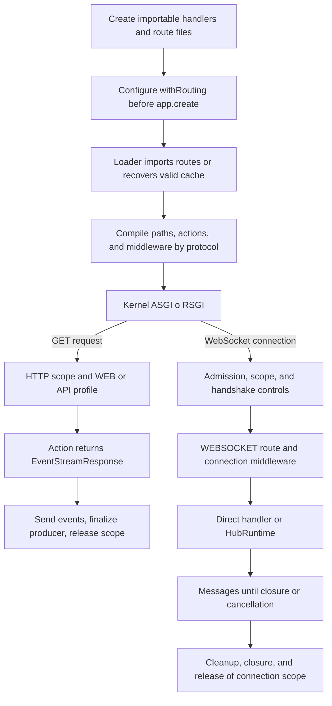

A URL identifies an endpoint, but its registration determines the exchange. `Route.websocket()` receives a messaging connection, `Route.hub()` hands it to the Realtime runtime, and `Route.get()` can return an SSE response.

This chapter creates three small endpoints to check the full registration process. Then continue with the [room chat](/en/realtime/chat), [WebSocket handler](/en/realtime/websocket), or [SSE progress](/en/realtime/streaming-and-sse) guides.

## Generating sockets and hubs with the CLI

From the project root, run the generator for the component you need:

```bash
python -B reactor make:realtime-socket chat
python -B reactor make:realtime-hub chat
```

The direct command equivalents are:

```bash
orionis make:realtime-socket chat
orionis make:realtime-hub chat
```

These are alternative ways to create each component; you do not need to run both forms of the same command.

| Generator | Default result for `chat` |
| --- | --- |
| `make:realtime-socket` | Class `ChatSocket` in `app/realtime/sockets/chat_socket.py`. |
| `make:realtime-hub` | Class `ChatHub` in `app/realtime/hubs/chat_hub.py`. |

Both accept one required argument, `name`, with no default. `-h` or `--help` displays help. There are no generator-specific options to force overwriting or change the directory: destinations use the configured `app_realtime_sockets` and `app_realtime_hubs` paths.

The generated socket is an invokable class whose `__call__()` accepts the connection, receives text, and echoes it. The hub extends `Hub` and contains a `@remote echo(message: str) -> str` method. Choosing the name `chat` does not add rooms, history, or broadcasts; the [complete chat](/en/realtime/chat) builds that logic on the generated hub.

### Names and existing files

| Name | Behavior |
| --- | --- |
| `chat` | Adds the `Socket` or `Hub` suffix to the class and `_socket` or `_hub` to the file. |
| `chat_socket.py` or `chat_hub.py` | Recognizes the matching suffix without duplicating it; the generated file keeps the `.py` extension. |
| `rooms/chat` | Creates a `rooms` subdirectory inside the generator's destination. Windows separators are also accepted. |
| `ChatSocket` or `ChatHub` | Preserves those class names, but generates `chatsocket.py` or `chathub.py`: CamelCase is not split into words. |

Segments accept ASCII letters, digits, and underscores, starting with a letter. Directories are lowercased; underscores separate class-name words. Absolute paths, empty segments, `.` and `..` are rejected.

The generator creates the directories it needs. If the destination file already exists, it reports an error and preserves its contents. It does not register routes, modify `bootstrap/app.py`, or start a server: afterward, add `Route.websocket(...)` or `Route.hub(...)` and register the corresponding file.

The [WebSocket](/en/realtime/websocket#generating-a-socket-with-the-cli) and [hub](/en/realtime/hubs-and-methods#generating-a-hub-with-the-cli) guides show the templates and their registration.

## Preparing the files

From your project root, create the application files shown and keep any that already exist:

```text
app/
├── http/controllers/live_demo_controller.py
└── realtime/
    └── status_hub.py
routes/
├── api.py
├── web.py
└── websocket.py
bootstrap/app.py
```

Handlers must belong to importable modules: the router retains their references for compilation and cache recovery. Avoid lambdas or local functions as registered actions.

### Controller for WebSocket and SSE

Save `app/http/controllers/live_demo_controller.py`:

```python
import asyncio
import json
from collections.abc import AsyncIterator

from orionis.http import (
    EventStreamResponse,
    ServerSentEvent,
    WebSocket,
    WebSocketDisconnected,
    response,
)
from orionis.http.base import BaseController


class LiveDemoController(BaseController):
    async def socket(self, socket: WebSocket, channel: str) -> None:
        await socket.accept()
        try:
            while True:
                message = await socket.receiveText()
                await socket.sendText(f"{channel}: {message}")
        except WebSocketDisconnected:
            return
        finally:
            await socket.close()

    async def progress(self, job_id: int) -> EventStreamResponse:
        async def events() -> AsyncIterator[ServerSentEvent]:
            for step in range(1, 4):
                await asyncio.sleep(1)
                yield ServerSentEvent(
                    data=json.dumps({"job_id": job_id, "step": step}),
                    event="progress",
                    id=str(step),
                )

            yield ServerSentEvent(data="{}", event="done")

        return response.eventStream(events())
```

`socket()` keeps the connection alive until reading ends and returns `None`. `progress()` returns a response whose generator is consumed during delivery; its pauses do not block the event loop. Progress is simulated per request, not a job queue or persistent record.

### Query hub

Save `app/realtime/status_hub.py`:

```python
from orionis.realtime import Hub, remote


class StatusHub(Hub):
    @remote
    async def where(self) -> dict[str, str]:
        channel = self.context.socket.routeParams()["channel"]
        return {
            "channel": channel,
            "connection_id": self.context.connection_id,
        }
```

The client can invoke `where` after receiving `ready`. `channel` comes from the connection URL; it is not an argument that must be repeated in the RPC message.

## Registering the routes

Always import the facade from `orionis.support.facades`. Add to `routes/websocket.py`:

```python
from app.http.controllers.live_demo_controller import LiveDemoController
from app.realtime.status_hub import StatusHub
from orionis.support.facades import Route

Route.group(
    prefix="/live",
    routes=[
        Route.websocket(
            "/socket/{channel:slug}",
            [LiveDemoController, "socket"],
        ).name("live.socket"),
        Route.hub(
            "/hubs/{channel:slug}",
            StatusHub,
        ).name("live.hub"),
    ],
)
```

The group applies its prefix to both registrations. Their URLs are `/live/socket/lobby` and `/live/hubs/lobby`; the filename does not add `/websocket`.

Add to `routes/api.py`:

```python
from app.http.controllers.live_demo_controller import LiveDemoController
from orionis.support.facades import Route

Route.get(
    "/live/jobs/{job_id:int}/events",
    [LiveDemoController, "progress"],
).name("live.progress")
```

The SSE URL is `/live/jobs/12/events`. The API file does not automatically add `/api` either. Add a prefix with `Route.group(prefix="/api", ...)` if you want one.

`routes/web.py` can continue to contain your application pages. If you need to create it, start with `from orionis.support.facades import Route` and add its registrations. The [chat](/en/realtime/chat) HTML page shows a complete use.

## Configuring loading in bootstrap/app.py

Modify the **existing** `app.withRouting(...)` call before `app.create()`. This fragment shows the three files used in this walkthrough:

```python
app.withRouting(
    api="routes/api.py",
    web="routes/web.py",
    websocket="routes/websocket.py",
    # Keep existing console, ai and health entries here.
)
```

Keep your bootstrap's other arguments, including `console`, `ai`, and `health` when configured. A second `withRouting()` call replaces the file configuration; it does not append entries to the previous call.

Registered files must exist. To declare routes, import `Route` from `orionis.support.facades`. Creating a class or file without registering its route file does not publish the endpoint.

`websocket` also accepts a list. To separate connections and hubs, prepare:

```python
websocket_files = [
    "routes/websocket.py",
    "routes/realtime.py",
]
```

Use `websocket=websocket_files` in the same call. Create both files before startup and avoid registering the same route twice.

### Flow associated with registration

| Registration | Pipeline |
| --- | --- |
| HTTP in `routes/web.py` | WEB profile: session, CSRF, and session authentication context, plus the HTTP pipeline and application/route middleware. |
| HTTP in `routes/api.py` | API profile without a WEB session; resolves token authentication context and runs the HTTP pipeline. |
| `Route.websocket` or `Route.hub` | Shared handshake controls, admission/origin checks, and explicit WebSocket middleware. |

Native profiles do not require an identity for every endpoint by themselves. Apply your application's access restrictions.

A file is a loading unit. The registration determines the protocol: a WebSocket route remains WebSocket even if declared in a registered WEB file. The dedicated `websocket` file keeps its organization clear.

## Parameters: URL, message, and invocation

All three flows support the same path converters:

| Converter | Example | Resolved value |
| --- | --- | --- |
| `str`, implicit | `/live/{channel}` or `/live/{channel:str}` | A nonempty segment without `/`; yields `str`. |
| `slug` | `/live/{channel:slug}` | Lowercase ASCII letters, digits, and hyphens; yields `str`. |
| `int` | `/jobs/{job_id:int}` | Unsigned digits; yields `int`. |
| `uuid` | `/rooms/{room_id:uuid}` | Hyphenated hexadecimal UUID; yields `uuid.UUID`. |

An incompatible path does not reach that route's handler. Parameter names in an HTTP or WebSocket action must match the registration: the kernel passes `job_id` or `channel` when invoking it through the container.

| Data | Access |
| --- | --- |
| WebSocket path | Named action parameter or `socket.routeParams()`. |
| Hub path | `self.context.socket.routeParams()`; not added to each remote signature. |
| SSE path | Named HTTP controller parameter; also available through its `Request`. |
| WebSocket message | Explicit reading through `receiveText()`, `receiveBytes()`, or `receiveJson()`. |
| Realtime arguments | `invoke` fields `args` and `kwargs`, validated against the remote method. |

Injecting `WebSocket` into an action and validating a message are different operations. Do not declare a schema expecting the kernel to populate it automatically from the next socket message; the [WebSocket guide](/en/realtime/websocket) shows explicit validation.

Groups support prefixes and nested groups. Use `WebSocketMiddleware` classes for connections and hubs, and `BaseMiddleware` for HTTP/SSE. The compiler rejects middleware from an incompatible protocol. The complete [socket](/en/realtime/websocket) and [HTTP routing](/en/http/routing) examples develop this composition.

## From files to execution



Rejections can end the flow before the action. On WebSocket, they occur during the handshake or by closing the connection; they do not generate the ordinary HTTP HTML exception page.

A `Hub` also has invocation scopes. Do not store user state in Hub attributes expecting the instance to be reused; see its [lifecycle](/en/realtime/hubs-and-methods). An SSE response retains the HTTP scope during delivery and cleanup, not only during the controller method.

## Starting and checking

From the project root, use either alternative:

```bash
orionis serve
```

```bash
uv run python -B reactor serve
```

The CLI selects RSGI by default; `--interface asgi` selects ASGI. Use the URL printed in the console; these examples assume `http://localhost:8000`.

Review registrations using either form:

```bash
orionis route:list
```

```bash
python -B reactor route:list
```

The table should include `WEBSOCKET /live/socket/{channel:slug}`, `WEBSOCKET /live/hubs/{channel:slug}`, and `GET /live/jobs/{job_id:int}/events`. `WEBSOCKET` is an internal dispatch key, not a verb to send through `fetch`.

### Checking SSE

From a terminal:

```bash
curl -N "http://localhost:8000/live/jobs/12/events"
```

You receive three `progress` events with `job_id` equal to `12` and `step` from `1` to `3`, followed by `done`. The stream then ends. The [EventSource client](/en/realtime/streaming-and-sse) closes its subscription upon receiving that event.

### Checking WebSocket

From the console of a page served by the same application:

```javascript
const scheme = location.protocol === "https:" ? "wss:" : "ws:";
const socket = new WebSocket(
    scheme + "//" + location.host + "/live/socket/lobby"
);

socket.addEventListener("open", () => socket.send("Hello"));
socket.addEventListener("message", (event) => {
    console.log(event.data); // lobby: Hello
    socket.close();
});
socket.addEventListener("error", () => {
    console.error("The WebSocket connection failed.");
});
```

### Checking the Hub

In the same console, with a separate connection:

```javascript
const hubScheme = location.protocol === "https:" ? "wss:" : "ws:";
const hubSocket = new WebSocket(
    hubScheme + "//" + location.host + "/live/hubs/lobby"
);

hubSocket.addEventListener("message", (event) => {
    const message = JSON.parse(event.data);

    if (message.type === "ready") {
        hubSocket.send(JSON.stringify({
            type: "invoke",
            id: "where-1",
            target: "where",
            args: [],
            kwargs: {},
        }));
    } else if (message.type === "completion" && message.id === "where-1") {
        console.log(message.result ?? message.error);
        hubSocket.close();
    }
});
hubSocket.addEventListener("error", () => {
    console.error("The Realtime connection failed.");
});
```

The result contains `channel: "lobby"` and the generated connection ID. The method uses the path and does not receive `channel` in `args`. The [complete client](/en/realtime/protocol-and-streaming) adds pending-operation and disconnection management.

## Restarting and troubleshooting

When modifying routes or configuration, apply the change to the running process. With compiled bootstrap configuration, consider its configured invalidation; where applicable, clear caches with `orionis optimize:clear` or `python -B reactor optimize:clear` and restart the server.

If an endpoint is missing, check its file in `withRouting`, its facade import, and `route:list`. If a WebSocket is rejected, also check origin, capacity, and socket middleware. A GET route on the same path does not replace the connection registration.

To check the chat in two tabs, follow its [single-worker command](/en/realtime/chat). The `serve` CLI uses one worker on Windows and several according to CPU count on Unix; the default Realtime manager does not share connections between those processes.
