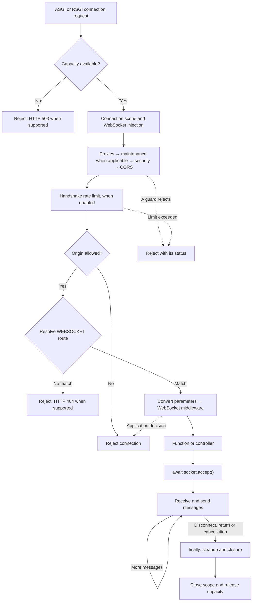

A WebSocket keeps a connection open so that client and server can both send messages. In Orionis, `Route.websocket()` passes that connection to a function or controller, which decides when to accept it, how to process messages and when to finish.

This API provides the transport: text, bytes and JSON. For remote calls with correlated results, events and group broadcasts, use [Realtime and its hubs](/en/realtime). The [complete chat example](/en/realtime/chat) connects several clients. Here we will build an endpoint that acknowledges messages **only to the connection that sent them**.

## Register the file and route

Create `routes/websocket.py` with `from orionis.support.facades import Route` if it does not exist yet. Include the `websocket` argument in the existing `app.withRouting()` call in `bootstrap/app.py`:

```python
app.withRouting(
    api="routes/api.py",
    web="routes/web.py",
    websocket="routes/websocket.py",
    health="/up",
)
```

The example assumes those API and WEB files exist. Keep any `ai`, `console` and other files already used by your application: edit its current call. Register this configuration before `app.create()`.

Registering the file does not prefix URLs. Write `/ws` explicitly if you want that prefix. HTTP and WebSocket routes resolve separately; `Route.get("/ws/chat", ...)` does not replace `Route.websocket("/ws/chat", ...)`.

### Generating a socket with the CLI

Run either alternative from the project root:

```bash
python -B reactor make:realtime-socket chat
```

```bash
orionis make:realtime-socket chat
```

`name` is the only argument and is required: here its value is `chat`. With the default application paths, the generator creates `app/realtime/sockets/chat_socket.py` containing the `ChatSocket` class and this code:

```python
from orionis.http import WebSocket, WebSocketDisconnected

class ChatSocket:
    """Handle a realtime WebSocket connection."""

    async def __call__(self, socket: WebSocket) -> None:
        """
        Accept the connection and echo incoming text messages.

        Parameters
        ----------
        socket : WebSocket
            Connection supplied by the WebSocket kernel.

        Returns
        -------
        None
            Complete the handler when the peer disconnects.
        """
        try:
            await socket.accept()
            while True:
                message = await socket.receiveText()
                await socket.sendText(message)
        except WebSocketDisconnected:
            return
        finally:
            await socket.close()
```

This is an invokable class: `__call__` receives the injected `WebSocket`, accepts the connection and echoes each text message to the same client. It catches disconnection and closes in `finally`; other errors propagate. It does not need to extend `BaseController` or return an HTTP response.

The generator creates missing directories and preserves existing files: if the destination exists, it reports an error without overwriting it. There is no `--force` or other command-specific flag; see `python -B reactor make:realtime-socket --help` or `orionis make:realtime-socket --help`. The shared chapter explains [generator names and subdirectories](/en/realtime/routing-and-lifecycle).

### Associate the socket with a route

Generation does not modify routes or start the server. Add this registration to `routes/websocket.py`:

```python
from app.realtime.sockets.chat_socket import ChatSocket
from orionis.support.facades import Route

Route.websocket("/ws/chat", ChatSocket)
```

`chat` is the generated component's name; this echo does not add rooms, history or broadcasting to other clients. The [chat with rooms](/en/realtime/chat) builds those operations through a hub.

Run either alternative from the project root:

```bash
orionis serve
```

```bash
python -B reactor serve
```

Open a page served by that application and run this in its browser console:

```javascript
const scheme = location.protocol === "https:" ? "wss:" : "ws:";
const echoSocket = new WebSocket(scheme + "//" + location.host + "/ws/chat");

echoSocket.addEventListener("open", () => echoSocket.send("Hello Orionis"));
echoSocket.addEventListener("message", (event) => console.log(event.data));
echoSocket.addEventListener("close", (event) => console.log("Closed:", event.code));
echoSocket.addEventListener("error", () => console.error("Connection failed"));

// When finished testing: echoSocket.close();
```

The received message will be `Hello Orionis`. `location.host` uses the current page's host and port. When testing from another application, configure the server URL explicitly and allow that origin; see the origin policy below.

## Connection lifecycle



Acceptance is explicit: before `accept()` you can reject the handshake; afterwards the WebSocket closing protocol applies. The handler remains active during the connection and must return `None`, without returning a `Response`, dictionary or schema as an HTTP response.

The kernel closes the connection when the handler finishes and releases capacity even on failure. Its scope lasts for the connection; a basic WebSocket does not create a new scope per message.

## Parameters, controllers and dependencies

The route supports the same four native converters as [HTTP routes](/en/http/routing):

| Declaration | Received value |
| --- | --- |
| `{name}` or `{name:str}` | `str`: nonempty segment without `/`. |
| `{room:slug}` | `str`: lowercase ASCII letters, digits and hyphens. |
| `{room_id:int}` | `int`: unsigned digits; no negative or decimal numbers. |
| `{connection_id:uuid}` | `uuid.UUID`: hexadecimal UUID in `8-4-4-4-12` format. |

The handler argument's name matches the route parameter. Declare `socket: WebSocket` to receive the connection through injection; the container also resolves constructor and action dependencies.

Besides an importable function, `[Controller, "method"]` and an invokable class with `__call__` are supported. Do not pass an instance, an already bound method or a lambda. Keep functions and classes at module level so they can be imported at boot.

### Constructor and action injection

Services can be received both in `__init__` and in the action handling the connection. Create `app/services/socket_dependencies.py` with two concrete services:

```python
from time import perf_counter


class MessageFormatter:
    def format(self, room: str, text: str) -> str:
        return f"[{room}] {text.strip()}"


class ConnectionTimer:
    def __init__(self) -> None:
        self._started = perf_counter()

    def elapsedMs(self) -> float:
        return round((perf_counter() - self._started) * 1000, 2)
```

In `app/http/controllers/dependency_socket_controller.py`, the formatter is received through the constructor and the timer through the method:

```python
from app.services.socket_dependencies import ConnectionTimer, MessageFormatter
from orionis.http import WebSocket, WebSocketDisconnected


class DependencySocketController:
    def __init__(self, formatter: MessageFormatter) -> None:
        self._formatter = formatter

    async def __call__(
        self,
        socket: WebSocket,
        room: str,
        timer: ConnectionTimer,
    ) -> None:
        await socket.accept()
        try:
            while True:
                text = await socket.receiveText()
                await socket.sendJson({
                    "room": room,
                    "text": self._formatter.format(room, text),
                    "elapsed_ms": timer.elapsedMs(),
                })
        except WebSocketDisconnected:
            return
        finally:
            await socket.close()
```

Register the controller in `routes/websocket.py`:

```python
from app.http.controllers.dependency_socket_controller import DependencySocketController
from orionis.support.facades import Route

Route.websocket("/ws/dependencies/{room:slug}", DependencySocketController)
```

The equivalent explicit form is `Route.websocket("/ws/dependencies/{room:slug}", [DependencySocketController, "__call__"])`. If you name the action `listen` instead of `__call__`, register `[DependencySocketController, "listen"]`. The container resolves that method's arguments in the same way; registering the class alone requires `__call__`.

From a page served by the same application, you can check the exchange with:

```javascript
const url = new URL("/ws/dependencies/general", window.location.href);
url.protocol = url.protocol === "https:" ? "wss:" : "ws:";
const socket = new WebSocket(url);

socket.addEventListener("open", () => socket.send("  Hello  "));
socket.addEventListener("message", (event) => {
  console.log(JSON.parse(event.data));
  // { room: "general", text: "[general] Hello", elapsed_ms: ... }
  socket.close(1000);
});
socket.addEventListener("error", () => console.error("Connection failed"));
```

The framework builds the controller when dispatching the connection and then invokes its action through the container. `MessageFormatter` and `ConnectionTimer` are concrete classes without external configuration: their annotations allow automatic construction without registering a provider. Abstract contracts or services requiring configuration need their corresponding [container](/en/application/container) registrations.

`socket` comes from the active scope and `room` from the converted URL parameters, matched by name. Route parameters are supplied to the action, **not the constructor**. The method is invoked once per connection; the timer retains its initial value throughout the loop. An annotation does not make an automatically built class shared: reuse depends on its registered container lifetime.

### Function injection

A route function can also receive services through its parameters. For example, create `app/realtime/socket_status.py`:

```python
from app.services.socket_dependencies import ConnectionTimer
from orionis.http import WebSocket


async def dependency_status(socket: WebSocket, timer: ConnectionTimer) -> None:
    await socket.accept()
    try:
        await socket.sendJson({"elapsed_ms": timer.elapsedMs()})
    finally:
        await socket.close()
```

Add it to `routes/websocket.py`:

```python
from app.realtime.socket_status import dependency_status
from orionis.support.facades import Route

Route.websocket("/ws/dependency-status", dependency_status)
```

When connecting to `/ws/dependency-status`, the client receives a JSON object containing `elapsed_ms` and the connection ends. The function has no constructor; its parameters are resolved when Orionis invokes it.

### Parameters and message validation

The next example uses an invokable controller. First create `app/http/schemas/socket_message.py`:

```python
from orionis.schemas import Schema
from orionis.schemas.constraints import MaxLength, MinLength
from orionis.schemas.fields import Field


class SocketMessage(Schema):
    text: Field[str, MinLength(1), MaxLength(500)]
```

In `app/http/controllers/message_socket_controller.py`:

```python
import msgspec

from app.http.schemas.socket_message import SocketMessage
from orionis.http import WebSocket, WebSocketDisconnected
from orionis.http.base import BaseController
from orionis.schemas.exceptions.validation import ValidationException
from orionis.schemas.validator import Schema as Validator


class MessageSocketController(BaseController):
    async def __call__(self, socket: WebSocket, room: str) -> None:
        await socket.accept()
        try:
            await socket.sendJson({"event": "ready", "room": room})

            while True:
                try:
                    raw = await socket.receiveJson()
                except msgspec.DecodeError:
                    await socket.sendJson({
                        "event": "error",
                        "code": "invalid_json",
                    })
                    continue

                try:
                    message = await Validator.validate(raw, SocketMessage)
                except ValidationException as error:
                    await socket.sendJson({
                        "event": "error",
                        "code": "validation_error",
                        "errors": error.errors,
                    })
                    continue

                await socket.sendJson({
                    "event": "received",
                    "room": room,
                    "text": message.text,
                })
        except WebSocketDisconnected:
            return
        finally:
            await socket.close()
```

Add the registration to `routes/websocket.py` alongside the echo route:

```python
from app.http.controllers.message_socket_controller import MessageSocketController
from orionis.support.facades import Route

Route.websocket("/ws/rooms/{room:slug}", MessageSocketController)
```

`/ws/rooms/general` injects `room="general"`. The equivalent explicit action form is `Route.websocket("/ws/rooms/{room:slug}", [MessageSocketController, "__call__"])`; choose one declaration for that path.

The client sends `{"text": "Hello"}`. The server responds with `{"event": "received", "room": "general", "text": "Hello"}`. The room name identifies the endpoint, but this example does not store messages or connect participants to each other. For broadcasts to other room members, continue with [Realtime groups and chat](/en/realtime/chat).

### Validate each message

`receiveJson()` decodes JSON without requiring an object or a business format. The example explicitly passes its result to `await Validator.validate(raw, SocketMessage)` and sends its own error event when validation fails.

`Schema` is the declarative base; `Validator` is an alias for the asynchronous utility here. Do not simply declare `payload: SocketMessage` as a handler argument expecting it to read the next frame: HTTP schema injection obtains the `Request` body, not messages from this connection. See [schemas in HTTP, MCP and Realtime](/en/validation/integrations).

The example's `event`/`code` format is an application decision. A basic WebSocket does not create HTTP `422` responses per message or automatically include a hub's RPC protocol.

## JavaScript client with a form

Create `resources/views/socket-demo.html` with the following HTML. Below those elements, place the JavaScript block inside `<script type="module">...</script>`. The script connects to the previous controller and displays text through `textContent`:

```html
<form id="message-form">
    <label for="message-text">Message</label>
    <input id="message-text" maxlength="500" required>
    <button id="message-send" type="submit" disabled>Send</button>
</form>
<p id="connection-status" role="status">Connecting…</p>
<ul id="message-log"></ul>
<button id="connection-close" type="button">Disconnect</button>
```

```javascript
const form = document.querySelector("#message-form");
const input = document.querySelector("#message-text");
const sendButton = document.querySelector("#message-send");
const status = document.querySelector("#connection-status");
const log = document.querySelector("#message-log");
const closeButton = document.querySelector("#connection-close");

const scheme = location.protocol === "https:" ? "wss:" : "ws:";
const room = "general";
const socket = new WebSocket(
    scheme + "//" + location.host + "/ws/rooms/" + encodeURIComponent(room)
);

function appendMessage(text) {
    const item = document.createElement("li");
    item.textContent = text;
    log.append(item);
}

socket.addEventListener("open", () => {
    status.textContent = "Connected";
    sendButton.disabled = false;
});

socket.addEventListener("message", (event) => {
    const message = JSON.parse(event.data);

    if (message.event === "ready") {
        appendMessage("Room: " + message.room);
    } else if (message.event === "received") {
        appendMessage("Acknowledged: " + message.text);
    } else if (message.event === "error") {
        appendMessage("Error: " + message.code);
        if (message.errors) {
            appendMessage(JSON.stringify(message.errors));
        }
    }
});

form.addEventListener("submit", (event) => {
    event.preventDefault();
    if (socket.readyState !== WebSocket.OPEN) return;

    socket.send(JSON.stringify({ text: input.value }));
    input.value = "";
});

socket.addEventListener("close", (event) => {
    status.textContent = "Disconnected (" + event.code + ")";
    sendButton.disabled = true;
});

socket.addEventListener("error", () => {
    status.textContent = "The connection could not be maintained";
});

closeButton.addEventListener("click", () => socket.close());
window.addEventListener("pagehide", () => socket.close());
```

Register the page in the configured WEB route file, normally `routes/web.py`:

```python
from orionis.support.facades import Route

Route.view("/socket-demo", "socket-demo")
```

With the server running, open `http://localhost:8000/socket-demo`, or the address and port shown in your console. The browser loads the interface over HTTP and separately opens the `/ws/rooms/general` connection.

An empty message sent by another client produces `validation_error`; incomplete JSON produces `invalid_json`. The controller keeps the connection open for the next message. The form limit helps the interface while the schema validates the actual received data.

This client does not automatically reconnect or resend messages. If you add reconnection, create a new `WebSocket` and decide which operations can be repeated; a new connection does not itself recover previous messages.

## Receive and send messages

| Asynchronous method | Behavior |
| --- | --- |
| `receive()` | Returns a text, bytes or disconnect `WebSocketMessage`. |
| `receiveText()` | Returns `str`; a binary message raises `TypeError`. |
| `receiveBytes()` | Returns `bytes`; a text message raises `TypeError`. |
| `receiveJson()` | Decodes JSON from text or bytes; invalid JSON raises `msgspec.DecodeError`. |
| `send(data)` | Sends only `str` or `bytes`. |
| `sendText(text)` | Sends only `str`. |
| `sendBytes(data)` | Sends only `bytes`. |
| `sendJson(value)` | Encodes with `msgspec` and sends a JSON text message. |

`receive()` delivers disconnection as a message once; the specialized receive methods translate it to `WebSocketDisconnected`. Further operations on a closed connection also raise that exception.

To handle several types without mixing reads, use one consumer:

```python
from orionis.http import WebSocket, WebSocketDisconnected


async def mixed_echo(socket: WebSocket) -> None:
    await socket.accept()
    try:
        async for message in socket:
            if message.isText():
                await socket.sendText(message.text)
            elif message.isBytes():
                await socket.sendBytes(message.bytes)
    except WebSocketDisconnected:
        return
    finally:
        await socket.close()
```

Asynchronous iteration ends when disconnection is detected. Messages are immutable and also expose `type`, `data`, `code` and `reason`. `message.text` and `message.bytes` require the correct type.

Only one `receive` can be active; simultaneous reads raise `RuntimeError`. Sends are serialized and each `await` waits for the transport operation. This API does not add a broadcast queue, persistence or a guarantee that the client has processed the message.

## Connection middleware and groups

A WebSocket middleware extends `WebSocketMiddleware` and returns `None`. Its `WebSocketNext` continuation takes no arguments and can be called at most once. Code before `await call_next()` runs before the handler; code afterwards runs when it finishes, normally at the end of the connection rather than after each message.

Middleware also support **constructor injection**. The kernel builds them through the container within the connection scope, but calls `handle(socket, call_next)` directly: do not add service parameters to `handle()`. For example, create `app/http/middleware/connection_duration_middleware.py` using the preceding service:

```python
import logging

from app.services.socket_dependencies import ConnectionTimer
from orionis.http import WebSocket, WebSocketMiddleware, WebSocketNext

logger = logging.getLogger(__name__)


class ConnectionDurationMiddleware(WebSocketMiddleware):
    def __init__(self, timer: ConnectionTimer) -> None:
        self._timer = timer

    async def handle(
        self,
        socket: WebSocket,
        call_next: WebSocketNext,
    ) -> None:
        try:
            await call_next()
        finally:
            logger.info("WebSocket duration: %s ms", self._timer.elapsedMs())
```

To use it, replace the dependency example's route registration with:

```python
from app.http.controllers.dependency_socket_controller import DependencySocketController
from app.http.middleware.connection_duration_middleware import ConnectionDurationMiddleware
from orionis.support.facades import Route

Route.websocket(
    "/ws/dependencies/{room:slug}",
    DependencySocketController,
).middleware(ConnectionDurationMiddleware)
```

This middleware's timer is created while building the layer; the controller method's timer is a separate resolution. To share an instance between both, explicitly register that service with a scoped lifetime in the container. The `finally` block logs duration even when the next component ends with an exception or cancellation.

For example, create `app/http/middleware/room_socket_middleware.py` to limit room name length before acceptance:

```python
from orionis.http import WebSocket, WebSocketMiddleware, WebSocketNext


class RoomSocketMiddleware(WebSocketMiddleware):
    __slots__ = ()

    async def handle(
        self,
        socket: WebSocket,
        call_next: WebSocketNext,
    ) -> None:
        room = socket.routeParams()["room"]
        if len(room) > 30:
            await socket.reject(status_code=400)
            return

        socket.state.room = room
        await call_next()
```

To apply it only to the existing endpoint, replace its registration with:

```python
from app.http.controllers.message_socket_controller import MessageSocketController
from app.http.middleware.room_socket_middleware import RoomSocketMiddleware
from orionis.support.facades import Route

Route.websocket(
    "/ws/rooms/{room:slug}",
    MessageSocketController,
).middleware(RoomSocketMiddleware)
```

Groups are also supported. This replaces the preceding registration; do not declare both:

```python
from app.http.controllers.message_socket_controller import MessageSocketController
from app.http.middleware.room_socket_middleware import RoomSocketMiddleware
from orionis.support.facades import Route

Route.group(
    prefix="/ws",
    middleware=[RoomSocketMiddleware],
    routes=[
        Route.group(
            prefix="/rooms",
            routes=[
                Route.websocket("/{room:slug}", MessageSocketController),
            ],
        ),
    ],
)
```

The final path is `/ws/rooms/{room:slug}`. Parent group middleware precede child and route middleware; repeated classes run once. Group `without_middleware` and route `withOutMiddleware()` exclude classes from the final stack.

**The WebSocket flow does not run HTTP middleware registered through `app.withMiddleware()` or the automatic session, CSRF or token identity layers of WEB/API routes.** The compiler accepts only `WebSocketMiddleware` for these routes and builds them within the connection scope. The diagram's shared kernel guards still apply.

An allowed origin does not authenticate a user. If an endpoint requires identity or authorization, check them through connection logic before `accept()` and, where necessary, per operation. A browser may send cookies during the handshake, but this API does not automatically turn them into an authenticated session.

The [browser WebSocket constructor](https://websockets.spec.whatwg.org/#the-websocket-interface) takes a URL and optional subprotocols; it has no option to add arbitrary headers such as `Authorization`. Design credential delivery and verification around that client restriction.

## Metadata, acceptance and closure

| Access | Purpose |
| --- | --- |
| `socket.path` | Handshake path without the query string. |
| `socket.headers` | Handshake header collection. |
| `socket.routeParams()` | Converted parameter dictionary, also used for injection. |
| `socket.state` | Mutable attributes exclusive to this connection. |
| `socket.connectionState` | `CONNECTING`, `CONNECTED`, `CLOSING` or `CLOSED`. |
| `socket.accepted` | Whether the connection was accepted; retained after closure. |
| `socket.closed` | Whether the connection is terminal. |
| `socket.supportsCloseDetails` | Whether the transport can send custom close codes and reasons. |

`await socket.accept(subprotocol=None, headers=None)` accepts once. Application data cannot be sent or received before acceptance. `await socket.reject(status_code=403)` rejects before acceptance and permits HTTP statuses between `400` and `599`. The visible status depends on the transport.

`await socket.close()` is the portable closing method. Before acceptance it rejects the handshake; after acceptance it requests normal closure. Repeated calls after closure do nothing.

For a custom close, respect the transport's capability:

```python
from orionis.http import WebSocket


async def close_for_policy(socket: WebSocket) -> None:
    if socket.supportsCloseDetails:
        await socket.close(code=1008, reason="Policy violation")
    else:
        await socket.close()
```

`close()` permits valid standard closing codes or private codes between `3000` and `4999`. The reason cannot exceed `123` UTF-8 bytes. `1006` represents the absence of an observed normal close; it cannot be sent as a closing code.

## Configuration, origins and transport differences

`config/http.py` uses the `HTTPWebSocket` entity for its `websocket` property:

| Configuration | Bootstrap environment variable | Default |
| --- | --- | --- |
| `max_connections` | `WEBSOCKET_MAX_CONNECTIONS` | `128` per kernel/worker. |
| `max_message_size` | `WEBSOCKET_MAX_MESSAGE_SIZE` | `1048576` bytes: `1 MiB` per complete incoming message. |
| `allow_origins` | `CORS_ALLOW_ORIGINS` | Empty collection. |

Limits must be positive integers. Text message size is measured in UTF-8 bytes rather than characters. An oversized incoming message closes the connection and raises `WebSocketDisconnected` with logical code `1009`; the close the transport can send varies. This limit does not set outgoing message size.

The kernel allows a handshake without `Origin`, one from the same origin or one included in `allow_origins`; `"*"` allows every origin. The WebSocket comparison lowercases origins and removes the trailing slash. Same-origin access remains allowed when you add other origins to the list. This check does not use `CORS_ALLOW_ORIGIN_REGEX`.

For a frontend at `http://localhost:5173`, configure the entity explicitly in your HTTP configuration's `websocket` field:

```python
from orionis.foundation.config.http import HTTPWebSocket

socket_settings = HTTPWebSocket(
    max_connections=128,
    max_message_size=1024 * 1024,
    allow_origins=("http://localhost:5173",),
)
```

The `socket_settings` value must be assigned to `BootstrapHTTP.websocket` in place of its existing construction. Creating an isolated variable does not change the application. See [route files and lifecycle](/en/realtime/routing-and-lifecycle) for shared integration.

| Capability | ASGI | RSGI |
| --- | --- | --- |
| Text, bytes and JSON | Supported. | Supported. |
| `accept()` subprotocol | Must be offered by the client. | Unavailable; requesting it raises `NotImplementedError`. |
| Extra `accept()` headers | Require ASGI HTTP specification `2.1` or later. | Unavailable; requesting them raises `NotImplementedError`. |
| Rejection with a chosen HTTP status | Requires `websocket.http.response`; without it the server uses standard rejection. | The protocol allows a rejection status. |
| Custom close code/reason | Codes supported; reasons sent from ASGI HTTP `2.3`. | Normal closure without a reason only; use `close()`. |
| Client close details | Preserves details supplied by the server. | The adapter reports `1006` when these details are unavailable. |

Select the development interface with `orionis serve --interface asgi` or `python -B reactor serve --interface asgi`; use `rsgi` for the other alternative. Check server capabilities when relying on specific handshake options.

## Errors and cleanup

Disconnection can be observed while receiving or sending; handle `WebSocketDisconnected` and release resources in `finally`. Cancel and await tasks created by the handler: do not leave tasks reading a connection that has ended.

An unhandled error logs `WebSocket handler failed`, attempts to close an accepted connection with `1011` where supported or normal closure in RSGI, and propagates. This flow does not generate the [HTTP exception](/en/http/exceptions) HTML page or turn every exception into a JSON event; define application errors as in the example.

During shutdown, the kernel cancels active connection tasks and waits up to five seconds for cleanup. Preserve cooperative cancellation: do not catch `asyncio.CancelledError` to continue the loop.

Each worker maintains its own capacity and connections. To send events across workers or instances, see [Realtime groups and deployment](/en/realtime/groups-and-deployment); the WebSocket on this page does not provide distributed broadcasting or history.
