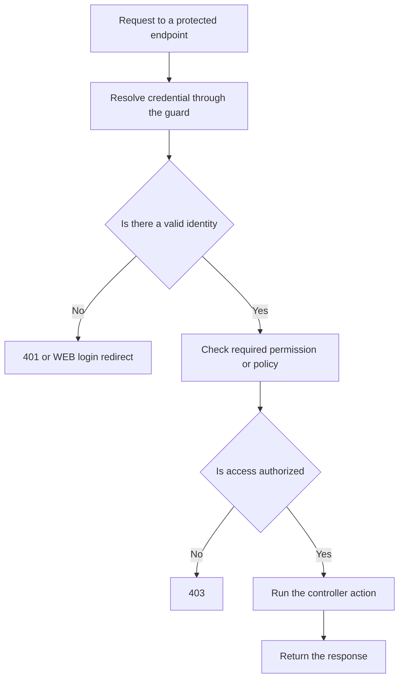

Orionis separates **authentication**, which identifies the user making a request, from **authorization**, which decides whether that user may perform an operation. A signed-in user may still lack permission to publish, manage accounts, or modify somebody else's resource.

The `Auth` facade and container contracts expose both mechanisms to controllers and services. Identity belongs to the request context; shared services consult that context when used.

## Choose an authentication flow

| Need | Native mechanism | First guide |
| --- | --- | --- |
| Sign in through a browser and submit forms | `session` guard, HTTP sessions, and CSRF. | [Session authentication](/en/security/authentication/identity-and-session) |
| Call an API from a client application or integration | `token` guard and personal credential sent as Bearer. | [Token authentication](/en/security/authentication/personal-access-tokens) |
| Recover an account or confirm its email | Password broker and registration/verification routes. | [Account recovery and verification](/en/security/authentication/account-recovery) |

Remember-me extends session login through an optional persistent credential. Token abilities restrict a credential's scope; roles, permissions, and policies determine its owner's authorization.

## Prepare an application

1. Configure the model and `config/auth.py` fields in [Configuration and guards](/en/security/authentication/configuration-and-guards).
2. Prepare the database and run the [project migrations](/en/database/migrations-and-seeders). Session, token, and role guides identify the tables each mechanism uses.
3. Use WEB routes for browser login and API routes for Bearer credentials.
4. Attach [access middleware](/en/security/authentication/middleware) to private routes.
5. Assign [roles and permissions](/en/security/authentication/authorization), or register [policies](/en/security/authentication/policies) for resource decisions.

The usual model is `app.models.user.User` with the `Authenticatable` and `Authorizable` concerns. The session guide includes its complete definition, account creation, and password hashing with the `Hash` facade.

## Inspect the current identity

Import the facade from `orionis.support.facades`. `Auth.check()`, `guest()`, `user()`, `identifier()`, and `context()` are synchronous operations.

Create `app/http/controllers/auth_status_controller.py`:

```python
from orionis.http import JSONResponse, response
from orionis.support.facades import Auth


class AuthStatusController:
    async def show(self) -> JSONResponse:
        return response.json({
            "authenticated": Auth.check(),
            "guest": Auth.guest(),
            "identifier": Auth.identifier(),
            "guard": Auth.context().guard,
        })
```

In `routes/api.py`, registered in the application's routing configuration:

```python
from app.http.controllers.auth_status_controller import AuthStatusController
from orionis.support.facades import Route

Route.get("/authentication/status", [AuthStatusController, "show"])
```

For a guest, `GET /authentication/status` returns:

```json
{
  "authenticated": false,
  "guest": true,
  "identifier": null,
  "guard": "token"
}
```

This route permits guests so it can report their state. In API, a valid token resolves its owner; session cookies belong to the WEB flow. Require a token before invoking the action by adding `AuthenticateTokenMiddleware` as shown in [Middleware](/en/security/authentication/middleware).

`Auth.user()` returns the authenticated model or `None`. Expose only the data a response needs. To declare the dependency explicitly, inject `IAuthManager` from `orionis.auth.contracts.manager`; the session guide includes constructor and method examples.

Operations that perform asynchronous work must be awaited, such as `await Auth.attempt(credentials)`, `await Auth.logout()`, `await Auth.can("reports.read")`, and `await Auth.authorizeResource("update", resource)`. Each guide identifies the corresponding signature.

## Authentication and authorization on a protected route



A **role** groups permissions, for example `editor`. A **permission** expresses a capability such as `reports.read`. A **policy** evaluates an ability against a class or specific row, for example whether a user owns a document.

Authentication does not automatically grant permissions. A capability declared on a token does not create privileges either: when a credential has restricted abilities, access must satisfy both the user's permissions and the credential's limits.

## Documentation roadmap

- [Configuration and guards](/en/security/authentication/configuration-and-guards): `config/auth.py` options and mechanism selection.
- [Session authentication](/en/security/authentication/identity-and-session): models, account creation, forms, login, logout, and remember-me.
- [Token authentication](/en/security/authentication/personal-access-tokens): issue, use, inspect, and revoke personal credentials.
- [Access middleware](/en/security/authentication/middleware): resolve identity, require authentication, and restrict routes or groups.
- [Roles and permissions](/en/security/authentication/authorization): create, assign, check, update, and revoke access.
- [Resource policies](/en/security/authentication/policies): register rules and authorize operations on specific objects.
- [Recovery and verification](/en/security/authentication/account-recovery): password reset and email verification.

[HTTP sessions](/en/http/sessions), [password hashing](/en/security/hashing), and [encryption](/en/security/encryption) have their own menu categories. [Responses](/en/http/responses) and [HTTP exceptions](/en/http/exceptions) cover the results and failures produced by these flows.
