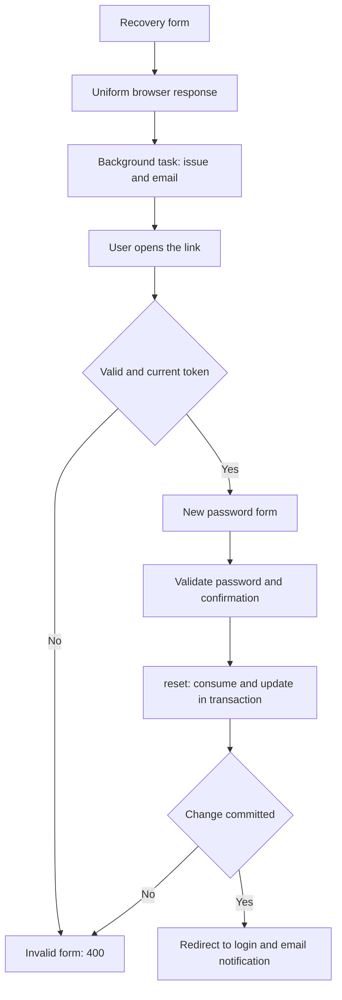

Recovery changes a password when the user can no longer sign in. Email verification confirms access to an account's address before activation. These are separate workflows: a recovery link is not a personal API token, and verifying an address does not automatically start a session.

Orionis includes routes, controllers, schemas and templates for these workflows. Use that integration or inject `PasswordBroker` into your own controllers. Persistent cookie-based sign-in is covered in [browser authentication](/en/security/authentication/identity-and-session).

## Prepare the application

Configure the database connection, the identity model in `config/auth.py` and [mail delivery](/en/services/mail). Recovery uses `email` and the password of the configured model; built-in registration and verification explicitly use `app.models.user.User`.

The project includes migrations for `users`, `personal_access_tokens` and `password_reset_tokens`. The latter creates one record per email address containing the token digest, user identifier, password fingerprint and issuance time. Apply pending migrations using either alternative:

```bash
orionis migrate
```

```bash
python -B reactor migrate
```

These commands apply all pending migrations on the configured connection. Registering routes does not create an account or configure mail delivery.

## Enable the built-in pages

Register this once in `routes/web.py`:

```python
from orionis.support.facades import Route

Route.auth()
```

The helper must run in the WEB routing context, which supplies sessions and CSRF protection. It registers ten routes:

| Method and URL | Action | Route name | Access |
| --- | --- | --- | --- |
| `GET /login` | `LoginController.index` | Unnamed. | Guests. |
| `POST /login` | `LoginController.login` | `login` | Guests. |
| `GET /sign-up` | `RegisterController.index` | Unnamed. | Guests. |
| `POST /sign-up` | `RegisterController.register` | `register` | Guests. |
| `GET /forgot-password` | `ForgotPasswordController.index` | Unnamed. | Guests. |
| `POST /forgot-password` | `ForgotPasswordController.sendResetLinkEmail` | `forgot-password` | Guests. |
| `GET /reset-password` | `ForgotPasswordController.showResetForm` | `password.reset` | Guests. |
| `POST /reset-password` | `ForgotPasswordController.resetPassword` | `password.update` | Guests. |
| `GET /verify-email` | `RegisterController.verifyEmail` | `verify-email` | Any visitor. |
| `POST /logout` | `LoginController.logout` | `logout` | Authenticated session. |

The first eight routes use `GuestMiddleware`; the last uses `AuthenticateSessionMiddleware`. Verification accepts visitors with or without a session so a link opened in an authenticated browser can still work. See [middleware](/en/security/authentication/middleware) for access behavior.

The project's template structure is:

```text
resources/views/
├── layouts/auth.html
├── auth/
│   ├── login.html
│   ├── register.html
│   ├── forgot-password.html
│   ├── reset-password.html
│   └── verify-email.html
└── emails/
    ├── reset-password.html
    └── verify-email.html
```

Keep or adapt these templates when using the included controllers. `Route.auth()` registers routes; it does not generate template files. POST forms must include ``.

## Password recovery workflow

1. The user opens `/forgot-password` and submits an address. `ForgotPasswordSchema` requires a valid email of at most 255 characters.
2. The controller returns a private redirect to the form with a uniform message: if a matching account exists, it will receive a link. Lookup and delivery run through `BackgroundTask` after the response.
3. `PasswordBroker.issue()` normalizes the address, looks up the identity and checks the issuance interval. When issuance is allowed, it stores a digest and returns the secret to delivery code.
4. The email renders `emails/reset-password.html` with `user_name`, `reset_url` and `expires_minutes`. Its link points to `/reset-password?email=…&token=…`, built from `request.baseUrl` with parameters encoded by `urlencode()`.
5. Opening the link checks the token without consuming it and displays `auth/reset-password.html`. An invalid link returns that view with status `400`, without retaining its email or token in the form.
6. The user submits email, token, password and confirmation. The controller checks the link again, validates `ResetPasswordSchema` and calls `broker.reset()`.
7. A successful change redirects to `/login` and sends a change notification in another background task. The user must sign in with the new password.



The flow applies `Cache-Control: no-store`, `Referrer-Policy: no-referrer` and `X-Robots-Tag: noindex, nofollow` to recovery responses. Password values are not saved as old form input. Password validation errors are shown without losing a link that is still valid.

`BackgroundTask` belongs to the response in the current process; it is not a durable queue. Configure and test the mail transport. Applications requiring persistent delivery retries must integrate that delivery strategy.

### PasswordBroker configuration

| `auth.passwords` option | Environment variable | Default |
| --- | --- | --- |
| `table` | `AUTH_PASSWORD_RESET_TABLE` | `password_reset_tokens` |
| `expiration` | `AUTH_PASSWORD_RESET_EXPIRATION` | `60` minutes. |
| `throttle` | `AUTH_PASSWORD_RESET_THROTTLE` | `60` seconds. |

`throttle` limits issuance per address using a persisted record; it is not a general HTTP request limit per IP. Replacing a token after that interval invalidates the previous one. Consumption does not delete the record or restart its issuance time: the timestamp remains to preserve that interval.

If the model uses a specific ORM connection, the broker uses that connection for recovery records and its transaction. Credential tables needed for revocation must be available there. See [guard configuration](/en/security/authentication/configuration-and-guards) for all options.

## Use PasswordBroker in your own controller

The container can construct `PasswordBroker` and inject it into a constructor or method. Its three operations are asynchronous:

| Method | Result and purpose |
| --- | --- |
| `issue(email)` | `(identity, plain_token)` when issued; `None` for an unknown identity or while issuance is throttled. It does not send mail itself. |
| `valid(email, token)` | `bool`; checks the link without consuming it. |
| `reset(email, token, password)` | Identity when the change commits; `None` when it cannot consume a valid, current token. The service handles hashing and persistence. |

This controller is a JSON alternative for applications retaining the `Route.auth()` pages and requesting links or completing resets from JavaScript. Create `app/http/controllers/account_recovery_controller.py`:

```python
from urllib.parse import urlencode

from orionis.auth.passwords.broker import PasswordBroker
from orionis.background.task import BackgroundTask
from orionis.http import JSONResponse, Request, response
from orionis.http.default.schemas.forgot_password import ForgotPasswordSchema
from orionis.http.default.schemas.reset_password import ResetPasswordSchema
from orionis.mail.entities.content import Content
from orionis.support.facades import Mail


class AccountRecoveryController:

    def __init__(self, broker: PasswordBroker) -> None:
        self.broker = broker

    async def requestLink(
        self,
        payload: ForgotPasswordSchema,
        request: Request,
    ) -> JSONResponse:
        return response.json(
            {"message": "If an account matches, a reset link will be sent."},
            status_code=202,
            headers={"Cache-Control": "no-store"},
            background=BackgroundTask(self.sendLink, payload.email, request.baseUrl),
        )

    async def sendLink(self, email: str, base_url: str) -> None:
        issued = await self.broker.issue(email)
        if issued is None:
            return
        user, token = issued
        reset_url = base_url.rstrip("/") + "/reset-password?" + urlencode({
            "email": user.email,
            "token": token,
        })
        await Mail.to(user.email).subject("Reset your password").send(
            Content(
                view="emails.reset-password",
                data={
                    "user_name": getattr(user, "name", ""),
                    "reset_url": reset_url,
                    "expires_minutes": self.broker.settings.expiration,
                },
            ),
        )

    async def check(
        self,
        request: Request,
        broker: PasswordBroker,
    ) -> JSONResponse:
        email = request.queryParams.get("email", "")
        token = request.queryParams.get("token", "")
        valid = (
            isinstance(email, str)
            and len(email) <= 255
            and isinstance(token, str)
            and len(token) == 43
            and await broker.valid(email, token)
        )
        return response.json(
            {"valid": valid},
            headers={"Cache-Control": "no-store", "Referrer-Policy": "no-referrer"},
        )

    async def reset(self, payload: ResetPasswordSchema) -> JSONResponse:
        user = await self.broker.reset(payload.email, payload.token, payload.password)
        if user is None:
            return response.json(
                {"message": "Invalid or expired reset link"},
                status_code=400,
                headers={"Cache-Control": "no-store"},
            )
        return response.json(
            {"message": "Password updated. Sign in with your new password."},
            headers={"Cache-Control": "no-store"},
        )
```

Add these routes to `routes/web.py` alongside the helper providing HTML pages:

```python
from app.http.controllers.account_recovery_controller import AccountRecoveryController
from orionis.auth.middleware import GuestMiddleware
from orionis.support.facades import Route

Route.group(
    prefix="/account/password",
    middleware=GuestMiddleware,
    routes=[
        Route.post("/requests", [AccountRecoveryController, "requestLink"]),
        Route.get("/valid", [AccountRecoveryController, "check"]),
        Route.post("/reset", [AccountRecoveryController, "reset"]),
    ],
)
```

These are still WEB routes, retaining CSRF protection on POST requests. A JavaScript client must send `Accept: application/json` and the form's CSRF token, for example in `X-CSRF-Token`. Injected `ForgotPasswordSchema` and `ResetPasswordSchema` validate payloads before their actions run; see [validation](/en/validation) and [requests](/en/http/forms-and-uploads).

To complete the change, send this payload:

```json
{
  "email": "ada@example.com",
  "token": "REPLACE_WITH_THE_43_CHARACTER_RESET_TOKEN",
  "password": "NewPassword123!",
  "password_confirmation": "NewPassword123!"
}
```

Replace `token` with the link's secret; the example text is a placeholder rather than a valid token. The schema requires exactly 43 URL-safe characters, an 8-to-1024-character password containing uppercase, lowercase and a digit, and matching confirmation. The broker receives an already validated password: it does not enforce these rules itself.

This alternative returns JSON and uses the same broker; it does not itself send the post-change confirmation email sent by the default controller.

### How links are protected and consumed

The recovery secret uses `secrets.token_urlsafe(32)`, producing 43 characters. Only its SHA-256 digest is stored. The record also contains the identity identifier and a fingerprint of the stored password: changing that password invalidates an earlier link.

`valid()` does not reserve a token; another request may consume it afterward. `reset()` rechecks it and uses conditional writes in a transaction to:

1. Mark the token consumed by setting its stored value to `None`.
2. Update the password only if the identity and previous hash still match.
3. Clear `remember_token` when the model has that column.
4. Revoke personal access tokens if the identity implements `IAuthorizable`.

If updating the identity fails, the transaction does not commit consumption. A consumed, expired, replaced or tampered token, or one associated with another password, cannot change it again.

Existing sessions that saved the password fingerprint stop resolving the identity on their next request because the hash has changed. The broker does not iterate over or physically delete every session-store record. Resetting also creates no new session: the user signs in again.

## Email verification

The default `User` model includes the `MustVerifyEmail` marker. Registration uses it to require verification:

```python
from typing import ClassVar

from database.schemas.users_v1 import USERS_V1
from orionis.auth import Authenticatable, Authorizable, MustVerifyEmail
from orionis.orm import Model
from orionis.orm.schema.table import TableDefinition


class User(Model, Authenticatable, Authorizable, MustVerifyEmail):

    table_definition: TableDefinition = USERS_V1
    casts: ClassVar[dict[str, str]] = {
        "active": "bool",
        "email_verified_at": "datetime",
    }
    hidden: ClassVar[list[str]] = ["password", "remember_token"]
    fillable: ClassVar[list[str]] = ["name", "email", "password", "active"]
```

The marker does not add model columns or methods. `users` must contain `active` and `email_verified_at`, as in the project's table definition.

### From registration to activation

1. `POST /sign-up` validates input and stores the user with a password generated by `Hash.make()`.
2. If the object is `MustVerifyEmail`, it is created with `active=False`; after creation commits, a background task sends the email.
3. The message uses `emails/verify-email.html`, the `user_name` and `verification_url` variables, and a `/verify-email?id=…` link. The value encrypts `str(user.id)` using `Crypt` and the application key.
4. `GET /verify-email` decrypts the identifier, finds the user and renders `auth/verify-email.html` with one of these states:

| View state | Result |
| --- | --- |
| `verified` | Sets `active=True` and `email_verified_at` to the current time. |
| `already_verified` | The user already has a verification timestamp; the page reports that. |
| `invalid` | The value is missing, cannot be decrypted or no longer identifies an account. |

Activation enables normal session sign-in; the controller does not call `Auth.login()`. Without `MustVerifyEmail`, built-in registration does not send this email or force `active=False` for verification.

The link identifies an account using an encrypted value; it does not use the recovery table or configure a dedicated expiration. Changing the application key prevents older links from decrypting. If you need a validity period, controlled resending or verification tied to an address change, implement those rules in your controllers.

## Customize the controllers

`Route.auth()` allows independent replacement through `login_controller=`, `register_controller=` and `forgot_password_controller=`. Omitted components retain their defaults.

For example, a recovery controller can inherit the workflow and change its initial template without registering every route again. Create `app/http/controllers/recovery_pages_controller.py`:

```python
from orionis.http import HTMLResponse, response
from orionis.http.default.controllers.forgot_password_controller import ForgotPasswordController


class RecoveryPagesController(ForgotPasswordController):

    async def index(self) -> HTMLResponse:
        rendered = await response.view("account.recover")
        rendered.setHeader("Cache-Control", "no-store")
        rendered.setHeader("Referrer-Policy", "no-referrer")
        rendered.setHeader("X-Robots-Tag", "noindex, nofollow")
        return rendered
```

Replace the earlier `Route.auth()` call with:

```python
from app.http.controllers.recovery_pages_controller import RecoveryPagesController
from orionis.support.facades import Route

Route.auth(forgot_password_controller=RecoveryPagesController)
```

Create `resources/views/account/recover.html` with the corresponding form:

```jinja

Recover your account
Recover your account

  <form action="{{ route('forgot-password') }}" method="post">
    
    <label for="email">Email address</label>
    <input id="email" name="email" type="email" maxlength="255" required>
    <button type="submit">Send reset link</button>
  </form>

```

When replacing an entire controller, retain the actions expected by its routes: `index/login/logout`, `index/register/verifyEmail` or `index/sendResetLinkEmail/showResetForm/resetPassword`, respectively. Do not register `Route.auth()` alongside a second copy of those same routes.

Changing `auth.identity.model` does not change the `User` reference in the default registration controller. For another model or activation lifecycle, replace registration/verification and its templates as well. `MustVerifyEmail` marks that workflow; it is not general middleware protecting every API route. API credential issuance and revocation are covered in [token authentication](/en/security/authentication/personal-access-tokens).
