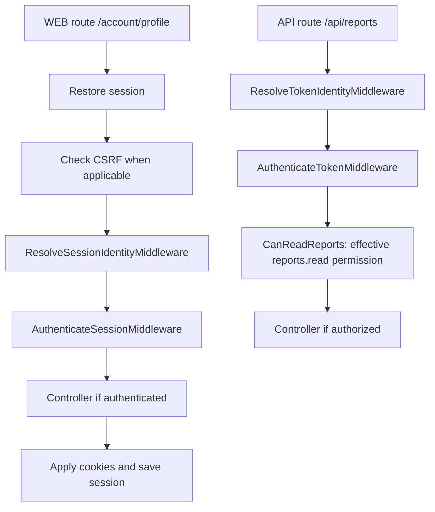

Authentication middleware resolves or requires an identity. Authorization middleware checks whether that identity may perform an operation. They run before the controller and can end a request with a redirect or error response.

Import classes from `orionis.auth.middleware` and register classes rather than parameterized instances. The general [HTTP middleware guide](/en/http/middleware-and-security) covers creation, global registration, and chaining; this page focuses on authentication components.

## Resolve identity and require authentication

For normal WEB routes, the kernel runs `StartSessionMiddleware`, `CSRFTokenMiddleware`, and `ResolveSessionIdentityMiddleware`. API uses `ResolveTokenIdentityMiddleware`. Resolving identity lets a guest continue: a route does not become private merely by belonging to `routes/web.py` or `routes/api.py`.

| Middleware | Behavior |
| --- | --- |
| `ResolveIdentityMiddleware` | Uses the selected or default guard and continues with an identity or guest. |
| `ResolveSessionIdentityMiddleware` | Resolves session and remember-me credentials; allows guests. The kernel adds it to WEB. |
| `ResolveTokenIdentityMiddleware` | Resolves the Bearer token; allows guests. The kernel adds it to API. |
| `AuthenticateMiddleware` | Requires identity using the context's guard or the default. |
| `AuthenticateSessionMiddleware` | Requires an identity from the `session` guard. |
| `AuthenticateTokenMiddleware` | Requires an identity from the `token` guard. |
| `GuestMiddleware` | Allows session guests and restricts login/registration pages to them. |

There is no need to repeat resolvers already supplied by the kernel. Use `Authenticate*` on private routes and `GuestMiddleware` on pages intended only for guests.

Identity context belongs to the request. Resolving the same guard again reuses its result; an authenticated request cannot replace it with another guard. Define endpoints in the appropriate WEB or API context and choose the matching middleware.

## Protect a browser route

Create `app/http/controllers/access_examples_controller.py`. Its actions are reused in the following examples:

```python
from orionis.http import JSONResponse, Response, response
from orionis.support.facades import Auth


class AccessExamplesController:
    async def profile(self) -> JSONResponse:
        return response.json({"user_id": Auth.identifier()})

    async def reports(self) -> JSONResponse:
        return response.json({"reports": ["Monthly report"]})

    async def guest_offer(self) -> Response:
        return response.text("Create an account or sign in.")
```

In `routes/web.py`:

```python
from app.http.controllers.access_examples_controller import AccessExamplesController
from orionis.auth.middleware import AuthenticateSessionMiddleware, GuestMiddleware
from orionis.support.facades import Route

Route.get(
    "/account/profile",
    [AccessExamplesController, "profile"],
).middleware(AuthenticateSessionMiddleware)

Route.get(
    "/guest-offer",
    [AccessExamplesController, "guest_offer"],
).middleware(GuestMiddleware)
```

With an authenticated session, `GET /account/profile` returns that request's identifier. A guest making a normal browser navigation receives `302` to `auth.session.redirect_to`, configured as `/login` in the project file. A client requesting JSON or making an AJAX request receives `401`. With `redirect_to=None`, the browser also receives `401`.

`GuestMiddleware` allows guests to visit `/guest-offer`. It redirects signed-in browser users to `auth.session.home`; for JSON/AJAX it produces `403`. A subclass can set `redirect_to` to use another destination.

`Authenticate*` middleware applies `Cache-Control: no-store, private` to responses it returns. The `cache_control` class attribute can change that header, or use `None` to omit its application.

## Require a token and permission for a group

Create `app/http/middleware/can_read_reports.py`:

```python
from typing import ClassVar

from orionis.auth.middleware import RequirePermissionMiddleware


class CanReadReports(RequirePermissionMiddleware):
    permissions: ClassVar[tuple[str, ...]] = ("reports.read",)
    requires_all: ClassVar[bool] = True
```

Register the group in `routes/api.py`:

```python
from app.http.controllers.access_examples_controller import AccessExamplesController
from app.http.middleware.can_read_reports import CanReadReports
from orionis.auth.middleware import AuthenticateTokenMiddleware
from orionis.support.facades import Route

Route.group(
    prefix="/api",
    middleware=[AuthenticateTokenMiddleware, CanReadReports],
    routes=[
        Route.get("/reports", [AccessExamplesController, "reports"]),
    ],
)
```

The order expresses two requirements: `AuthenticateTokenMiddleware` requires a valid credential, then `CanReadReports` requires `reports.read`. Only then does `AccessExamplesController.reports` run. The identity must have that permission, and a restricted token must include it in its abilities.

Guests receive `401`. A valid identity without the effective permission receives `403`. Declaring `reports.read` on a token does not grant that permission to its owner. [Roles and permissions](/en/security/authentication/authorization) explains creation, assignment, and revocation.

The same middleware can be attached to an individual route with `.middleware(AuthenticateTokenMiddleware, CanReadReports)`. Groups avoid repeating the list on each endpoint. See [routing](/en/http/routing) for groups and middleware inheritance.

## Permissions, roles, and policies

| Middleware | Subclass configuration |
| --- | --- |
| `RequirePermissionMiddleware` | Nonempty `permissions` tuple; `requires_all=True` requires all, while `False` allows any. |
| `RequireRoleMiddleware` | Nonempty `roles` tuple; `requires_all=False` allows any, while `True` requires all. |
| `RequirePolicyMiddleware` | `ability` names the ability; `resource` is the resource class registered with a policy. |

These classes check the current context; they do not replace the guard. Declare requirements in importable classes such as `CanReadReports`. Route files do not use aliases such as `"auth:token"` or middleware objects constructed with parameters.

To restrict a WEB area to an editorial role, create `app/http/middleware/editors_only.py`:

```python
from typing import ClassVar

from orionis.auth.middleware import RequireRoleMiddleware


class EditorsOnly(RequireRoleMiddleware):
    roles: ClassVar[tuple[str, ...]] = ("editor",)
    requires_all: ClassVar[bool] = False
```

Attach `EditorsOnly` after `AuthenticateSessionMiddleware` on the relevant route or group. Creating this class does not assign the role: use `PermissionRegistrar` as explained in [roles and permissions](/en/security/authentication/authorization).

For tokens with restricted abilities, require a specific capability through permissions or policies: `RequireRoleMiddleware` rejects these credentials even when their owner belongs to the role. Membership must not broaden a restricted credential's scope.

`RequirePolicyMiddleware` evaluates an ability against the resource **class**, suitable for `create` or `viewAny`. For checks on a particular row, load it in the controller and use `await Auth.authorizeResource(...)`. [Policies](/en/security/authentication/policies) covers registration, both cases, and dependency injection.

## Order in the protected examples



Checks may stop execution before the controller. See [HTTP exceptions](/en/http/exceptions) for HTTP failures. Response, header, and session guides explain their respective behavior; authentication adds access requirements to that flow.
