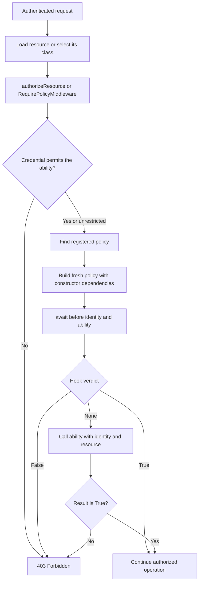

A policy groups decisions about a resource: viewing a profile, updating an owned record, or allowing an entity to be created. Authentication identifies the caller; the policy decides whether they may perform an action on that resource.

[Roles and permissions](/en/security/authentication/authorization) express general capabilities. A policy can use them and add conditions such as record ownership. Each ability is a method chosen by your application; no CRUD actions are generated automatically.

## Create a policy

Create `app/policies/user_policy.py`:

```python
from app.models.user import User
from orionis.auth import Policy
from orionis.auth.contracts.authenticatable import IAuthenticatable
from orionis.auth.contracts.manager import IAuthManager


class UserPolicy(Policy):

    def __init__(self, auth: IAuthManager) -> None:
        self.auth = auth

    async def view(
        self,
        identity: IAuthenticatable,
        member: User,
    ) -> bool:
        if identity.getAuthIdentifier() == member.getAuthIdentifier():
            return True
        return await self.auth.can("users.view")

    async def update(
        self,
        identity: IAuthenticatable,
        member: User,
    ) -> bool:
        if identity.getAuthIdentifier() == member.getAuthIdentifier():
            return True
        return await self.auth.can("users.update")

    async def create(
        self,
        identity: IAuthenticatable,
        resource: type[User],
    ) -> bool:
        return await self.auth.can("users.create")
```

This policy protects the project's `User` model:

- `view` allows reading your own profile, or using `users.view` to read other profiles.
- `update` allows updating your own profile, or using `users.update` to update others.
- `create` receives the `User` **class** and requires `users.create`. It does not need an existing user.

Grant permissions through `PermissionRegistrar` as explained in [Roles and permissions](/en/security/authentication/authorization). Extending `Policy` neither creates those permissions nor assigns them automatically.

### Signature and dependencies

Abilities receive exactly `identity` and `resource`, in that order. `identity` is the authenticated identity; `resource` is the instance or class passed to the evaluator.

Policies support **constructor injection**; this example receives `IAuthManager`. Orionis builds a fresh instance for each evaluation in the current scope. Abilities are called directly: do not declare additional dependency parameters on them.

An ability may be `def` or `async def`. It must return the boolean `True` to allow an action; a truthy object, `1`, or an HTTP response does not replace that result. A policy decides access; the controller performs the operation and generates the response.

## Register the policy

Create `app/providers/authorization_provider.py`:

```python
from app.models.user import User
from app.policies.user_policy import UserPolicy
from orionis.container.providers.service_provider import ServiceProvider
from orionis.support.facades import Auth


class AuthorizationProvider(ServiceProvider):

    async def boot(self) -> None:
        Auth.registerPolicy(User, UserPolicy)
```

`Auth.registerPolicy()` is synchronous. Import the facade from `orionis.support.facades`.

Providers in the default `app/providers` directory are discovered when the application starts. When using explicit registration, include it in `bootstrap/app.py` **before** `app.create()`:

```python
from app.providers.authorization_provider import AuthorizationProvider


app.withProviders(AuthorizationProvider)
```

Integrate these lines into the existing bootstrap; `app` is the configured `Application` instance. Do not register the policy inside every request.

Registration associates a resource class with a class implementing `IPolicy`; `Policy` already implements that contract. Policy lookup also walks the resource's base classes, so a subclass may use its ancestor's policy. Registering a new association replaces the previous one for that type.

## Authorize a resource in a controller

Save `app/http/controllers/member_controller.py`:

```python
from app.models.user import User
from orionis.auth.contracts.manager import IAuthManager
from orionis.http import JSONResponse


class MemberController:

    def __init__(self, auth: IAuthManager) -> None:
        self.auth = auth

    async def show(self, user_id: int) -> JSONResponse:
        member = await User.findOrFail(user_id)
        await self.auth.authorizeResource("view", member)

        return JSONResponse({
            "id": member.id,
            "name": member.name,
        })

    async def capabilities(
        self,
        user_id: int,
        auth: IAuthManager,
    ) -> JSONResponse:
        member = await User.findOrFail(user_id)
        await auth.authorizeResource("view", member)

        return JSONResponse({
            "can_update": await auth.allows("update", member),
            "cannot_update": await auth.denies("update", member),
        })
```

`show` loads the requested user, requires access before exposing their data, and returns only `id` and `name`. `capabilities` first requires permission to view that profile, then reports whether it may be updated.

The constructor demonstrates `IAuthManager` injection; `capabilities` demonstrates the same dependency through method injection.

In `routes/api.py`:

```python
from app.http.controllers.member_controller import MemberController
from orionis.auth.middleware import AuthenticateTokenMiddleware
from orionis.support.facades import Route


Route.get("/members/{user_id:int}", [MemberController, "show"]).middleware(
    AuthenticateTokenMiddleware,
)

Route.get(
    "/members/{user_id:int}/capabilities",
    [MemberController, "capabilities"],
).middleware(AuthenticateTokenMiddleware)
```

Try it with a [personal access token](/en/security/authentication/personal-access-tokens) belonging to the caller:

```bash
curl "http://localhost:8000/members/7" \
  -H "Authorization: Bearer YOUR_TOKEN" \
  -H "Accept: application/json"

curl "http://localhost:8000/members/7/capabilities" \
  -H "Authorization: Bearer YOUR_TOKEN" \
  -H "Accept: application/json"
```

Use an existing `user_id` and the URL printed by your server. For browser routes, use the same controller with `AuthenticateSessionMiddleware`.

The `{user_id:int}` parameter reaches the controller as an integer. The controller loads the model with `User.findOrFail()`; neither the router nor the policy automatically retrieves it based on the parameter name.

### The same API through the facade

Access the service through `Auth` as well. Save `app/http/controllers/own_profile_controller.py` and register its action on an authenticated route:

```python
from app.models.user import User
from orionis.http import JSONResponse
from orionis.support.facades import Auth


class OwnProfileController:

    async def __call__(self) -> JSONResponse:
        member = await User.findOrFail(Auth.identifier())
        await Auth.authorizeResource("view", member)

        return JSONResponse({
            "id": member.id,
            "can_update": await Auth.allows("update", member),
        })
```

| Method | Usage |
| --- | --- |
| `await Auth.allows(ability, resource)` | Query whether the policy allows the action. |
| `await Auth.denies(ability, resource)` | The inverse of `allows`. |
| `await Auth.authorizeResource(ability, resource)` | Continue if allowed; raise an exception otherwise. |

`allows` returns `False` for guests. `authorizeResource` distinguishes a missing identity from denied access. Do not confuse `authorize("users.update")`, which requires a permission, with `authorizeResource("update", member)`, which evaluates `member`'s policy.

Authorize before writing changes. For example, an action calling `await member.update(...)` must first execute `await Auth.authorizeResource("update", member)`.

## Middleware for class-level abilities

When a decision does not depend on an existing record, use `RequirePolicyMiddleware`. Create `app/http/middleware/can_create_members.py`:

```python
from app.models.user import User
from orionis.auth.middleware import RequirePolicyMiddleware


class CanCreateMembers(RequirePolicyMiddleware):
    ability = "create"
    resource = User
```

In `routes/api.py`, this endpoint provides form fields only to callers allowed to create users:

```python
from app.http.middleware.can_create_members import CanCreateMembers
from orionis.auth.middleware import AuthenticateTokenMiddleware
from orionis.http import JSONResponse
from orionis.support.facades import Route


async def member_creation_form() -> JSONResponse:
    return JSONResponse({"fields": ["name", "email", "password"]})


Route.get("/members/create", member_creation_form).middleware(
    AuthenticateTokenMiddleware,
    CanCreateMembers,
)
```

The middleware evaluates `UserPolicy.create(identity, User)`. It neither creates a user nor processes a form: the protected action performs its work after access is granted.

Native middleware always receives the **class** specified by `resource`; it does not provide a callback for loading models from route parameters. For `update`, `view`, or other abilities requiring a record, load that instance in the controller and call `authorizeResource` there.

Apply the same classes to route groups. Keep authentication middleware before the policy check; see [Authentication middleware](/en/security/authentication/middleware).

## Intercept decisions with before

The `Policy` base class defines `async before(identity, ability)` and returns `None`. Override it to implement a condition shared by all abilities.

This example base class denies operations for inactive accounts; a concrete policy can extend it and declare its abilities:

```python
from orionis.auth import Policy
from orionis.auth.contracts.authenticatable import IAuthenticatable


class ActiveAccountPolicy(Policy):

    async def before(
        self,
        identity: IAuthenticatable,
        ability: str,
    ) -> bool | None:
        if not identity.active:
            return False
        return None
```

The example assumes the default `User` model's `active` attribute.

| Return value from `before` | Effect |
| --- | --- |
| `None` | Execute the requested ability method. |
| `True` | Allow without executing that ability. |
| `False` | Deny without executing that ability. |

`before` must be asynchronous; the evaluator always awaits it. It receives the identity and ability name without the resource. A role named `admin` does not implicitly bypass checks: explicitly declare any such behavior in your policy logic.

Credential limits are checked **before** the hook. A `before` returning `True` cannot expand a restricted token's abilities.

## Policies and personal access tokens

The ability name is also constrained by `abilities`. With a restricted token, `allows("update", member)` reaches the policy only if the token contains exactly `"update"`.

The policy then decides. In `UserPolicy`:

- To update your own profile, ownership grants access when the credential permits `update`.
- To update another user's profile, `Auth.can("users.update")` must also succeed. The user must own that permission and the restricted token must also include `users.update`.

For that second case, the token therefore needs `["update", "users.update"]` and the user needs `users.update`. Abilities are not wildcards and do not create permissions. An unrestricted token with `abilities=None` leaves the decision to the policy using its identity's authorization.

There is no additional automatic check for a permission named `update`: that permission is only required if your code calls `can` or `authorize` for it.

## Query a policy from a view

Pass the `member` instance to the template. The `auth()` global can query the same policy, and Jinja automatically awaits its result:

```jinja

  
    <a href="/members/{{ member.id }}/edit">Edit profile</a>
  

```

`/members/{id}/edit` represents a route that you must define in your application. Keep the check in the endpoint updating the user; the template only determines which elements to display.

## Authorization flow



The flow begins after identity resolution. `authorizeResource` and native middleware reject guests before evaluating a policy.

Policy classes are registered and lookup results are reused; instances are built afresh for each evaluation. Injected dependencies therefore belong to the current scope. Do not store the current user in attributes of global services.

## Denials and configuration errors

- **Missing identity:** `authorizeResource` or the middleware raises `AuthenticationException`. The default HTTP handler returns `401` for this exception. Earlier session authentication middleware may redirect a browser to login instead.
- **Identity without access:** they raise `AuthorizationException`, converted to `403` by the default handler.
- **Unregistered policy:** `PolicyNotFoundException` is raised when evaluation reaches policy lookup.
- **Missing ability:** `PolicyNotFoundException` is raised if `before` delegates and the method does not exist. A hook granting or denying access does not need to execute that method.
- **Private or invalid name:** `allows` returns `False` for names that are not Python identifiers, start with `_`, or are `before`.
- **Middleware without `ability` or `resource`:** `AuthConfigurationException` is raised.

Exceptions from your logic or its dependencies propagate to the [HTTP exception handler](/en/http/exceptions); an error evaluating a policy does not equal the boolean `False`. See [Configuration and guards](/en/security/authentication/configuration-and-guards) for identity resolution and [Roles and permissions](/en/security/authentication/authorization) for capability management.
