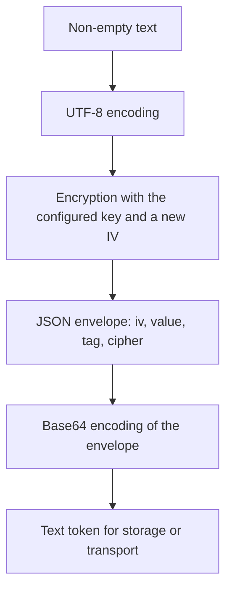

The encryption service lets you store a value and later recover its original text with the same key. Use [hashing](/en/security/hashing) for passwords that should only be verified; use encryption when your application needs to read the content again.

## Configure the key and cipher

These settings belong to `config/app.py`. `config/hashing.py` configures password hashing and does not control this service.

| Setting | Environment variable | Behavior |
| --- | --- | --- |
| `app.cipher` | `APP_CIPHER` | Cipher identifier. Default: `AES-256-CBC`. |
| `app.key` | `APP_KEY` | Key shared by the processes that must decrypt the same values. |

Write the identifiers exactly as shown:

| Cipher | Key | IV per operation | Content authentication |
| --- | --- | --- | --- |
| `AES-128-CBC` | 16 bytes | 16 bytes | Adds no MAC or tag; uses PKCS7 padding. |
| `AES-256-CBC` | 32 bytes | 16 bytes | Adds no MAC or tag; uses PKCS7 padding. |
| `AES-128-GCM` | 16 bytes | 12 bytes | Creates and verifies a 16-byte tag. |
| `AES-256-GCM` | 32 bytes | 12 bytes | Creates and verifies a 16-byte tag. |

To use GCM in a workflow that needs to verify content authenticity, configure, for example:

```dotenv
APP_CIPHER=AES-256-GCM
```

Configuration accepts a `bytes` key, raw text converted to UTF-8, or text prefixed with `base64:` that is decoded before use. The required length applies to the **key bytes**, not the characters in its Base64 representation. An unsupported cipher, invalid Base64 key, or incompatible length prevents configuration validation.

If `app.key` is `None`, configuration generates a random key of the appropriate size and attempts to save it through `Env.set("APP_KEY", ...)`. Retain that value for subsequent starts and deployments.

### Generate a key through the CLI

From the project root, these alternatives are equivalent:

```bash
orionis key:generate
```

```bash
python -B reactor key:generate
```

The command reads `app.cipher`, generates random bytes, represents them as `base64:...`, and saves `APP_KEY` in the project environment. If a non-empty key already exists, it preserves the key and exits successfully.

| Option | Default | Effect |
| --- | --- | --- |
| `--force` | `False` | Replaces the existing key. |
| `-h`, `--help` | — | Displays command help. |

To explicitly replace the key:

```bash
orionis key:generate --force
```

```bash
python -B reactor key:generate --force
```

**Replacing the key does not re-encrypt existing data.** Retain the previous key if you need to recover it. Restart application processes after changing the key or cipher: the resolved service retains the configuration used to construct it.

## Available API

The public `IEncrypter` contract declares two **synchronous** methods:

| Method | Input | Result |
| --- | --- | --- |
| `encrypt(plaintext: str) -> str` | Non-empty, UTF-8-encodable text. | Complete encrypted token as a `str`. |
| `decrypt(payload: str) -> str` | Complete token produced by `encrypt()`. | Original text as a `str`. |

Do not add `await` to these calls, even inside an `async` controller. The API does not directly accept `bytes`, dictionaries, models, or files; later examples show how to represent other data as text.

## Use dependency injection in controllers

Request `IEncrypter` from `orionis.encrypter.contracts`. Orionis registers the service as a singleton; the container can inject it into a constructor or an action.

Create `app/http/controllers/encryption_controller.py`:

```python
from orionis.encrypter.contracts import IEncrypter
from orionis.http import JSONResponse
from orionis.http.base import BaseController
from orionis.schemas import Schema


class PlaintextPayload(Schema):
    value: str


class EncryptedPayload(Schema):
    token: str


class EncryptionController(BaseController):

    def __init__(self, crypt: IEncrypter) -> None:
        self._crypt = crypt

    async def encrypt(self, payload: PlaintextPayload) -> JSONResponse:
        if not payload.value:
            return JSONResponse(
                {"message": "The value must not be empty."},
                status_code=422,
            )

        token = self._crypt.encrypt(payload.value)
        return JSONResponse({"token": token})

    async def decrypt(
        self,
        payload: EncryptedPayload,
        crypt: IEncrypter,
    ) -> JSONResponse:
        try:
            plaintext = crypt.decrypt(payload.token)
        except (ValueError, RuntimeError):
            return JSONResponse(
                {"message": "The encrypted value is invalid."},
                status_code=422,
            )

        return JSONResponse({"value": plaintext})
```

The `encrypt` action uses the dependency received in `__init__`; `decrypt` demonstrates receiving it directly as an action argument. Both resolve the same configured service. The [schemas](/en/validation) receive and validate the JSON body before the action executes.

In `routes/api.py`, register the actions with the [route facade](/en/http/routing):

```python
from app.http.controllers.encryption_controller import EncryptionController
from orionis.support.facades import Route


Route.post("/secrets/encrypt", [EncryptionController, "encrypt"])
Route.post("/secrets/decrypt", [EncryptionController, "decrypt"])
```

Send a JSON body `{"value": "private note"}` to the first route and use its returned `token` as `{"token": "..."}` in the second. This example demonstrates data exchange; an application workflow can persist that token and decrypt it when retrieving the record. Apply the appropriate [authentication and authorization](/en/security/authentication) before allowing access to the content.

## Use the Crypt facade

The facade uses the same container service and is available after application boot. Import it from the public module:

```python
from orionis.http import JSONResponse
from orionis.http.base import BaseController
from orionis.support.facades import Crypt


class EncryptionPreviewController(BaseController):

    async def __call__(self) -> JSONResponse:
        token = Crypt.encrypt("private note")
        restored = Crypt.decrypt(token)

        return JSONResponse({
            "token": token,
            "restored": restored,
        })
```

You can also use `Crypt` or inject `IEncrypter` into services, commands, and other components resolved by the container. No additional provider registration is needed for the native service.

## Encrypt structured data

Serialize a JSON-compatible object before encryption and decode the recovered text afterward. `decrypt()` returns text; it does not automatically reconstruct objects.

```python
import json

from orionis.encrypter.contracts import IEncrypter
from orionis.http import JSONResponse
from orionis.http.base import BaseController


class PreferencesPreviewController(BaseController):

    async def __call__(self, crypt: IEncrypter) -> JSONResponse:
        preferences = {
            "language": "es",
            "notifications": True,
        }

        token = crypt.encrypt(json.dumps(preferences, ensure_ascii=False))
        restored = json.loads(crypt.decrypt(token))

        return JSONResponse({
            "token": token,
            "preferences": restored,
        })
```

To represent bytes, perform an explicit round-trip conversion. Here Base64 represents the original bytes as text **before** encryption; it does not replace the cryptographic operation.

```python
import base64

from orionis.encrypter.contracts import IEncrypter
from orionis.http import JSONResponse
from orionis.http.base import BaseController


class BinaryPreviewController(BaseController):

    async def __call__(self, crypt: IEncrypter) -> JSONResponse:
        original = b"\x00\xff\x10"
        text = base64.b64encode(original).decode("ascii")

        token = crypt.encrypt(text)
        restored = base64.b64decode(crypt.decrypt(token), validate=True)

        return JSONResponse({"matches": restored == original})
```

The service processes the entire content in memory; it does not provide streaming file encryption.

## What the token contains

Each call generates a new random IV. Encrypting the same value twice produces different tokens that recover the same text.



The binary `iv`, `value`, and `tag` fields are also represented in Base64. In CBC, `tag` is `None`; in GCM, it contains the authentication tag. Store the **complete token**: ciphertext alone does not include all the information needed for decryption.

The token takes more space than the original text because of the IV, tag where applicable, JSON, and Base64. It contains no key, key identifier, expiration date, or list of previous keys. Its `cipher` field must match the decrypting instance; it does not automatically change that instance's configuration.

GCM checks its tag during decryption and rejects altered content. CBC checks padding, but this implementation adds no MAC: successful CBC decryption does not prove integrity.

## Input and decryption errors

| Situation | Public exception |
| --- | --- |
| Input that is not a `str`. | `TypeError`. |
| Empty text or token; text that cannot be encoded as UTF-8. | `ValueError`. |
| Invalid Base64/JSON envelope, incompatible fields, different cipher, or incorrect IV size. | `ValueError`. |
| Encryption failure. | `RuntimeError`. |
| Missing or incorrectly sized GCM tag, authentication failure, invalid CBC padding, or failure to recover UTF-8. | `RuntimeError`, with the original cause chained. |

The example's `decrypt` action converts expected token errors into an HTTP response without exposing the exception's internal details. Other failures follow the [HTTP exception flow](/en/http/exceptions). Catching `TypeError` is unnecessary there because the schema already requires a `str`.

## Retain and change keys

All processes reading the same tokens need the same key and cipher. Keep `APP_KEY` out of published code and retain its value across restarts and deployments.

The service provides no key ring or parameter for trying previous keys. To change the key or cipher for existing data:

1. Retain access to its original configuration.
2. Recover each value with that configuration.
3. Encrypt it with the new configuration.
4. Replace the token only when both operations have completed successfully.
5. Change the reading configuration after the corresponding records have been migrated.

The application must identify which configuration applies to each record during the migration. `key:generate --force` only replaces `APP_KEY`; it does not perform these steps.

---

[Encryption index](/en/security/encryption) · [Password hashing](/en/security/hashing) · [Controllers](/en/http/default-responses)
