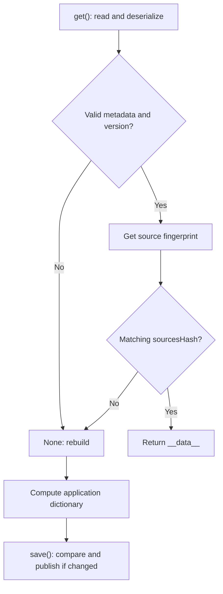

`FileBasedCache` stores a complete dictionary and invalidates it when source metadata changes. It serves compiled indexes and metadata, such as information a component needs during startup or repeated resolution. Its operations are **synchronous**; it does not use `Cache` stores or their TTL.

| Need | Appropriate API |
| --- | --- |
| Independent keys, TTL, or configurable storage backend. | `Cache` / `CacheRepository`: [API reference](/en/services/cache/api-reference). |
| A dictionary derived from files, rebuilt when those sources change. | `FileBasedCache`. |
| Preserve Python types through markers in a trusted JSON artifact. | `orionis.cache.serializer.Serializer`. |

The value cache's `MsgspecSerializer` is a different class: it encodes ordinary JSON without this `Serializer`'s type markers. Do not assume storing an object through `Cache` preserves its types exactly as an artifact does.

## A file index from an asynchronous service

Save this service in `app/services/service_index.py`. It receives the application through DI, uses configured paths, and moves synchronous reading, fingerprinting, and writing onto a worker thread:

```python
import asyncio
from pathlib import Path
from orionis.cache import FileBasedCache
from orionis.foundation.contracts.application import IApplication


class ServiceIndex:
    def __init__(self, app: IApplication) -> None:
        bootstrap = app.path("bootstrap")
        services = app.path("app_services")
        if not isinstance(bootstrap, Path) or not isinstance(services, Path):
            raise RuntimeError("Application paths are not configured")

        self.services = services
        self.artifact = FileBasedCache(
            path=bootstrap / "cache" / "artifacts",
            filename="service-index.cache",
            monitored_dirs=[services],
        )

    async def get(self) -> dict:
        return await asyncio.to_thread(self._load_or_build)

    def _load_or_build(self) -> dict:
        cached = self.artifact.get()
        if cached is not None:
            return cached

        data = {
            "modules": sorted(
                file.relative_to(self.services).as_posix()
                for file in self.services.rglob("*.py")
            ),
        }
        self.artifact.save(data)
        return data
```

`bootstrap` and `app_services` are real path-registry keys; `app.path()` returns a configured `Path`, or `None` for an unknown key. The `FileBasedCache` constructor creates its base directory. All example paths come from the application registry.

Query the index from a controller with action injection:

```python
from app.services.service_index import ServiceIndex
from orionis.http import JSONResponse


class ServiceIndexController:
    async def show(self, index: ServiceIndex) -> JSONResponse:
        return JSONResponse(await index.get())
```

Map a route to `show` as explained in [controllers](/en/http/request-lifecycle). This service rebuilds an absent or invalidated artifact; corrupted files follow the error behavior below. Construction also performs brief synchronous I/O to prepare the directory: if construction must happen outside your event loop, perform it during configuration or your own compilation process.

## Complete FileBasedCache API

<a id="artifact-construction"></a>
### Constructor

```text
FileBasedCache(
    path: Path,
    filename: str,
    monitored_dirs: list[Path] | None = None,
    monitored_files: list[Path] | None = None,
) -> None
```

| Parameter | Behavior |
| --- | --- |
| `path` | Artifact directory; must be a `pathlib.Path`, otherwise raises `TypeError`. Creates missing parents. |
| `filename` | Required name, joined as `path / filename`. No default. |
| `monitored_dirs=None` | Directories recursively scanned for `*.py` only. `None` means no monitored directories. |
| `monitored_files=None` | Explicit paths, including non-`.py` extensions. `None` means no explicit files. |

Missing monitored paths are omitted. Matches are resolved to absolute paths, deduplicated, and sorted; the cache file itself is excluded. With both lists empty, the hash represents an empty set and application-code changes do not invalidate the artifact.

`filename` is combined through `Path` without Storage's normalization or isolation. Use an application-controlled simple name: an absolute name can replace the base directory, and a name containing subdirectories requires preparing those parents. The constructor does not individually validate every monitored-path type. Use configured `Path` objects rather than client-provided names.

To include a specific configuration file alongside services, construct the artifact as follows:

```python
from pathlib import Path
from orionis.cache import FileBasedCache
from orionis.foundation.contracts.application import IApplication


def configured_artifact(app: IApplication) -> FileBasedCache:
    bootstrap = app.path("bootstrap")
    services = app.path("app_services")
    config = app.path("config")
    if not all(isinstance(path, Path) for path in (bootstrap, services, config)):
        raise RuntimeError("Application paths are not configured")

    return FileBasedCache(
        path=bootstrap / "cache" / "artifacts",
        filename="configured-index.cache",
        monitored_dirs=[services],
        monitored_files=[config / "app.py"],
    )
```

<a id="artifact-get"></a>
### get() -> dict | None

Reads and deserializes the file on every call. Returns its `__data__` dictionary when version and hash match; returns `None` for unusable/missing content, missing metadata, a version mismatch, or changed sources. A saved empty `{}` is valid: check `is not None`, as `ServiceIndex` does, instead of truthiness.

Only the source fingerprint is memoized; the dictionary is not a live in-memory cache. Changing a result does not update the file: call `save()` to persist it. The `dict | None` annotation describes artifacts written by `save()`; `get()` does not thoroughly validate manually edited file shapes.

<a id="artifact-save"></a>
### save(data: dict) -> tuple[int, str]

Accepts only `dict`; other input raises `TypeError`. Values must be supported by the `Serializer` described here. Computes the fingerprint, compares existing content, and skips rewriting when **version, hash, and data** all match.

Returns `(FileBasedCache.CACHE_VERSION, sources_hash)` whether it publishes or skips writing; this result does not count writes. The payload contains:

```text
__meta__:
    version: CACHE_VERSION
    generatedAt: integer Unix timestamp
    sourcesHash: hexadecimal hash
__data__:
    application dictionary
```

`generatedAt` records generation time rather than a TTL. Data is serialized into a randomly suffixed sibling `.tmp`, which replaces the destination on completion. An `OSError` during staging/replacement attempts temporary-file removal and propagates. Publication does not coordinate multiple compilers: another result can replace yours.

<a id="artifact-clear"></a>
### clear() -> bool

Removes only this artifact's file. Returns `True` if removed and `False` if absent; other filesystem errors propagate. It neither clears a `Cache` store nor removes directories or resets fingerprint memoization.

This asynchronous service reuses the earlier example to force data rebuilding:

```python
import asyncio
from app.services.service_index import ServiceIndex
from orionis.foundation.contracts.application import IApplication


async def rebuild_service_index(app: IApplication) -> dict:
    index = ServiceIndex(app)
    removed = await asyncio.to_thread(index.artifact.clear)
    data = await index.get()
    return {"removed_previous_artifact": removed, "index": data}
```

<a id="artifact-version"></a>
### CACHE_VERSION

The public constant is currently `1` and identifies the **internal artifact format**, not a framework release. `get()` compares the stored value against it; a different format produces a miss. Use the constant and `save()` result instead of duplicating that number in your application.

<a id="artifact-sources"></a>
## How source invalidation works

The hash is SHA-1 used as a change identifier, not a security check. For each sorted file, it combines the absolute POSIX path, `st_mtime_ns`, and size. It **does not read or hash file content**. Renaming, adding, deleting, or changing metadata of monitored sources can invalidate it; changed content preserving size and mtime can go unnoticed.

The fingerprint is reused for 0.5 seconds per instance, measured with a monotonic clock. A change may remain unseen during that interval; it is not a data TTL. A new instance computes its own fingerprint, and `clear()` does not force the existing instance to recompute.

Directories contribute only `*.py`; explicitly include JSON, templates, or other formats through `monitored_files`. Explicit relative paths resolve against the working directory, so `app.path()` avoids depending on where a command started.



Sources and results are not captured atomically. Files changing during compilation can produce data representing a different state from the saved hash. Compile against stable sources or coordinate the operation when required. `FileBasedCache` provides no TTL, independent keys, locks, or asynchronous API; see [locks and concurrency](/en/services/cache/locks) for explicit coordination, respecting the selected backend's scope.

## Serializer: enriched JSON for artifacts

Import `Serializer` from `orionis.cache.serializer`. Its four methods are static and synchronous. They are neither a key-value cache API nor replacements for HTTP JSON responses.

<a id="serializer-dumps"></a>
### dumps(data: Any, indent: int | None = None) -> str

Transforms supported types into JSON data with markers and returns `str`. `indent=None` uses `msgspec.json` for compact output; an explicit `indent` uses `json.dumps` with that indentation. Unsupported objects raise `TypeError`. For portable results, use finite numbers and dictionary `str` keys: keys do not undergo value transformation, and JSON can turn numeric keys into strings.

<a id="serializer-loads"></a>
### loads(raw: str | bytes) -> Any

Decodes JSON through `msgspec.json`, then reconstructs markers recursively. Returns the restored object: a dictionary, collection, or primitive. Invalid JSON propagates `msgspec.DecodeError`; unknown markers raise `ValueError`. Incomplete markers or incompatible values can also raise `KeyError`, `TypeError`, `ValueError`, or converter-specific errors.

<a id="serializer-types"></a>
### Supported types and complete example

| Original type | Restoration |
| --- | --- |
| `str`, `int`, `float`, `bool`, `None` | Simple JSON values. |
| `dict`, `list` | Containers with recursively processed values. |
| `bytes` | Base64, restored to `bytes`. |
| `Path` and platform variants | Path reconstructed through `Path`. |
| `datetime`, `date`, `time` | ISO representation; preserves the date/time value and offset when present. |
| `timedelta` | Days, seconds, and microseconds. |
| `Decimal`, `UUID`, `complex` | Their types and values are restored. |
| `tuple`, `set`, `frozenset` | Markers preserve collection type and process elements. |
| `enum.Enum` | Importable class reference plus its value. |
| `type` | Importable type reference. |
| `MISSING` | Restores the framework sentinel. |

Save this code in an importable module, such as `app/services/artifact_values.py`. The enum lives at module scope so its reference can be reconstructed:

```python
from datetime import UTC, date, datetime, time, timedelta
from decimal import Decimal
from enum import Enum
from pathlib import Path
from uuid import UUID
from orionis.cache.serializer import Serializer
from orionis.foundation.contracts.application import IApplication
from orionis.support.types.sentinel import MISSING


class ArtifactKind(Enum):
    INDEX = "index"


def serializer_roundtrip(app: IApplication) -> dict:
    services = app.path("app_services")
    if not isinstance(services, Path):
        raise RuntimeError("Services path is not configured")

    original = {
        "text": "service index",
        "count": 3,
        "ratio": 0.5,
        "ready": True,
        "optional": None,
        "list": [1, {"enabled": True}],
        "bytes": b"\x00\xff",
        "path": services,
        "datetime": datetime(2026, 1, 2, 12, 30, tzinfo=UTC),
        "date": date(2026, 1, 2),
        "time": time(12, 30),
        "duration": timedelta(days=1, seconds=30, microseconds=5),
        "price": Decimal("12.50"),
        "uuid": UUID("12345678-1234-5678-1234-567812345678"),
        "complex": complex(2, 3),
        "tuple": (1, "a"),
        "set": {1, 2},
        "frozenset": frozenset({3, 4}),
        "kind": ArtifactKind.INDEX,
        "type": Path,
        "missing": MISSING,
    }
    encoded = Serializer.dumps(original, indent=2)
    restored = Serializer.loads(encoded.encode("utf-8"))
    assert restored == original
    assert restored["missing"] is MISSING
    return restored
```

This is not a general serializer for arbitrary instances, models, or dataclasses. Some supported subclasses—such as dict/list and tuple subclasses—are restored as their base container rather than the custom class. A primitive base type appearing above does not imply support for all its subclasses.

Types and enums resolve by module and class name. Use importable module-level classes and JSON-compatible enum values; local or nested classes do not have general resolution support. Functions, closures, bytearrays, and user objects have no configurable public converter in this API.

<a id="serializer-dumptofile"></a>
### dumpToFile(data: Any, file_path: Path) -> None

Writes compact enriched JSON through a sibling `<name>.<16 hex>.tmp` and replacement. It does not create parent directories or return a boolean. An `OSError` during writing/replacement attempts temporary removal and propagates; serialization errors also propagate. Each writer has a unique staging file, but results can replace one another without a compilation lock.

<a id="serializer-loadfromfile"></a>
### loadFromFile(file_path: Path) -> Any

Reads and restores the file. Returns `None` for any read `OSError`—including an absent file, directory, or insufficient permission—or empty content. Legitimately stored `null` also returns `None`; the API does not distinguish these cases. Invalid JSON and reconstruction errors are not absorbed.

This service prepares parents using an application path and moves synchronous I/O to a worker:

```python
import asyncio
from pathlib import Path
from orionis.cache.serializer import Serializer
from orionis.foundation.contracts.application import IApplication


async def save_artifact_metadata(app: IApplication) -> dict:
    bootstrap = app.path("bootstrap")
    if not isinstance(bootstrap, Path):
        raise RuntimeError("Bootstrap path is not configured")
    target = bootstrap / "cache" / "artifacts" / "metadata.cache"

    def write_and_read() -> dict:
        target.parent.mkdir(parents=True, exist_ok=True)
        Serializer.dumpToFile({"modules": ("billing", "catalog")}, target)
        return Serializer.loadFromFile(target)

    return await asyncio.to_thread(write_and_read)
```

## Trusted format, errors, and lifecycle

Reserved markers are `__type__` and `__value__`. A dictionary containing `__type__` is interpreted as a typed object during decoding; avoid these names for business maps requiring an unchanged round trip.

Reconstructing types/enums can import named modules. Use the format only for application-controlled artifacts; do not deserialize HTTP bodies or client-writable files. There is no signature, encryption, or hash authenticating file content.

`FileBasedCache.get()` and `save()` invoke the same deserializer. Truncated files, malformed metadata, unknown tags, or removed modules can propagate errors rather than always becoming misses. Decide whether damaged artifacts should fail compilation or be cleared and rebuilt, recording the original error first. Do not indiscriminately treat failures in your own compiler as invalid cached data.

Operations close their files on completion; `FileBasedCache` and `Serializer` require no `close()` and expose no file contexts. Reads/writes remain blocking: use `asyncio.to_thread` from asynchronous components when cost matters. Cancelling that await does not stop a worker write already underway; replacement can finish after cancellation. Unique staging avoids concurrent writers mixing in one temporary file, but guarantees neither durability after process interruption nor consistency of computation with other operations.
