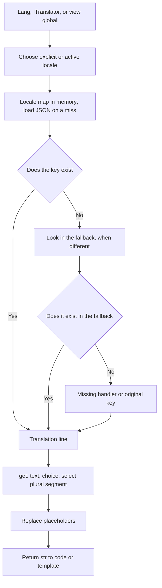

Localization lets your application display a message in different languages without repeating text in every controller or template. Orionis loads JSON files, resolves keys, applies replacements, and selects plural forms through a shared translator.

The `orionis/localization` component is the translation engine. Views use it through Jinja globals, and the same service is available in controllers, commands, and other application services.

## Your first translation

Create `resources/lang/en/quickstart.json`:

```json
{
  "greeting": "Hello :name"
}
```

Create `resources/lang/es/quickstart.json`:

```json
{
  "greeting": "Hola :name"
}
```

The `quickstart.greeting` key combines the filename and its entry. With the default configuration, Orionis looks for these resources in `resources/lang`, relative to the project root.

Save `app/http/controllers/quick_translation_controller.py`:

```python
from orionis.http import JSONResponse, response
from orionis.support.facades import Lang


class QuickTranslationController:
    async def show(self, language: str) -> JSONResponse:
        if language not in {"en", "es"}:
            return response.json(
                {"message": "Unsupported language."},
                status_code=422,
            )

        return response.json(
            {
                "message": Lang.get(
                    "quickstart.greeting",
                    locale=language,
                    name="Ada",
                ),
            },
            headers={"Content-Language": language},
        )
```

In `routes/api.py`, loaded by your existing `app.withRouting(api="routes/api.py", ...)` configuration:

```python
from app.http.controllers.quick_translation_controller import QuickTranslationController
from orionis.support.facades import Route

Route.get("/hello/{language:slug}", [QuickTranslationController, "show"])
```

With the application running, `GET /hello/es` returns `{"message":"Hola Ada"}` and `GET /hello/en` returns `{"message":"Hello Ada"}`. A well-formed code outside the allowlist, such as `fr`, returns `422` because that is this controller's policy. The `slug` annotation controls the segment format; the `{"en", "es"}` allowlist determines the languages this example supports.

`Lang.get()` is **synchronous**: do not await it, even inside an asynchronous action. The first lookup for a locale may read its files; subsequent calls use its in-memory map.

## Three ways to use the same translator

| Entry point | API | When to use it |
| --- | --- | --- |
| Application code with booted providers | `Lang.get("quickstart.greeting", locale="es", name="Ada")` | Access through the public facade. |
| Constructor or method resolved by the container | `ITranslator` and `translator.get(...)` | Declare a service or controller dependency. |
| Template inside `resources/views` | `{{ trans("quickstart.greeting", locale=page_language, name="Ada") }}` | Translate during rendering with the language passed in context. |

Import the facade with `from orionis.support.facades import Lang`. Import the contract from `orionis.localization.contracts.translator`. The view provider registers `trans`, `__`, `choice`, `locale`, and `locales` globals. See [Facade, injection, and views](/en/services/localization/application-and-views) for complete examples of each approach.

## Application locale and request locale

`config/app.py` defines `locale`, `fallback_locale`, and `language_path`. The active locale belongs to the process-wide translator; it is not automatically selected from `Accept-Language`, a URL, or a session.

When a request selects a language, validate it against your application's supported languages and pass it as `locale=` to each translation. Use a variable such as `page_language` in views. `setLocale()` changes shared state and can affect other concurrent requests.

The fallback is a configured locale used for missing keys. There is no inferred regional chain: `es-CO` does not imply trying `es`. [Files, locales, and configuration](/en/services/localization/messages-and-locales) explains actual formats and settings.

## How a message is resolved



Translations are text. The translator does not escape HTML, automatically format dates or currencies, or apply ICU/CLDR plural rules. For an HTML view, escaping is the view engine's responsibility.

## Guide roadmap

- [Files and locales](/en/services/localization/messages-and-locales): grouped or literal JSON, directories, precedence, and configuration.
- [Messages and plurals](/en/services/localization/translating-content): `get`, `has`, replacements, fallback, and `choice` selectors.
- [Facade, injection, and views](/en/services/localization/application-and-views): controllers, services, and templates.

For HTML page composition, continue with [Views](/en/services/views).
