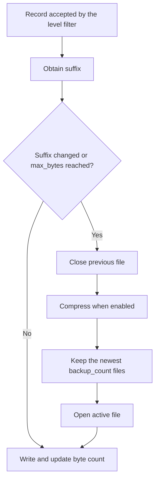

The selected channel determines which file receives records and how it rotates. All six channels write to the local filesystem; `stack` means a single file rather than a combination of channels. Set its fields in [Logging configuration](/en/services/logging/configuration) and use the [facade or service](/en/services/logging/writing-logs) to write messages.

<a id="log-files"></a>

## Where files are written

Default paths start at the project root:

| Channel | Default path | Initial opening |
|---|---|---|
| `stack` | `storage/logs/stack.log` | When the logger initializes, even if the first message is filtered out. |
| `hourly` | `storage/logs/hourly_{suffix}.log` | When the first record passes the level filter. |
| `daily` | `storage/logs/daily_{suffix}.log` | When the first record passes the level filter. |
| `weekly` | `storage/logs/weekly_{suffix}.log` | When the first record passes the level filter. |
| `monthly` | `storage/logs/monthly_{suffix}.log` | When the first record passes the level filter. |
| `chunked` | `storage/logs/chunked_{suffix}.log` | When the first record passes the level filter. |

Parent directories are created automatically. Records are appended using UTF-8. The process user needs permission to create and write files, and to delete them when using rotating channels.

Configuration entities require a nonempty string ending in `.log`; rotating channels also require the literal `{suffix}` placeholder. Put it in the **filename**, as shown here: cleanup only scans the directory of the file that has just been closed. Using `{suffix}` to split periods into separate directories does not provide cleanup across those directories.

Use paths relative to the root, especially with `stack`: its default initialization concatenates the root and configured path, while the factory used when switching channels resolves paths through `Path`. An absolute `stack` path does not behave consistently across both paths.

<a id="time-rotation"></a>

## Rotation by period

Each record requests the current suffix. When it differs from the open file's suffix, the handler closes that file, applies retention, and opens the file for the new period. Without new records, no files are created, period changes are not checked, and cleanup does not run.

| Channel | Suffix | Effective file boundary |
|---|---|---|
| `hourly` | `YYYY-MM-DD_HH` | Hour change in the application's configured timezone. |
| `daily` | `YYYY-MM-DD` | Date change in that timezone. |
| `weekly` | `YYYY-weekWW` | ISO week change: Monday, using the ISO year. |
| `monthly` | `YYYY-MM` | Calendar month change. |

For example, December 29, 2025 belongs to `2026-week01`. The week is not calculated by splitting the year into seven-day blocks. Resolvers capture the `DateTime` timezone when constructed; when passed an explicit `datetime`, `getSuffix(dt)` formats that value without converting it to another timezone.

```dotenv
LOG_CHANNEL=daily
LOG_LEVEL=INFO
LOG_PATH=storage/logs/application_{suffix}.log
LOG_RETENTION=int:14
```

With that configuration, a record on October 23 writes to `application_2026-10-23.log`. The first record of the following day opens `application_2026-10-24.log`. Changing `.env` requires reloading application configuration as explained in [Environment](/en/architecture/environment); reloading the logger alone does not do that.

### What `daily.at` affects

`Daily.at` accepts `datetime.time` or a string supported by `time.fromisoformat()`, such as `"02:30:00"`. The resolver can calculate the next time through `getNextRotationTime()`, but the integrated handler **does not call that method**: it decides when to rotate by comparing suffixes. Therefore, `LOG_ROTATION_TIME=02:30:00` does not move the effective daily boundary from midnight to 02:30 or schedule a cleanup task.

<a id="size-rotation"></a>

## `chunked`: size, suffixes, and compression

Configuration exposes `mb_size` —an integer from 1 to 1000, default 10— and `files` —a positive integer, default 5—. The factory converts `mb_size` to bytes using `mb_size * 1024 * 1024`, making the effective unit MiB. The handler counts the encoded text bytes and its line break.

There is an important consideration in the current implementation: `ChunkedSuffixResolver.getSuffix()` produces a new suffix **on every call**, formatted as `YYYYMMDD_HHMMSS_counter`, and the handler requests one on every emission. Because changing the suffix already causes rotation, **the integrated channel rotates for every emitted record**, even when the file is far below `mb_size`. The parameter exists and reaches the handler; it does not guarantee that records accumulate until reaching that size.

For example, three consecutive messages normally produce two closed `.log.gz` files and one active `.log` file, each containing one record. The counter starts at `0001` for each resolver instance; timestamp and counter are not a global identifier across processes.

```dotenv
LOG_CHANNEL=chunked
LOG_PATH=storage/logs/application_{suffix}.log
LOG_MB_SIZE=int:10
LOG_FILES=int:5
```

Gzip compression runs during rotation, after closing the previous file. On success, the original `.log` file is removed. The active file remains uncompressed; `close()` does not compress it. If compression encounters an `OSError`, it attempts to remove the incomplete compressed file.

The handler checks size **before** writing the next record, using the bytes already accumulated. It does not anticipate the next message's size: one entry can exceed the threshold. This is also not a maximum disk usage limit.

<a id="log-retention"></a>

## What retention preserves

The names `retention_hours`, `retention_days`, `retention_weeks`, and `retention_months` express the channel's period, but the factory passes them directly as `backup_count`. Cleanup retains a **number of files** rather than comparing record age with a duration.

| Channel | Field | Default | Entity validation range |
|---|---|---|---|
| `stack` | No integrated retention | — | — |
| `hourly` | `retention_hours` | `24` | `1` to `168` |
| `daily` | `retention_days` | `7` | `1` to `90` |
| `weekly` | `retention_weeks` | `4` | `1` to `12` |
| `monthly` | `retention_months` | `4` | `1` to `12` |
| `chunked` | `files` | `5` | Integer greater than `0` |

On every rotation, cleanup runs in this order:

1. Find files in the directory of the file that has just been closed.
2. Select names matching the template, including the `.gz` variant.
3. Sort by modification time (`mtime`), newest first.
4. Delete files beyond `backup_count` and, where applicable, their compressed variant.
5. The handler then opens the new active file.



After this sequence there may be up to **`backup_count + 1` files**: those kept during cleanup plus the new active file. Setting `daily.retention_days=7` does not delete each record exactly seven days later. Periods without traffic generate no files, while changing `mtime` or sharing a pattern with another process affects which files count as newest.

Cleanup does not run when constructing a handler with no active file or when closing it. Filesystem inspection and deletion errors are suppressed, so retention is an attempted cleanup rather than a strict maximum-space guarantee. Configuration entities reject zero retention; do not use it to disable keeping files.

<a id="logger-lifecycle"></a>

## Initialization, channel switching, and shutdown

The service reads `app.config("logging")` during construction and prepares the native logger on its first operation that requires it. It initializes a single default channel. Channel enumeration methods inspect configuration or the handler cache without forcing initialization.

`switchChannel(name)` closes and removes current handlers before creating the replacement. A missing channel returns `False` before removing them; a configured channel whose creation fails can return `False` after the logger has lost its handlers. Check the result and `getActiveChannel()` when the change matters to your operation. Switching does not modify `logging.default`.

`reloadConfiguration()` removes handlers, reads application configuration again, and rebuilds the default channel. It does not preserve a previous channel switch or reload `.env` or Python configuration modules. Initialization and reloading can raise `RuntimeError`.

`close()` removes and closes handlers, clears their references, and suppresses common closing errors. It is idempotent; it does not permanently disable the service: a later record can initialize it again. The destructor also attempts to release resources. For an explicit shutdown phase, use an application hook:

```python
# bootstrap/app.py: register before app.create().
from orionis.foundation.enums import Lifespan
from orionis.logging.contracts.logger import ILogger


def close_logs(logger: ILogger) -> None:
    logger.close()


app.on(Lifespan.SHUTDOWN, close_logs)
```

Here, `app` is the instance already configured by the bootstrap. The callback receives the shared service through `ILogger`. Avoid logging after closing it if you want the files to remain closed. See the [application lifecycle](/en/getting-started/application-lifecycle) for hook ordering.

<a id="log-concurrency"></a>

## Workers, concurrency, and write errors

The service uses thread locks for initialization, switching, reloading, and closing; the rotating handler protects writes and file changes with another lock. These mechanisms work within a process: there is no distributed lock or rotation coordination between workers or servers.

Each process owns its counters and file descriptors. Processes sharing a template in a shared directory can compress or delete files another process is still using. Separate their files by configuring an instance-specific path at deployment, or adopt an external collection infrastructure. [Configuration](/en/services/logging/configuration) explains how to construct a path from configuration values.

Writing, gzip compression, and deletion are synchronous. Calling `Log.info()` or a `Logger` method in an asynchronous controller does not move that work into a queue. The integrated implementation does not add a network transport or logging worker.

The handler captures `OSError` during emission and reports it through `handleError(record)`, the standard logging mechanism. Returning `None` is not a persisted-write acknowledgment. Other errors, such as those from a custom formatter, are not covered by that `OSError` handler.

<a id="handler-extension"></a>

## Integrating your own handler

`getLogger()` returns the underlying `logging.Logger`. You can attach another handler through the standard API; coordinate its lifecycle because `switchChannel()`, `reloadConfiguration()`, and `close()` remove handlers attached to that logger. The service uses a shared native logger name, `__orionis__`, within the process: manually constructing another `Logger` does not provide an isolated destination.

The factory recognizes only the six integrated names; the service has no `extend()` channel registry. This function creates a daily handler for an integration that explicitly manages attachment and closing:

```python
import logging
from orionis.foundation.contracts.application import IApplication
from orionis.logging.handlers.rotating_handler_factory import RotatingHandlerFactory


def create_audit_handler(app: IApplication) -> logging.Handler:
    handler = RotatingHandlerFactory.createHandler(
        channel_name="daily",
        channel_config={
            "path": "storage/logs/audit_{suffix}.log",
            "level": logging.WARNING,
            "retention_days": 14,
        },
        app_root=str(app.path("root")),
    )
    assert handler is not None
    handler.setFormatter(logging.Formatter("%(levelname)s %(message)s"))
    return handler
```

`createHandler(channel_name: str, channel_config: dict, app_root: str) -> Handler | None` returns `FileHandler` for `stack`, `AdvancedRotatingFileHandler` for the other five channels, or `None` for an unsupported name. It accepts a numeric level; `Logger` normalizes `Level` or strings before calling the factory. The factory uses the supplied `path` or `storage/logs/default.log`, with a default level of `20`; it does not replace configuration entity validation. Its `stack` opens the file lazily, unlike the service's default initialization.

<a id="suffix-resolvers"></a>

## Suffix resolver contract

`SuffixResolver` is an abstract contract with two methods. All integrated implementations expose:

```text
getSuffix(dt: datetime | None = None) -> str
getNextRotationTime(current_time: datetime) -> datetime
```

| Class | Constructor | `getNextRotationTime()` result |
|---|---|---|
| `HourlySuffixResolver` | `()` | Beginning of the following hour, using the resolver's timezone. |
| `DailySuffixResolver` | `(at_time: time | None = None)` | Next configured daily date/time; the following day if it has passed. |
| `WeeklySuffixResolver` | `(at_time: time | None = None)` | Monday of the following week at that time. |
| `MonthlySuffixResolver` | `(at_time: time | None = None)` | First day of the following month at that time. |
| `ChunkedSuffixResolver` | `()` | `current_time + timedelta(hours=1)`, unused as an integrated trigger. |

For the three constructors with `at_time`, `None` means midnight. These are extension APIs: the integrated handler consumes `getSuffix()` and does not schedule the time calculated by `getNextRotationTime()`.

```python
from datetime import UTC, datetime, time
from orionis.logging.handlers.daily_suffix_resolver import DailySuffixResolver
from orionis.logging.handlers.weekly_suffix_resolver import WeeklySuffixResolver

moment = datetime(2026, 10, 23, 15, 30, tzinfo=UTC)
daily = DailySuffixResolver(time(2, 30))

assert daily.getSuffix(moment) == "2026-10-23"
assert WeeklySuffixResolver().getSuffix(moment) == "2026-week43"
```

<a id="handler-api"></a>

## `AdvancedRotatingFileHandler` reference

```text
AdvancedRotatingFileHandler(
    path_template: str,
    suffix_resolver: SuffixResolver,
    max_bytes: int | None = None,
    backup_count: int = 5,
    encoding: str = "utf-8",
    *,
    delay: bool = True,
    compress_rotated: bool = False,
    app_root: str = ".",
) -> None

emit(record: LogRecord) -> None
close() -> None
```

`path_template` and `app_root` determine the path; `suffix_resolver` generates suffixes. `max_bytes=None` disables the size check. `backup_count` controls how many files are kept during rotation. `encoding` is used both to write and count bytes. `delay=True` defers opening until the first emission; `False` prepares the stream in the constructor. `compress_rotated=True` compresses files closed during rotation.

`emit()` formats a record, adds `\n`, ensures the correct file, writes, and updates the byte counter. `close()` closes the stream under a lock and delegates to the base class without compression or cleanup. Reopening an existing file restores its initial size; later external writes do not continuously update that counter.

The configuration attributes above are accessible on the handler, as are `stream`, `current_path`, `current_suffix`, and `file_size`. The latter represent active-file state rather than an API for forcing rotation. The handler maintains an internal path cache and exposes no public manual cleanup or `rotate()` method.
