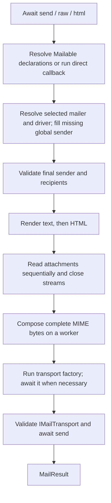

The `Mail` facade starts an independent message declaration. Synchronous fluent methods configure it; asynchronous `send`, `raw`, and `html` methods prepare and deliver it, returning `MailResult`.

The examples run in an initialized Orionis application. They explicitly select the configured `file` mailer, which publishes an `.eml` file instead of contacting an SMTP server. See [configuration](/en/services/mail/configuration) before selecting the mailer intended for real delivery.

```python
from orionis.mail import MailResult
from orionis.support.facades import Mail


class NotificationService:

    async def publish(self, recipient: str) -> MailResult:
        manager = await Mail.resolve()
        return await (
            manager.mailer("file")
            .fromAddress("notifications@example.com", "Example App")
            .to(recipient)
            .subject("Account ready")
            .raw("Your account is ready.")
        )
```

## Facade, manager, and independent chains

Import `Mail` from `orionis.support.facades`. `MailProvider` is an **eager** core provider: it registers singleton `MailComposer` and `IMailManager` services, then pins the facade during normal application startup. It does not open SMTP connections or validate every configured mailer at boot.

`manager = await Mail.resolve()` retrieves the manager explicitly and makes the examples usable even when custom startup has not pinned the facade. Do this before relying on a first synchronous facade builder. Before pinning, `Mail.to(...)` can produce a deferred dispatcher rather than a `PendingMail` that supports chaining.

`MailManager` inherits the eleven public fluent/terminal methods of `PendingMail` and adds `extend`. A fluent call returns a **new `PendingMail`**, leaving the manager and the previous chain unchanged. Save the return value or chain the call. Calling `base.to(...)` and discarding its result does not add recipients to `base`.

A `Message` received by a callback behaves differently: its seven mutators update that operation's configuration and return the **same `Message`**. It has no terminal send methods or body setters.

For constructor/method injection of `IMailManager`, see [manager and injection](/en/services/mail/manager-and-injection).

## Fluent API: headers, recipients, and attachments

The signatures omit `self`. Each operation is synchronous. The `MailManager`/`PendingMail` signature returns `PendingMail`; where listed, the corresponding `Message` signature returns `Self`. That distinction changes how you retain the result, not the mailbox validation rules.

The recipient alias is:

```text
Recipients = str | Address | list[str | Address] | tuple[str | Address, ...]
```

Use one mailbox such as `"ana@example.com"`, an `Address("ana@example.com", "Ana")`, or a list/tuple of such values. A comma-separated string, display-name syntax inside the address string, a set, or a generator is not a recipient collection. `name` is accepted only with a single string mailbox; combining it with an `Address` or collection raises `MailCompositionException`.

Addresses normalize domains to lowercase IDNA form and preserve local-part case. Recipient lists are deduplicated by the normalized mailbox while preserving their first declaration. The final transport union contains To, Cc, and Bcc; Reply-To is excluded. An address cannot be both visible (To/Cc) and Bcc in the final envelope.

<a id="manager-mailer"></a>
<a id="pending-mailer"></a>

### `mailer`: select a configuration entry

```text
mailer(name: str) -> PendingMail
```

`name` is required. It selects a key under `mail.mailers`, not necessarily a driver name. For example, a configured `archive` mailer may use the `file` driver. The last selection on a derived chain wins; an unselected chain uses `mail.default` when sent.

A non-string or blank name raises `MailConfigurationException` immediately. A nonblank name is retained exactly, without trimming or case normalization; an undefined entry fails when the terminal is awaited.

<a id="manager-fromaddress"></a>
<a id="pending-fromaddress"></a>
<a id="message-fromaddress"></a>

### `fromAddress`: replace the sender

```text
fromAddress(address: str | Address, name: str | None = None) -> PendingMail
Message.fromAddress(address: str | Address, name: str | None = None) -> Self
```

`address` is required; `name` defaults to `None`. Sets both the From header and transport sender. The last explicit sender replaces the previous one. The global `mail.from_address` is used only when the final envelope has none.

Invalid mailboxes or ambiguous names raise `MailCompositionException`. The framework needs one final sender before preparing a message.

<a id="manager-to"></a>
<a id="pending-to"></a>
<a id="message-to"></a>

### `to`: append primary recipients

```text
to(addresses: Recipients, name: str | None = None) -> PendingMail
Message.to(addresses: Recipients, name: str | None = None) -> Self
```

Appends the required `addresses` instead of replacing previous To recipients. `name=None` follows the single-string rule above. You can call `to` repeatedly or supply one list/tuple. Mailbox validation failures raise `MailCompositionException`.

<a id="manager-cc"></a>
<a id="pending-cc"></a>
<a id="message-cc"></a>

### `cc`: append visible copies

```text
cc(addresses: Recipients, name: str | None = None) -> PendingMail
Message.cc(addresses: Recipients, name: str | None = None) -> Self
```

Appends Cc recipients using the same accepted inputs and validation as `to`. They appear in the MIME Cc header and belong to the transport recipient union.

<a id="manager-bcc"></a>
<a id="pending-bcc"></a>
<a id="message-bcc"></a>

### `bcc`: append hidden recipients

```text
bcc(addresses: Recipients, name: str | None = None) -> PendingMail
Message.bcc(addresses: Recipients, name: str | None = None) -> Self
```

Appends hidden transport recipients. The composer does not write a Bcc header into the MIME bytes. A Bcc-only message is valid: To is not mandatory if Cc or Bcc provides recipients.

A visible/Bcc collision in the merged envelope raises `MailCompositionException` at sending. Avoid exposing `MailResult.recipients` indiscriminately: it includes hidden recipients.

<a id="manager-replyto"></a>
<a id="pending-replyto"></a>
<a id="message-replyto"></a>

### `replyTo`: append reply destinations

```text
replyTo(addresses: Recipients, name: str | None = None) -> PendingMail
Message.replyTo(addresses: Recipients, name: str | None = None) -> Self
```

Appends mailboxes to the Reply-To header. These mailboxes do not receive the original message unless also declared in To, Cc, or Bcc. Accepted inputs, `name=None`, and validation are the same as `to`.

<a id="manager-subject"></a>
<a id="pending-subject"></a>
<a id="message-subject"></a>

### `subject`: replace the subject

```text
subject(value: str) -> PendingMail
Message.subject(value: str) -> Self
```

`value` is required. The last value wins, including an intentionally empty string. Subject text is literal; it is not a template. Non-string values or control characters, including CR/LF, raise `MailCompositionException`.

<a id="manager-attach"></a>
<a id="pending-attach"></a>
<a id="message-attach"></a>

### `attach`: append a deferred storage attachment

```text
attach(attachment: Attachment) -> PendingMail
Message.attach(attachment: Attachment) -> Self
```

`attachment` must be an `Attachment` declaration; a path string alone raises `MailCompositionException`. Repeated calls append attachments in order. Declarations validate logical storage paths and metadata without opening a file. The file is read during the awaited terminal; an unreadable attachment produces `MailAttachmentException` before transport.

This complete service demonstrates all eight fluent methods, including a file created through `Storage`:

```python
from orionis.mail import Address, Attachment, Content, MailResult
from orionis.support.facades import Mail, Storage


class MonthlyReportService:

    async def publish(self) -> MailResult:
        storage = await Storage.resolve()
        await storage.disk("local").file("reports/monthly.txt").write(
            "Monthly total: 42\n",
        )
        manager = await Mail.resolve()
        return await (
            manager.mailer("file")
            .fromAddress(Address("reports@example.com", "Example Reports"))
            .to(["ana@example.com", Address("luis@example.com", "Luis")])
            .cc("audit@example.com")
            .bcc("archive@example.com")
            .replyTo("support@example.com", "Support")
            .subject("Monthly report")
            .attach(
                Attachment.fromStorage(
                    "reports/monthly.txt",
                    disk="local",
                    name="monthly-report.txt",
                    mime_type="text/plain",
                ),
            )
            .send(
                Content(
                    text="Your report is attached.",
                    html="<p>Your report is attached.</p>",
                ),
            )
        )
```

The `local` disk must be configured. Its logical path is not a process-relative filesystem path. For disk selection, filenames, MIME precedence, and streams, see [attachments](/en/services/mail/attachments).

## Terminal methods

These methods are asynchronous and return `MailResult`. Building a chain performs no rendering, attachment reads, or transport I/O. Awaiting a terminal starts that work; each terminal call is a separate send, even when the same chain or Mailable is reused.

<a id="manager-send"></a>
<a id="pending-send"></a>

### `send`: Mailable, view, or Content

The three supported overloads are:

```text
async send(mailable: Mailable | type[Mailable], /) -> MailResult
async send(
    view: str, /,
    data: Mapping[str, object] | None = None,
    callback: MessageCallback | None = None,
) -> MailResult
async send(
    content: Content, /, *,
    callback: MessageCallback | None = None,
) -> MailResult
```

The first argument is positional-only. The runtime implementation distinguishes omitted optional arguments with `MISSING`:

```text
async send(
    value: Mailable | type[Mailable] | str | Content, /,
    data: object = MISSING,
    callback: object = MISSING,
) -> MailResult
```

| First argument | Context | Callback |
| --- | --- | --- |
| Mailable instance | Owned by `content()`; extra `data` is rejected. | Rejected, even `callback=None`. |
| Mailable class | Constructed per send through the application container. | Rejected, even `callback=None`. |
| View name string | Optional mapping with string keys; `None` means an empty context. | Optional sync/async configurator. |
| `Content` | Already owned by the content object; extra `data` is rejected, even `None`. | Pass using `callback=...`. |

Invalid types or argument combinations raise `MailCompositionException`. Do not pass `data=None` with a Mailable or Content merely to fill an argument position.

#### Send a reusable declaration or its class

```python
from orionis.mail import Content, Envelope, MailResult, Mailable
from orionis.support.facades import Mail


class StatusMail(Mailable):

    def envelope(self) -> Envelope:
        return Envelope(
            from_address="status@example.com",
            subject="Service status",
        )

    def content(self) -> Content:
        return Content(text="All systems operational.")


class StatusNotificationService:

    async def from_instance(self, recipient: str) -> MailResult:
        manager = await Mail.resolve()
        return await manager.mailer("file").to(recipient).send(StatusMail())

    async def from_container(self, recipient: str) -> MailResult:
        manager = await Mail.resolve()
        return await manager.mailer("file").to(recipient).send(StatusMail)
```

Passing an instance uses it as supplied. Passing a class asks `app.build` for a fresh Mailable, allowing constructor injection; construction failures are wrapped as `MailCompositionException` with their cause. A standalone `PendingMail` without a Mailable builder cannot resolve a class.

`envelope()`, `content()`, and `attachments()` are synchronous declarations returning `Envelope`, `Content`, and a `Sequence[Attachment]` respectively. An async declaration is rejected. Prepare business data before creating an instance when its constructor requires values such as an order number. See [composing reusable mail](/en/services/mail/composing-mail).

#### Send an HTML view

With the default view path, create `resources/views/emails/welcome.html`:

```html
<p>Hello, {{ name }}.</p>
```

Then send the view identifier and explicit context:

```python
from orionis.mail import MailResult
from orionis.support.facades import Mail


class WelcomeNotificationService:

    async def publish(self, recipient: str, name: str) -> MailResult:
        manager = await Mail.resolve()
        return await (
            manager.mailer("file")
            .fromAddress("welcome@example.com")
            .to(recipient)
            .subject("Welcome")
            .send("emails.welcome", {"name": name})
        )
```

A string passed to `send` identifies an HTML view, not a literal body. The composer calls the configured view engine without constructing an HTTP response. Missing templates or rendering failures become `MailCompositionException`. See [content and views](/en/services/mail/content-and-views) for text templates, context snapshots, and alternatives.

#### Send explicit Content

```python
from orionis.mail import Content, MailResult
from orionis.support.facades import Mail


class AccountNotificationService:

    async def publish(self, recipient: str) -> MailResult:
        manager = await Mail.resolve()
        return await (
            manager.mailer("file")
            .fromAddress("accounts@example.com")
            .to(recipient)
            .subject("Account ready")
            .send(
                Content(
                    text="Your account is ready.",
                    html="<p>Your account is ready.</p>",
                ),
            )
        )
```

`Content` allows at most one declaration per body type: HTML is `view` or `html`; plain text is `text_view` or `text`. At least one body is required, but an empty literal string is valid. Supplying both text and HTML creates MIME alternatives.

<a id="manager-raw"></a>
<a id="pending-raw"></a>

### `raw`: literal plain text

```text
async raw(text: str, callback: MessageCallback | None = None) -> MailResult
```

`text` is required; `callback=None` is optional. The text is never interpreted as a template, including strings containing `{{ ... }}`. It follows the same configuration, preparation, callback, and transport pipeline as `send(Content(text=...))`. An invalid body or callback raises `MailCompositionException`.

<a id="manager-html"></a>
<a id="pending-html"></a>

### `html`: literal HTML

```text
async html(html: str, callback: MessageCallback | None = None) -> MailResult
```

`html` is required; `callback=None` is optional. Sends literal HTML without template rendering or automatic creation of a plain-text alternative. For untrusted variables, use a view with the configured escaping policy.

```python
from orionis.mail import MailResult
from orionis.support.facades import Mail


class LiteralNotificationService:

    async def plain(self, recipient: str) -> MailResult:
        manager = await Mail.resolve()
        return await (
            manager.mailer("file")
            .fromAddress("notices@example.com")
            .to(recipient)
            .raw("Literal template syntax: {{ name }}")
        )

    async def rich(self, recipient: str) -> MailResult:
        manager = await Mail.resolve()
        return await (
            manager.mailer("file")
            .fromAddress("notices@example.com")
            .to(recipient)
            .html("<p>Your export is ready.</p>")
        )
```

## Callbacks and the Message configurator

A direct-send callback receives exactly one operation-local `Message` initialized from its pending chain. It runs once before mailer resolution, rendering, or transport. A synchronous callback can return `None` or that same `Message`. If its result is awaitable, Orionis awaits it and applies the same return rule.

```text
MessageCallback = Callable[
    [Message],
    Message | Awaitable[Message | None] | None,
]
```

Returning `False` does not cancel sending: it is a `MailCompositionException`. Returning another `Message` or any other value also fails. An existing `MailCompositionException` propagates unchanged; other ordinary callback exceptions are wrapped as `MailCompositionException` with their cause. Cancellation propagates instead of being converted.

This callback uses every `Message` mutator; each returns the same configurator:

```python
from orionis.mail import Attachment, MailResult, Message
from orionis.support.facades import Mail, Storage


class CallbackNotificationService:

    async def publish(self, recipient: str) -> MailResult:
        storage = await Storage.resolve()
        await storage.disk("local").file("reports/summary.txt").write(
            "Summary total: 42\n",
        )

        def configure(message: Message) -> Message:
            return (
                message.fromAddress("reports@example.com", "Reports")
                .to(recipient)
                .cc("audit@example.com")
                .bcc("archive@example.com")
                .replyTo("support@example.com")
                .subject("Summary")
                .attach(
                    Attachment.fromStorage("reports/summary.txt", disk="local"),
                )
            )

        manager = await Mail.resolve()
        return await manager.mailer("file").raw("Summary attached.", configure)
```

An asynchronous callback can load operation-specific metadata before finalizing the message:

```python
from collections.abc import Awaitable, Callable

from orionis.mail import MailResult, Message
from orionis.support.facades import Mail


class AsyncCallbackNotificationService:

    async def publish(
        self,
        recipient: str,
        load_subject: Callable[[], Awaitable[str]],
    ) -> MailResult:
        async def configure(message: Message) -> None:
            message.to(recipient).subject(await load_subject())

        manager = await Mail.resolve()
        return await (
            manager.mailer("file")
            .fromAddress("notices@example.com")
            .raw("Your notification is ready.", callback=configure)
        )
```

A callback can be a function, bound method, or callable object. It is not automatically resolved through the dependency container: capture dependencies or use a bound method of an injected service. Do not share the mutable `Message` between operations. A snapshot is detached before preparation, so later mutations do not alter the sent envelope.

## Merge rules and precedence

| Field | Repeated fluent calls | Direct-send callback | Mailable plus pending chain |
| --- | --- | --- | --- |
| Mailer | Last selection wins. | `Message` has no mailer setter. | Chain selects it; otherwise the global default applies. |
| Sender | Last explicit sender wins. | Overrides the chain sender. | Explicit chain sender overrides `envelope()`. Global sender only fills a remaining absence. |
| Subject | Last value wins, including `""`. | Overrides the chain subject. | Explicit chain subject overrides `envelope()`, including `""`. |
| To/Cc/Bcc/Reply-To | Append to the same collection. | Appends after the chain's entries. | Declared recipients first, then chain entries. |
| Attachments | Append in order. | Appends after chain attachments. | Mailable attachments first, then chain attachments. |
| Bodies/context | Supplied by the terminal. | No body/context setters. | Mailable owns `content()`; no extra data or callback accepted. |

There is no fluent method for clearing a recipient collection. Start a different chain when it needs different base recipients. Merging rebuilds an `Envelope`, so a visibility/Bcc conflict cannot bypass validation.

## What happens when you await a terminal



Preparation completes before resolving a transport instance. Invalid declarations, failed views, or unreadable attachments do not open SMTP connections or publish mail files. The selected name and driver are checked before preparation; transport-specific settings are validated when its factory is invoked.

Native transports run blocking SMTP or file publication on workers. A shared factory can return a shared custom transport, but its implementation must isolate operation state. The manager itself retains no per-send envelope, content, or attachment payloads.

<a id="mail-result"></a>

## MailResult: interpret the actual outcome

All terminals return the same frozen, slotted result. Its keyword-only constructor is:

```text
MailResult(
    *,
    message_id: str,
    mailer: str,
    driver: str,
    status: MailStatus,
    recipients: tuple[str, ...],
    accepted_recipients: tuple[str, ...] = (),
    rejected_recipients: Mapping[str, tuple[int, str]] = <factory>,
    file_path: Path | None = None,
) -> None
```

| Field | Meaning |
| --- | --- |
| `message_id` | Message-ID generated during this send's MIME composition. |
| `mailer` | Selected configuration entry name. |
| `driver` | Transport implementation name. |
| `status` | Confirmed native outcome, described below. |
| `recipients` | Intended, deduplicated transport recipients, including Bcc. |
| `accepted_recipients` | SMTP-confirmed recipients; an empty tuple for file publication. |
| `rejected_recipients` | Read-only mapping `address -> (SMTP code, reason)`; empty for file publication. |
| `file_path` | Published `Path` for file results; `None` for SMTP. |

Recipient collections are copied to tuples. Rejections are copied into a read-only mapping; reasons are reduced to a bounded single line of at most 512 characters. The native SMTP transport redacts known credentials before constructing the result. Custom transports must also redact secrets; the result constructor does not know their credentials.

| Status | Confirmed evidence | Limit |
| --- | --- | --- |
| `MailStatus.ACCEPTED` / `"accepted"` | SMTP accepted every intended recipient. | Does not prove final mailbox delivery or reading. |
| `MailStatus.PARTIAL` / `"partial"` | SMTP accepted some recipients and rejected others. | A retry to everyone can duplicate already accepted mail. |
| `MailStatus.STORED` / `"stored"` | A complete `.eml` was published by the file transport. | No SMTP acceptance is claimed. |

If SMTP rejects every recipient, the native transport raises `MailTransportException` rather than returning a fourth status. There is no `failed` result status or built-in `success()` helper.

Process the returned result in application logic without inventing an outcome:

```python
from orionis.mail import MailResult, MailStatus


class DeliverySummaryService:

    async def summarize(self, result: MailResult) -> dict:
        return {
            "message_id": result.message_id,
            "mailer": result.mailer,
            "driver": result.driver,
            "status": result.status.value,
            "accepted_count": len(result.accepted_recipients),
            "rejected_count": len(result.rejected_recipients),
            "needs_recipient_review": result.status is MailStatus.PARTIAL,
            "stored_path": str(result.file_path) if result.file_path else None,
        }
```

Keep recipient details and rejection diagnostics in appropriately scoped application records rather than exposing them in a public response.

## Errors and cancellation

| Exception | Typical stage |
| --- | --- |
| `MailConfigurationException` | Invalid/unknown mailer, unregistered driver, invalid native transport settings, duplicate extension, or factory returning a non-`IMailTransport`. |
| `MailCompositionException` | Invalid addresses/headers/content, incompatible `send` arguments, invalid Mailable declarations, callback failure, view failure, or MIME encoding error. |
| `MailAttachmentException` | Invalid storage attachment declaration or failure opening, inspecting, reading, or closing its stream. Subclass of `MailCompositionException`. |
| `MailTransportException` | Native SMTP failure, total recipient rejection, or file publication failure. |
| `asyncio.CancelledError` | Cancellation remains cancellation; it is not converted to a mail failure result. |

These mail exceptions inherit from `MailException`. Custom callbacks, factories, and transports can execute application code; custom factory/transport exceptions are not universally normalized by the manager.

Cancellation during a callback stops the pipeline before transport. During an attachment read, the composer shields its owned storage task and waits for stream cleanup before propagating cancellation, so cancellation can take time.

Once a native SMTP/file worker is running, cancelling the awaiting coroutine does not stop that synchronous worker. A file may still be published or SMTP may already have accepted the message. Disconnection likewise does not prove non-delivery. There are no automatic retries, durable send records, idempotency keys, or `Mail.queue`/batch terminal methods. Decide retry and deduplication policy in application code; retain accepted/rejected recipient evidence for a partial outcome.

## Concurrent sends

Branch a reusable pending chain instead of mutating shared operation state:

```python
import asyncio

from orionis.mail import MailResult
from orionis.support.facades import Mail


class IndependentNotificationsService:

    async def publish(self) -> list[MailResult]:
        manager = await Mail.resolve()
        base = (
            manager.mailer("file")
            .fromAddress("notices@example.com")
            .subject("Notice")
        )
        first = base.to("ana@example.com")
        second = base.to("luis@example.com")
        return await asyncio.gather(
            first.raw("Hello, Ana."),
            second.raw("Hello, Luis."),
        )
```

Both derivations retain their own recipients. Every awaited send invokes the transport factory; native SMTP uses one connection per message, and native file publication uses unique output files. There is no shared SMTP connection pool or automatic parallelization inside one preparation.

Reusing a Mailable does not mutate it in the framework. Its own declaration methods and any user objects captured in context must still be safe for concurrent access: owned containers are snapshotted, but arbitrary application objects retain their identity.

<a id="manager-extend"></a>

## extend: register a transport factory

```text
extend(driver: str, factory: TransportFactory) -> None

TransportFactory = Callable[
    [IApplication, Mapping[str, object]],
    IMailTransport | Awaitable[IMailTransport],
]
```

Register during provider startup, before concurrent sends. `driver` is a required, nonblank string retained exactly. `factory` is required and callable. Built-in `smtp`/`file` names and previously registered names cannot be replaced; invalid/duplicate registration raises `MailConfigurationException`.

Registration performs no I/O and does not invoke the factory. At sending, it receives the application and an immutable snapshot of the selected mailer configuration, including `driver`. Its result is awaited when necessary and must implement `IMailTransport`. The factory runs per send; only its registration is retained.

An application startup component can receive its concrete factory and register it through the resolved manager:

```python
from orionis.mail.types import TransportFactory
from orionis.support.facades import Mail


class MailDriverRegistration:

    async def register(self, driver: str, factory: TransportFactory) -> None:
        manager = await Mail.resolve()
        manager.extend(driver, factory)
```

A configured mailer must then select that driver. The consumer facade stub intentionally focuses on composition and terminal methods; use the resolved manager or injected `IMailManager` for `extend`. See [transports and extensions](/en/services/mail/transports-and-extensions) for complete implementations.

## Operation snapshots and advanced construction

Normal application code obtains the manager through the facade or injection. These constructors describe the public components used by the pipeline; they do not boot an application or configure a transport.

<a id="manager-construction"></a>

### MailManager

```text
MailManager(app: IApplication, composer: MailComposer) -> None
```

Retains the application's configuration/container and shared composer, initializes an empty pending chain, and defers transport factories. The composer needs configured view and storage engines even for a send containing literal text and no attachments.

<a id="pending-construction"></a>

### PendingMail

```text
PendingMail(
    delivery: Delivery,
    options: MailOptions | None = None,
    mailable_builder: Callable[[type[Mailable]], Awaitable[Mailable]] | None = None,
) -> None

Delivery = Callable[
    [str | None, Envelope, Content, tuple[Attachment, ...]],
    Awaitable[MailResult],
]
```

`delivery` is required and owns the actual preparation/transport pipeline. `options=None` creates empty `MailOptions`. `mailable_builder=None` means a Mailable instance is accepted, but passing its class cannot be resolved. Construction does not perform I/O or validate an entire delivery implementation.

<a id="message-construction"></a>

### Message

```text
Message(options: MailOptions | None = None) -> None
```

`options=None` starts an empty configurator. PendingMail creates a new one per direct send using the chain's snapshot. Its public methods are the seven mutators documented above; snapshot extraction is internal to the pipeline.

<a id="delivery-options"></a>

### MailOptions

`MailOptions` is exported from `orionis.mail.entities`. It is a frozen, slotted snapshot with these constructor fields:

```text
MailOptions(
    mailer: str | None = None,
    from_address: Address | None = None,
    subject: str | None = None,
    to: tuple[Address, ...] = (),
    cc: tuple[Address, ...] = (),
    bcc: tuple[Address, ...] = (),
    reply_to: tuple[Address, ...] = (),
    attachments: tuple[Attachment, ...] = (),
) -> None
```


| Field | Type | Default |
| --- | --- | --- |
| `mailer` | `str \| None` | `None` |
| `from_address` | `Address \| None` | `None` |
| `subject` | `str \| None` | `None` |
| `to` | `tuple[Address, ...]` | `()` |
| `cc` | `tuple[Address, ...]` | `()` |
| `bcc` | `tuple[Address, ...]` | `()` |
| `reply_to` | `tuple[Address, ...]` | `()` |
| `attachments` | `tuple[Attachment, ...]` | `()` |

`envelope(base: Envelope | None = None) -> Envelope` constructs a new validated envelope. `None` scalar options preserve the base declaration; explicit subject/sender values override it, and recipient tuples are appended. `base=None` starts from an empty `Envelope`. A visible/Bcc conflict raises `MailCompositionException`.

```python
from orionis.mail import Address, Envelope
from orionis.mail.entities import MailOptions


class DeliveryOptionsService:

    async def envelope_for(self, recipient: str) -> Envelope:
        options = MailOptions(
            subject="",
            to=(Address(recipient),),
        )
        return options.envelope(
            Envelope(
                from_address="notices@example.com",
                subject="Original subject",
            ),
        )
```

The resulting envelope intentionally has an empty subject and the new recipient. The snapshot's `mailer` and `attachments` are consumed separately by PendingMail; `envelope()` does not send anything.

<a id="prepared-mail"></a>

### PreparedMail

`PreparedMail`, exported from `orionis.mail.entities`, is the frozen, slotted value passed to a transport:

```text
PreparedMail(
    *,
    message_id: str,
    sender: str,
    recipients: tuple[str, ...],
    mime: bytes,
    smtp_utf8: bool,
) -> None
```

All five fields are required and keyword-only. `sender` is the transport mailbox; `recipients` is the deduplicated To/Cc/Bcc union. `mime` contains complete MIME bytes without a Bcc header. `smtp_utf8` indicates international mailbox requirements; a Unicode display name alone does not require SMTPUTF8. Transports receive no templates, logical attachment paths, or mutable `EmailMessage`.

Use the [API reference](/en/services/mail/api-reference) for the component inventory and [content and views](/en/services/mail/content-and-views) to continue with body declarations.
