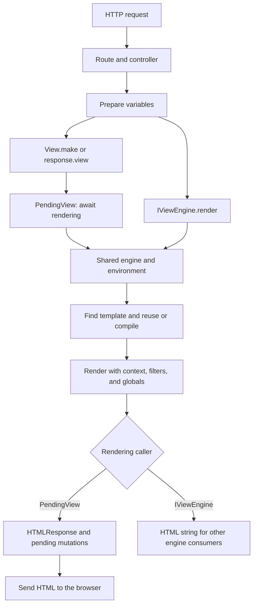

Views generate server-side HTML from a template and data supplied by your application. Orionis integrates Jinja2 with its container, HTTP responses, sessions, and framework helpers. The engine uses asynchronous rendering and can await asynchronous services from templates without writing `await` in them.

The engine lives in `orionis/view`. Application templates belong in `resources/views` by default; `config/view.py` can add or change directories. Views do not contain the logic that queries data or authorizes an operation: prepare that information in controllers or services and pass the required context.

## Your first page

Create `resources/views/pages/welcome.html` manually:

```jinja
<!doctype html>
<html lang="en">
<head>
    <meta charset="utf-8">
    <meta name="viewport" content="width=device-width, initial-scale=1">
    <title>{{ page_title }}</title>
</head>
<body>
    <h1>{{ page_title }}</h1>
    <ul>
        
            <li>{{ feature }}</li>
        
    </ul>
</body>
</html>
```

In `app/http/controllers/welcome_page_controller.py`:

```python
from orionis.http import HTMLResponse
from orionis.http.base import BaseController
from orionis.support.facades import View


class WelcomePageController(BaseController):
    async def __call__(self) -> HTMLResponse:
        return await View.make(
            "pages.welcome",
            page_title="Welcome to Orionis",
            features=["Async rendering", "Layouts", "Template helpers"],
        )
```

Register a route in `routes/web.py`, loaded by your existing `app.withRouting(web="routes/web.py", ...)` configuration:

```python
from app.http.controllers.welcome_page_controller import WelcomePageController
from orionis.support.facades import Route

Route.get("/welcome-page", WelcomePageController)
```

With the application running, open `http://localhost:8000/welcome-page` or the address shown in its console. Orionis finds `pages/welcome.html`, adds `page_title` and `features` to the context, and returns an HTML response. Ordinary values are escaped with the default configuration.

`pages.welcome` is an Orionis identifier; `pages/welcome.html` is the template path. Dots become directories when the identifier has no `/`. Inside `extends`, `include`, and `import`, use template filenames. The [template guide](/en/services/views/template-language) explains these differences.

## HTTP response or HTML text

| Need | API | Result |
| --- | --- | --- |
| Return a page to the browser | `return await View.make("pages.welcome", **data)` | `HTMLResponse` containing rendered HTML. |
| Use the HTTP builder | `return await response.view("pages.welcome", **data)` | The same view flow. |
| Obtain content for another use | `await engine.render("pages.welcome", data)` with an injected `IViewEngine` | A `str` containing HTML, without an HTTP response. |

`View.make()` prepares a `PendingView`: work happens when awaited. Its `render()` method also returns `HTMLResponse`; use the engine for a string, rather than a nonexistent `View.render()` method. See [Controllers and HTML](/en/services/views/rendering-templates) for complete examples of variables, controllers, headers, and HTML to save.

## Organize and extend templates

A typical structure is:

```text
resources/views/
├── layouts/base.html
├── pages/welcome.html
├── partials/navigation.html
└── macros/forms.html
```

These directories organize your files; they do not automatically register components. A layout defines blocks; pages extend it, partials are included, and macros encapsulate reusable fragments. See [Templates and inheritance](/en/services/views/template-language).

The environment includes **56 filters** —54 standard and 2 Orionis filters—, **36 global names** —30 Orionis and 6 standard names—, and the `` extension. The catalogs give an example for every filter and global, so you do not need to inspect source code to learn their usage.

- [Filters](/en/services/views/filters): transformations, formatting, collections, JSON, Markdown, and escaping.
- [Globals and context](/en/services/views/globals): routes, assets, sessions, forms, translations, and other helpers.
- [Providers and extensions](/en/services/views/providers-and-extensions): custom filters, globals, tests, and tags registered during startup.

## Configuration and caching

`config/view.py` configures template search paths, the number held in memory, the bytecode directory, source reloading, and HTML escaping. Bytecode is stored in `storage/framework/views` by default and contains compiled templates, rather than final HTML or individual users' data.

Memory and disk caches are independent. They reduce repeated loading or compilation work according to the layer; HTML still renders with each request's data. [Configuration and cache](/en/services/views/configuration-and-extensions) explains actual options, defaults, and `orionis clear:views`.

## Rendering flow



Async rendering can await asynchronous callables but does not automatically make a blocking function nonblocking. Execute queries and business work in services before rendering, and keep the shared environment stable during requests.

Translation helpers remain available in templates; see [Localization](/en/services/localization). For HTTP formats, cookies, or downloads, see [Responses](/en/http/responses).
