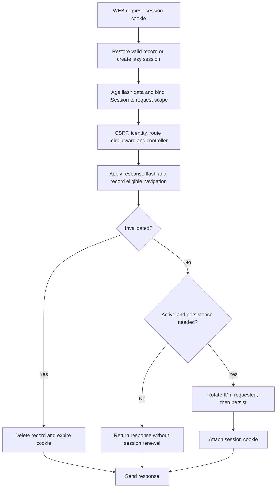

Session settings live in `config/session.py`, in the `BootstrapSession` class. Its fields inherit validation from `orionis.foundation.config.session.Session` and read environment values when the application's configuration is constructed.

Configure storage and the cookie before starting workers. The manager keeps those values throughout its lifetime; changing an environment variable does not reconfigure a request already in progress.

## All configuration options

These are the defaults in `config/session.py` when no environment variable overrides them.

### Storage and duration

| Field and environment variable | Default | Purpose |
|---|---|---|
| `driver` · `SESSION_DRIVER` | `"memory"` | Server store: `memory`, `file`, `database` or `cache`. Python configuration also accepts `SessionDriver` members. |
| `lifetime` · `SESSION_LIFETIME` | `120` | Record lifetime in **minutes** since its last persistence. An integer greater than zero. |
| `expire_on_close` · `SESSION_EXPIRE_ON_CLOSE` | `False` | When `True`, omits `Max-Age` and issues a browser session cookie. The server record remains subject to `lifetime`. |
| `renewal_interval` · `SESSION_RENEWAL_INTERVAL` | `0` | Interval in **seconds** for renewing unchanged scalar data. `0` renews on every save of an active session. |
| `track_previous_url` · `SESSION_TRACK_PREVIOUS_URL` | `True` | Remembers the URL of a GET/HEAD navigation with a 200–299 response, excluding AJAX and requests asking for JSON. |
| `files` · `SESSION_FILES` | `"storage/framework/sessions"` | Directory for the `file` driver. Relative paths resolve from the project root. Use a nonempty path when selecting that driver. |
| `connection` · `SESSION_DB_CONNECTION` | `None` | Database connection for the `database` driver; `None` uses the default connection. |
| `table` · `SESSION_DB_TABLE` | `"sessions"` | Table for the `database` driver. |
| `cache` · `SESSION_CACHE_STORE` | `None` | Store for the `cache` driver; `None` uses the default cache store. |

See [stores and concurrency](/en/sessions/stores-and-concurrency) to select a driver and prepare its dependencies.

### Cookie identity and scope

| Field and environment variable | Default | Purpose |
|---|---|---|
| `cookie` · `SESSION_COOKIE` | `"sessionid"` | Cookie name containing the session identifier. Must be a valid cookie name. |
| `path` · `SESSION_PATH` | `"/"` | Cookie path; must start with `/`. |
| `domain` · `SESSION_DOMAIN` | `None` | Omits `Domain` and restricts the cookie to the host issuing it. An explicit domain must be a nonempty string without leading/trailing dots or consecutive dots. |

### Security policy

| Field and environment variable | Default | Purpose |
|---|---|---|
| `secure` · `SESSION_SECURE` | `False` | Adds `Secure` to restrict sending the cookie to HTTPS. |
| `http_only` · `SESSION_HTTP_ONLY` | `True` | Adds `HttpOnly` to prevent JavaScript from reading the session cookie. |
| `same_site` · `SESSION_SAME_SITE` | `"lax"` | Policy: `lax`, `strict` or `none`. Python configuration also accepts `SameSitePolicy`. `none` requires `secure=True`. |
| `partitioned` · `SESSION_PARTITIONED` | `False` | Adds the `Partitioned` cookie attribute when enabled. Does not change the driver or partition server records. |

Boolean fields must be actual booleans in Python configuration. `renewal_interval` must be an integer between `0` and `lifetime * 60 - 1`. Driver names and SameSite policies are normalized to lowercase.

The `None` defaults in these tables are Python values: leave the default when you do not need that field. Avoid setting an empty domain or connection in the configuration file.

## Configuration example

These variables retain a cookie suitable for local HTTP development and allow renewals to be skipped for five minutes when the session contains only unchanged scalar data:

```dotenv
SESSION_DRIVER=memory
SESSION_LIFETIME=120
SESSION_EXPIRE_ON_CLOSE=false
SESSION_RENEWAL_INTERVAL=300
SESSION_TRACK_PREVIOUS_URL=true
SESSION_COOKIE=sessionid
SESSION_PATH=/
SESSION_SECURE=false
SESSION_HTTP_ONLY=true
SESSION_SAME_SITE=lax
SESSION_PARTITIONED=false
```

The `memory` driver belongs to one process. To deploy several workers or preserve sessions after a restart, select an appropriate store in [the driver guide](/en/sessions/stores-and-concurrency).

For an HTTPS deployment, adjust at least:

```dotenv
SESSION_SECURE=true
SESSION_HTTP_ONLY=true
SESSION_SAME_SITE=lax
```

`SameSite=strict` restricts cross-site sending further; `none` allows cross-site contexts and requires `secure=True`. `Partitioned` is a cookie option, not an authentication mechanism. The framework does not automatically enable `Secure` when `partitioned=True`.

## How a request proceeds

Session middleware is integrated into the normal **WEB** route chain. It restores the record, ages flash data, exposes the session as `request.state.session` and registers `ISession` in the request's container. It then allows the remaining middleware and the controller to run.

When the response returns, it applies attached flash data, updates the navigation URL when eligible, and saves the session before sending the response.



A missing cookie, malformed identifier or missing/expired record produces a new lazy session. The incoming identifier is validated before querying the store. The first write activates the session and generates its identifier.

**A controller that only reads does not imply that the request cannot create a session.** CSRF protection can store its token, and navigation tracking can write the URL. API routes do not restore or save sessions automatically; use the WEB context for this section's examples.

## Expiration and renewal

When persisting a session, Orionis sets its expiration to `now + lifetime`. With `expire_on_close=False`, the cookie receives `Max-Age=lifetime * 60`. With `True`, it omits `Max-Age`; the server record still expires, and closing the browser does not execute immediate deletion in the store.

With `renewal_interval=0`, every response for an active session saves it and renews the cookie. With a positive interval, a restored session containing only immutable scalars can retain its expiration and skip the write and `Set-Cookie` until renewal is due. The deadline is checked when the response is ready.

New sessions, changes, flash aging and rotation requests still persist. Payloads containing lists, dictionaries or other nonscalar values are also saved conservatively because they can change through a reference without setting `dirty`. Reading a session still queries its store; the interval reduces renewals, not reads.

Tracking a different URL also changes data. The interval therefore optimizes unchanged sessions; it does not promise that every request waits that many seconds before saving.

## Rotate or invalidate from a controller

`regenerate()` requests a new identifier **while keeping the data**. The change is deferred: the manager deletes the old record, assigns another ID and persists when processing the response. Do not use `Session.id` inside the controller as though it were already the rotated identifier.

`invalidate()` clears data and requests record deletion and cookie expiration. `clear()` only clears values; it retains session identity and does not invalidate the session.

For example, in `routes/web.py`:

```python
from orionis.http import JSONResponse
from orionis.support.facades import Route, Session


class SessionLifecycleController:

    async def rotate(self) -> JSONResponse:
        Session.regenerate()
        return JSONResponse({"message": "Session rotation requested."})

    async def reset(self) -> JSONResponse:
        Session.invalidate()
        return JSONResponse({"message": "Session cleared."})


Route.post("/session/rotate", [SessionLifecycleController, "rotate"])
Route.post("/session/reset", [SessionLifecycleController, "reset"])
```

These endpoints change state and require the session's CSRF token, like other POST requests to WEB routes. See [HTTP middleware](/en/http/middleware) for form and header integration.

The [session authentication API](/en/authentication/session-authentication) already rotates the ID on login and explicitly replaces the CSRF token. Use its logout operation to end an authenticated session: it also coordinates identity and the remember-me cookie. The `reset` example demonstrates session data invalidation; it does not replace that flow.

Session rotation alone retains the existing CSRF token because it keeps data. Invalidation removes it; a subsequent request obtains a new session and token.

## Failures and usage considerations

- Do not construct a new session in every controller or share an instance across requests. Use [the facade or `ISession` injection](/en/sessions/state-and-flash).
- Middleware owns `SessionManager.start()`, `save()` and `abort()`, which are asynchronous infrastructure operations. Controller data operations are synchronous; do not save a second time manually.
- A controller exception transformed into a response can still persist flash data and session changes. If the request cannot produce a response or is cancelled, `abort()` deletes identifiers marked for invalidation or replacement without issuing a new cookie.
- A restored record revoked by another request is not recreated by a late update. See [concurrency](/en/sessions/stores-and-concurrency) for the scope of this protection.
- The cookie transports the identifier, not the entire payload. Session stores do not automatically encrypt every payload; keep stored data limited to what you need.
- `HttpOnly` protects reading the cookie from scripts and does not replace CSRF protection. The session cookie and optional `XSRF-TOKEN` cookie serve different purposes.

If a session is not retained across requests, inspect `Set-Cookie`, the cookie sent by the next request, its domain/path, `Secure` and the selected driver. If a state-changing WEB request fails CSRF validation, use a token from that same session. Actual backend errors propagate; they are not hidden by issuing a cookie promising data that could not be saved.
