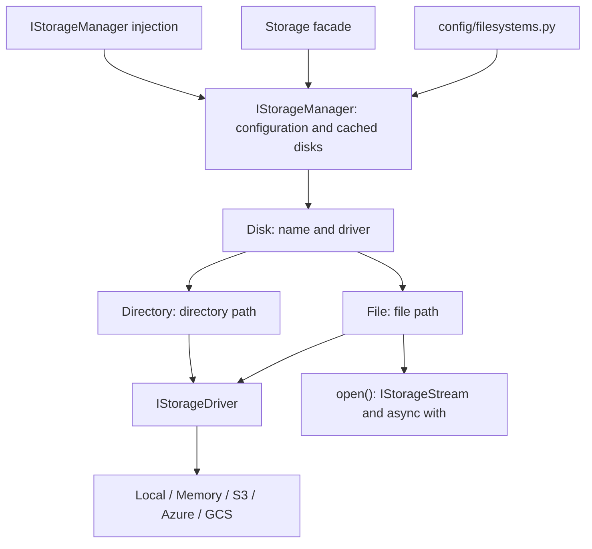

Storage provides an asynchronous API for saving, reading, copying, moving, and deleting files from controllers, services, and other application components. It supports local storage, memory, Amazon S3, Azure Blob Storage, and Google Cloud Storage; capabilities and publication behavior depend on the driver.

## Disks, drivers, and references

A **disk** is a named configuration: it contains the local root, bucket, or container and its options. A **driver** executes operations against that medium. Two disks can use the same driver: `local` and `public` use the local driver with different roots and publication settings.



`Storage.disk()` and the references `disk.file(path)` and `disk.directory(path)` are synchronous. Building a reference does not read or create its file. Await I/O operations; consume the iterator returned by `readStream()` with `async for`.

## Save a private application file

The `local` disk is available without a cloud SDK or credentials. In your application's `.env`, before startup:

```dotenv
FILESYSTEM_DISK=local
LOCAL_PATH=storage/app/private
```

Ensure the process can write to that directory. `config/filesystems.py` owns the disk definitions. After bootstrap, call the facade from an async controller, command, or service:

```python
from uuid import UUID
from orionis.support.facades import Storage


async def save_report(report_id: UUID, content: bytes) -> str:
    file = await Storage.disk("local").put(
        f"reports/{report_id}.txt", content, visibility="private",
    )
    return file.path()
```

The result is a logical path such as `reports/550e8400-e29b-41d4-a716-446655440000.txt`, not an HTTP URL. Save that path with the report's metadata. To read later, obtain the authorized report record, then use `await Storage.disk("local").file(saved_path).read()`; the result is `bytes`.

`put()` replaces content at the same path. The default private disk is not publicly served. Returning a path does not authorize a download or publish the directory; implement that policy in your application.

## Choose the next step

1. [Files and directories](/en/storage/files-and-directories): save, read, inspect, copy, move, list, and delete.
2. [Streams and uploads](/en/storage/streaming-and-uploads): validate HTTP uploads and process larger files without assuming unlimited memory.
3. [Disks and drivers](/en/storage/disks-and-drivers): local/public disks, optional S3/Azure/GCS dependencies, credentials, URLs, and extensions.

4. [Complete configuration](/en/storage/configuration): fields, environment variables, validation, and defaults in `config/filesystems.py`.
5. [Temporary files and contexts](/en/storage/temporary-files-and-contexts): closing, publication, and cleanup for each driver.
6. [Facade and injection](/en/storage/manager-and-injection): constructor and method usage and the complete `IStorageManager` API.
7. [Technical reference](/en/storage/api-reference): contracts, constructors, helpers, exceptions, and the API inventory.

## First HTTP workflow

This controller saves a file and returns its logical path and size:

```python
from orionis.http import JSONResponse
from orionis.support.facades import Storage


class ReportController:
    async def store(self) -> JSONResponse:
        file = await Storage.disk("local").put(
            "reports/42.txt", "Report ready", visibility="private",
        )
        return JSONResponse({"path": file.path(), "size": await file.size()})
```

Save it as `app/http/controllers/report_controller.py` and register its action in the configured API routing file:

```python
from app.http.controllers.report_controller import ReportController
from orionis.support.facades import Route

Route.post("/storage/reports", [ReportController, "store"])
```

A `POST /storage/reports` returns `{"path": "reports/42.txt", "size": 12}`. The application already registers `IStorageManager`; you do not need to register the native provider manually. The injection guide provides the contract-based alternative and a complete write/read example.

## What the common API provides

Strings are stored as UTF-8 and reads return `bytes`. Copies and moves operate within the same disk; to transfer between disks, connect one disk's chunk reader to the other's writer. A public URL does not grant permissions, and a signed temporary URL is not a temporary file.

The manager reuses resolved disks, but does not open a transaction across database records and files or a general filesystem transaction. `async with` manages a handle; it does not automatically roll back writes on an exception. Driver and context guides explain publication and memory differences.
