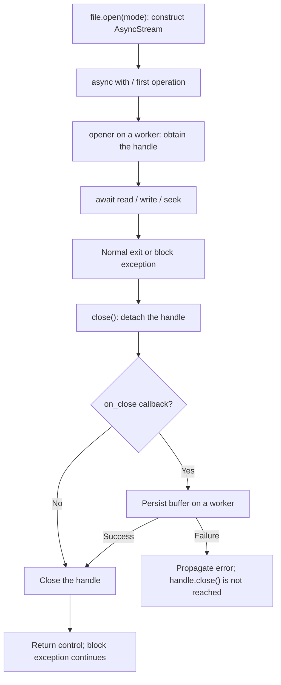

An operation can use an internal temporary file without creating a temporary file visible to your application. Storage also lets you save a working file at a logical path and remove it when finished. Their lifecycles differ: closing a stream releases its handle, but does not delete the file saved on the disk.

There is no public `Storage.temporaryFile()`, `tempfile()`, or temporary context on `IFile`. `temporaryUrl()` produces an expiring access URL when supported by the driver; expiration does not delete the object. For working files, use the real `file()`, `write()`/`writeStream()`, `open()`, and `delete()` operations.

## Where temporary content lives

| Source | Intermediate storage | Release or publication |
| --- | --- | --- |
| Local `write()`/`writeStream()` | Sibling file named `<destination>.<16 hex>.tmp`. | Replaces the destination on completion; staging ceases to exist after replacement. |
| Local `open()` | The destination file itself. | Its handle closes; the file and its changes remain. |
| S3, Azure, or GCS `writeStream()` | `SpooledTemporaryFile`: memory first, then a system temporary file above 8 MiB. | The SDK receives the complete buffer, then `finally` attempts closure, including after upload failure. |
| S3, Azure, or GCS `open()` | `SpooledTemporaryFile` with an 8 MiB threshold. | Writable modes upload all content on close; the buffer then closes if uploading succeeds. |
| Memory | Driver-held `bytes`; `bytearray` during `writeStream()` and `BytesIO` during `open()`. | Stream closure persists the buffer in the driver; the file remains until `delete()` or that instance/process is lost. |
| HTTP multipart upload | `SpooledTemporaryFile` with a request-configured threshold. | Closes when the request finishes or earlier through `move()`; closing removes its physical temporary file if it spilled to disk. |

Python/operating-system configuration determines where `tempfile` temporaries live; they need not be under `storage/app`. Storage does not expose their physical path or the cloud threshold as `open()`/`writeStream()` arguments.

### Local staging and publication

Local uses unique names so concurrent writers do not share staging. `write()` creates the temporary file, writes content, and replaces the destination; it removes staging if that sequence raises `OSError`. `writeStream()` writes each chunk into its temporary file and replaces the destination only after the producer finishes normally.

If a `writeStream()` producer fails or is cancelled before completion, `finally` attempts to close and remove staging. Final replacement occurs after that block: a replacement failure does not have the same automatic cleanup and can leave a `.tmp`. Applying visibility can fail after publication. An exception alone therefore does not prove the destination remained unchanged.

Local file listings omit names ending in `.tmp`, including staging left after an error. The API does not publish an operation to inspect or automatically purge those internal temporary files. Avoid this suffix for working files you need to discover with `files()`.

Replacement avoids publishing incomplete chunks when a write fails before commit; it is not a transaction with other operations or a durability guarantee against machine interruption. `open("wb")` does not use staging: it opens and truncates the destination directly on entry or first operation.

### Cloud buffers

S3, Azure, and GCS first consume the complete `writeStream()` producer into a buffer. It retains the first 8 MiB in memory and spills to disk above that threshold; the buffer is then rewound for SDK upload. Producer failure attempts to close the spool before propagating. Upload failure also attempts closure in `finally`.

`open("rb")` and `open("rb+")` download the complete object before returning the handle. `ab` and `ab+` also download existing content and position at the end, tolerating a missing object. `wb` and `wb+` begin with an empty buffer. Every mode other than `rb` uploads the complete buffer again on close, even if you wrote no additional bytes. Use `readStream()` for incremental reading.

These calls do not expose a remote transaction, a Storage `abort()` operation, or visibility changes through `open()`. To provide visibility on publication, use `write()`/`writeStream()` or the file operations described in the [API reference](/en/storage/api-reference).

## A context manages a handle

`file.open(mode="rb")` is synchronous and lazy. Drivers return `AsyncStream`, implementing `IStorageStream`; `read`, `write`, `seek`, `close`, and its context are asynchronous. See its [signatures and modes](/en/storage/streaming-and-uploads#stream-construction).



`async with` calls `close()` when leaving the block, both successfully and after an exception. With memory/cloud, that exit can **publish previously written bytes even when application logic failed**. Local already modified the actual file. The context does not interpret the exception as a rollback request.

This asynchronous service demonstrates the distinction. After the exception, the file contains `b"partial"`:

```python
from orionis.support.facades import Storage


async def inspect_failed_write() -> bytes:
    file = Storage.disk("local").file("work/failed-report.bin")
    try:
        async with file.open("wb") as stream:
            await stream.write(b"partial")
            raise ValueError("Report validation failed")
    except ValueError:
        return await file.read()
```

When managing a stream manually, surround operations with `try/finally`. `close()` is idempotent between closures, but a later read can reopen it. There is no public `closed` state or public `flush()` operation to publish a cloud buffer early.

```python
from orionis.support.facades import Storage


async def read_report_signature() -> bytes:
    stream = Storage.disk("local").file("reports/stock.csv").open("rb")
    try:
        return await stream.read(8)
    finally:
        await stream.close()
```

The stream contains no locks: do not share one handle across concurrent reads, writes, or closure. Open a separate context for each independent consumer.

## Create and remove a working file

This is an application helper, not a framework-provided function. Save it in `app/services/temporary_files.py`. It uses a random name beneath `work/`, a private local disk, and public Storage operations:

```python
from collections.abc import AsyncIterable, AsyncIterator
from contextlib import asynccontextmanager
from uuid import uuid4
from orionis.storage.contracts.file import IFile
from orionis.support.facades import Storage


@asynccontextmanager
async def temporary_csv(chunks: AsyncIterable[bytes]) -> AsyncIterator[IFile]:
    file = Storage.disk("local").file(f"work/export-{uuid4().hex}.csv")
    try:
        await file.writeStream(chunks, visibility="private")
        yield file
    finally:
        await file.delete()
```

The path is disk-relative; it does not create a `Path` outside Storage. The `try` covers both writing and using the file. A successful write provides a normal `IFile` to the consumer; on exit, `delete()` removes that file and returns `False` if it no longer exists. Write or consumer exceptions attempt the same deletion. A failing `delete()` also propagates its exception.

Consume it from a service or controller:

```python
from app.services.temporary_files import temporary_csv


async def inspect_temporary_export() -> dict[str, int | str]:
    async def rows():
        yield b"product,quantity\n"
        yield b"keyboard,4\n"

    async with temporary_csv(rows()) as file:
        async with file.open("rb") as stream:
            header = await stream.read(16)
        return {"header": header.decode("utf-8"), "bytes": await file.size()}
```

Returning the result first closes the handle, then removes the file. Do not return this `IFile` for later use: its context will already have ended. This pattern deletes the logical path chosen by your application; it does not know or purge internal `.tmp` names left by a driver commit failure.

### Keep a temporary file throughout an HTTP download

`StreamingResponse` consumes chunks after the action returns the response object. Its context therefore belongs **inside the content generator**, rather than around response construction in the controller:

```python
from collections.abc import AsyncIterator
from contextlib import aclosing
from app.services.temporary_files import temporary_csv
from orionis.http import StreamingResponse


class CsvExportController:
    async def download(self) -> StreamingResponse:
        async def rows() -> AsyncIterator[bytes]:
            yield b"product,quantity\n"
            yield b"keyboard,4\n"

        async def content() -> AsyncIterator[bytes]:
            async with temporary_csv(rows()) as file:
                async with aclosing(file.readStream(chunk_size=65536)) as chunks:
                    async for chunk in chunks:
                        yield chunk

        return StreamingResponse(
            content(),
            media_type="text/csv",
            headers={"Content-Disposition": 'attachment; filename="export.csv"'},
        )
```

Save the controller in `app/http/controllers/csv_export_controller.py` and map a GET route to `download`, as shown in [streaming and uploads](/en/storage/streaming-and-uploads). HTTP adapters close the response iterator during cleanup. Closing `content()` makes its contexts attempt reader closure and file deletion. Do not delete the working file immediately after `return StreamingResponse(...)`, or open a handle in a context that ends before transmission.

For this small report, you could yield rows directly into `StreamingResponse`; an intermediate file is useful when a consumer must reread, seek, or check the result before delivery.

## Exceptions, cancellation, and cleanup

Distinguish the guarantees of each operation:

- `AsyncStream` closure runs its persistence callback first. A failure propagates before `handle.close()`; a second `close()` does not retry that detached handle. Do not assume a failed remote write immediately closed its buffer.
- Local, S3, and GCS include `finally` to close chunk readers. Exhausting or explicitly closing the generator allows that cleanup to run; use `aclosing()` when stopping early. Azure delegates to the SDK iterator without adding this explicit closure.
- Drivers run blocking I/O with `asyncio.to_thread`. Task cancellation does not stop an operation already running on a worker or guarantee cancelling an SDK upload. A write can continue or finish after cancellation arrives.
- `finally` blocks attempt resource release during cancellation, but Storage does not protect all cleanup from repeated cancellation or uniformly join all workers before releasing resources. The helper above makes no such guarantee either: another cancellation, cleanup failure, or process termination can leave pending work or a working file.

Keep each operation and its cleanup under the same task's control; await completion before reusing/deleting its files. If a service needs restart recovery, keep a record of its working files and implement a cleanup policy for paths owned by that service. Storage assigns no TTL and provides no automatic collector.

I/O and SDK exceptions propagate. A close/delete error can replace the exception that originally triggered context exit; preserve that context in logs. The helper does not make multiple operations transactional or roll back a file already published at another path.

## HTTP upload lifetime

`Request.form()` receives files through the multipart parser. Its spool threshold comes from `HTTPBodyLimits.memory_threshold`, configured through `HTTP_UPLOAD_MEMORY_THRESHOLD` and defaulting to **256 KiB per file**. Directly constructing `orionis.http.payload.uploaded_file.UploadedFile(...)` uses a different default: **1 MiB**. Neither threshold is the maximum permitted upload size.

The parser separately limits received bytes, each part's size, and multipart memory. When a file write uses disk, its helper waits for the worker even during cancellation before continuing cleanup. Parsing failure or cancellation attempts to close the current file part and previously collected files.

After `FormData` is built, `Request.close()` closes its files through `FormData.close()`. The kernel runs it in `finally` after response delivery in ASGI and RSGI flows. The synchronous `with form:` context also closes them on exit; do not end it while another consumer still needs an upload.

`Storage.uploaded(source)` references the same buffer without extending its lifetime. `store()`, `storeAs()`, and `copy()` keep it open; `move()` saves and then closes it. Persist within the request and pass subsequent jobs the saved file's logical path, rather than the HTTP object. See [Request and payloads](/en/http/requests) and the [upload adapter reference](/en/storage/streaming-and-uploads#upload-construction).
