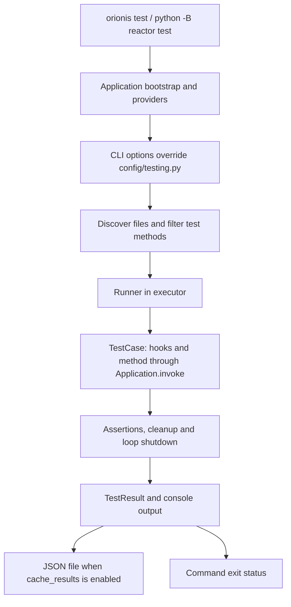

Orionis testing integrates case discovery, the application container and asynchronous execution with `unittest` assertions. It checks rules, services and integrations using the same application that registers providers and configuration.

**Every case must inherit from `TestCase`, imported with `from orionis.test import TestCase`.** It supports `def` and `async def` methods; the selected method runs with automatic dependency resolution. Each case has an isolated event loop, while the container and external data may remain shared.

## Recommended path

| Guide | What you will learn |
| --- | --- |
| [Writing and running tests](/en/testing/writing-and-running-tests) | Generate a case with `make:test`, replace the initial skip with assertions and run files or methods. |
| [TestCase and decorators](/en/testing/cases-and-decorators) | Use hooks, cleanups, contexts, skips, expected failures, subtests and mocks. |
| [Dependencies and isolation](/en/testing/dependency-injection) | Inject services, resolve them in fixtures and control scopes and persistent resources. |
| [Results and configuration](/en/testing/results-and-reference) | Configure `config/testing.py`, choose verbosity, filter the suite and save JSON results. |

[Database and ORM tests](/en/orm/testing) and [MCP tests](/en/mcp/testing) retain dedicated guides in their respective component menus.

## Execution flow



The runner uses one loop per case to execute and clean up asynchronous operations; methods do not need `asyncio.run()`. Skip and expected-failure decorators come from `unittest`: Orionis exports no testing decorators of its own.

Normal execution starts from the project root:

```shell
python -B reactor test
```

You can also run `orionis test` or `uv run python -B reactor test`. You do not need another runner to use this component. Running cases directly through `unittest.main()` does not bootstrap the Orionis application for injection.

## Configure the suite environment

`config/testing.py` defines six options: verbosity, fail-fast, starting directory, filename pattern, method pattern and result persistence. The command can override the corresponding execution settings. JSON is saved to disk; there is no `--json` flag that turns stdout into a JSON report.

The command does not automatically choose another database or change `APP_ENV` to `testing`. Prepare configuration and test resources before bootstrap. Inheriting from `TestCase` does not enable rollback, file cleanup or an independent container scope per case; arrange cleanup with the documented mechanisms.

Start by [creating your first test](/en/testing/writing-and-running-tests).
