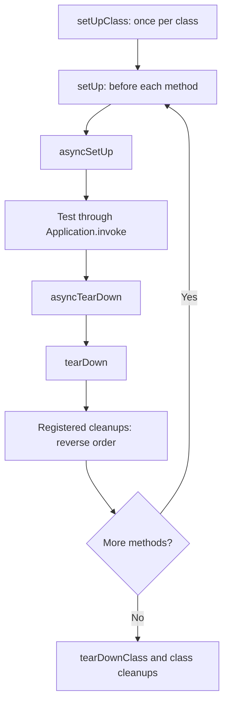

## The base class for every test

All test cases in an Orionis application must extend `TestCase`, imported from the public package:

```python
from orionis.test import TestCase


class TestTotals(TestCase):
    def testAddition(self) -> None:
        self.assertEqual(2 + 3, 5)

    async def testAsyncCalculation(self) -> None:
        async def calculate() -> int:
            return 2 + 3

        self.assertEqual(await calculate(), 5)
```

Save this as `tests/unit/test_totals.py` and run it with [the test command](/en/testing/writing-and-running-tests). The runner starts the application; running these cases directly with `unittest.main()` does not provide that startup.

`TestCase` extends `unittest.IsolatedAsyncioTestCase`: it accepts `def` and `async def`, retains Python's assertions and creates an isolated event loop for each executed method. Do not call `asyncio.run()` inside a test; use `await`. Return `None` and communicate the outcome through assertions or exceptions.

A case instance is constructed with `TestCase(method_name="runTest")`. The loader supplies the method name; this constructor is not a dependency injection point. Keep the inherited constructor and use lifecycle hooks to prepare each test.

## Lifecycle

When preparation and execution succeed, the order is:



| Hook | Signature to implement | Purpose |
| --- | --- | --- |
| `setUp` | `def setUp(self) -> None` | Prepare synchronous values and resources for one method. |
| `asyncSetUp` | `async def asyncSetUp(self) -> None` | Open resources requiring `await`. Runs after `setUp`. |
| `asyncTearDown` | `async def asyncTearDown(self) -> None` | Finalize asynchronous resources after the test. |
| `tearDown` | `def tearDown(self) -> None` | Synchronous cleanup after `asyncTearDown`. |
| `setUpClass` | `@classmethod def setUpClass(cls) -> None` | Synchronous preparation shared by the class. |
| `tearDownClass` | `@classmethod def tearDownClass(cls) -> None` | Clean up that shared preparation synchronously. |

All six hooks retain their `unittest` signatures and **do not receive automatic injection**. If `setUp` or `asyncSetUp` fails, the test method and its teardown do not run; registered cleanups are still attempted. After successful preparation, a test failure does not prevent teardown from being attempted. Errors in per-case hooks are recorded as test errors. Class hook failures before the first case have a specific processor limitation described in [results](/en/testing/results-and-reference).

The loop closes when the case finishes and cancels tasks still pending. This does not replace explicitly closing connections, streams or other resources.

These tools are inherited from [`unittest.IsolatedAsyncioTestCase`](https://docs.python.org/3.14/library/unittest.html#unittest.IsolatedAsyncioTestCase); Orionis adds method invocation through the container.

### Preparing and cleaning up resources

This complete module uses an asynchronous fixture and a temporary directory. `addAsyncCleanup` registers the function without running it or requiring `await` at registration time:

```python
from pathlib import Path
from tempfile import TemporaryDirectory

from orionis.test import TestCase


class AsyncBuffer:
    def __init__(self) -> None:
        self.closed = False
        self.values: list[str] = []

    async def write(self, value: str) -> None:
        if self.closed:
            raise RuntimeError("Buffer is closed")
        self.values.append(value)

    async def close(self) -> None:
        self.closed = True


class TestExport(TestCase):
    def setUp(self) -> None:
        directory = TemporaryDirectory()
        self.addCleanup(directory.cleanup)
        self.directory = Path(directory.name)

    async def asyncSetUp(self) -> None:
        self.buffer = AsyncBuffer()
        self.addAsyncCleanup(self.buffer.close)

    async def testExport(self) -> None:
        await self.buffer.write("ready")
        target = self.directory / "export.txt"
        target.write_text(self.buffer.values[0], encoding="utf-8")
        self.assertEqual(target.read_text(encoding="utf-8"), "ready")
```

Cleanups run after teardown in reverse registration order: the buffer closes first and the directory is removed afterwards. Registering cleanup immediately after acquiring a resource also allows it to be released when later preparation fails.

### Resource management methods

The following signatures omit `self` and `cls`:

| Inherited method | Result and behavior |
| --- | --- |
| `addCleanup(function, /, *args, **kwargs)` | Register synchronous cleanup for the test; return `None`. |
| `addAsyncCleanup(func, /, *args, **kwargs)` | Register asynchronous cleanup for the test; return `None`. |
| `enterContext(cm)` | Enter a synchronous context, register its exit and return its `__enter__` value. |
| `await enterAsyncContext(cm)` | Do the same for an asynchronous context and return its `__aenter__` value. |
| `doCleanups()` | Run the test's pending cleanups early. The runner also calls it at the end. |
| `addClassCleanup(function, /, *args, **kwargs)` | Register synchronous cleanup for the class. |
| `enterClassContext(cm)` | Enter a synchronous class context and register its exit. |
| `doClassCleanups()` | Run the class's pending cleanups early. |

For example, `self.directory = Path(self.enterContext(TemporaryDirectory()))` replaces the directory creation and registration lines in the previous example. For an asynchronous context, use `resource = await self.enterAsyncContext(context_manager)`.

Preparation for an entire module can also use synchronous `setUpModule()` and `tearDownModule()` functions, without injected parameters. For data or connections tied to a test's loop, use `asyncSetUp` and `addAsyncCleanup` in the corresponding case.

See [dependency injection and isolation](/en/testing/dependency-injection) for services in test methods, explicit resolution in hooks and container scopes.

## Supported decorators

Orionis does not define or export its own testing decorators. Outcome control decorators come from `unittest`; import them explicitly. They work with `def` and `async def` methods:

| Decorator | When to use it |
| --- | --- |
| `@skip(reason)` | Skip a test or class and explain why. |
| `@skipIf(condition, reason)` | Skip it when the condition is true. |
| `@skipUnless(condition, reason)` | Run it only when the condition is true. |
| `@expectedFailure` | Mark a known failure expected to occur inside the test method. |

This module demonstrates all four without environment variables or external services:

```python
import sys
from unittest import expectedFailure, skip, skipIf, skipUnless

from orionis.test import TestCase


class TestCompatibility(TestCase):
    @skip("Example requiring an external test fixture")
    def testExternalFixture(self) -> None:
        self.fail("This body is not executed")

    @skipIf(sys.platform == "win32", "Unix-only path example")
    async def testUnixPath(self) -> None:
        self.assertNotEqual(sys.platform, "win32")

    @skipUnless(sys.platform == "win32", "Windows-only path example")
    def testWindowsPath(self) -> None:
        self.assertEqual(sys.platform, "win32")

    @expectedFailure
    async def testKnownDefect(self) -> None:
        self.assertEqual("actual", "expected")
```

The three skip decorators can also apply to a whole class. A skipped method does not execute its per-test fixtures; a skipped class does not run its class fixtures either. `self.skipTest(reason)` lets you decide inside the test or its preparation.

`expectedFailure` does not turn a `setUp` or teardown error into an expected failure. Orionis exports expected failures as `SKIPPED`; if the method unexpectedly passes, it is exported as `FAILED` and the command exits with an error. Remove the marker once the defect is fixed.

## Assertions, exceptions and subtests

Use inherited assertions to explain which condition must hold. For example, `assertEqual`, `assertTrue`, `assertIsNone`, `assertIsInstance`, `assertIn`, `assertCountEqual` and `assertAlmostEqual` cover values, identity, membership and numerical comparisons. You do not need separate `assert*` function imports.

`assertRaises` also works around an awaited operation. `subTest` lets you iterate through inputs while retaining the value responsible for a failure:

```python
from orionis.test import TestCase


async def parseQuantity(value: str) -> int:
    return int(value)


class TestQuantities(TestCase):
    async def testValidQuantities(self) -> None:
        for text, expected in [("0", 0), ("12", 12)]:
            with self.subTest(text=text):
                self.assertEqual(await parseQuantity(text), expected)

    async def testInvalidQuantity(self) -> None:
        with self.assertRaises(ValueError) as captured:
            await parseQuantity("invalid")
        self.assertIsInstance(captured.exception, ValueError)
```

An `AssertionError` is recorded as a failure; another unexpected exception is an error. A failed subtest produces a result with its parameterized identifier. Successful subtests do not generate additional individual records. `assertWarns`, `assertLogs` and `assertNoLogs` are also inherited when you need to check warnings or records compatible with Python logging.

## Test doubles

`unittest.mock` can replace collaborators. A `patch.object(...)` context keeps the replacement explicit without adding parameters to the signature Orionis examines for dependency injection:

```python
from unittest.mock import AsyncMock, patch

from orionis.test import TestCase


class NotificationGateway:
    async def send(self, recipient: str) -> str:
        raise RuntimeError("Real transport must be configured")


class TestNotifications(TestCase):
    async def testSend(self, gateway: NotificationGateway) -> None:
        fake = AsyncMock(return_value="accepted")

        with patch.object(gateway, "send", new=fake):
            result = await gateway.send("user@example.com")

        self.assertEqual(result, "accepted")
        fake.assert_awaited_once_with("user@example.com")
```

Do not assume that an arbitrary decorator changing a signature preserves injection: decorating with `patch` can add its own arguments. For methods with injected dependencies, the example's context avoids that interaction. The [`unittest.mock` reference](https://docs.python.org/3.14/library/unittest.mock.html) describes its other patching forms.

## TestCase-specific utilities

### `setMethodPattern(pattern: str) -> None`

A class method that sets the glob deciding whether the selected method is wrapped with application invocation. It defaults to `test*` and belongs to the current context. The engine updates it through `setMethodPattern(...)`; use the [test configuration and execution options](/en/testing/writing-and-running-tests).

This does not change `unittest.TestLoader`'s discovery prefix: the command still loads methods beginning with `test`. Keep that prefix and use patterns such as `testCreate*` to select a subset. Lifecycle hooks and private methods are never wrapped.

### `await mcp(server, config=None, *, app=None) -> McpTestClient`

Create an in-process MCP client for a server class or an already compiled server. It reuses the application started by the runner unless another container is supplied through `app=`. `config` accepts a `McpConfig` configuration; omitting it uses the client's defaults.

Client calls open their own scopes; this isolation belongs to the MCP client. See the complete [MCP server testing examples](/en/testing/mcp-testing).

Continue with [execution and discovery](/en/testing/writing-and-running-tests) and [configuration and results](/en/testing/results-and-reference).
