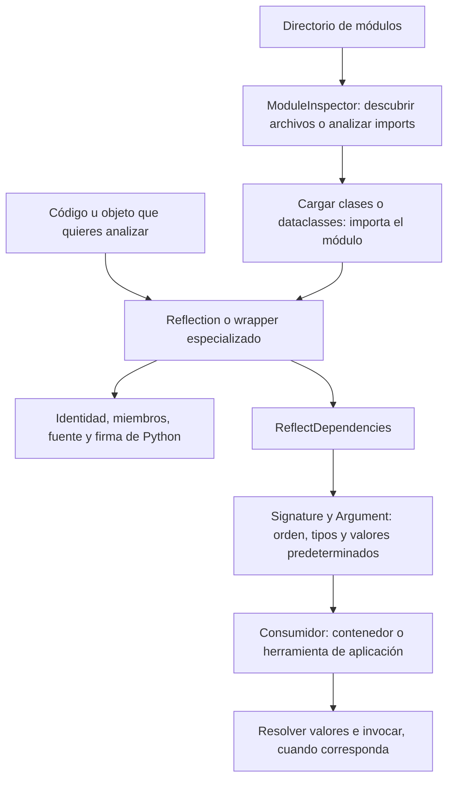

La introspección permite consultar la estructura de código Python durante la ejecución: qué clase representa un objeto, qué métodos declara, qué argumentos necesita una función y en qué módulo está definida. Orionis reúne estas operaciones en wrappers especializados, análisis de dependencias y herramientas de descubrimiento de módulos.

Utiliza este componente para crear herramientas de diagnóstico, descubrir plugins o analizar handlers propios. Un controlador, job o comando habitual no necesita resolver sus dependencias manualmente: el [contenedor](/es/architecture/service-container) ya utiliza estas herramientas en su flujo de construcción e invocación.

## Elegir la herramienta

| Necesidad | Referencia |
| --- | --- |
| Clasificar un objeto y elegir un wrapper | [Reflection](/es/advanced/introspection/reflection). |
| Leer identidad, documentación, fuente o firma de una función | [Callables](/es/advanced/introspection/callables). |
| Inspeccionar una clase abstracta | [Clases abstractas](/es/advanced/introspection/abstract-classes). |
| Inspeccionar o modificar una clase concreta | [Clases concretas](/es/advanced/introspection/concrete-classes). |
| Consultar los datos y métodos de un objeto existente | [Instancias](/es/advanced/introspection/instances). |
| Analizar argumentos y sus dependencias | [Dependencias y firmas](/es/advanced/introspection/dependencies-and-discovery). |
| Inspeccionar clases, funciones y constantes de un módulo importado | [Módulos](/es/advanced/introspection/modules). |
| Encontrar archivos Python y cargar componentes | [Descubrimiento de módulos](/es/advanced/introspection/module-discovery). |

## Importaciones públicas

```python
from orionis.introspection import (
    ModuleInspector,
    ReflectDependencies,
    Reflection,
    ReflectionAbstract,
    ReflectionCallable,
    ReflectionConcrete,
    ReflectionInstance,
    ReflectionModule,
)
```

Estas son las ocho exportaciones del paquete. No se importan desde `orionis.support.facades`: `Reflection` es una clase de utilidades estáticas, no una fachada del contenedor. Las entidades del análisis de argumentos tienen sus módulos explícitos:

```python
from orionis.introspection.dependencies.entities.argument import Argument
from orionis.introspection.dependencies.entities.signature import Signature
```

El componente funciona sin iniciar una aplicación y no tiene archivo de configuración propio. Las dependencias que utiliza forman parte de Orionis; no necesitas instalar otro paquete para estos ejemplos.

## Primer análisis de un handler

```python
from orionis.introspection import Reflection

def quote(units: int, *, currency: str = "USD") -> str:
    """Build a quote label."""
    return f"{units} {currency}"

reflected = Reflection.callable(quote)
assert reflected.getName() == "quote"
assert reflected.getDocstring() == "Build a quote label."
assert list(reflected.getSignature().parameters) == ["units", "currency"]

dependencies = reflected.getDependencies()
assert "units" in dependencies.getUnresolved()
assert dependencies.getResolved()["currency"].default == "USD"
assert list(dependencies.getAllOrdered()) == ["units", "currency"]
```

`getSignature()` devuelve un `inspect.Signature` de Python. `getDependencies()` produce la entidad `Signature` de Orionis con descriptores `Argument`. El segundo resultado clasifica argumentos para su posterior resolución; **no invoca el handler ni construye sus servicios**. Los valores builtin requeridos, como `units`, necesitan datos del llamador.

## Flujo de lectura y resolución



El descubrimiento de archivos y el análisis AST de imports no ejecutan el módulo. Reflejar un módulo, cargar una clase o descubrir dataclasses frozen sí puede importarlo y ejecutar su código de nivel superior. Usa el análisis de archivos cuando solo necesites decidir qué componentes examinar después.

## Acceso directo e inyección

Los wrappers reciben el **objeto que se inspecciona**: una clase, una función, una instancia o un nombre de módulo. Ese dato no aparece automáticamente por anotar una dependencia con `ReflectionCallable` o `ReflectionInstance`.

Puedes construir el wrapper donde tengas el objetivo, registrar deliberadamente una instancia ya preparada o inyectar un servicio propio que realice la inspección. Cada referencia muestra el patrón aplicable. `Reflection` y `ModuleInspector` se usan normalmente desde la clase, sin crear instancias ni utilizar el contenedor.

Para ejecutar un componente con dependencias, utiliza los mecanismos de [registro e invocación](/es/architecture/service-container/bindings-and-invocation) de la aplicación. La introspección proporciona metadatos; no sustituye los ciclos de vida del contenedor, la [validación](/es/validation) ni los datos de entrada de una solicitud.

## Cachés, mutaciones y fuente disponible

Los wrappers cachean resultados en memoria del proceso. El resultado no se actualiza necesariamente cuando otro código modifica la clase, instancia, módulo o función: utiliza `clearCache()` según la referencia correspondiente o crea otro wrapper. Los métodos de mutación no invalidan todos los mismos grupos de caché; las páginas explican sus efectos reales.

La recuperación de fuente depende de que Python pueda acceder al archivo que define el objeto. Los ejemplos de análisis de código deben guardarse en archivos `.py` cuando usan `getSourceCode()`; una sesión interactiva o una función creada con `exec()` puede no tener fuente recuperable.

Las categorías pública, protegida, privada y dunder describen convenciones de nombres y reglas de cada scan. No son controles de autorización. Los wrappers de clase, instancia y módulo recorren miembros distintos; consulta sus reglas antes de usar sus resultados como inventario de una aplicación.
