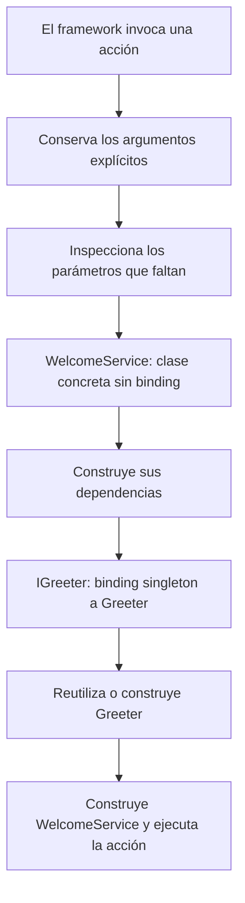

El contenedor construye los objetos de la aplicación y conecta sus dependencias. Un controlador puede solicitar un servicio mediante una anotación de tipo; un proveedor registra qué implementación corresponde a ese contrato y cuánto tiempo debe reutilizarse.

`Application` extiende `Container`, e `IApplication` extiende `IContainer`. Cuando recibes `app: IApplication`, utilizas tanto las funciones de la aplicación como los mismos bindings que registraron sus proveedores. El código habitual de la aplicación utiliza esa instancia existente.

## Del contrato al consumidor

Este ejemplo puede guardarse en `app/services/greetings.py`:

```python
from abc import ABC, abstractmethod


class IGreeter(ABC):

    @abstractmethod
    def greet(self, name: str) -> str:
        raise NotImplementedError


class Greeter(IGreeter):

    def greet(self, name: str) -> str:
        return f"Hello, {name}!"


class WelcomeService:

    def __init__(self, greeter: IGreeter) -> None:
        self._greeter = greeter

    def message(self, name: str) -> str:
        return self._greeter.greet(name)
```

Registra la implementación en `app/providers/greeting_provider.py`:

```python
from app.services.greetings import Greeter, IGreeter
from orionis.container.providers import ServiceProvider


class GreetingProvider(ServiceProvider):

    def register(self) -> None:
        self.app.singleton(IGreeter, Greeter)
```

Configura o descubre este proveedor según la [guía de proveedores](/es/application/container/providers). La siguiente acción recibe el servicio a través del contenedor:

```python
from app.services.greetings import WelcomeService
from orionis.http import JSONResponse


class GreetingController:

    async def show(
        self,
        name: str,
        welcome: WelcomeService,
    ) -> JSONResponse:
        return JSONResponse({"message": welcome.message(name)})
```

Una [ruta](/es/http/routing) entrega `name` y selecciona `GreetingController.show`. El framework construye `WelcomeService`, resuelve su contrato `IGreeter` y reutiliza el `Greeter` singleton. La clase concreta `WelcomeService` no necesita un binding para autoconstruirse.



La inyección se produce cuando el contenedor construye o invoca el componente. Una llamada Python directa a `GreetingController().show(...)` requiere que proporciones sus argumentos.

## Elegir el ciclo de vida

| Registro | Creación y reutilización | Uso habitual |
|---|---|---|
| `transient(contrato, clase)` | Una instancia nueva en cada `make()`. | Servicios sin identidad compartida. |
| `singleton(contrato, clase)` | Una instancia por contenedor, creada al resolverla por primera vez. | Servicios que pueden reutilizarse durante la vida del proceso. |
| `scoped(contrato, clase)` | Una instancia por scope activo. | Estado de la solicitud o de un comando. |
| `instance(contrato, objeto)` | Publica un objeto ya creado en el scope activo; fuera de él, globalmente. | Adaptadores o recursos que ya inicializaste. |

Un singleton se comparte en el proceso que posee el contenedor. Otros workers, servidores o tareas de Fargate tienen sus propias instancias. La caché JSON de la aplicación contiene metadatos de bootstrap, no los objetos del contenedor.

## Resolver e invocar

| Operación | Propósito |
|---|---|
| `await app.make(contrato_o_alias)` | Resolver un registro respetando su ciclo de vida; una clase concreta sin registro puede autoconstruirse. |
| `await app.build(Clase)` | Crear una instancia nueva de esa clase e inyectar su constructor. |
| `await app.invoke(función, ...)` | Inyectar y ejecutar una función síncrona o asíncrona. |
| `await app.call(objeto, "método", ...)` | Inyectar y ejecutar un método de un objeto existente. |

`build()` construye el tipo recibido aunque ese tipo tenga un registro singleton. Para recuperar la instancia compartida, utiliza `make()`.

## Recorrido de la guía

- [Registrar e invocar servicios](/es/application/container/bindings-and-invocation): API completa de `IContainer`, argumentos, clases y funciones.
- [Proveedores y fachadas](/es/application/container/providers): publicación de servicios y acceso mediante fachadas.
- [Scopes, aislamiento y concurrencia](/es/application/container/scopes-and-concurrency): ámbitos HTTP y CLI, tareas hijas y cierre de recursos.

Consulta [Aplicación y contenedor](/es/application) para el bootstrap y el ciclo de vida de `IApplication`, y [Schemas y validación](/es/validation) para los payloads tipados.
