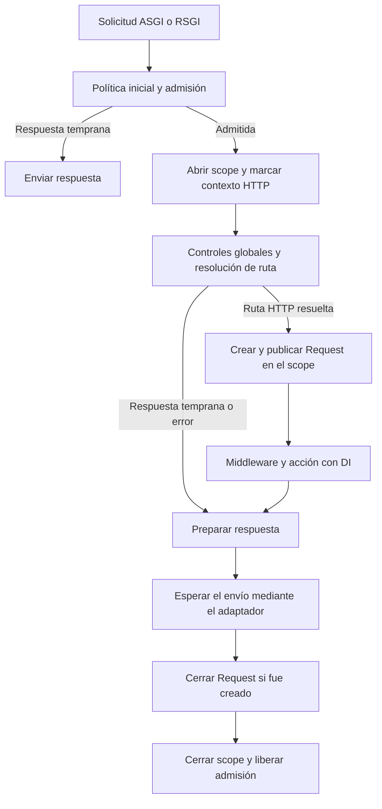
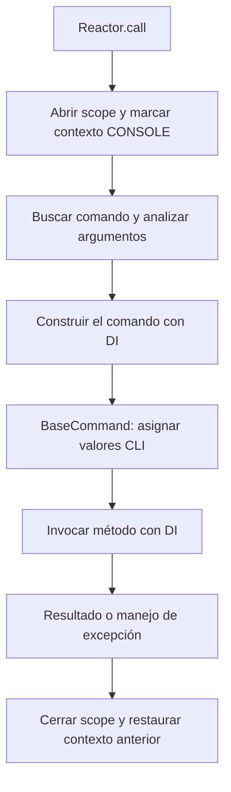

Un scope delimita una unidad de trabajo y conserva sus propias instancias. Dos solicitudes pueden utilizar el mismo contrato `scoped` y recibir objetos diferentes; dentro de una solicitud, resolver ese contrato varias veces devuelve el mismo objeto.

Los kernels HTTP y Reactor ya administran estos ámbitos. Utiliza un scope manual al implementar una unidad de trabajo que todavía no tenga uno; los controladores habituales no necesitan abrir otro.

<a id="container-begin-scope"></a>

## Abrir un scope

```text
beginScope() -> ScopeManager
```

Devuelve un administrador nuevo, todavía sin activar. La entrada en `async with` publica ese ámbito en un `ContextVar`; la salida limpia sus referencias, lo marca cerrado y restaura el contexto anterior, incluso si hubo una excepción.

Este módulo puede guardarse como `app/providers/work_provider.py`:

```python
from orionis.container.providers import ServiceProvider
from orionis.foundation.contracts.application import IApplication


class WorkState:

    def __init__(self) -> None:
        self.visited: list[str] = []


class WorkProvider(ServiceProvider):

    def register(self) -> None:
        self.app.scoped(None, WorkState)


async def run_work(app: IApplication) -> list[str]:
    async with app.beginScope():
        first = await app.make(WorkState)
        first.visited.append("catalog")
        second = await app.make(WorkState)
        assert first is second
        result = second.visited.copy()

    async with app.beginScope():
        third = await app.make(WorkState)
        assert third is not first
        assert third.visited == []

    return result
```

Después de registrar el proveedor, `run_work(app)` devuelve `["catalog"]`. Los dos ámbitos tienen instancias independientes. Conserva datos simples como resultado de la operación; evita que una dependencia que pertenece al scope siga utilizándose tras su cierre.

<a id="container-current-scope"></a>

## Consultar el contexto actual

```text
getCurrentScope() -> ScopeManager | None
```

Devuelve el administrador asociado al contexto actual o `None` cuando no existe uno. En un contexto normal, salir del scope restaura el exterior, que puede ser otro scope o `None`.

Una tarea hija puede conservar una referencia al administrador de un scope ya cerrado. Comprueba también `scope.isActive` si trabajas con contextos de bajo nivel; `getCurrentScope()` no convierte automáticamente esa referencia heredada en `None`. Resolver un servicio scoped nuevo en ese ámbito cerrado produce `RuntimeError`.

<a id="scope-http"></a>

## Scope de una solicitud HTTP

Los dos transportes, ASGI y RSGI, siguen el mismo límite de resolución:



El scope incluye la ejecución de la acción y el envío esperado por el adaptador, también cuando la respuesta transmite contenido progresivamente. El `finally` del kernel cierra el `Request` si llegó a crearlo; el administrador después libera sus referencias.

No toda respuesta temprana dispone de `Request`: algunas políticas y rechazos de capacidad ocurren antes de abrir el ámbito, y los controles previos a resolver la ruta utilizan el adaptador de transporte. Las dependencias de la solicitud deben pedirse en el punto del flujo donde ya existen.

Los middleware HTTP pueden construirse durante el arranque y reutilizarse. No almacenes un `Request` o servicio scoped en sus constructores; recibe el `request` del método `handle()` o resuelve el contexto durante la ejecución correspondiente. Consulta [Middleware](/es/http/middleware).

### Conexiones WebSocket

El kernel abre un scope propio para cada conexión admitida y publica `WebSocket`. El ámbito permanece abierto durante el manejador de conexión; el kernel intenta cerrar el socket en su `finally` y libera después el scope y la admisión. No hay un `Request` HTTP ordinario que deba asumirse disponible en ese contexto. Consulta [WebSocket](/es/realtime/websocket).

<a id="scope-cli"></a>

## Scope de un comando CLI

Cada `Reactor.call()` abre un ámbito nuevo, incluida la ejecución programática:



Para un `BaseCommand`, los valores CLI se guardan con `setArguments()` y se consultan con `getArgument()`; los parámetros del método sirven para dependencias. Un manejador de ruta de consola que no es `BaseCommand` recibe los valores analizados como argumentos nombrados. Ambas formas utilizan el mismo contenedor.

Si un comando llama a otro mediante Reactor, la ejecución interior recibe un scope distinto y al terminar se restaura el exterior. No hereda las instancias del scope padre. Un `Exception` gestionado por Reactor normalmente produce el código `1`; una salida del parser o una cancelación conserva sus reglas propias. El cierre del administrador no suprime esas excepciones. Consulta [ejecución programática](/es/console/reactor-and-injection).

<a id="scope-precedence"></a>

## Precedencia de resolución y scopes anidados

`make()` consulta, en este orden, el singleton global ya cacheado, las instancias del scope actual y el binding que debe resolverse o autoconstruirse. Por ello:

- Una instancia publicada en el scope puede proporcionar un contrato todavía no materializado globalmente, pero no sustituye un singleton global ya cacheado.
- Un scope interior tiene su propio diccionario; no consulta el diccionario del exterior. Los bindings y singletons globales siguen disponibles.
- Salir del interior restaura el scope exterior y sus objetos.
- `transient()`, `singleton()` y `scoped()` siempre modifican el registro global, aunque los llames desde un scope. `instance()` es el registro que selecciona el ámbito activo como destino.

El contexto es compartido por las instancias de contenedor que se ejecutan en la misma tarea; no representa un almacén distinto por cada objeto `Container`. En una aplicación utiliza la instancia de `IApplication` existente.

<a id="scope-concurrency"></a>

## Tareas concurrentes e identidad

Las tareas hijas heredan el contexto de creación. Si se crean dentro de un scope y no abren otro, comparten el mismo administrador y sus servicios scoped. Un `TaskGroup` permite esperar su finalización antes de cerrar la unidad de trabajo:

```python
import asyncio

from app.providers.work_provider import WorkState
from orionis.foundation.contracts.application import IApplication


async def shared_work(app: IApplication) -> bool:
    async with app.beginScope():
        async with asyncio.TaskGroup() as tasks:
            first = tasks.create_task(app.make(WorkState))
            second = tasks.create_task(app.make(WorkState))
        return first.result() is second.result()
```

Con el binding anterior devuelve `True`. Para unidades independientes, cada tarea debe entrar en un nuevo `beginScope()`. Compartir el administrador no vuelve seguro cualquier estado mutable: tu servicio debe coordinar sus propias operaciones concurrentes.

La primera construcción de un singleton se serializa por contrato dentro del mismo event loop. Los servicios scoped usan un lock por contrato y por scope; los proveedores diferidos también coordinan su inicialización. Una construcción cancelada libera su lock y una resolución posterior puede reintentarlo.

La creación del propio contenedor utiliza un lock de hilos y devuelve una única instancia por subclase. El registro de bindings modifica diccionarios sin coordinación adicional. Los locks de construcción de singletons y proveedores se sustituyen al cambiar de event loop: no existe una garantía de construcción única entre loops concurrentes en hilos distintos.

<a id="scope-cleanup"></a>

## Cierre de recursos y dependencias retenidas

Salir del scope elimina sus referencias; no llama automáticamente a `close()` o `aclose()` de todos los servicios, no cancela tareas arbitrarias y no espera tareas que creaste por tu cuenta. Utiliza el context manager del recurso o `try/finally` en el componente que lo posee.

Una tarea hija que continúa después del cierre conserva el contexto heredado, pero el administrador está cerrado. No puede publicar nuevas instancias y una resolución en curso que intenta guardarlas termina con `RuntimeError`. Espera las tareas que dependen del scope antes de salir.

El contenedor no impide que un singleton almacene un servicio scoped: esa referencia podría sobrevivir a la solicitud y filtrar estado entre usuarios. Evita esa dependencia de duración incompatible. Los objetos ya entregados no se destruyen por arte de magia al vaciar el scope.

<a id="scope-manager"></a>

## Referencia de `ScopeManager`

Se obtiene normalmente con `beginScope()`. Su constructor público `ScopeManager()` crea un administrador vacío y de un solo uso.

| Miembro | Firma y comportamiento |
|---|---|
| `isActive` | Propiedad `bool`: `False` antes de entrar y después de salir. |
| `__aenter__` | `async __aenter__() -> Self`: publica el contexto y devuelve el administrador. Reentrar o reutilizar uno cerrado produce `RuntimeError`. |
| `__aexit__` | `async __aexit__(exc_type: type[BaseException] | None, exc_val: BaseException | None, exc_tb: types.TracebackType | None) -> None`: limpia y restaura el contexto; no suprime la excepción. |
| Lectura por clave | `__getitem__(key: object) -> object | None`: devuelve el valor guardado o `None`. |
| Escritura por clave | `__setitem__(key: object, value: object) -> None`: guarda o reemplaza; falla si está cerrado. |
| Pertenencia | `__contains__(key: object) -> bool`: comprueba si la clave existe. |
| `set()` | `set(key: object, value: Any) -> None`: equivalente a guardar por clave, con la misma comprobación de cierre. |
| `get()` | `async get(key: object) -> Any | None`: devuelve el valor; si es coroutine, la convierte en `Task`, la espera y guarda el resultado. También espera un `asyncio.Task` ya guardado. |
| `resolve()` | `async resolve(key: object) -> Any`: utiliza `get()`; lanza `KeyError` si no encuentra un valor o el resultado es `None`. |
| `clear()` | `clear() -> None`: vacía las referencias guardadas, sin cerrar ni restaurar el contexto. |
| `creationLock()` | `creationLock(key: object) -> asyncio.Lock`: obtiene el lock por clave; un administrador cerrado produce `RuntimeError`. |

Las claves deben poder utilizarse en un diccionario. `get()` no ejecuta funciones almacenadas ni espera automáticamente cualquier tipo de `Future`. Una excepción de la coroutine se propaga.

El tratamiento asíncrono de `ScopeManager.get()` es explícito. `app.make()` consulta la entrada scoped directamente; no utiliza ese método para esperar una coroutine guardada. Publica servicios ya inicializados para consumirlos mediante la inyección normal.

<a id="scoped-context"></a>

## Contexto de bajo nivel

`orionis.container.context.scope.ScopedContext` expone métodos de clase para integraciones que administren contextos:

```text
getCurrentScope() -> object | None
setCurrentScope(scope: object) -> contextvars.Token
reset(token: contextvars.Token) -> None
```

`setCurrentScope()` devuelve el token del estado anterior y `reset()` lo restaura en el contexto correspondiente. Estas operaciones solo cambian el `ContextVar`: no activan, limpian ni cierran un `ScopeManager`. Un token inválido o usado desde otro contexto conserva los errores nativos de `contextvars`.

El mismo módulo publica las funciones `get_current_scope()`, `set_current_scope(scope)` y `reset_scope(token)` como accesos al mismo `ContextVar`. En código de aplicación, `beginScope()` y `getCurrentScope()` de `IApplication` ofrecen el recorrido habitual y administran el cierre.

Continúa con [Registro e invocación](/es/application/container/bindings-and-invocation) o [Proveedores y fachadas](/es/application/container/providers).
