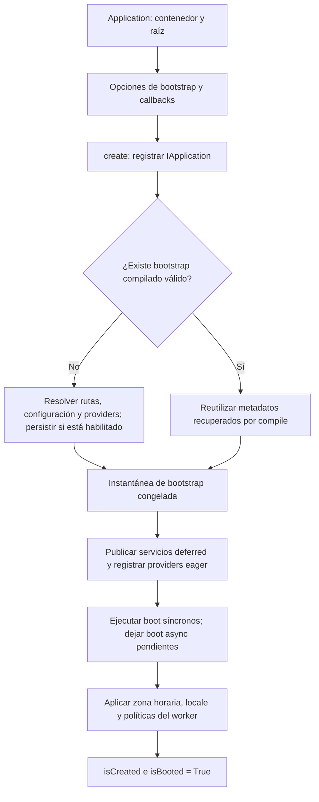
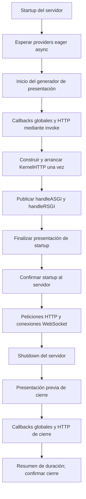
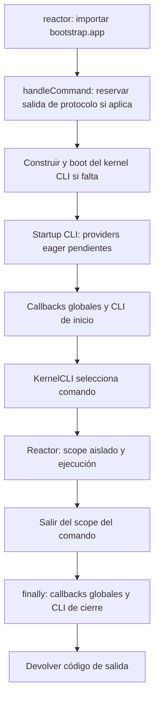

El proyecto exporta una aplicación desde `bootstrap/app.py`. Ese archivo prepara la configuración y registra los servicios; el servidor HTTP o Reactor completa el arranque que necesita su runtime. Distinguir ambas etapas permite inicializar recursos asíncronos antes de atender solicitudes y cerrarlos en el momento adecuado.

Trabaja sobre la instancia existente. En controladores, comandos y servicios, recibe `IApplication` mediante inyección de dependencias; no construyas otra aplicación para consultar su estado.

<a id="creation"></a>

## 1. Construcción y creación

La llamada `Application(base_path=...)` inicializa el contenedor, valida la raíz y la versión mínima de Python, registra el instante inicial y prepara los estados internos. Todavía no carga la configuración de la aplicación.

`create() -> Self` realiza la creación síncrona una sola vez y devuelve la misma instancia:



`compile()` puede recuperar una instantánea válida antes de `create()`; la creación reutiliza esos metadatos. La configuración compilada conserva metadatos, no instancias abiertas, tareas ni conexiones. Sus archivos, invalidación y alcance por proceso o despliegue se explican en [Directorios y caché de arranque](/es/application/paths-and-caching).

Los providers eager ejecutan `register()` durante `create()`. Si su `boot()` es síncrono también se ejecuta aquí; los métodos declarados `async def boot()` quedan pendientes hasta `boot()` o el startup de un runtime. Los providers deferred siguen resolviéndose cuando se solicita uno de sus servicios. Consulta [Providers y fachadas](/es/application/container/providers) para definirlos.

Las siguientes llamadas a `create()` devuelven la instancia sin repetir una creación completada. No convierten una configuración modificada en una nueva inicialización. `Application.current() -> Self | None` permite obtener la instancia existente sin construirla ni arrancarla; puede devolver una aplicación todavía sin crear, o `None` si no existe.

<a id="readiness"></a>

## 2. Creación, providers y preparación HTTP

Son propiedades de lectura; no se invocan con paréntesis:

| Propiedad | Tipo | Cuándo es verdadera |
|---|---|---|
| `isCreated` | `bool` | Terminó `create()`, incluida la configuración y el registro de servicios. |
| `isBooted` | `bool` | Alias histórico del mismo estado de creación. No garantiza que los providers async hayan terminado. |
| `areProvidersBooted` | `bool` | La aplicación fue creada y no quedan providers eager async pendientes. No anticipa la carga de los deferred. |
| `isHttpReady` | `bool` | Los eager terminaron y se publicaron los dos manejadores del kernel HTTP, ASGI y RSGI. |
| `startAt` | `int` | Instante de construcción en nanosegundos desde Unix epoch; sirve para calcular duración del proceso. |

`isHttpReady` informa sobre la preparación del kernel. No comprueba sockets, conectividad de la base de datos, estado del balanceador ni salud de servicios externos. Tampoco se restablece automáticamente a `False` al cerrar el servidor; no lo utilices como señal de liveness de todo el despliegue.

Por ejemplo, este controlador consulta la aplicación que el framework ya registró:

```python
from orionis.foundation.contracts.application import IApplication
from orionis.http import JSONResponse


class RuntimeStatusController:
    async def __call__(self, app: IApplication) -> JSONResponse:
        return JSONResponse({
            "created": app.isCreated,
            "providers_ready": app.areProvidersBooted,
            "http_ready": app.isHttpReady,
        })
```

Regístralo como cualquier [controlador HTTP](/es/http/controllers). Este ejemplo muestra los estados internos; la ruta de health configurada mediante `withRouting(health=...)` tiene su propio tratamiento en el kernel.

<a id="headless-boot"></a>

## 3. Arrancar servicios sin servidor HTTP

`async boot() -> Self` llama a `create()` y espera el arranque pendiente de los providers eager. Es útil en un componente que necesita los servicios de aplicación sin ejecutar un servidor o un comando completo.

```python
from orionis.foundation.contracts.application import IApplication


class ImportCoordinator:
    def __init__(self, app: IApplication) -> None:
        self.app = app

    async def prepare(self) -> bool:
        await self.app.boot()
        return self.app.areProvidersBooted
```

El código que llama a `prepare()` debe hacerlo desde su propio contexto asíncrono. Dentro de un controlador o de un comando normal, los providers eager ya pasaron por el startup correspondiente y no suele ser necesario llamar a `boot()`.

`boot()` no dispara callbacks `STARTUP`/`SHUTDOWN`, no construye los kernels y no inicia el scheduler. No ofrece un cierre automático al terminar el método. Si tu proceso abre recursos adicionales, su propietario debe cerrarlos con su API o con un `try/finally`.

Las llamadas concurrentes a `boot()` en el mismo event loop comparten un bloqueo de arranque. Cada provider pendiente se espera en orden de registro y solo se retira de la cola cuando termina correctamente. Si falla o se cancela, permanece pendiente y una llamada posterior puede reintentar su `boot()`: diseña esa inicialización para tolerar una ejecución parcial anterior.

<a id="lifespan-events"></a>

## 4. Callbacks de inicio y cierre

Los callbacks agregan comportamiento propio a los eventos de la aplicación. El proyecto incluye `bootstrap/lifespan.py` y llama a `register_lifespan_callbacks(app)` desde `bootstrap/app.py`.

La API real es:

```python
def on(
    self,
    lifespan: Lifespan,
    *callbacks: Callable[..., Any] | Callable[..., Awaitable[Any]],
    runtime: Runtime | None = None,
) -> Self:
    ...
```

| Argumento | Uso |
|---|---|
| `lifespan` | Miembro de `Lifespan`: `STARTUP` o `SHUTDOWN`. Una cadena suelta no reemplaza al enum. |
| `*callbacks` | Uno o varios callables. Se permiten funciones sync y async; se ejecutan con `await app.invoke(callback)`, con inyección de sus dependencias anotadas. |
| `runtime=None` | Callback global: participa tanto en eventos HTTP como CLI. |
| `runtime=Runtime.HTTP` | Solo participa en el ciclo del servidor HTTP, incluido WebSocket. |
| `runtime=Runtime.CLI` | Solo participa en las llamadas a `handleCommand()`. |

`on()` devuelve la aplicación, rechaza un evento de tipo incorrecto con `TypeError`, una lista vacía de callbacks con `ValueError` y un elemento no callable con `TypeError`. Los callables deben poder almacenarse en un conjunto; una instancia callable no hashable provoca `TypeError`. Registra funciones o instancias callable, no clases: aunque una clase pase la comprobación inicial de callable, `invoke()` la rechaza al ejecutar el evento. Usa los enums para evitar ambigüedades: un runtime hashable no reconocido se registra en el grupo global.

<a id="lifespan-enums"></a>

### Eventos y runtimes disponibles

```python
from orionis.foundation.enums import Lifespan, Runtime
```

| Enum | Miembros y valores |
|---|---|
| `Lifespan` | `STARTUP = "lifespan.startup"`, `SHUTDOWN = "lifespan.shutdown"`. |
| `Runtime` | `HTTP = "http"`, `CLI = "cli"`. |

Ambos son `StrEnum`. No existe un evento separado por petición o una variante de `Runtime` para MCP o WebSocket: su transporte determina qué runtime los atiende.

### Ejemplo con inyección en los callbacks

En `bootstrap/lifespan.py`, conserva tu función de registro y agrega los callbacks que necesites:

```python
import logging
from orionis.foundation.contracts.application import IApplication
from orionis.foundation.enums import Lifespan, Runtime


logger = logging.getLogger(__name__)


async def on_startup_http(app: IApplication) -> None:
    logger.info("Starting HTTP application %s", app.config("app.name"))


async def on_shutdown_http(app: IApplication) -> None:
    logger.info("Stopping HTTP application %s", app.config("app.name"))


def register_lifespan_callbacks(app: IApplication) -> None:
    app.on(Lifespan.STARTUP, on_startup_http, runtime=Runtime.HTTP)
    app.on(Lifespan.SHUTDOWN, on_shutdown_http, runtime=Runtime.HTTP)
```

El registro no ejecuta la función. La dependencia `app` se resuelve cuando ocurre el evento. Los callbacks se mantienen en memoria y no se recuperan del JSON compilado: el módulo de bootstrap debe volver a registrarlos en cada proceso.

Puedes registrar callbacks después de `create()`; ese método no bloquea `on()`. Deben estar registrados antes del evento que quieres observar. Agregar uno después del startup no reproduce el evento anterior.

<a id="callback-order"></a>

### Orden y deduplicación

El framework une el conjunto global con el del runtime y ejecuta sus elementos secuencialmente. **El orden de registro no está garantizado**, ni entre callbacks globales y específicos ni dentro de un mismo grupo. Registrar la misma función en ambos grupos hace que se ejecute una sola vez en ese evento.

Si dos operaciones dependen entre sí, escribe su secuencia dentro de un único callback. No supongas que los callbacks de cierre se ejecutan en el orden inverso a los de inicio. El registro conserva las funciones originales; `app.invoke()` no proporciona un mecanismo de entrada/salida para callbacks generator ni async generator: para lógica asíncrona usa `async def` y un cierre explícito en `SHUTDOWN`.

<a id="http-startup"></a>

## 5. Ciclo del servidor HTTP

En ASGI, el servidor envía el evento de startup; en RSGI llama al hook de inicialización. Ambos llegan al mismo proceso:



Los callbacks de startup se ejecutan antes de construir el kernel HTTP. Este carga rutas, prepara handlers y middleware, crea adaptadores y registra sus cierres internos cuando corresponden. Solo después se publican los manejadores de ambos protocolos. Los callbacks pueden consumir servicios registrados, pero no deben asumir que el kernel ya está preparado en ese momento.

Si llega una petición antes de haber pasado por lifespan, el despacho puede inicializar el kernel bajo demanda. Esta ruta no reproduce los callbacks de startup HTTP; usa un servidor que gestione correctamente el ciclo de vida. Consulta [Puntos de entrada ASGI y RSGI](/es/application/server-entrypoints).

El kernel mantiene un ámbito por petición HTTP y por conexión WebSocket. La petición HTTP conserva su ámbito durante la generación y transmisión de la respuesta; su `Request` se cierra en `finally`. Una conexión WebSocket conserva el suyo durante la conexión y cierra el socket al terminar. Las solicitudes rechazadas anticipadamente por políticas o capacidad pueden finalizar antes de abrir un scope. Los detalles están en [Scopes y concurrencia](/es/application/container/scopes-and-concurrency).

Durante el shutdown HTTP, el kernel registra la cancelación y espera cooperativa de conexiones WebSocket activas cuando existen rutas de ese tipo. La espera de limpieza está limitada a cinco segundos. Otros recursos del framework pueden registrar sus propios callbacks; esto no equivale a cerrar automáticamente todos los servicios del contenedor.

<a id="cli-lifecycle"></a>

## 6. Ciclo de una ejecución CLI

El archivo `reactor` importa la misma aplicación de `bootstrap.app`, crea el loop administrado del framework y llama a `app.handleCommand(sys.argv)`. El método público es:

```python
async def handleCommand(self, args: list[str] | None = None) -> int:
    ...
```



El boot del kernel CLI sucede antes del startup CLI. Ese kernel obtiene Reactor; después se completan los providers eager pendientes y los callbacks de inicio. Reactor abre el ámbito aislado del comando al ejecutarlo. En llamadas repetidas a `handleCommand()`, el kernel se reutiliza pero los eventos de inicio y cierre se repiten.

El `finally` de cierre comienza después de que el startup CLI terminó correctamente. Si falla la construcción del kernel o un callback de startup, no se entra en ese `finally`. Si falla el comando una vez iniciada su ejecución, sí se intenta el shutdown; si un callback de shutdown lanza otra excepción, puede reemplazar la excepción previa o impedir devolver el código de salida.

Para invocar un comando desde otro componente, normalmente utiliza [Reactor](/es/console/reactor-and-injection). `Reactor.call()` ejecuta el comando con su scope; no reproduce los callbacks de aplicación de `handleCommand()`.

<a id="failures-and-ownership"></a>

## 7. Fallos, concurrencia y propiedad de los recursos

Un fallo al cargar configuración, registrar providers o ejecutar su boot se propaga. Un eager async fallido queda pendiente; un fallo en un callback detiene los callbacks restantes de ese evento. No hay una reversión automática de los recursos que otros callbacks ya abrieron.

En ASGI, una excepción ordinaria del startup/shutdown produce el mensaje `lifespan.startup.failed` o `lifespan.shutdown.failed` y termina ese bucle de lifespan. Las cancelaciones no se convierten en esos mensajes de excepción ordinaria. En RSGI, los hooks propagan el error al servidor. Los estados de readiness solo se publican cuando termina la preparación correspondiente.

La inicialización de cada kernel y el boot pendiente de providers tienen bloqueos asíncronos para coordinar tareas concurrentes dentro del event loop del worker. Estos bloqueos no hacen thread-safe toda la aplicación ni sincronizan procesos diferentes. Los callbacks no tienen una garantía general de ejecución única entre varias llamadas concurrentes al lifecycle; no utilices `handleCommand()` concurrentemente como si fuera un mutex de recursos de aplicación.

Para recursos propios:

- Abre y cierra el recurso desde callbacks o desde el componente que sea su propietario, con dependencias inyectadas y una estrategia de recuperación si el startup queda incompleto.
- Usa `try/finally` dentro de una tarea o un handler cuando la duración del recurso sea la de esa operación.
- No dependas del shutdown para persistir datos imprescindibles ante una terminación forzada del proceso.
- Un singleton del contenedor no implica cierre automático de su método `close()`/`aclose()`. El final del scope elimina sus referencias de ese contexto; el cierre de recursos es una responsabilidad explícita.

La presentación incorporada del startup/shutdown se explica en [Puntos de entrada](/es/application/server-entrypoints#lifespan-presentation). La configuración inicial se detalla en [Opciones de bootstrap](/es/application/bootstrap) y la API de consulta en [Referencia de aplicación](/es/application/api).
