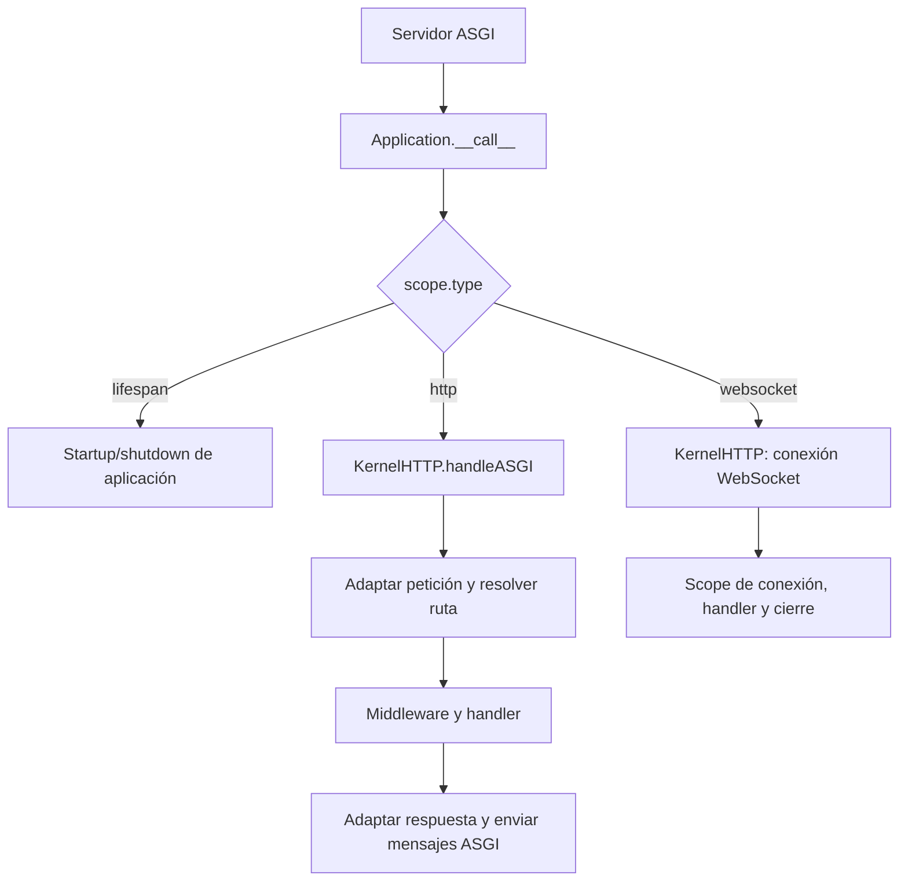

Orionis expone la misma instancia de aplicación mediante ASGI y RSGI. El servidor recibe conexiones y eventos de ciclo de vida; `Application` los dirige al kernel HTTP. Tus rutas y controladores utilizan las APIs de Orionis sin implementar el protocolo del servidor.

<a id="application-target"></a>

## La aplicación exportada

El punto de entrada del proyecto es **`bootstrap.app:app`**:

- `bootstrap.app` es el módulo `bootstrap/app.py`.
- `app` es la instancia creada y exportada por ese módulo.
- La última llamada `app.create()` prepara configuración y registro de providers. El servidor completa el startup HTTP.

El siguiente es un bootstrap mínimo, como alternativa a la configuración del proyecto, para mostrar la relación entre módulo y objeto. Conserva las demás opciones del `bootstrap/app.py` generado cuando trabajes en tu aplicación real:

```python
from pathlib import Path
from orionis import Application


app = Application(base_path=Path(__file__).parent.parent)
app.withRouting(
    api="routes/api.py",
    web="routes/web.py",
    health="/up",
)
app.create()
```

Los archivos de rutas indicados deben existir. No añadas otro objeto `Application` en los controladores ni sustituyas la instancia por una función factory si utilizas el punto de entrada generado.

<a id="entry-point-property"></a>

### Consultar `entryPoint`

`app.entryPoint -> str | None` obtiene el módulo del archivo desde el que se llamó a `create()` y añade `:app`. Antes de crear la aplicación devuelve `None`. Con el bootstrap predeterminado devuelve `"bootstrap.app:app"`.

El método no descubre cualquier nombre de variable: el sufijo es siempre `:app`. Si cambias la ubicación de la llamada a `create()`, también cambia el módulo calculado. Mantén esa llamada en el archivo que exporta `app`, especialmente al usar `serve`, que utiliza esta propiedad como target.

<a id="serve"></a>

## Elegir la interfaz al iniciar el servidor

Ejecuta una de las dos alternativas desde la raíz del proyecto:

```shell
orionis serve
python -B reactor serve
```

La interfaz efectiva predeterminada es `rsgi`. Para elegir ASGI explícitamente:

```shell
orionis serve --interface asgi --port 8001
python -B reactor serve --interface asgi --port 8001
```

Para seleccionar RSGI explícitamente:

```shell
orionis serve --interface rsgi
python -B reactor serve --interface rsgi
```

`--interface` tiene el alias `-i`; solo admite `asgi` o `rsgi`. `--port` tiene el alias `-p`. Las otras opciones específicas son `--log` y `--export`. Consulta sus efectos y las diferencias de plataforma en la [referencia completa de `serve`](/es/console/built-in-application#command-serve).

`serve` prepara el servidor Granian y pasa `app.entryPoint` como target. En el lanzamiento normal utiliza un puerto predeterminado de `8000`, enlaza `127.0.0.1` en desarrollo y `0.0.0.0` en producción. El modo de depuración integrado de Windows consulta `app.host` y `app.port`, además del argumento de puerto. Abre siempre la dirección que indique la consola.

La ejecución normal usa un proceso administrado en Windows y sustituye el proceso en sistemas Unix. Bajo un depurador en Windows se utiliza el servidor integrado. En ese caso, el lanzamiento RSGI espera explícitamente startup y shutdown desde el loop activo, sin llamar dentro de él a los hooks síncronos que ejecutan `run_until_complete()`.

<a id="asgi"></a>

## ASGI: scopes y mensajes

La firma implementada por la aplicación es:

```python
async def __call__(
    self,
    scope: dict,
    receive: Callable[[], Awaitable[dict[str, Any]]],
    send: Callable[[dict[str, Any]], Awaitable[None]],
) -> Any | None:
    ...
```

El servidor suministra `scope`, `receive` y `send`; no debes fabricarlos en una ruta.

| `scope["type"]` | Destino |
|---|---|
| `"lifespan"` | Eventos de startup y shutdown de la aplicación. |
| `"http"` | Kernel HTTP, adaptación de la petición, middleware y handler. |
| `"websocket"` | Kernel HTTP y ciclo de conexión WebSocket. |
| Otro valor | La aplicación devuelve `None` sin despachar un handler. |



### Mensajes de lifespan

Al recibir `lifespan.startup`, Orionis espera providers eager, ejecuta callbacks y prepara el kernel. Si termina correctamente responde `lifespan.startup.complete`. Ante una excepción ordinaria envía `lifespan.startup.failed` con `message=str(error)` y termina el bucle.

`lifespan.shutdown` ejecuta los callbacks de cierre, responde `lifespan.shutdown.complete` y termina. Un error ordinario produce `lifespan.shutdown.failed`. Un startup repetido dentro de la misma conversación de lifespan se confirma sin repetir sus callbacks. `lifespan.disconnect` termina esa conversación y los tipos no reconocidos se ignoran.

Ese control de repetición pertenece a la conversación de lifespan; no es un bloqueo global de todos los arranques posibles. Si tu servidor o tus pruebas omiten lifespan, el primer despacho puede preparar el kernel, pero no reemplaza los callbacks del arranque HTTP.

<a id="rsgi"></a>

## RSGI: protocolo y hooks del servidor

RSGI utiliza los métodos especiales de la misma instancia:

```python
async def __rsgi__(
    self,
    scope: Scope,
    protocol: HTTPProtocol | WebsocketProtocol | ProtocolError | ProtocolClosed,
) -> object:
    ...


def __rsgi_init__(self, loop: asyncio.AbstractEventLoop) -> None:
    ...


def __rsgi_del__(self, loop: asyncio.AbstractEventLoop) -> None:
    ...
```

Estos nombres y objetos pertenecen al contrato del servidor. No son métodos para invocar desde un controlador:

| Entrada | Comportamiento |
|---|---|
| `__rsgi_init__(loop)` | El servidor proporciona su loop; Orionis ejecuta el startup HTTP con interfaz `"rsgi"` mediante `run_until_complete()`. |
| `__rsgi__(scope, protocol)` | Despacha `scope.proto == "http"` o `"ws"` al kernel. Otros protocolos devuelven `None`. |
| `__rsgi_del__(loop)` | Ejecuta el shutdown HTTP mediante el loop proporcionado. |

El kernel crea el adaptador de transporte RSGI y utiliza `handleRSGI()` para HTTP o su flujo WebSocket para `"ws"`. La definición de rutas, los servicios inyectados y las acciones de controladores se mantienen.

Los hooks síncronos requieren que el servidor controle el loop en ese momento. No los llames dentro de un método async para arrancar o detener la aplicación. En particular, `await app.boot()` es la API pública para completar providers en un uso sin servidor; no equivale al startup RSGI.

<a id="kernels"></a>

## La frontera entre aplicación y kernels

La configuración core define dos kernels. `get_core_kernels_mapping() -> MappingProxyType` devuelve el mapa inmutable de metadatos; `CORE_KERNELS` expone ese mapa:

| Clave | Clase registrada |
|---|---|
| `KernelHTTP` | `orionis.http.kernel.KernelHTTP`. |
| `KernelCLI` | `orionis.console.kernel.KernelCLI`. |

La aplicación importa las clases desde esos metadatos, las construye con el contenedor y comprueba sus contratos `IKernelHTTP` o `IKernelCLI`. Un tipo que no implemente el contrato produce `TypeError`. El kernel CLI ausente produce `RuntimeError`; una entrada HTTP ausente no tiene esa conversión específica y el acceso a sus metadatos puede producir `KeyError`.

El arranque HTTP llama a `await kernel.boot()` y publica ambos handlers solo cuando termina. El arranque CLI acepta `boot(application)` y espera su resultado si es awaitable. Cada inicialización comparte un bloqueo propio para que dos primeros despachos concurrentes no publiquen kernels incompletos.

Estas entradas son parte de la integración core; `bootstrap/app.py` no ofrece un método `withKernel()` ni un selector público para sustituirlas. Para personalizar comportamiento de aplicación usa providers, middleware, rutas, callbacks y el handler de excepciones.

<a id="disconnects"></a>

## Desconexión, cancelación y respuestas largas

Sin monitorización adicional, Application delega el manejo HTTP directamente en la tarea del servidor. Si esa tarea se cancela, la cancelación atraviesa el handler y sus bloques `finally`.

`http.monitor_disconnects=True` activa la vigilancia HTTP. Las políticas compiladas de endpoints también pueden activar vigilancia para rutas concretas. El ajuste debe ser un `bool` cuando se configura; un valor diferente de `None` que no sea booleano hace fallar `create()` con `TypeError`.

- En ASGI, un consumidor adicional distribuye los mensajes recibidos hacia el handler mediante una cola acotada. Puede mantener ocho mensajes en cola y uno esperando entrar; la detección de desconexión se pausa mientras esa cola está llena.
- En RSGI, una tarea espera `protocol.client_disconnect()` y solicita la cancelación del handler si se desconecta el cliente.
- Al terminar se espera y limpia la tarea de vigilancia. La cancelación atribuida a esa desconexión devuelve `None`; cancelaciones del servidor y errores de transporte se propagan.
- WebSocket usa su propio ciclo de conexión y no pasa por esta vigilancia adicional de HTTP.

Configura esta política mediante [bootstrap](/es/application/bootstrap) o la configuración HTTP. Para streaming y SSE, conserva `try/finally` en los generadores de tu aplicación y revisa las [respuestas HTTP](/es/http/responses) y [Realtime, WebSocket y SSE](/es/realtime).

<a id="lifespan-presentation"></a>

## Presentación del arranque y cierre

Foundation envuelve los callbacks HTTP con dos generadores internos de presentación. No son un mecanismo de registro de recursos ni reemplazan `app.on(...)`:

| Función | Firma y efecto |
|---|---|
| `before_startup_orionis_generator()` | `-> None`: muestra el panel inicial de arranque. |
| `after_startup_orionis_generator(host: str, port: int)` | `-> None`: muestra dirección, fecha, zona horaria, PID, loop e interfaz. Los metadatos de lanzamiento del servidor ajustan dirección e interfaz presentadas. |
| `startup_orionis_generator(app: IApplication)` | `-> Generator[None]`: muestra el panel previo, hace `yield`, y muestra el resultado cuando el kernel terminó de prepararse. |
| `before_shutdown_orionis_generator()` | `-> None`: muestra el panel previo de cierre. |
| `after_shutdown_orionis_generator(start_at: int)` | `-> None`: calcula el tiempo transcurrido desde el timestamp en nanosegundos y presenta días, horas, minutos, segundos y milisegundos. |
| `shutdown_orionis_generator(app: IApplication)` | `-> Generator[None]`: hace `yield` entre el panel previo y el resumen posterior al cierre. |

La aplicación usa estos wrappers solo en el ciclo HTTP. Los wrappers muestran su contenido cuando `app.isDebug()` es verdadero y `app.isProduction()` es falso. Si los callbacks o la preparación del kernel fallan, no se llega al paso posterior del generador. La duración se calcula desde `app.startAt`, que se fija al construir la aplicación.

Para completar el recorrido, consulta [Ciclo de vida y recursos de aplicación](/es/application/lifecycle), [Opciones de bootstrap](/es/application/bootstrap) y [Scopes y concurrencia](/es/application/container/scopes-and-concurrency).
