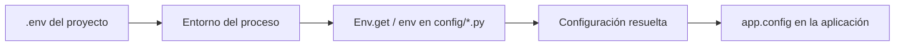

El componente de entorno conecta las variables del proyecto con sus archivos de configuración. Lee el archivo `.env`, interpreta sus valores y permite construir ajustes como la conexión de base de datos, el nombre de la aplicación o los límites de un servicio.

**Utiliza `Env` y `env()` únicamente dentro de los archivos de `config/`. No los uses directamente durante el runtime de la aplicación.** Los controladores, jobs, comandos, hubs y demás componentes deben consumir la configuración ya resuelta mediante `app.config(...)` o el servicio correspondiente. Así, todos trabajan con los mismos ajustes, tanto si la aplicación carga los archivos Python como si recupera su configuración compilada.

## De `.env` a la configuración



El archivo `.env` conserva las entradas como texto. La lectura desde `config/` puede producir cadenas, números, booleanos, colecciones y otros valores admitidos por el componente. La aplicación recibe el resultado de esa lectura; no necesita volver a consultar el archivo en cada petición.

## 1. Define las variables

Crea o edita `.env` en la raíz del proyecto generado, al mismo nivel que `reactor`, `bootstrap/` y `config/`:

```dotenv
APP_NAME="str:Orionis Reports"
APP_DEBUG=bool:true
REPORTS_LIMIT=int:100
REPORTS_ENABLED=bool:on
```

Los nombres utilizados con la API deben cumplir `[A-Z][A-Z0-9_]*`: empiezan por una letra mayúscula y continúan con mayúsculas, números o guiones bajos. `REPORTS_LIMIT` es válido; `reports_limit`, `1REPORT` y `REPORTS-LIMIT` no lo son.

Mantén un `.env.example` con las claves que necesita el proyecto y valores de ejemplo. El `.env` real contiene los valores de cada despliegue. Los prefijos como `int:` y `bool:` pertenecen al valor; no forman parte del nombre de la variable.

## 2. Lee los valores desde `config/`

El paquete público expone ambas alternativas:

```python
from orionis.environment import Env, env
```

`Env.get("REPORTS_LIMIT", 100)` y `env("REPORTS_LIMIT", 100)` realizan la misma lectura. El helper `env()` delega en `Env.get()`; no introduce reglas de conversión diferentes.

Por ejemplo, crea `config/reports.py`:

```python
from dataclasses import dataclass, field
from orionis.environment import Env, env


@dataclass(frozen=True, kw_only=True)
class Reports:
    limit: int = field(
        default_factory=lambda: Env.get("REPORTS_LIMIT", 100),
    )
    enabled: bool = field(
        default_factory=lambda: env("REPORTS_ENABLED", False),
    )
```

Orionis descubre las dataclasses congeladas de `config/`, las instancia al construir la configuración y registra sus valores bajo la sección correspondiente al módulo. En este caso, las claves resultantes son `reports.limit` y `reports.enabled`.

`default_factory` aplaza la lectura hasta la construcción de la instancia de configuración. La anotación `int` o `bool` describe el campo; el prefijo del valor es el que dirige la conversión realizada por el componente de entorno. Una dataclass por sí sola no convierte una cadena incorrecta al tipo de su anotación.

## 3. Consume la configuración resuelta

Una vez creada la aplicación, utiliza `app.config("reports.limit")` y `app.config("reports.enabled")` desde los componentes que reciben la aplicación. Con el archivo anterior, los valores resueltos son el entero `100` y el booleano `True`.

Este es el límite entre configuración y runtime: las lecturas de `.env` permanecen en `config/`; el resto del proyecto utiliza los ajustes construidos durante el arranque. La [guía de compilación y persistencia](/es/architecture/environment/compiled-configuration) muestra un ejemplo de consumo desde un componente y explica la recuperación desde JSON.

## Cómo se selecciona y carga `.env`

La primera llamada a la fachada inicializa un `DotEnv` compartido por el proceso:

1. Selecciona `.env` en el directorio de trabajo actual. Ejecuta los comandos del proyecto desde su raíz.
2. Si el archivo no existe, intenta crearlo vacío. La carpeta seleccionada debe permitir esa operación.
3. Carga sus variables en el entorno del proceso con sobrescritura: cuando una clave existe tanto en el sistema como en el archivo, prevalece el valor del `.env`.
4. Conserva una instantánea de las entradas del archivo para `Env.all()`.

Las lecturas posteriores de `Env.get()` consultan el entorno del proceso y convierten el valor encontrado. Una variable definida únicamente por el sistema también se puede leer, siempre que cumpla el formato de nombre requerido y no haya sido sobrescrita por el archivo.

La ruta elegida pertenece a ese singleton: cambiar de directorio después de inicializarlo no selecciona otro `.env`. El uso directo de `DotEnv(path)` permite fijar una ruta en la primera construcción; es una opción de integración que se explica en la [referencia del componente](/es/architecture/environment/operations-and-reference).

## Valores predeterminados y cambios

El segundo argumento de `Env.get()` y `env()` solo se utiliza si la clave no existe. Una entrada vacía o un valor `null` produce `None`, aunque se haya indicado otro valor predeterminado. Para conservar texto que parece un número o un booleano, utiliza `str:`. Consulta todos los casos y los diez prefijos admitidos en [Variables y configuración tipada](/es/architecture/environment/typed-configuration).

Editar `.env` no modifica por sí solo la configuración de una aplicación que ya está creada. Tras cambiar ajustes, inicia un proceso nuevo y sigue las indicaciones de [invalidación de la configuración compilada](/es/architecture/environment/compiled-configuration). `Env.reload()` recarga el entorno del proceso, pero no reconstruye las instancias ni la configuración ya resuelta.

## Continúa con la guía

- [Variables y configuración tipada](/es/architecture/environment/typed-configuration): cadenas, números, booleanos, colecciones, rutas, Base64 y conversores.
- [Compilación y persistencia](/es/architecture/environment/compiled-configuration): activación en bootstrap, archivos JSON y consumo de configuración durante el runtime.
- [Operaciones y referencia](/es/architecture/environment/operations-and-reference): API de lectura, escritura, eliminación, recarga, validación y generación de claves.
