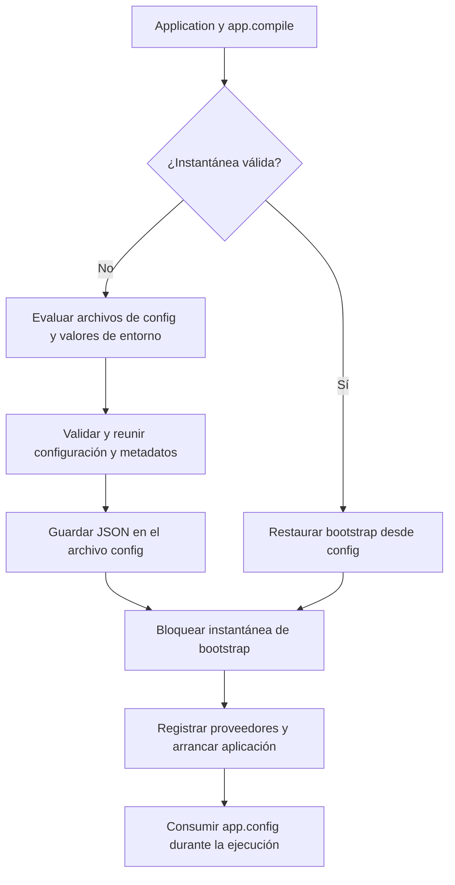

El componente de entorno se utiliza **únicamente en los archivos de configuración**. Durante el arranque, Orionis evalúa esos archivos y construye la configuración que consumen los servicios. Durante la ejecución de la aplicación, lee esa configuración mediante `IApplication.config()`; no vuelvas a consultar `Env` ni `env()` desde controladores, comandos, jobs o servicios.

La compilación permite reutilizar el resultado del bootstrap en otros arranques. Persiste JSON dentro de `storage/framework`, pero **no crea una copia independiente de todas las variables de `.env`**.

## Activar la persistencia en el bootstrap

La aplicación distribuida configura lo siguiente en `bootstrap/app.py`, después de construir `app` y antes de registrar sus componentes y llamar a `app.create()`:

```python
app.compile(
    path="storage/framework/bootstrap",
    invalidation_paths=[
        "app",
        "bootstrap",
        "config",
        "database",
        "resources",
        "routes",
        ".env",
    ],
)
```

La firma real es:

```text
compile(
    path: str | None = None,
    invalidation_paths: list[str] | None = None,
) -> None
```

| Parámetro | Comportamiento |
| --- | --- |
| `path` | Directorio de persistencia. Una ruta relativa se resuelve respecto a la raíz de la aplicación. Si se omite, se utiliza `storage/framework/cache`; el bootstrap anterior lo cambia a `storage/framework/bootstrap`. El directorio se crea si es necesario. |
| `invalidation_paths` | Archivos y directorios cuyas modificaciones invalidan la instantánea. Por defecto no se añade ninguna ruta del proyecto. Las definiciones internas de rutas del framework se monitorizan adicionalmente para la configuración. |

No existe un argumento `env=True` ni es necesario llamar a un método de compilación de `Env`. Si no se llama a `app.compile()`, el arranque construye la configuración sin esta persistencia.

Incluye `.env` de forma **explícita** y comprueba que exista antes de `compile()`. Las rutas se clasifican cuando se configura la compilación: una ruta inexistente en ese momento no queda registrada para monitorización. Los directorios monitorizados aportan sus archivos `*.py`, por lo que indicar solo la raíz del proyecto no sustituye a indicar `.env`.

## Qué se almacena

Con el bootstrap anterior, los archivos son:

| Archivo | Contenido y consumidor |
| --- | --- |
| `storage/framework/bootstrap/config` | Instantánea del bootstrap: configuración resuelta, rutas de directorios, descriptores de proveedores, archivos de rutas, middleware, kernels, scheduler y manejador de excepciones. La lee `Application`. |
| `storage/framework/bootstrap/commands` | Metadatos del registro de comandos y sus argumentos. Los consume el loader de Reactor al descubrir comandos. |
| `storage/framework/bootstrap/routes` | Metadatos compilados de rutas HTTP. Los consume el loader de rutas cuando se necesitan. |

Los tres contienen **JSON y no tienen extensión**. No se llaman `config.json`, `env.json` ni `commands.json`. Los archivos de comandos y rutas se generan cuando sus componentes cargan y persisten sus registros; activar la compilación no obliga a crearlos todos inmediatamente.

La envoltura de cada archivo incluye:

- `__meta__.version`: versión del formato de caché.
- `__meta__.generatedAt`: instante de generación como timestamp Unix en segundos.
- `__meta__.sourcesHash`: huella de las fuentes monitorizadas.
- `__data__`: datos serializados del componente.

El serializador representa tipos como `Path`, bytes, tuplas, conjuntos y enumeraciones mediante etiquetas JSON que permiten reconstruirlos. Los proveedores y otros componentes se conservan como referencias de módulos y clases, no como instancias activas. La escritura utiliza un archivo temporal en el mismo directorio y después reemplaza el archivo de destino.

En `config` se guardan los **valores que llegaron a la configuración**, incluidos los leídos desde `.env`. No se exportan automáticamente todas las entradas de `Env.all()` ni todo `os.environ`. Una variable que no participa en la configuración no se incorpora por el simple hecho de existir en `.env`.

Los valores sensibles utilizados por la configuración también pueden quedar en esa instantánea, incluidas credenciales y la clave de aplicación serializada. El formato JSON y la codificación Base64 no los cifran: aplica a este directorio el mismo cuidado que al archivo `.env` y evita publicarlo como contenido estático.

## Ciclo de carga



En un arranque sin instantánea válida, `app.create()` descubre las dataclasses congeladas de `config/`, las instancia, reúne sus valores con la configuración base y registra los metadatos de proveedores antes de persistir. Es aquí donde se resuelven las lecturas de entorno declaradas en las configuraciones.

En un arranque con instantánea válida, `compile()` restaura y bloquea el bootstrap. La carga posterior reutiliza esa configuración y evita volver a descubrir e instanciar sus dataclasses; los proveedores de la aplicación siguen registrándose para ese proceso. Los métodos de configuración del bootstrap que detectan ese estado reutilizan los datos restaurados.

Las órdenes de reparación `bootstrap:*` utilizan un contexto de recuperación que evita leer y escribir la instantánea de configuración, para no conservar como normal el estado transitorio de una reparación.

<a id="runtime-configuration"></a>

## Leer la configuración durante la ejecución

Por ejemplo, `APP_NAME` se lee en `config/app.py` y queda disponible como `app.name`. Un controlador recibe la aplicación mediante inyección y utiliza el valor resuelto:

```python
from orionis.foundation.contracts.application import IApplication
from orionis.http import JSONResponse


class AppInfoController:
    async def __call__(self, app: IApplication) -> JSONResponse:
        return JSONResponse({
            "name": app.config("app.name"),
        })
```

Este acceso funciona con y sin persistencia. `app.config("seccion.clave")` consulta la configuración del proceso y devuelve `None` si la ruta no existe. No acepta un valor predeterminado como segundo argumento: ese argumento **modifica** la configuración en memoria.

La restauración de tipos del JSON es distinta de la preparación de la configuración para su uso. Orionis aplica `FreezeThaw.freeze()` al bootstrap y `FreezeThaw.thaw()` para crear la configuración de ejecución: los diccionarios vuelven a ser diccionarios y las secuencias congeladas se convierten en listas. Por eso, una tupla leída mediante `Env` en `config/` se consulta como `list` mediante `app.config()`, **también sin caché compilada**. Los conjuntos (`set`) y los bytes no se transforman en ese paso y conservan sus tipos; los conjuntos no se convierten en `frozenset`.

Modificar valores mediante `app.config(...)` no reescribe `.env` ni la instantánea compilada. `app.resetRuntimeConfig()` restaura una copia de la configuración del bootstrap ya cargado; tampoco vuelve a evaluar `.env`. Los servicios que ya capturaron valores pueden requerir una nueva construcción o un nuevo proceso.

<a id="refresh-compiled-configuration"></a>

## Cambios de entorno e invalidación

La validación compara la versión del formato y una huella calculada con las rutas, el tamaño y el tiempo de modificación en nanosegundos de los archivos monitorizados. No calcula un hash del contenido de cada archivo ni aplica un TTL de configuración. Un mismo objeto de caché reutiliza su huella durante medio segundo para reducir trabajo repetido.

Cuando `.env` está monitorizado, un cambio detectado invalida la instantánea **para el siguiente arranque que la compruebe**. Un proceso que ya construyó su aplicación conserva su configuración; editar `.env` no actualiza automáticamente controladores, conexiones ni servicios ya iniciados. Una modificación exclusiva de variables del sistema operativo tampoco cambia la huella de archivos.

Para aplicar cambios de forma controlada:

1. Actualiza `.env` o los archivos de configuración.
2. Limpia los artefactos de optimización si necesitas forzar su reconstrucción.
3. Reinicia los procesos de aplicación y workers que deban utilizar los nuevos valores.

Puedes limpiar desde la raíz del proyecto con cualquiera de estas alternativas:

```shell
orionis optimize:clear
```

```shell
python -B reactor optimize:clear
```

`optimize:clear` elimina `config`, `commands` y `routes` del directorio compilado efectivo. También limpia bytecode Python y artefactos de construcción; consulta su [alcance completo](/es/console/built-in-application). El siguiente arranque o acceso a los loaders regenera los archivos que correspondan. El comando `optimize` valida fuentes Python; no constituye un comando específico para compilar `.env`.

`Env.reload()` refresca el archivo y el estado del componente de entorno, pero **no reconstruye la configuración ya resuelta ni sus servicios**. No se utiliza como mecanismo de actualización de configuración durante las peticiones.

## Errores y operación

- El directorio compilado necesita permisos de creación y escritura para generar sus archivos; un error de escritura o serialización puede interrumpir el arranque.
- La ausencia de archivo, una versión distinta o una huella que no coincide permiten reconstruir desde las fuentes. Un JSON mal formado puede propagar un error de decodificación; no se garantiza su reparación silenciosa.
- No edites los archivos generados para configurar la aplicación. Cambia `.env` o `config/`, invalida y reinicia.
- No reutilices una instantánea entre instalaciones como sustituto de su bootstrap: contiene rutas resueltas y referencias a componentes de la aplicación que la generó.

Continúa con [lectura y tipado del entorno](/es/architecture/environment/typed-configuration) o con la [referencia del componente](/es/architecture/environment/operations-and-reference).
