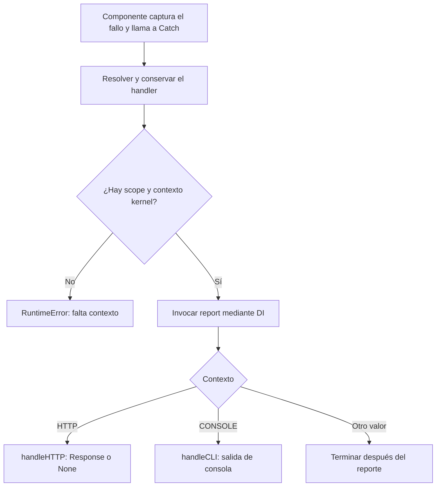

Una excepción es un objeto que representa una condición que interrumpe la ejecución normal de Python. Al lanzarse, el flujo busca un `except` compatible y recorre las llamadas pendientes si nadie la resuelve. Una respuesta HTTP, un mensaje de consola y una entrada de log son posibles tratamientos de ese fallo; son responsabilidades distintas.

El módulo `orionis.failure` coordina el **reporte** y la **presentación** de las excepciones que los componentes del framework le delegan. La aplicación define su política mediante una clase handler registrada con:

```python
# Set the global exception handler for unhandled exceptions.
app.withExceptionHandler(ExceptionHandler)
```

Esta guía desarrolla el sistema general. Para la página de diagnóstico, los estados y el comportamiento de una petición, consulta [Excepciones HTTP](/es/http/exceptions). El capítulo de HTTP conserva ese alcance y enlaza con esta configuración compartida.

## Qué resuelve el sistema de excepciones

Un componente puede resolver una excepción localmente si conoce una recuperación válida: rechazar un dato, elegir una alternativa o devolver un resultado de dominio. Si no puede resolverla, el error se propaga al límite del componente.

En los flujos integrados con `failure`, el framework utiliza el servicio `Catch` para ejecutar la política de aplicación. Esta coordinación permite:

- Registrar información del fallo con el servicio de logging.
- Presentar una excepción de comando en consola.
- Producir una respuesta HTTP apropiada.
- Traducir errores de dominio a una representación estable.
- Mantener un tratamiento común para los demás errores mediante la clase base.

Un `except Exception: pass` elimina esa propagación sin producir una recuperación ni un diagnóstico. Captura donde puedas tomar una decisión útil y conserva la información que necesites reportar.

### Reportar y presentar son operaciones diferentes

| Operación | Responsabilidad |
| --- | --- |
| Reportar | Registrar o comunicar el fallo a un destino de diagnóstico. |
| Presentar | Producir una salida adecuada al contexto que estaba ejecutándose. |
| Recuperar | Decidir cómo continúa una operación que puede resolver el problema. |

`report()` no construye una respuesta HTTP. `handleHTTP()` no sustituye la recuperación de una transacción de negocio. El kernel tampoco reintenta automáticamente una operación porque el handler haya producido un mensaje.

`Catch` reporta primero y después invoca la presentación correspondiente. La [guía de personalización](/es/architecture/exception-handling/handling-exceptions) muestra cómo cambiar una de esas responsabilidades conservando la otra.

<a id="exception-registration"></a>

## Registrar el handler de aplicación

### Dónde vive la clase

La estructura del proyecto incluye `app/exceptions/handler.py` y su clase `ExceptionHandler`. El archivo pertenece a la aplicación: allí defines las decisiones que necesita tu dominio.

Una implementación mínima, que conserva todo el comportamiento nativo, es:

```python
from orionis.failure.base import BaseExceptionHandler


class ExceptionHandler(BaseExceptionHandler):
    pass
```

`BaseExceptionHandler` implementa los contratos de conversión, reporte, presentación CLI y presentación HTTP. Al heredar sin sobrescribirlos, utiliza esos métodos y su constructor inyectable.

El proyecto también puede mostrar sobrescrituras delegadoras de `report()`, `handleCLI()` y `handleHTTP()`. Si sólo llaman a `super()`, mantienen el mismo comportamiento. Consulta los [ejemplos completos del handler](/es/architecture/exception-handling/handling-exceptions).

<a id="exception-bootstrap"></a>

### Registro desde bootstrap/app.py

Registra la clase **después de crear la instancia Application y antes de `app.create()`**, que arranca la aplicación. En el bootstrap existente:

```python
from app.exceptions.handler import ExceptionHandler

# Set the global exception handler for unhandled exceptions.
app.withExceptionHandler(ExceptionHandler)
```

Conserva las demás configuraciones de tu bootstrap y su llamada final a `app.create()`. Este fragmento configura la variable `app` ya existente; no crea otra aplicación.

| Aspecto | Comportamiento real |
| --- | --- |
| Método | `app.withExceptionHandler(handler: type[IBaseExceptionHandler]) -> Self`, síncrono. |
| Argumento | Una clase, no una instancia, función ni nombre de texto. |
| Contrato | La clase debe heredar de `IBaseExceptionHandler`. Extender `BaseExceptionHandler` es la opción práctica para reutilizar sus métodos. |
| Retorno | La misma aplicación; permite encadenar configuración. |
| Registro | Guarda el módulo y el nombre de la clase para su resolución posterior. |
| Varias llamadas | Una nueva clase reemplaza la registrada anteriormente mientras la configuración es modificable. |
| Sin registro propio | Se utiliza el handler base de Orionis. |

La clase debe ser importable desde su módulo. El registro no instancia el handler ni procesa una excepción en ese momento. Los requisitos abstractos se deben implementar si optas por heredar directamente del contrato.

`IBaseExceptionHandler` se importa desde `orionis.failure.contracts.handler`. El método comprueba ese contrato; no exige que todas las implementaciones personalizadas hereden necesariamente de la clase base concreta.

<a id="exception-dependencies"></a>

### Por qué se registra una clase

El contenedor construye el handler y resuelve las dependencias anotadas de su constructor y métodos. Por ejemplo, el constructor base recibe `DefaultResponses` e `IApplication`; `report()` recibe `ILogger` y `handleCLI()` recibe `Console`.

Esto permite usar los servicios configurados de la aplicación sin crearlos dentro del handler. Cuando personalices un método, conserva la firma y las anotaciones que necesita su inyección.

El servicio `Catch` reutiliza el handler resuelto. Guarda el estado de cada fallo en variables locales: atributos como `self.current_request` o `self.current_exception` compartirían información mutable entre ejecuciones concurrentes.

`await app.getExceptionHandler() -> IBaseExceptionHandler` exige una aplicación creada. Conserva la clase importada y construye una instancia nueva mediante `build()` en cada llamada. `Catch`, en cambio, retiene la primera instancia que obtiene y coordina esa resolución con un lock asíncrono. Son alcances distintos; no utilices el handler compartido como almacenamiento de la petición.

<a id="exception-flow"></a>

## Recorrido completo de failure

El punto de entrada del servicio es:

```text
await Catch.exception(exception, request=None)
```

`Catch` puede referirse al servicio concreto o a su fachada, según la importación. En una aplicación suele utilizarse la fachada o el contrato `ICatch` por inyección; los kernels ya los utilizan en sus flujos correspondientes.

Cuando una excepción llega al servicio:

1. Resuelve el handler mediante `app.getExceptionHandler()` y conserva la instancia para siguientes llamadas.
2. Consulta el scope activo y obtiene su contexto `kernel`.
3. Invoca `report(exception, ...)` mediante el contenedor.
4. Si el contexto es `KernelContext.CONSOLE`, invoca `handleCLI()`.
5. Si es `KernelContext.HTTP`, invoca `handleHTTP()`, pasando la petición o el adaptador.
6. Para otro valor de contexto, termina después del reporte.



`report()` termina antes de presentar el error. Su valor de retorno no decide por sí solo si se debe renderizar: retornar `None` no cancela la llamada posterior a `handleHTTP()` o `handleCLI()`. Una excepción durante el reporte, en cambio, interrumpe ese recorrido.

No hay métodos `shouldReport()`, `shouldRender()` ni un `render()` genérico en este contrato. Las extensiones utilizan los métodos reales descritos a continuación.

### Funciones de cada componente

| Componente | Papel dentro del flujo |
| --- | --- |
| `Catch` | Coordina resolución, contexto, reporte y despacho. |
| `BaseExceptionHandler` | Proporciona el tratamiento predeterminado reutilizable. |
| `IBaseExceptionHandler` | Define los cinco métodos que implementa un handler. |
| `Throwable` | Conserva una representación estructurada del fallo para el reporte. |
| `KernelContext` | Identifica los contextos CONSOLE y HTTP usados en el despacho. |
| `CatchProvider` | Registra el servicio compartido y prepara su fachada. |
| `DefaultResponses` | Construye las respuestas públicas y el diagnóstico HTML cuando se solicita desde la política HTTP. |

La [referencia del módulo](/es/architecture/exception-handling/policies-and-reference) describe sus firmas, imports, valores de retorno y condiciones de uso.

<a id="exception-default-handler"></a>

## Los cinco métodos del handler

| Método | Tipo | Propósito |
| --- | --- | --- |
| `toThrowable(exception)` | Síncrono | Convertir el fallo en `Throwable`. |
| `isExceptionIgnored(exception)` | Síncrono | Consultar la política de clases ignoradas. |
| `report(exception, log)` | Asíncrono | Reportar el fallo; el método base utiliza el logger. |
| `handleCLI(exception, console)` | Asíncrono | Presentarlo en consola. |
| `handleHTTP(exception, request)` | Asíncrono | Construir una respuesta HTTP o devolver `None` conforme al contrato. |

El tratamiento base utiliza `log.getLogger().error(...)` con `exc_info=(type(exception), exception, throwable.traceback)`. Registra `[ClassName] message` junto al traceback, incluidas las causas encadenadas y notas de Python, también cuando se reporta fuera del bloque `except` original.

La conversión a `Throwable` toma el primer argumento como mensaje y convierte todos los argumentos a cadenas; una excepción sin argumentos utiliza `("",)`. No se recopilan automáticamente todas las variables de una operación. Para cambiar el formato o seleccionar qué errores registrar, personaliza `report()` sin confundirlo con la respuesta pública.

Sin una personalización, `handleCLI()` presenta el fallo con `Console.exception()`. `handleHTTP()` conserva los estados de las excepciones HTTP conocidas; para otras devuelve un `500` genérico con debug desactivado y el diagnóstico HTML detallado con debug activado. La selección JSON/HTML y los casos resueltos directamente por el kernel se explican en [Excepciones HTTP](/es/http/exceptions). Un handler no decide por sí solo el código de salida de Reactor ni el formato de error de un protocolo.

### Throwable no es una respuesta

`Throwable` es una dataclass inmutable con `classtype`, `message`, `args` y `traceback`. Separa la información del fallo de su representación final.

No define por sí sola un estado HTTP, una política de reintentos ni un formato JSON. El traceback es un objeto Python nativo; para serializar o enviar información a otro sistema, convierte únicamente los datos que ese destino necesita.

### Heredar y delegar

La estrategia habitual es extender `BaseExceptionHandler` y sobrescribir la decisión específica:

- `report()` si cambia el registro de un error concreto.
- `handleCLI()` si necesitas una salida particular de comando.
- `handleHTTP()` si un fallo de dominio tiene un estado y cuerpo públicos propios.
- `toThrowable()` si necesitas una conversión compatible con el contrato.
- `isExceptionIgnored()` si la selección de ignorados necesita otra política explícita.

Para los casos que no especialices, delega con `super()`. Los ejemplos de [reporte, dominio y presentación](/es/architecture/exception-handling/handling-exceptions) muestran estas alternativas sin reemplazar toda la política nativa.

<a id="exception-runtime-boundaries"></a>

## Qué significa que el handler sea global

El registro es compartido por la aplicación, pero **no instala un capturador universal de Python**. No reemplaza `sys.excepthook` ni convierte cualquier excepción de un hilo, tarea independiente o integración en una respuesta HTTP.

La coordinación depende del componente que captura y entrega el fallo:

| Contexto | Integración relevante |
| --- | --- |
| HTTP ordinario | Las capas y el kernel resuelven casos propios y delegan los demás al tratamiento HTTP. |
| Comandos Reactor | Utilizan el sistema de reporte y presentación de consola. |
| Scheduler | Puede delegar fallos de sus callbacks al servicio Catch. |
| MCP | Utiliza el reporte del handler en sus puntos de integración y conserva respuestas del protocolo. |
| Realtime y WebSocket | Tienen errores, cierres y tratamiento propios de sus protocolos. |
| Workers de colas | Administran logging, reintentos y registros de fallos mediante su flujo de worker. |
| Background de una respuesta | Se ejecuta después de la entrega; un error allí no puede sustituir el estado HTTP ya enviado. |

La [matriz detallada por contexto](/es/architecture/exception-handling/contexts-and-transports) distingue estos casos. El estado HTTP no define cómo fallará una herramienta MCP o una operación en cola.

Los límites de captura también importan: que el contrato acepte `BaseException` no significa que los kernels capturen siempre `KeyboardInterrupt`, `SystemExit` o cancelaciones. Conserva las señales de finalización del runtime en lugar de tratarlas indiscriminadamente como errores de negocio.

## Ignorar, silenciar el log y recuperar

`dont_catch` en el handler base es una colección de clases exactas. Una coincidencia omite tanto el reporte como el renderer base. No es una lista de “errores que no deseo registrar” exclusivamente.

En HTTP, ignorar un error que no tiene otra respuesta puede dejar el flujo sin un Response válido. Para conservar una respuesta pública y omitir sólo su log, especializa `report()`; para resolverlo, define `handleHTTP()` o una recuperación local. Las [políticas de ignorados](/es/architecture/exception-handling/policies-and-reference) explican las diferencias.

La comprobación de ignorados utiliza el tipo exacto. El mapeo de estados HTTP, por su parte, recorre la jerarquía de clases y reconoce subclases. Son decisiones diferentes.

<a id="exception-bootstrap-cache"></a>

## Configuración compilada y procesos activos

`withExceptionHandler()` modifica la configuración de arranque. Después de arrancar, una modificación normal se rechaza con `RuntimeError`.

Cuando la aplicación carga configuración compilada, el método retorna sin volver a registrar la clase. La elección del handler procede entonces de los metadatos compilados. Mantén los archivos `app` y `bootstrap` entre las rutas de invalidación del esquema de compilación que utilices.

La aplicación también conserva la clase resuelta, y Catch conserva su instancia. Cambiar un archivo no reemplaza el handler ya retenido por un proceso en ejecución: reinicia los procesos correspondientes y actualiza o invalida la compilación cuando cambies el registro.

Si necesitas descartar los artefactos de optimización del proyecto, el CLI ofrece estas alternativas:

```bash
orionis optimize:clear
```

```bash
python -B reactor optimize:clear
```

Este comando elimina cachés compiladas de configuración, rutas y comandos, además de bytecode y artefactos de build. Aplícalo como parte de la actualización de esos artefactos; no configura el handler por sí mismo.

<a id="exception-debug"></a>

## Debug y mensajes públicos

La política HTTP base usa `app.debug` para los errores que no reconoce. En producción, configura `APP_DEBUG=bool:false` para obtener el mensaje público genérico y conservar el reporte interno.

El nombre `APP_ENV` no desactiva debug. Además, un handler personalizado decide sus propios cuerpos y mensajes: delegar a la política base conserva sus límites; construir una respuesta detallada propia puede cambiarlos.

La [página de excepciones HTTP](/es/http/exceptions) explica qué contiene el diagnóstico, los estados conocidos y por qué una petición API puede recibir HTML de debug. Los capítulos generales también distinguen los errores de reporte, las cancelaciones y los comportamientos de otros protocolos.

## Continuar con la implementación

El [inventario verificable de Exceptions](/downloads/exceptions-api-inventory.json) relaciona las declaraciones de `failure`, el handler del proyecto y su registro en la aplicación con sus guías. Las integraciones de cada transporte se revisan por separado; no se presentan como una captura universal del proceso.

1. [Reportar y gestionar excepciones](/es/architecture/exception-handling/handling-exceptions): clase de aplicación, errores de dominio, logging, CLI e inyección de servicios.
2. [Contextos y transportes](/es/architecture/exception-handling/contexts-and-transports): captura y respuesta real en HTTP, CLI, WebSocket, Realtime, MCP, colas y tareas.
3. [Políticas de errores y referencia](/es/architecture/exception-handling/policies-and-reference): contratos completos, Throwable, ignorados, contextos, concurrencia y verificación.
4. [Excepciones HTTP](/es/http/exceptions): diagnóstico, respuestas públicas y límites de una petición.
