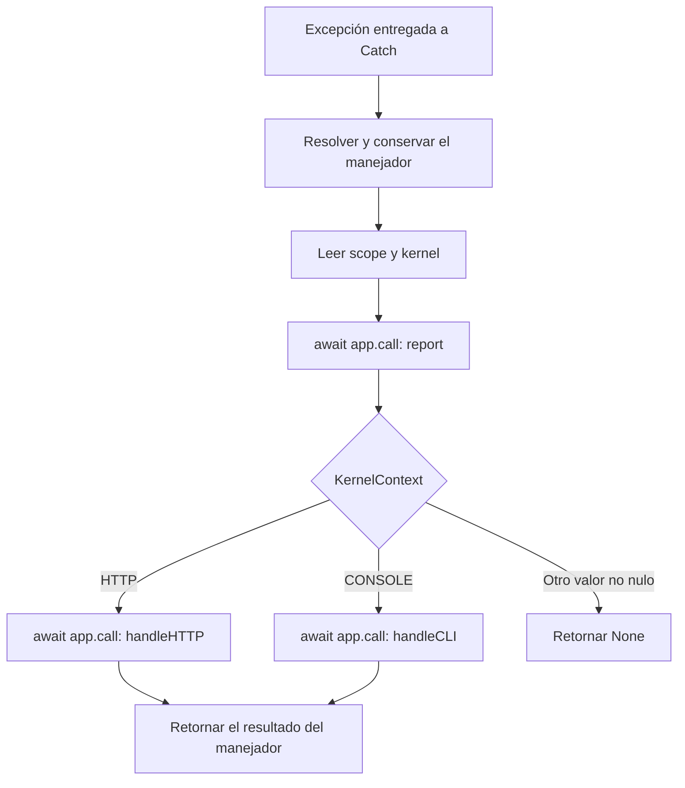

`Catch` coordina el reporte y la presentación de una excepción que otro componente ya capturó. El manejador decide qué registrar y qué devolver; el transporte decide en qué puntos intercepta los errores. Registrar un manejador no instala una captura universal de excepciones del proceso.

Comienza con [Registro y funcionamiento](/es/architecture/exception-handling), continúa con [Personalizar el manejador](/es/architecture/exception-handling/handling-exceptions) y consulta [Contextos y transportes](/es/architecture/exception-handling/contexts-and-transports) para conocer las diferencias entre HTTP, CLI, MCP, conexiones y trabajo en segundo plano.

<a id="failure-public-imports"></a>

## Importaciones públicas

```python
from orionis.support.facades import Catch
from orionis.failure.contracts import ICatch
from orionis.failure.entities import Throwable
from orionis.failure.enums import KernelContext
```

La primera importación es la fachada. `from orionis.failure import Catch` obtiene la clase concreta del servicio, cuyo constructor requiere una aplicación. Para ampliar la política se utilizan `BaseExceptionHandler` de `orionis.failure.base` e `IBaseExceptionHandler` de `orionis.failure.contracts.handler`; sus métodos se explican en la [guía de personalización](/es/architecture/exception-handling/handling-exceptions).

<a id="catch-service"></a>

## Catch e ICatch

La clase `orionis.failure.catch.Catch` implementa `ICatch` y expone esta API:

```python
def __init__(self, app: IApplication) -> None:
    ...

async def exception(
    self,
    exception: BaseException,
    request: Request | TransportAdapter | None = None,
) -> Response | None:
    ...
```

`ICatch.exception()` declara la misma firma asíncrona. El constructor guarda la aplicación y prepara la resolución diferida del manejador; no registra otro servicio ni inicia la aplicación.

| Parámetro | Tipo y valor predeterminado | Uso |
|---|---|---|
| `app` | `IApplication`, obligatorio en la construcción directa. | Resuelve el manejador, el scope y las dependencias de sus métodos. |
| `exception` | `BaseException`, obligatorio. | Excepción original entregada a `report()` y al método de presentación. |
| `request` | `Request \| TransportAdapter \| None = None`. | Petición que recibe `handleHTTP()`; el manejador base necesita una petición compatible en HTTP. |
| Resultado | `Response \| None`. | Retorno de `handleHTTP()` o `handleCLI()`; `None` en el flujo CLI base o cuando no coincide un contexto conocido. |

Siempre se utiliza `await`, tanto mediante `ICatch` como mediante la fachada:

```python
from orionis.failure.contracts import ICatch
from orionis.http import Request, Response


class ImportBoundary:
    def __init__(self, catch: ICatch) -> None:
        self.catch = catch

    async def present(
        self,
        exception: Exception,
        request: Request,
    ) -> Response:
        response = await self.catch.exception(exception, request=request)
        if response is None:
            raise RuntimeError("The exception policy did not return a response")
        return response
```

Este componente puede resolverse mediante el contenedor desde un controlador o una integración HTTP. Debe ejecutarse dentro del scope HTTP existente. No necesitas envolver cada acción del controlador: el kernel ya captura los errores de su flujo. Una frontera propia es útil cuando debes entregar explícitamente una excepción a la política y utilizar su respuesta.

Con la fachada, la operación equivalente es:

```python
from orionis.http import Request, Response
from orionis.support.facades import Catch


async def present_failure(
    exception: Exception,
    request: Request,
) -> Response | None:
    return await Catch.exception(exception, request=request)
```

<a id="catch-dispatch"></a>

## Orden de reporte y presentación



El reporte debe terminar antes de comenzar la presentación. Cada método recibe la excepción original mediante el argumento nombrado `exception`; `handleHTTP()` recibe además `request`. `app.call()` resuelve las demás dependencias anotadas del método, como `ILogger` o `Console`.

El resultado de `report()` se descarta. Devolver `None` desde ese método permite continuar con la presentación; lanzar una excepción la impide. `Catch` no valida ni convierte el resultado de los métodos del manejador: la anotación `Response | None` no genera automáticamente una respuesta.

<a id="catch-context"></a>

## Scope y KernelContext

`Catch.exception()` consulta `app.getCurrentScope()` y después `await scope.get("kernel")`. La primera resolución del manejador ocurre antes de estas comprobaciones.

| Estado del contexto | Comportamiento |
|---|---|
| No existe scope. | Lanza `RuntimeError("No active scope found for context retrieval.")`; no reporta. |
| `kernel` es `None`. | Lanza `RuntimeError("No kernel found in the current scope for context retrieval.")`; no reporta. |
| `kernel is KernelContext.HTTP`. | Reporta y ejecuta `handleHTTP()`. |
| `kernel is KernelContext.CONSOLE`. | Reporta y ejecuta `handleCLI()`. |
| Otro valor distinto de `None`. | Reporta y devuelve `None`. |

`KernelContext` es un `Enum` con exactamente dos miembros:

```python
from orionis.failure.enums import KernelContext

http_context = KernelContext.HTTP
console_context = KernelContext.CONSOLE
assert KernelContext["HTTP"] is http_context
assert http_context is not console_context
```

Sus valores se asignan con `auto()`. Para integrarte utiliza los miembros, no sus números ni las cadenas `"HTTP"` y `"CONSOLE"`: el despacho compara identidad. No hay miembros propios para MCP, Realtime, WebSocket o colas. Un marcador HTTP no obliga a esos protocolos a utilizar `handleHTTP()`.

Los puntos de entrada crean y finalizan sus scopes. No necesitas manipularlos desde un controlador. Consulta [Scopes y concurrencia](/es/architecture/service-container/scopes-and-concurrency) para implementar una integración que sea propietaria de su propio scope.

<a id="catch-provider"></a>

## Registro, caché e inyección

`CatchProvider` hereda de `ServiceProvider` y recibe la aplicación a través de su constructor heredado. Sus dos operaciones son:

| Firma | Efecto |
|---|---|
| `register(self) -> None` | Ejecuta `self.app.singleton(ICatch, Catch, alias="x-orionis-ICatch")`. |
| `async boot(self) -> None` | Ejecuta `await CatchFacade.pin()` para conservar el servicio resuelto en la fachada. |

Es un proveedor nativo; no debes volver a registrarlo para usar `ICatch`. El singleton se comparte dentro del proceso de aplicación. La fachada expone el mismo servicio registrado y conserva el carácter asíncrono de `exception()`.

Hay dos cachés diferentes:

1. `Application.getExceptionHandler()` conserva la **clase** resuelta y llama a `build()` en cada petición directa del manejador; su retorno es una instancia construida mediante el contenedor.
2. `Catch` conserva la **instancia** obtenida en su primer uso. Un `asyncio.Lock` evita resolverla varias veces cuando coinciden las primeras llamadas. Si la resolución falla antes de asignarla, una llamada posterior puede volver a intentarlo.

La instancia conservada no almacena la petición ni la excepción actuales. Mantén esos datos en variables locales: una misma política puede atender varias excepciones concurrentes. Las dependencias que se resuelven en el constructor del manejador permanecen junto a esa instancia; evita conservar allí servicios propios de una petición. Las dependencias de cada invocación pueden recibirse en los métodos llamados mediante el contenedor.

<a id="catch-facade"></a>

### API de la fachada

`Catch.getFacadeAccessor() -> str` devuelve `"x-orionis-ICatch"`. La fachada hereda también `async resolve(*args, **kwargs) -> object`, `async pin() -> None` y `unpin() -> None`; son mecanismos de resolución, no tratamientos adicionales de errores. El proveedor realiza el pin automáticamente. `unpin()` no borra el singleton ni la instancia del manejador ya conservada por ese servicio.

El uso habitual es `await Catch.exception(...)` o la inyección de `ICatch`. Para crear fachadas propias o entender la diferencia entre invocaciones síncronas y asíncronas, consulta [Fachadas](/es/architecture/service-container/facades).

<a id="failure-throwable"></a>

## Throwable: representación estructurada

`Throwable` es una dataclass con `frozen=True`, `kw_only=True` y `slots=True`:

```python
from orionis.failure.entities import Throwable


failure = Throwable(
    classtype=ValueError,
    message="Invalid quantity",
    args=("Invalid quantity",),
    traceback=None,
)
```

| Campo | Tipo declarado | Obligatorio y valor predeterminado |
|---|---|---|
| `classtype` | `type`. | Obligatorio; clase de la excepción. |
| `message` | `str`. | Obligatorio; mensaje del fallo. |
| `args` | `tuple`. | Obligatorio; argumentos representados por la entidad. |
| `traceback` | `TracebackType \| None`. | Opcional; `None`. |

Su construcción requiere argumentos nombrados. La entidad conserva lo que recibe: no valida ni normaliza los tipos en tiempo de ejecución. Impide reasignar sus campos y no crea un `__dict__` por instancia; esa inmutabilidad no convierte los objetos referenciados en copias inmutables.

`BaseExceptionHandler.toThrowable()` realiza la normalización utilizada por la política base: convierte `exception.args` a una tupla de cadenas, usa `("",)` si estaba vacío, toma el primer elemento como `message` y conserva la clase y el traceback originales. El mensaje puede diferir de `str(exception)` cuando la excepción recibió varios argumentos.

```python
from orionis.foundation.contracts.application import IApplication
from orionis.failure.entities import Throwable


async def describe_failure(
    app: IApplication,
    exception: BaseException,
) -> Throwable:
    handler = await app.getExceptionHandler()
    return handler.toThrowable(exception)
```

Este ayudante es válido en una aplicación creada y puede invocarse con dependencias del contenedor. No captura ni reporta el fallo. La entidad no incluye un método de serialización JSON; una clase y un traceback nativo tampoco son directamente un payload JSON.

<a id="failure-reporting-policy"></a>

## Reportar, ignorar y presentar

El reporte base envía al logger un registro de nivel `ERROR` con el mensaje `[%s] %s`, el nombre de la clase y el primer argumento convertido a texto. Utiliza `log.getLogger().error(..., exc_info=(type(exception), exception, throwable.traceback))`: conserva la excepción original para incluir traceback, encadenamientos y notas, incluso al reportar fuera del bloque `except`. La emisión efectiva depende del nivel y del canal configurados en [Logs](/es/services/logging).

La política `dont_catch` utiliza coincidencia de **clase exacta**. Los métodos base `report()`, `handleCLI()` y `handleHTTP()` la consultan; una clase ignorada produce `None` en el flujo HTTP base. `Catch` no transforma ese valor en una respuesta alternativa. El mapeo HTTP de errores conocidos, en cambio, recorre los antecesores de la excepción. Consulta [Personalizar el manejador](/es/architecture/exception-handling/handling-exceptions) para ver ambas políticas y sus ejemplos completos.

Si solo deseas omitir un registro, personaliza `report()` y conserva los métodos de presentación. Devolver `None` desde tu `report()` no silencia automáticamente la respuesta. Evita tratar `dont_catch` como un filtro exclusivo del logger.

<a id="failure-secondary-errors"></a>

## Errores de la política y cancelaciones

`Catch` no introduce un segundo manejador de respaldo: los fallos de resolución, `report()`, `handleCLI()` o `handleHTTP()` se propagan. Si el logger falla durante el reporte, no se ejecuta la presentación. No llames de nuevo a `Catch.exception()` desde esos métodos para tratar su propio error: volverías a entrar en la misma política.

Cuando una integración utiliza solo `app.call(handler, "report", ...)`, puede establecer su propia protección ante fallos del reporte. Eso corresponde a esa integración, como ocurre en MCP, y no es una garantía de `Catch`.

La firma admite `BaseException`, pero no captura excepciones por sí misma. Los kernels HTTP y CLI normalmente interceptan `Exception`; `asyncio.CancelledError`, `KeyboardInterrupt` y `SystemExit` tienen fronteras diferentes. La consola predeterminada valida una instancia de `Exception`; aceptar `BaseException` en el contrato no garantiza que pueda presentar cualquier subclase.

Conserva la propagación de cancelaciones en tus tratamientos propios. La respuesta ya transmitida tampoco puede sustituirse retroactivamente por el resultado del manejador. Las fronteras de captura, los códigos de protocolo y los errores posteriores a la respuesta se detallan en [Contextos y transportes](/es/architecture/exception-handling/contexts-and-transports).

<a id="failure-policy-checks"></a>

## Comprobar una política

Comprueba por separado reporte y presentación: tipo exacto ignorado y subclase no enumerada, error desconocido con debug activo o desactivado, respuestas de errores de dominio, fallo del logger y uso concurrente inicial del servicio. Verifica el resultado observable del transporte además del retorno de `handleHTTP()`.

Un tratamiento correcto debe conservar una respuesta válida donde el llamador la exige, evitar datos internos en respuestas públicas y respetar la cancelación del trabajo. La [guía HTTP](/es/http/exceptions) cubre el diagnóstico visible desde el navegador; la [guía de personalización](/es/architecture/exception-handling/handling-exceptions) contiene las implementaciones del manejador.
