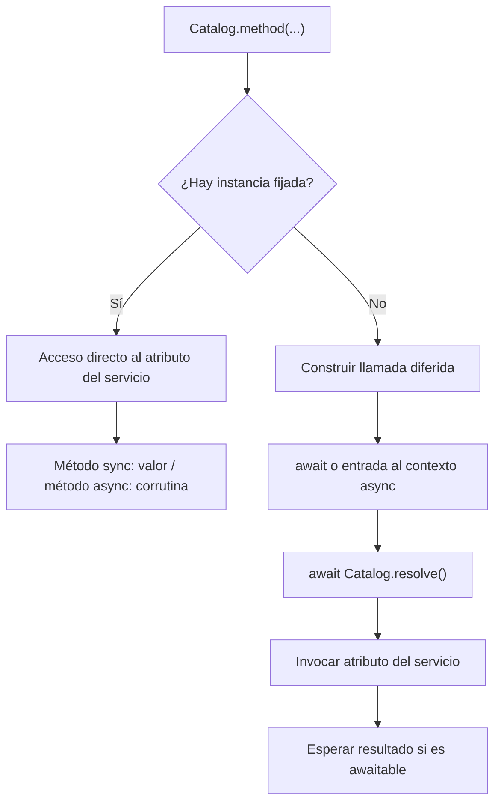

Una fachada ofrece acceso a un servicio del contenedor mediante una clase, por ejemplo `Storage`, `Mail` o `Cache`. Su `getFacadeAccessor()` identifica el contrato o alias que debe resolver; los métodos de negocio siguen perteneciendo al servicio.

Importa las fachadas del framework desde su módulo público:

```python
from orionis.support.facades import Cache, Mail, Storage
```

Para servicios propios, puedes elegir entre inyección de dependencias y una fachada. La inyección hace visible el contrato en el constructor o método del consumidor; la fachada permite acceder al mismo binding sin declarar ese parámetro. Ninguna de las dos alternativas cambia por sí sola el ciclo de vida registrado.

## Crear una fachada

El generador necesita un nombre y el identificador del servicio:

```bash
orionis make:facade catalog --accessor catalog
```

```bash
python -B reactor make:facade catalog --accessor catalog
```

<a id="facade-generator"></a>

| Argumento u opción | Requisito y efecto |
| --- | --- |
| `name` | Obligatorio. Nombre del archivo y la clase. Admite subdirectorios relativos. |
| `--accessor`, `-a` | Obligatorio. Cadena que identifica el servicio en el contenedor. No tiene valor predeterminado. |
| `-h`, `--help` | Muestra la ayuda del comando. |

Se generan `app/facades/catalog.py` y `app/facades/catalog.pyi`, ambos con la clase `Catalog`. Los nombres con guiones bajos se convierten en nombres de clase por palabras y los directorios se normalizan a minúsculas. Por ejemplo, `billing/invoice_catalog` crea la clase `InvoiceCatalog` dentro de `app/facades/billing/invoice_catalog.py` y su archivo `.pyi`.

El `.py` utiliza el template de `Facade`; su contenido funcional es:

```python
from orionis.container.facades.facade import Facade


class Catalog(Facade):
    @classmethod
    def getFacadeAccessor(cls) -> str:
        return "catalog"
```

El archivo `.pyi` declara una interfaz con el mismo nombre, basada en `IFacade`. Puedes completarla con las firmas de los métodos del servicio para el autocompletado y análisis de tipos; no es una implementación ejecutable y no registra servicios.

El generador crea directorios y rechaza rutas absolutas o componentes inseguros. No sobrescribe archivos y no ofrece `--force`. Crea primero el `.py` y luego el `.pyi`: si el segundo ya existe, el primero puede haber quedado creado; revisa ambos archivos antes de repetir el comando.

<a id="facade-accessor"></a>

## Elegir el accessor y registrar el servicio

```python
@classmethod
def getFacadeAccessor(cls) -> str | type:
    ...
```

El método debe devolver un alias o una clase utilizada como contrato. La implementación base de `Facade` lanza `NotImplementedError` si no lo defines. No debe ejecutar trabajo asíncrono: se necesita una clave inmediata para `app.make(...)`.

El generador construye un accessor de cadena. También puedes modificarlo para devolver `ICatalog` si prefieres resolver directamente por contrato. Una cadena como `"catalog"` es un alias: escribir el nombre de un módulo no importa o registra automáticamente su servicio.

El ejemplo utiliza el contrato y `MemoryCatalog` de la [guía de proveedores](/es/architecture/service-container/providers-and-facades). Completa el proveedor así:

```python
from app.facades.catalog import Catalog
from app.services.catalog import ICatalog, MemoryCatalog
from orionis.container.providers import ServiceProvider


class CatalogProvider(ServiceProvider):
    def register(self) -> None:
        self.app.singleton(ICatalog, MemoryCatalog, alias="catalog")

    async def boot(self) -> None:
        await Catalog.pin()
```

El descubrimiento del proveedor registra el singleton. Su `boot()` fija la instancia en la fachada para permitir acceso directo a los métodos síncronos. Esto sucede cuando el arranque espera los proveedores; una llamada aislada a `app.create()` todavía puede dejar ese hook pendiente.

<a id="facade-dispatch"></a>
<a id="facade-meta"></a>

## Cuándo utilizar `await`

El comportamiento depende de si la fachada tiene una instancia fijada mediante `pin()` o utiliza resolución diferida. **No depende de que exista o no un bucle de eventos en el punto de llamada.** La fachada no ejecuta un bucle por ti ni convierte métodos síncronos en trabajo de fondo.

| Estado de la fachada | Método síncrono del servicio | Método asíncrono del servicio |
| --- | --- | --- |
| Con instancia fijada | Devuelve el resultado directamente: `Catalog.names()`. | Devuelve la corrutina del servicio: `await Catalog.summary()`. |
| Sin instancia fijada | Devuelve una llamada diferida que debes esperar: `await Catalog.names()`. | Devuelve una llamada diferida que resuelve y espera el resultado: `await Catalog.summary()`. |
| `ScopedFacade` con servicio disponible | Acceso directo a la instancia del scope. | Acceso directo; espera el método si es asíncrono. |

### Fachada fijada: conserva la API del servicio

Con el proveedor anterior, después de completar el arranque:

```python
from app.facades.catalog import Catalog
from orionis.http import JSONResponse


class CatalogController:
    async def index(self) -> JSONResponse:
        names = Catalog.names()
        summary = await Catalog.summary()
        return JSONResponse({"names": names, "summary": summary})
```

`names()` es síncrono en `MemoryCatalog`, mientras que `summary()` es asíncrono. Fijar la fachada no espera automáticamente los métodos asíncronos ni transforma el resultado síncrono en awaitable. `await Catalog.names()` intentaría esperar una lista y produciría `TypeError`.

Una llamada a un método síncrono fijado también funciona desde una función síncrona fuera de un bucle, siempre que la aplicación y el proveedor ya hayan terminado su arranque. Un método asíncrono sigue necesitando un llamador que espere su corrutina.

### Fachada sin fijar: resolver al esperar la llamada

Si el proveedor registra el binding pero no llama a `pin()`, los dos métodos se consumen con `await`:

```python
from app.facades.catalog import Catalog
from orionis.http import JSONResponse


class CatalogController:
    async def index(self) -> JSONResponse:
        names = await Catalog.names()
        summary = await Catalog.summary()
        return JSONResponse({"names": names, "summary": summary})
```

Leer `Catalog.names` devuelve un dispatcher. Llamarlo construye una operación diferida; todavía no resuelve el servicio ni ejecuta `names()`. Al esperar esa operación, la fachada obtiene el binding, llama al método y espera su resultado si es awaitable.

Esto conserva los ciclos de vida: cada llamada diferida consulta el contenedor. Un binding `transient` puede producir una instancia distinta por llamada; un `singleton` conserva la suya. La caché de dispatchers evita recrear las funciones de despacho por atributo, pero no es una caché de respuestas ni convierte un transient en singleton.

Desde una función síncrona, una fachada sin fijar devuelve igualmente una operación pendiente. No la trates como un resultado ni supongas que se ejecutará sola. Usa un consumidor asíncrono, inyecta el servicio en el componente o fija deliberadamente un servicio de proceso durante el arranque.



### Atributos y gestores de contexto

Con una instancia fijada, los atributos no invocables también se leen directamente. Sin fijación, el dispatcher sigue siendo una función: para obtener un atributo del servicio sin estas diferencias, resuelve la instancia y lee su atributo allí.

```python
from app.facades.catalog import Catalog


async def catalog_names() -> list[str]:
    service = await Catalog.resolve()
    return service.names()
```

Una llamada diferida también admite `async with` cuando el método del servicio devuelve directamente un gestor de contexto asíncrono. La fachada resuelve el servicio y delega sus métodos `__aenter__()` y `__aexit__()`; no convierte un contexto síncrono ni una corrutina cualquiera en uno asíncrono.

Por ejemplo, si un servicio propio define:

```python
from contextlib import asynccontextmanager
from collections.abc import AsyncIterator


class CatalogSession:
    @asynccontextmanager
    async def open(self) -> AsyncIterator[dict[str, bool]]:
        state = {"active": True}
        try:
            yield state
        finally:
            state["active"] = False
```

Una fachada cuyo accessor resuelva `CatalogSession` permite `async with CatalogSessionFacade.open() as state:`. El método `open()` del ejemplo devuelve el gestor directamente porque está decorado con `asynccontextmanager`; no necesita esperarse antes de entrar al contexto. El registro completo de una fachada que use ese servicio sigue el mismo patrón del ejemplo de `Catalog`.

<a id="facade-resolve"></a>

## `resolve()`: obtener la instancia del contenedor

```python
@classmethod
async def resolve(cls, *args: object, **kwargs: object) -> object:
    ...
```

Delega en `await app.make(accessor, *args, **kwargs)` y devuelve el servicio. Los argumentos adicionales pertenecen a la resolución o construcción del servicio, no a uno de sus métodos. Las llamadas habituales `Catalog.names(...)` envían sus argumentos al método; no los usan para construir la instancia.

`resolve()` conserva el ciclo de vida del binding y sigue consultando el contenedor incluso cuando la fachada está fijada. Por tanto, resolver explícitamente y acceder a un atributo fijado son caminos diferentes; reemplazar un binding no actualiza por sí solo la instancia ya fijada.

La fachada obtiene de forma diferida la aplicación compartida y comprueba `app.isBooted`. Si todavía no se ha creado, lanza `RuntimeError` con la indicación de iniciar la aplicación. Ese indicador confirma el registro y la configuración: para necesitar servicios listos después de `boot()`, espera el arranque completo del componente que los utiliza.

Un alias desconocido produce el error de resolución del contenedor; una dependencia inválida o un método ausente propagan sus errores. La fachada no transforma esos errores en respuestas HTTP ni los oculta.

<a id="facade-pin"></a>

## `pin()`: fijar una instancia de proceso

```python
@classmethod
async def pin(cls) -> None:
    ...
```

Resuelve el servicio sin argumentos y conserva esa instancia en la clase de la fachada. Las siguientes lecturas de atributos acceden directamente a ella. Devuelve `None` y propaga los errores de resolución.

Úsalo en `async boot()` del proveedor cuando el servicio deba reutilizarse como estado de proceso y su API incluya métodos síncronos. Registrar un servicio como singleton **no fija automáticamente una fachada propia**; el proveedor del ejemplo realiza ambos pasos.

No fijes en una `Facade` normal un servicio dependiente de la solicitud o del comando. Incluso si su binding es `transient` o `scoped`, la fijación conserva una sola instancia y la expondría en llamadas posteriores. Elige una fachada sin fijar para respetar resoluciones independientes o `ScopedFacade` para estado publicado en un scope.

<a id="facade-unpin"></a>

## `unpin()`: volver al despacho diferido

```python
@classmethod
def unpin(cls) -> None:
    ...
```

Borra únicamente la referencia fijada de esa fachada y devuelve `None`. Puede llamarse repetidamente. No elimina el binding, no libera recursos del servicio y no borra el singleton que conserve el contenedor. Una llamada posterior vuelve a resolver según el ciclo de vida registrado.

Durante una prueba que cambie un binding, utiliza `unpin()` y vuelve a fijar la instancia cuando corresponda, o utiliza `resolve()` explícitamente. No hay un método público `Facade.reset()` que reinicie globalmente la aplicación y todos sus servicios.

<a id="scoped-facade"></a>
<a id="scoped-facade-meta"></a>

## Fachadas del scope: `ScopedFacade`

Importa esta base desde su módulo:

```python
from orionis.container.facades.facade import ScopedFacade
```

`ScopedFacade` busca un servicio **ya publicado** bajo su accessor en el scope activo. No llama a `make()`, no autoconstruye servicios y no conserva una instancia global. Este es el mecanismo utilizado por la fachada de sesión HTTP para leer la sesión de la solicitud actual.

El siguiente ejemplo independiente muestra el ciclo manual de un scope. En HTTP y CLI habituales, el kernel ya gestiona [sus propios scopes](/es/architecture/service-container/scopes-and-concurrency).

```python
from orionis.container.facades.facade import ScopedFacade
from orionis.foundation.contracts.application import IApplication


class OperationState:
    def __init__(self, identifier: str) -> None:
        self.identifier = identifier


class CurrentOperation(ScopedFacade):
    @classmethod
    def getFacadeAccessor(cls) -> type:
        return OperationState


async def read_operation(app: IApplication) -> str:
    async with app.beginScope():
        app.instance(OperationState, OperationState("report-42"))
        return CurrentOperation.identifier
```

El binding de instancia creado dentro de ese scope permanece local. Fuera del bloque, `CurrentOperation.identifier` lanza `RuntimeError`. Un hijo asíncrono que haya heredado el contexto tampoco puede seguir accediendo cuando el scope propietario ya cerró.

Declarar solamente `app.scoped(OperationState, ...)` no publica aún una instancia para la fachada: primero debe construirse con `await app.make(OperationState)` dentro del scope, o publicarse explícitamente como en el ejemplo. Usa un accessor de contrato coherente con la clave almacenada; `ScopedFacade` no traduce automáticamente alias globales al leer el diccionario local.

<a id="scoped-facade-instance"></a>

### API de `ScopedFacade`

| Método de clase | Resultado y comportamiento |
| --- | --- |
| `scopedInstance() -> object` | Devuelve directamente el servicio local. Lanza `RuntimeError` si falta un scope activo o una instancia no nula bajo el accessor. |
| `async resolve(*_args: object, **_kwargs: object) -> object` | Devuelve `scopedInstance()`. Los argumentos se ignoran; no construye servicios. |
| `async pin() -> None` | Comprueba que existe el servicio en el scope; no lo fija globalmente. |
| `unpin() -> None` | No realiza cambios: el scope conserva la responsabilidad de su ciclo de vida. |

Su metaclase devuelve directamente el atributo del servicio local, igual que el acceso a una instancia. Si el método es síncrono, consume el valor directamente; si es asíncrono, espera su resultado. No necesita fijación para obtener ese comportamiento.

## Elegir una forma de acceso

- **Inyección del contrato:** cuando quieres declarar dependencias y permitir que el contenedor gestione claramente su construcción y ciclo de vida.
- **Fachada sin fijar:** cuando cada llamada debe resolver el servicio respetando su binding y el consumidor puede utilizar `await`.
- **Fachada fijada:** para un servicio de proceso deliberadamente compartido, preparado por su proveedor y con la API síncrona o asíncrona del servicio.
- **`ScopedFacade`:** para un servicio que ya pertenece al scope actual y debe dejar de estar disponible al cerrarlo.

Consulta también [Proveedores de servicios](/es/architecture/service-container/providers-and-facades) y [Registrar e invocar servicios](/es/architecture/service-container/bindings-and-invocation).
