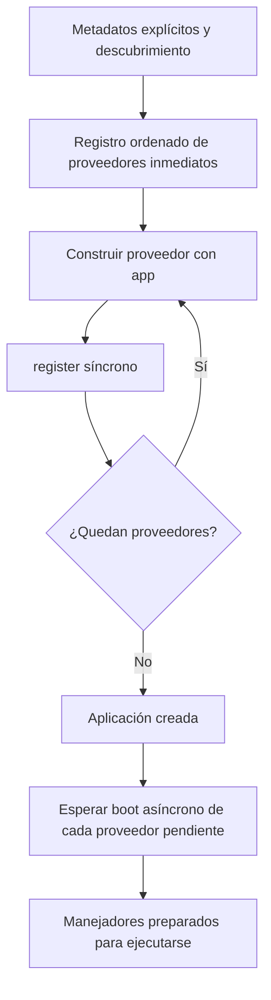

Un proveedor de servicios reúne la configuración de un componente: registra sus contratos en el contenedor y realiza la inicialización que necesita antes de utilizarse. Coloca esas tareas en `app/providers/` para mantener separados el arranque y la lógica de controladores, comandos o jobs.

`ServiceProvider` expone la aplicación como `self.app`. La misma aplicación permite registrar servicios, resolver dependencias y consultar la configuración con `self.app.config(...)`. Las variables de entorno se leen en los [archivos de configuración](/es/architecture/environment), no desde el proveedor durante el runtime.

## Crear un proveedor

Desde la raíz del proyecto, utiliza cualquiera de las dos formas del CLI:

```bash
orionis make:provider catalog
```

```bash
python -B reactor make:provider catalog
```

Ambas crean `app/providers/catalog_provider.py` con la clase `CatalogProvider`. El generador incorpora el sufijo `Provider` cuando falta; un nombre como `catalog_provider` también produce `CatalogProvider`. Para conservar la separación entre palabras, utiliza nombres como `product_catalog` o `Product_Catalog`; `ProductCatalog` conserva la clase, pero su archivo se normaliza a `productcatalog_provider.py`.

<a id="provider-generator"></a>

| Argumento u opción | Requisito y efecto |
| --- | --- |
| `name` | Obligatorio. Nombre del archivo y la clase; admite subdirectorios relativos, por ejemplo `billing/invoice`. |
| `--deferred` | Opcional; predeterminado `False`. Genera un proveedor diferido con `provides()`. |
| `-h`, `--help` | Muestra la ayuda del comando. |

Los directorios intermedios se crean automáticamente. El generador rechaza rutas absolutas, componentes `..` y nombres que no puedan formar módulos Python con letras, números y guiones bajos. Los archivos existentes no se sobrescriben y no existe una opción `--force`.

La estructura de los hooks generados es la siguiente; se omiten sus docstrings para mostrar el código que debes completar:

```python
from orionis.container.providers import ServiceProvider


class CatalogProvider(ServiceProvider):
    def register(self) -> None:
        # Register application-specific services here.
        pass

    async def boot(self) -> None:
        # Perform any asynchronous bootstrapping tasks here.
        pass
```

<a id="provider-service-provider"></a>
<a id="provider-construction"></a>

## Responsabilidad de cada hook

```text
ServiceProvider(app: IApplication) -> None
```

El constructor guarda `app` en `self.app`. Para un proveedor inmediato, la aplicación construye la clase directamente con ese único argumento. Conserva el constructor heredado o una firma compatible; no declares otras dependencias obligatorias suponiendo que se inyectarán automáticamente en un proveedor inmediato.

<a id="provider-register"></a>

### `register()`: declarar servicios

```python
def register(self) -> None:
    ...
```

Este hook es **síncrono**. Utiliza `self.app.instance(...)`, `transient(...)`, `singleton(...)` y `scoped(...)` para declarar [bindings y ciclos de vida](/es/architecture/service-container/bindings-and-invocation). No declares `async def register()`: el cargador llama al método sin esperar su resultado.

Registra aquí la relación entre contratos e implementaciones. Deja las operaciones que requieren `await`, la resolución de servicios y la preparación que depende de otros proveedores para `boot()`.

<a id="provider-boot"></a>

### `boot()`: inicializar servicios registrados

```python
async def boot(self) -> None:
    ...
```

Los hooks asíncronos de los proveedores inmediatos se ejecutan después de completar sus registros. `create()` registra y deja estos hooks pendientes; `await app.boot()` los completa para una ejecución sin kernel. En HTTP y CLI, el ciclo de arranque del framework espera los proveedores antes de ejecutar los manejadores correspondientes.

Para obtener una dependencia dentro del hook, resuélvela explícitamente:

```python
from app.services.catalog import ICatalog, MemoryCatalog
from orionis.container.providers import ServiceProvider


class CatalogProvider(ServiceProvider):
    def register(self) -> None:
        self.app.singleton(ICatalog, MemoryCatalog, alias="catalog")

    async def boot(self) -> None:
        catalog = await self.app.make(ICatalog)
        catalog.names()
```

El contrato y la implementación utilizados se definen en la siguiente sección. Los hooks se invocan directamente: **no reciben inyección automática de parámetros**. Una firma como `boot(self, catalog: ICatalog)` dejaría un argumento obligatorio sin proporcionar.

Un `boot()` síncrono también se ejecuta, pero lo hace inmediatamente durante el recorrido de registros y puede preceder al registro de otros proveedores. Utiliza el hook asíncrono del template cuando necesites todos los registros disponibles. No devuelvas una corrutina desde un `boot()` síncrono esperando que el cargador la espere.

## Ejemplo completo: contrato, implementación y consumidor

Crea `app/services/catalog.py`:

```python
from abc import ABC, abstractmethod


class ICatalog(ABC):
    @abstractmethod
    def names(self) -> list[str]:
        raise NotImplementedError

    @abstractmethod
    async def summary(self) -> dict[str, int]:
        raise NotImplementedError


class MemoryCatalog(ICatalog):
    def names(self) -> list[str]:
        return ["book", "lamp"]

    async def summary(self) -> dict[str, int]:
        return {"products": len(self.names())}
```

Completa `app/providers/catalog_provider.py`:

```python
from app.services.catalog import ICatalog, MemoryCatalog
from orionis.container.providers import ServiceProvider


class CatalogProvider(ServiceProvider):
    def register(self) -> None:
        self.app.singleton(ICatalog, MemoryCatalog, alias="catalog")
```

El hook `boot()` heredado no necesita sobrescribirse si el servicio no requiere preparación adicional. Este binding hace que las resoluciones de `ICatalog` y del alias `"catalog"` compartan una instancia por proceso. Puedes cambiar el ciclo de vida sin modificar los consumidores.

Por ejemplo, guarda el siguiente controlador en `app/http/controllers/catalog_controller.py`:

```python
from app.services.catalog import ICatalog
from orionis.http import JSONResponse


class CatalogController:
    def __init__(self, catalog: ICatalog) -> None:
        self.catalog = catalog

    async def index(self) -> JSONResponse:
        return JSONResponse({"products": self.catalog.names()})

    async def summary(self, catalog: ICatalog) -> JSONResponse:
        return JSONResponse(await catalog.summary())
```

El contenedor puede resolver el mismo contrato por constructor o por método del controlador. Registrar un proveedor no registra endpoints: asocia las acciones desde el [archivo de rutas correspondiente](/es/http/routing).

<a id="provider-registration"></a>

## Descubrimiento y registro en `bootstrap/app.py`

La aplicación descubre los módulos del directorio configurado como `app_providers`, cuyo valor predeterminado es `app/providers`. Dentro de cada módulo registra las clases concretas que:

- Heredan de `ServiceProvider`.
- Están definidas en ese mismo módulo; importar o reexportar otra clase no vuelve a descubrirla allí.
- No tienen métodos abstractos pendientes.

También puedes registrar explícitamente clases, especialmente las ubicadas fuera de ese directorio:

```python
from app.providers.catalog_provider import CatalogProvider

# In bootstrap/app.py, before the existing app.create() call:
app.withProviders(CatalogProvider)
```

La firma es `withProviders(*providers: type[IServiceProvider]) -> Self`. Admite varias clases y devuelve la aplicación para encadenar configuración. Rechaza instancias y clases que no implementen `IServiceProvider` mediante `TypeError`.

Una misma clase inmediata se identifica por módulo y nombre: volver a registrarla actualiza su posición en lugar de crear una segunda entrada. El descubrimiento ya cubre el caso habitual de `app/providers`; no hace falta añadir además cada clase manualmente.

<a id="provider-order"></a>

## Orden real e inicialización concurrente

El registro de metadatos inmediatos incorpora cada clase **al principio** del registro ordenado. Por tanto, `app.withProviders(FirstProvider, SecondProvider)` coloca inicialmente `SecondProvider` antes de `FirstProvider`. Más tarde, el descubrimiento recorre módulos ordenados por nombre y vuelve a posicionar sus clases; después se incorporan los proveedores del framework con prioridad al principio.

No interpretes la lista de `withProviders()` como un orden final de ejecución de izquierda a derecha. La secuencia efectiva depende también del descubrimiento y de los proveedores del framework. Cada proveedor inmediato ejecuta `register()` una vez por creación de la aplicación; los hooks `async boot()` pendientes se esperan uno a uno en el orden final de ese registro.



Las llamadas concurrentes al arranque comparten la coordinación de estos hooks. Un hook no se elimina de la cola pendiente hasta completar correctamente: una excepción o cancelación impide anunciar que todos los proveedores están listos y permite reintentar su inicialización posteriormente. Diseña cualquier efecto externo de `boot()` teniendo en cuenta ese posible reintento.

<a id="provider-deferred"></a>

## Proveedores diferidos

Un proveedor diferido pospone su construcción, registro y `boot()` hasta que se solicita alguno de los servicios que declara. Resulta útil para un componente que no necesita toda solicitud ni todo comando.

```bash
orionis make:provider catalog --deferred
```

```bash
python -B reactor make:provider catalog --deferred
```

El template añade `DeferrableProvider` y `provides()`, que inicialmente devuelve `[]`. Completa tanto el registro como la lista de servicios:

```python
from app.services.catalog import ICatalog, MemoryCatalog
from orionis.container.providers import DeferrableProvider, ServiceProvider


class CatalogProvider(ServiceProvider, DeferrableProvider):
    def register(self) -> None:
        self.app.singleton(ICatalog, MemoryCatalog, alias="catalog")

    @classmethod
    def provides(cls) -> list[type | str]:
        return [ICatalog, "catalog"]
```

Este ejemplo sustituye al proveedor inmediato anterior; utiliza una modalidad por clase. Declarar tanto contrato como alias permite que cualquiera de esas dos formas active el proveedor antes de que exista el binding.

<a id="provider-provides"></a>

### `provides()` y sus límites

```python
@classmethod
def provides(cls) -> list[type | str]:
    ...
```

Cada entrada debe ser una clase o una cadena. Las clases se convierten en claves de módulo y nombre; las cadenas se conservan como identificadores. Un elemento de otro tipo produce `TypeError` durante la configuración del registro. La implementación base de `DeferrableProvider.provides()` lanza `NotImplementedError` si no se sobrescribe.

La aplicación valida el tipo de cada entrada, **no que coincida con los bindings de `register()`**. Esa correspondencia es responsabilidad del proveedor: una lista vacía o un alias omitido no puede activar su carga. Una cadena declarada que luego no se registra sigue sin poder resolverse y acaba en `ValueError`.

`provides()` se evalúa al recopilar los metadatos del proveedor, incluso aunque su servicio nunca llegue a utilizarse. No coloques trabajo de inicialización ni lecturas de servicios en ese método.

### Qué sucede en la primera resolución

1. `make()`, `build()` o una dependencia anotada detectan un servicio anunciado por el proveedor.
2. El contenedor importa y construye la clase mediante `build()`. En este camino diferido sí puede resolver dependencias anotadas del constructor; conservar el constructor estándar con `IApplication` sirve para ambas modalidades.
3. Ejecuta `register()` de forma síncrona y conserva esa instancia del proveedor.
4. Espera `boot()` cuando está declarado como asíncrono; los hooks se llaman sin inyección de parámetros.
5. Marca listo el proveedor completo y continúa la resolución del servicio solicitado.

El bloqueo se comparte por proveedor, no por cada contrato anunciado. Varias primeras resoluciones concurrentes de sus contratos no repiten `register()` ni saltan la espera de un `boot()` pendiente. El propio `boot()` puede resolver sus servicios ya registrados sin esperarse a sí mismo.

La carga diferida puede activarse dentro del scope de una petición o comando. En ese contexto, `self.app.instance(...)` publica una instancia local y rechaza los aliases; no equivale a un registro global permanente. Para declarar servicios que deben seguir resolviéndose después de esa primera operación, utiliza bindings de clase con `singleton`, `transient` o `scoped`, como en el ejemplo.

Si `boot()` falla, la resolución falla y el proveedor conserva su registro para reintentar únicamente el hook pendiente en una resolución posterior. Si falla `register()`, no existe una reversión automática de los bindings que haya alcanzado a publicar. Evita efectos parciales y registra cada servicio de forma coherente.

<a id="provider-cache"></a>

## Proveedores y caché de arranque

Cuando habilitas la [compilación de configuración](/es/architecture/environment/compiled-configuration), los metadatos de proveedores inmediatos y diferidos se guardan junto con el bootstrap. Se persisten identificadores de módulo y clase; **no se serializan las instancias de servicios, las conexiones abiertas ni el resultado de `boot()`**.

Al recuperar una configuración válida, la aplicación utiliza el registro guardado en lugar de repetir el descubrimiento. `withProviders()` devuelve la aplicación sin modificarlo si se cargó ese estado compilado. Cada proceso sigue construyendo sus propios proveedores y servicios y ejecutando sus hooks cuando corresponde.

El seguimiento de archivos del directorio de proveedores participa en la invalidación. Si cambias registro explícito o componentes externos a las rutas supervisadas, elimina o regenera la caché durante el despliegue; [la guía del bootstrap](/es/getting-started/bootstrap-options) detalla sus opciones.

## Errores que conviene revisar

| Situación | Comprobación |
| --- | --- |
| El proveedor no aparece por descubrimiento | Revisa `app_providers`, que la clase herede de `ServiceProvider`, pertenezca al módulo y sea concreta. |
| Falta una dependencia del constructor inmediato | Conserva `__init__(app)` y resuelve servicios dentro de `async boot()`. |
| El hook recibe argumentos faltantes | `register()` y `boot()` se llaman sin DI de parámetros. |
| Un servicio diferido no activa el proveedor | Incluye en `provides()` la clave utilizada realmente, además de publicarla en `register()`. |
| El binding ya existe | Revisa contratos duplicados y usa `override=True` solo cuando quieras reemplazar deliberadamente un registro. |
| La fachada no permite una llamada síncrona | Revisa el [despacho y pinning de fachadas](/es/architecture/service-container/facades). |

Continúa con [Fachadas síncronas y asíncronas](/es/architecture/service-container/facades) o con [Scopes, aislamiento y concurrencia](/es/architecture/service-container/scopes-and-concurrency).
