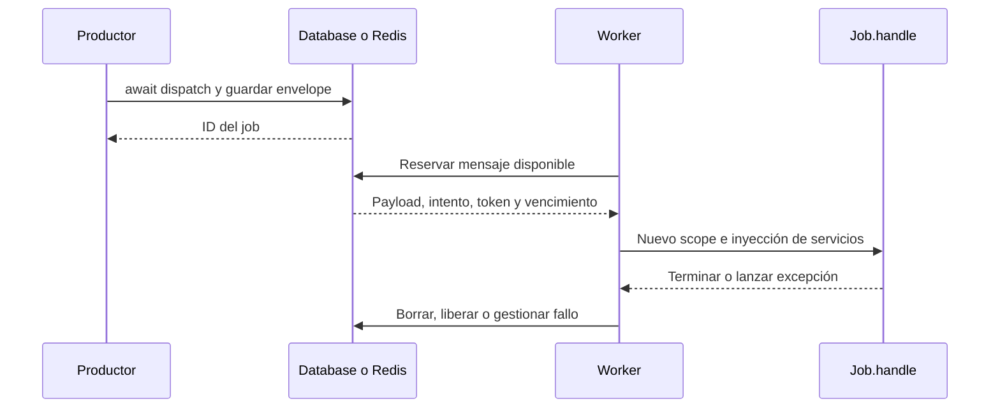

## Elegir dónde se ejecuta el trabajo

La API es async en todos los drivers. Eso no significa que todo envío utilice otro proceso: el backend determina cuándo se ejecuta `handle()`.

| Modalidad | Qué espera el productor | Qué ejecuta el job |
| --- | --- | --- |
| `sync` | La ejecución completa del intento. | El proceso y event loop que realiza el envío. |
| `database` | La inserción persistente del mensaje. | Un worker que consume la misma tabla y canal. |
| `redis` | La escritura del mensaje en Redis. | Un worker que consume el mismo namespace y canal. |

Database depende de la durabilidad de la base configurada; una SQLite en memoria no sobrevive al proceso. Redis depende de su configuración de persistencia y recuperación. Consulta [drivers y persistencia](/es/asynchronous/queues/drivers-and-configuration).

## Ejecutar inmediatamente con sync

Con `QUEUE_CONNECTION=sync`, o seleccionándolo explícitamente:

```python
from app.jobs.process_record_job import ProcessRecordJob
from orionis.support.facades import Queue


async def process_now(record_id: int) -> str:
    return await (
        Queue.dispatch(ProcessRecordJob(record_id)).onConnection("sync")
    )
```

El driver serializa el estado, prepara una reserva con un intento y pasa por `Worker.execute(raise_errors=True)`: se aplican el scope, la inyección de `handle()` y el timeout. Si termina correctamente devuelve el ID; una excepción de ejecución se registra como fallo cuando es posible y se propaga al productor. No utiliza el presupuesto normal de reintentos automáticos, no conserva una cola pendiente y rechaza `delay()` distinto de cero o `JobContext.release()`.

Sirve cuando necesitas que la operación termine antes de continuar, manteniendo la estructura de un job. No reduce el tiempo de una petición que espera ese trabajo ni crea un worker separado.

## Enviar ahora y procesar después

Para `database` o `redis`, productor y consumidor deben compartir configuración, canal y clases importables de jobs. Por ejemplo:

```python
from app.jobs.process_record_job import ProcessRecordJob
from orionis.support.facades import Queue


async def process_later(record_id: int) -> str:
    return await (
        Queue.dispatch(ProcessRecordJob(record_id))
        .onConnection("database")
        .onQueue("records")
        .delay(10.0)
    )
```

Un envío correcto devuelve el ID antes de ejecutar `handle()`. La demora solo establece desde cuándo puede reservarse el mensaje; no garantiza su hora exacta de ejecución. Sin un worker, el mensaje permanece pendiente.



## Worker continuo mediante CLI

Desde la raíz del proyecto, en otro proceso:

```shell
orionis queue:work database --queue records --concurrency 2
```

Su equivalente local es:

```shell
python -B reactor queue:work database --queue records --concurrency 2
```

El comando permanece activo esperando mensajes. La concurrencia es un número de consumidores async dentro del proceso; no crea ese número de procesos ni convierte operaciones Python bloqueantes en trabajo paralelo de CPU. El [manual del worker](/es/asynchronous/queues/workers-and-failures#command-work) explica todos los argumentos, señales y valores predeterminados.

## Procesamiento acotado mediante CLI

Para procesar mensajes disponibles y salir cuando no haya ninguno listo:

```shell
python -B reactor queue:work database --queue records --stop-when-empty
```

Para limitar el número de reservas procesadas:

```shell
orionis queue:work database --queue records --max-jobs 100 --stop-when-empty
```

`--stop-when-empty` puede terminar aunque existan mensajes demorados o reservados por otro consumidor. `--max-jobs` cuenta intentos reservados, no jobs únicos ni éxitos. Una salida correcta del comando no demuestra que todas las operaciones de negocio hayan tenido éxito: inspecciona los [fallos definitivos](/es/asynchronous/queues/failures-and-retries).

## Controlar el worker desde un componente async

`worker()` permite integrar el consumo en un comando propio o un servicio con ciclo de vida administrado:

```python
from orionis.queues.contracts.manager import IQueueManager


async def drain_records(queue: IQueueManager) -> int:
    worker = await queue.worker(
        "database", queues=("urgent", "records"), concurrency=2,
    )
    return await worker.run(stop_when_empty=True, max_jobs=100)
```

Para un consumidor continuo cuyo apagado controla otro componente:

```python
import asyncio
from orionis.queues.contracts.manager import IQueueManager


async def consume_until_stop(
    queue: IQueueManager, shutdown: asyncio.Event,
) -> int:
    worker = await queue.worker("database", queues=("records",))
    task = asyncio.create_task(worker.run())
    try:
        await shutdown.wait()
    finally:
        worker.stop()
        processed = await task
    return processed
```

Este ejemplo presupone que el componente propietario establece `shutdown` al apagarse y que el worker no falla antes. En una integración completa también debes supervisar `task` y reaccionar a sus excepciones; el [CLI nativo](/es/asynchronous/queues/workers-and-failures) ya coordina las señales soportadas. `stop()` solicita la parada: deja terminar los intentos activos y no vacía todos los mensajes pendientes.

`Worker.execute(reserved)` es una operación de nivel bajo para una reserva ya adquirida. No reserva mensajes ni inicia un bucle. Usa `run()` o el CLI salvo que estés implementando y verificando tu propio consumidor; consulta [la API del worker](/es/asynchronous/queues/workers-and-failures#worker-execute).

## Relación con tareas de respuesta y programación

Una [tarea después de responder](/es/asynchronous/background-tasks/response-tasks) se ejecuta en el proceso de la aplicación y no equivale por sí sola a un mensaje persistente. Puede enviar un job a Database o Redis, pero el envío también debe completarse y el worker debe estar activo.

El [programador de tareas](/es/console/task-scheduling) decide cuándo invocar un comando o callback. Si este envía jobs, sus consumidores continúan siendo independientes: programar el envío no arranca `queue:work` automáticamente.

Llamar directamente a `job.handle()` tampoco pasa por serialización, reservas, políticas, scopes ni gestión de fallos de la cola. Para esas garantías utiliza `await Queue.dispatch(job)` y el backend adecuado.
