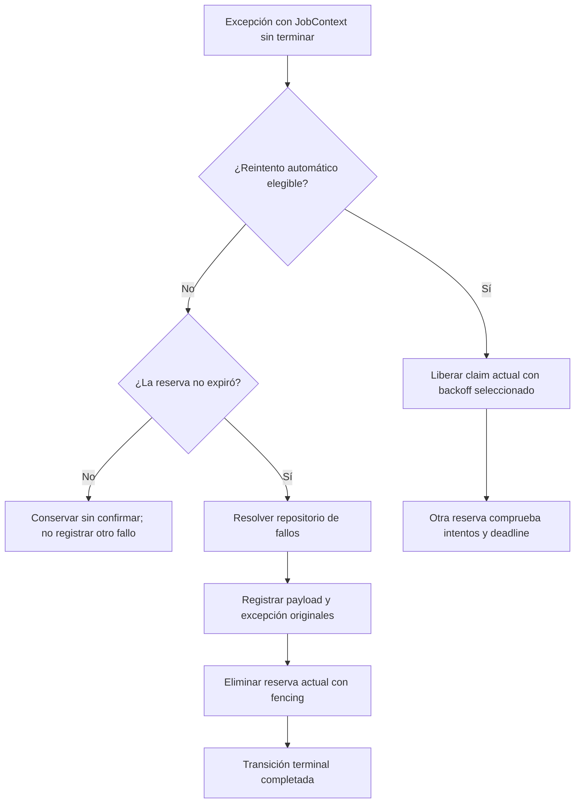

Un intento fallido y un job con fallo terminal son estados distintos. Una excepción reintentable puede liberar el mismo job para otra reserva. Un fallo terminal se registra antes de que el worker intente eliminar la reserva actual.

La guía de [workers](/es/asynchronous/queues/workers-and-failures) explica consumo, leases, timeout y parada gradual. Esta página desarrolla las decisiones posteriores a la ejecución y las APIs para inspeccionar su evidencia.

## Intentos y política de reintentos

El despacho almacena estos ajustes en el sobre:

| Ajuste | Significado |
| --- | --- |
| `max_tries` | Presupuesto total de reservas, incluido el primer intento. Procede de `tries` del job o de los predeterminados al despachar. |
| `backoff` | Tupla no vacía de segundos no negativos entre intentos fallidos reintentables. Procede del job o de los predeterminados al despachar. |
| `timeout` | Límite cooperativo de ejecución. Debe ser positivo, finito y menor que `retry_after` de la conexión. |
| `retry_until` | Deadline epoch absoluto opcional devuelto por `retryUntil()`. No es un retraso relativo. |

`tries=3` permite un intento inicial y hasta dos reintentos automáticos. `JobContext.attempts` cuenta reservas, incluidas las recuperadas tras una caída; no coincide necesariamente con llamadas completadas a `handle`.

Con `backoff=(1.0, 5.0)`, el reintento del intento 1 espera un segundo, el del intento 2 espera cinco y los posteriores que sigan siendo elegibles reutilizan cinco. El índice es `min(attempts - 1, len(backoff) - 1)`.

Backoff, `delay` inicial y lease `retry_after` tienen funciones diferentes. Backoff programa otro intento tras un error; delay pospone la disponibilidad inicial; `retry_after` limita la propiedad de una reserva.

### Qué reintenta automáticamente el worker

Después de una excepción ordinaria y mientras el contexto no haya terminado, libera la reserva únicamente si:

1. `raise_errors` es `False`.
2. El sobre se decodificó correctamente.
3. `attempts < max_tries`.
4. La excepción no es `QueuePayloadError`, `QueueConfigurationError` ni `QueueRetryError`, incluidas sus subclases.
5. Si hay deadline, `current_time + selected_backoff < retry_until`.

En otro caso intenta registrar un fallo terminal. `UnknownJobError` es un `QueuePayloadError`, por lo que un job no registrado no se trata como una indisponibilidad temporal del negocio.

Antes de invocar `handle` también rechaza una reserva cuyos intentos ya exceden el presupuesto o cuyo deadline se alcanzó. Por tanto, un claim recuperado o liberado explícitamente puede registrarse con un conteo superior a `max_tries` sin volver a ejecutar el handler.

Un timeout se transforma en `TimeoutError` y puede reintentarse con esas reglas. Una confirmación fallida también puede llevar a otro intento aunque el handler ya haya completado su operación de negocio.

### Declarar una política de reintentos limitada

Guarda un job como este en `app/jobs/archive_report_job.py`. Su constructor contiene datos persistentes, no servicios activos:

```python
from typing import ClassVar

from orionis.queues import BaseJob, JobContext
from orionis.support.facades import Storage


class ArchiveReportJob(BaseJob):
    __slots__ = ("report_id", "deadline")

    report_id: str
    deadline: float

    tries: ClassVar[int | None] = 3
    timeout: ClassVar[float | None] = 10.0
    backoff: ClassVar[tuple[float, ...] | None] = (1.0, 5.0)

    def __init__(self, report_id: str, deadline: float) -> None:
        self.report_id = report_id
        self.deadline = deadline

    def retryUntil(self) -> float | None:
        return self.deadline

    async def handle(self, context: JobContext) -> None:
        storage = await Storage.resolve()
        disk = storage.disk("local")
        source = disk.file(f"reports/{self.report_id}.txt")
        if not await source.exists():
            raise FileNotFoundError(f"Report {self.report_id} is not ready.")
        await disk.file(f"archive/{self.report_id}.txt").write(
            await source.read(),
        )
```

El `retry_after` configurado de la conexión debe superar los diez segundos para este job. Si falta el informe, el worker decide si corresponde otro intento. Cuando existe, confirma automáticamente la finalización normal.

Despáchalo desde un servicio asíncrono inicializado:

```python
from app.jobs.archive_report_job import ArchiveReportJob
from orionis.support.facades import DateTime, Queue


class ArchiveReportService:

    async def submit(self, report_id: str) -> str:
        manager = await Queue.resolve()
        deadline = DateTime.now().timestamp() + 600.0
        return await (
            manager.dispatch(ArchiveReportJob(report_id, deadline))
            .onConnection("database")
            .onQueue("reports")
        )
```

El deadline se calcula antes del despacho y se persiste tanto en el estado del job como en la política del sobre. Un reintento manual posterior no lo recalcula. Reutilizar un deadline vencido no concede otra ventana de diez minutos.

<a id="job-context"></a>
<a id="job-context-construction"></a>

## JobContext: inspeccionar y completar la reserva actual

Orionis registra un `JobContext` nuevo dentro del scope DI aislado de cada job. Recíbelo como argumento anotado de `handle`, como en el ejemplo. No lo serialices en el constructor ni lo reutilices fuera de esa ejecución.

Su constructor avanzado es:

```text
JobContext(
    driver: IQueueDriver,
    reserved: ReservedJob,
    connection: str,
    fail: FailureCallback,
) -> None

FailureCallback = Callable[[ReservedJob, Exception], Awaitable[bool]]
```

Los cuatro argumentos son obligatorios. El worker proporciona el driver, el claim real con fencing, la conexión lógica y el callback que registra fallos terminales. El constructor establece `finished=False` y `failure=None`; no adquiere una reserva.

### Propiedades de solo lectura

<a id="job-context-id"></a>
<a id="job-context-attempts"></a>
<a id="job-context-queue"></a>
<a id="job-context-connection"></a>
<a id="job-context-finished"></a>
<a id="job-context-failure"></a>

| Propiedad | Tipo | Significado |
| --- | --- | --- |
| `id` | `str` | Identificador original del despacho. |
| `attempts` | `int` | Conteo de reservas de esta ejecución, empezando en uno. |
| `queue` | `str` | Canal lógico de la reserva. |
| `connection` | `str` | Conexión lógica de colas seleccionada por el worker. |
| `finished` | `bool` | Si se completó una operación explícita del ciclo de vida. Inicialmente `False`. |
| `failure` | `Exception \| None` | Excepción de un `fail` explícito completado. Inicialmente `None`. |

Por ejemplo, puedes registrar metadatos con un logger inyectado sin añadir dependencias activas al estado persistente:

```python
from orionis.logging.contracts.logger import ILogger
from orionis.queues import BaseJob, JobContext


class ObserveAttemptJob(BaseJob):
    __slots__ = ("record_id",)

    record_id: str

    def __init__(self, record_id: str) -> None:
        self.record_id = record_id

    async def handle(self, context: JobContext, logger: ILogger) -> None:
        logger.info(
            f"Job {context.id}: record={self.record_id}, "
            f"attempt={context.attempts}, "
            f"connection={context.connection}, queue={context.queue}",
        )
```

<a id="job-context-release"></a>

### release: programar explícitamente otra reserva

```text
async release(delay: float = 0.0) -> None
```

`delay` es opcional y representa segundos finitos no negativos; booleanos, valores negativos, NaN e infinito generan `QueueConfigurationError`. Llama a la liberación del driver sobre el claim actual. Si termina correctamente, `finished` cambia a `True` y se omite la confirmación automática.

Una transición repetida o un `False` del driver por propiedad perdida/expirada genera `QueueLeaseError`. Las excepciones del backend pueden propagarse; una operación fallida no marca el contexto como terminado.

Es una liberación explícita, no el backoff automático de una excepción. Utiliza el delay indicado y no comprueba por sí misma el presupuesto ni el deadline. La siguiente reserva realiza esas validaciones. Retorna inmediatamente de `handle` después de liberar:

```python
from orionis.queues import BaseJob, JobContext


class DeferFirstAttemptJob(BaseJob):
    __slots__ = ()

    async def handle(self, context: JobContext) -> None:
        if context.attempts == 1:
            await context.release(delay=5.0)
            return
```

Este job mínimo pospone su primera reserva y completa normalmente la siguiente. Utiliza una conexión durable: `sync` no permite liberar para ejecutar después.

<a id="job-context-delete"></a>

### delete: confirmar un job completado u omitido intencionalmente

```text
async delete() -> None
```

No recibe argumentos. Elimina la reserva propia y establece `finished=True`. Una transición repetida o propiedad rechazada genera `QueueLeaseError`; los errores de almacenamiento se propagan.

La finalización normal de `handle` ya lo invoca automáticamente. Úsalo explícitamente cuando quieras confirmar una rama y retornar:

```python
from orionis.queues import BaseJob, JobContext
from orionis.support.facades import Storage


class EnsureReportMarkerJob(BaseJob):
    __slots__ = ("report_id",)

    report_id: str

    def __init__(self, report_id: str) -> None:
        self.report_id = report_id

    async def handle(self, context: JobContext) -> None:
        storage = await Storage.resolve()
        marker = storage.disk("local").file(f"markers/{self.report_id}.txt")
        if await marker.exists():
            await context.delete()
            return
        await marker.write("ready\n")
```

La comprobación de existencia es una decisión de aplicación, no un lock distribuido atómico de negocio. Una escritura exitosa del marcador sigue ocurriendo antes de la confirmación automática.

<a id="job-context-fail"></a>

### fail: registrar una decisión terminal de aplicación

```text
async fail(exception: Exception) -> None
```

`exception` es obligatorio. El callback del worker la registra antes de intentar eliminar la reserva. Si termina correctamente, `failure` contiene esa misma excepción y `finished=True`. Un fallo explícito completado no produce otro reintento automático.

Una transición repetida o un callback que devuelve `False` genera `QueueLeaseError`. Pueden propagarse errores de repositorio no disponible, resolución, SQL o eliminación. Si se registra el fallo pero no se elimina la reserva, pueden coexistir un evento de fallo y el job en cola.

```python
from orionis.queues import BaseJob, JobContext


class ValidateReportIdJob(BaseJob):
    __slots__ = ("report_id",)

    report_id: str

    def __init__(self, report_id: str) -> None:
        self.report_id = report_id

    async def handle(self, context: JobContext) -> None:
        if not self.report_id.isdecimal():
            await context.fail(ValueError("Report ID must contain decimal digits."))
            return
```

No existe un hook `failed()` en `IJob`, `BaseJob` ni en el flujo del worker. Implementa la decisión explícita en `handle` con `context.fail` o inspecciona el repositorio de fallos; no dependas de un callback de otro framework.

Después de un `release`, `delete` o `fail` exitoso, deja de ejecutar esa rama del handler. El framework no interrumpe por ti el flujo de Python. Una excepción posterior se registra, pero un contexto terminado conserva su transición y no recibe otro reintento automático.

<a id="job-handle-exceptions"></a>

## Capturar una excepción dentro de handle

Captura un error cuando el job pueda tomar una decisión explícita sobre su ciclo de vida. Este job completo registra un número inválido como fallo terminal y utiliza el manager de Storage inyectado solo para una entrada válida:

```python
from orionis.queues import BaseJob, JobContext
from orionis.storage.contracts.manager import IStorageManager


class ParseReportNumberJob(BaseJob):
    __slots__ = ("raw",)

    raw: str

    def __init__(self, raw: str) -> None:
        self.raw = raw

    async def handle(
        self,
        context: JobContext,
        storage: IStorageManager,
    ) -> None:
        try:
            number = int(self.raw)
        except ValueError as exc:
            await context.fail(exc)
            return

        await storage.disk("local").put(f"parsed/{number}.txt", str(number))
```

El `ValueError` capturado conserva su traceback original al pasarlo a `context.fail(exc)`. El `return` posterior termina esa rama del handler. Los errores de `disk(...).put(...)` quedan fuera del bloque `try`: se propagan al worker, que aplica su política de reintentos automáticos.

Capturar y suprimir una excepción sin `fail` ni `release` hace que el handler parezca exitoso, salvo que ocurra otra excepción. La finalización normal provoca entonces la confirmación automática. Para conservar el manejo de errores del worker desde un bloque `except`, utiliza `raise` sin argumentos y propaga la excepción original.

## Secuencia de fallo terminal y problemas de almacenamiento



El worker comprueba la expiración antes de registrar el fallo; la eliminación nativa comprueba después la propiedad/fencing. Registrar y eliminar de la cola son operaciones separadas y pueden utilizar distintos almacenes. Una recuperación competidora o fallo intermedio del backend puede dejar simultáneamente el registro durable y el job.

Los errores de liberación, resolución del repositorio, registro o eliminación se escriben en los logs del worker normal. Cuando no puede finalizar de forma segura, conserva el claim sin confirmar cuando es posible para recuperar tras expirar el lease. Esa recuperación puede repetir efectos de negocio ya realizados. Aplica idempotencia de negocio o reconciliación: la confirmación de cola no es una transacción de ejecución única con un sistema externo.

El driver `sync` utiliza `execute(..., raise_errors=True)`: intenta una ejecución inmediata, omite los reintentos automáticos y propaga el error original. Puede seguir necesitando SQL para registrar el fallo terminal. Consulta [modos de ejecución](/es/asynchronous/queues/execution-modes).

<a id="command-failed"></a>

## queue:failed: listar eventos de fallo

```bash
orionis queue:failed
python -B reactor queue:failed
```

No tiene argumentos posicionales ni opciones específicas de colas; dispone de `-h`/`--help`. Lista cronológicamente todos los eventos almacenados con este formato:

```text
FAILURE_ID | job=JOB_ID | CONNECTION/QUEUE | attempts=N | EXCEPTION_TYPE: MESSAGE
```

No imprime el payload ni el traceback guardado. Un repositorio vacío muestra `No failed jobs.`. Devuelve `0` al terminar o `1` ante un `QueueError` capturado; ese bloque no convierte otras excepciones SQL/de infraestructura.

El primer ID es un **identificador del evento de fallo**, distinto de `job=...`. Utilízalo en `queue:retry` o `queue:forget`.

<a id="command-retry"></a>

## queue:retry: reencolar un evento registrado

```bash
orionis queue:retry FAILURE_ID
python -B reactor queue:retry FAILURE_ID
```

`id` es un `str` posicional obligatorio. Sustituye `FAILURE_ID` por uno listado en `queue:failed`. No existe argumento especial `all`, flag `--all` ni una opción para cambiar la conexión.

Llama a `retryFailed(failed_id: str) -> str` del manager:

1. Busca el fallo; si falta, genera `QueueRetryError`.
2. Decodifica el sobre original y rechaza un deadline original vencido.
3. Lo inserta en su conexión y cola originales, sin añadir delay de despacho.
4. Elimina ese evento de fallo **después** de una inserción exitosa.
5. Devuelve el ID conservado del job; el estado de intentos del backend vuelve al inicial de una inserción.

El sobre conserva datos del job, ID, máximo de intentos, timeout, backoff y deadline. Cambiar los predeterminados actuales no reemplaza esos valores. Un payload corrupto, conexión no configurada, deadline vencido o inserción fallida conserva el registro para inspección.

El comando imprime `Job JOB_ID queued for retry.` y devuelve `0`; un `QueueError` capturado devuelve `1`. No ejecuta inmediatamente un job persistente: debe consumirlo un worker. Una conexión original `sync` es la excepción porque su `push` ejecuta en ese momento.

Insertar y eliminar el fallo no forman una transacción entre almacenes. Si la inserción funciona y falla la eliminación del registro, el job puede estar en cola aunque el comando informe un error. Inspecciona la cola y el evento antes de repetir ciegamente la acción administrativa.

```python
from orionis.support.facades import Queue


class RetryFailureService:

    async def retry(self, failure_id: str) -> str:
        manager = await Queue.resolve()
        return await manager.retryFailed(failure_id)
```

<a id="command-forget"></a>

## queue:forget: eliminar un registro de fallo

```bash
orionis queue:forget FAILURE_ID
python -B reactor queue:forget FAILURE_ID
```

`id` es un `str` posicional obligatorio. Elimina únicamente la evidencia del fallo; no ejecuta el job ni vacía una cola durable.

Una eliminación imprime `Failed job deleted.` y devuelve `0`. Un registro inexistente imprime `Failed job not found.` y devuelve `1`. Los `QueueError` capturados también devuelven `1`. No hay confirmación interactiva, borrado por lotes ni opción `--force`.

Para borrar jobs listos, retrasados y reservados, consulta [queue:clear](/es/asynchronous/queues/workers-and-failures#command-clear).

<a id="failed-repository"></a>

## API del repositorio de jobs fallidos

`await manager.failed()` devuelve el `IFailedJobRepository` compartido, implementado de forma nativa por `DatabaseFailedJobRepository`. Los fallos utilizan una conexión de base de datos del framework incluso cuando los jobs proceden de Redis o sync. Su configuración es independiente de la persistencia de los jobs durables.

### Construcción

<a id="failed-repository-construction"></a>

```text
DatabaseFailedJobRepository(
    connection: IConnection,
    table: str = "failed_jobs",
) -> None
```

`connection` es obligatorio; `table` vale `"failed_jobs"` de forma predeterminada. Es un nombre lógico: la capa DB aplica el prefijo de la conexión. Un identificador SQL inválido genera `QueueConfigurationError`.

El constructor define el esquema sin crear una tabla. El primer `record`, `all`, `find` o `forget` asegura que exista. Por eso los errores de permisos SQL o conexión pueden aparecer al utilizar por primera vez un comando de inspección. La creación es diferida y se protege por repositorio; utiliza el ciclo de vida compartido de la conexión en lugar de abrir otra por llamada.

<a id="failed-repository-record"></a>

### record: persistir el fallo de una reserva

```text
async record(
    reserved: ReservedJob,
    connection: str,
    exception: Exception,
) -> FailedJob
```

Todos los argumentos son obligatorios. Conserva el sobre codificado original, enrutamiento, intentos, tipo cualificado de excepción, mensaje, traceback formateado y momento del fallo.

El ID es determinista para la conexión de colas, ID del job y token de reserva. Registrar de nuevo el mismo claim devuelve el evento existente, sin reemplazar sus diagnósticos originales. Otro token produce un evento distinto aunque corresponda al mismo job.

Este método por sí solo **no valida el lease, elimina el job ni invoca un hook**. El worker coordina esos pasos. Utilízalo directamente solo al implementar una integración operativa de ese tipo:

```python
from orionis.queues.entities.failed_job import FailedJob
from orionis.queues.entities.reserved_job import ReservedJob
from orionis.support.facades import Queue


class FailureRecordingService:

    async def record(
        self,
        reserved: ReservedJob,
        connection: str,
        error: Exception,
    ) -> FailedJob:
        manager = await Queue.resolve()
        repository = await manager.failed()
        return await repository.record(reserved, connection, error)
```

Los errores SQL se propagan salvo que, tras un conflicto de inserción, pueda recuperarse el evento determinista existente. Una excepción recién creada y nunca lanzada tiene tipo/mensaje formateados, no un stack de ejecución que nunca adquirió.

<a id="failed-repository-all"></a>

### all: consultar todos los eventos

```text
async all() -> tuple[FailedJob, ...]
```

No recibe argumentos. Devuelve una tupla inmutable ordenada por `failed_at` y después `id`. Un repositorio vacío devuelve `()`. No incorpora argumentos de paginación ni filtros.

```python
from orionis.support.facades import Queue


class FailureSummaryService:

    async def list(self) -> list[dict]:
        manager = await Queue.resolve()
        repository = await manager.failed()
        return [
            {
                "failure_id": item.id,
                "job_id": item.job_id,
                "queue": item.queue,
                "attempts": item.attempts,
                "exception": item.exception_type,
            }
            for item in await repository.all()
        ]
```

<a id="failed-repository-find"></a>

### find: recuperar un evento

```text
async find(failure_id: str) -> FailedJob | None
```

Devuelve el evento o `None`. El identificador es el del fallo, no el del job. No decodifica ni ejecuta el job almacenado.

```python
from orionis.queues.entities.failed_job import FailedJob
from orionis.support.facades import Queue


class FailureInspectionService:

    async def find(self, failure_id: str) -> FailedJob | None:
        manager = await Queue.resolve()
        repository = await manager.failed()
        return await repository.find(failure_id)
```

<a id="failed-repository-forget"></a>

### forget: eliminar un evento

```text
async forget(failure_id: str) -> bool
```

Devuelve `True` únicamente cuando elimina una fila coincidente; en otro caso, `False`. No modifica la persistencia de jobs listos/reservados ni realiza reintentos.

```python
from orionis.support.facades import Queue


class FailureRemovalService:

    async def forget(self, failure_id: str) -> bool:
        manager = await Queue.resolve()
        repository = await manager.failed()
        return await repository.forget(failure_id)
```

<a id="failed-repository-close"></a>

### close: reiniciar la marca de preparación del repositorio

```text
async close() -> None
```

No recibe argumentos. La implementación nativa reinicia su marca de esquema preparado. **No desconecta la conexión DB compartida**, elimina filas ni desactiva permanentemente el repositorio. Una operación posterior vuelve a asegurar el esquema.

El cierre de aplicación normalmente coordina esto mediante el manager. Un componente operativo puede llamar al contrato cuando controle ese ciclo de vida:

```python
from orionis.queues.contracts.failed_repository import IFailedJobRepository


class FailureRepositoryLifecycle:

    async def close(self, repository: IFailedJobRepository) -> None:
        await repository.close()
```

La interfaz anota `record.exception` como `BaseException` y la implementación nativa como `Exception`. El parámetro de `find`/`forget` se llama `failed_id` en la interfaz y `failure_id` en la implementación; los ejemplos utilizan identificadores posicionales para funcionar con ambas. Consulta la [referencia de API](/es/asynchronous/queues/api-reference) para los contratos.

<a id="failed-job"></a>

## Campos de FailedJob y evidencia sensible

Este `msgspec.Struct` inmutable, con argumentos exclusivamente por nombre, tiene diez campos obligatorios:

```text
FailedJob(
    *,
    id: str,
    job_id: str,
    connection: str,
    queue: str,
    payload: bytes,
    exception_type: str,
    exception_message: str,
    traceback: str,
    failed_at: float,
    attempts: int,
)
```

| Campo | Significado |
| --- | --- |
| `id` | Identificador estable de este evento/token de fallo. |
| `job_id` | ID original del despacho, conservado al reintentar manualmente. |
| `connection` | Conexión lógica de colas en la que ocurrió el fallo. |
| `queue` | Canal lógico. |
| `payload` | Bytes del sobre original, con estado serializado y política de reintentos. |
| `exception_type` | Nombre de clase de excepción cualificado con su módulo en el repositorio nativo. |
| `exception_message` | `str(exception)`, sin ocultamiento automático de información. |
| `traceback` | Excepción formateada y traceback disponible, sin ocultamiento automático. |
| `failed_at` | Segundos epoch del reloj. |
| `attempts` | Conteo de reservas asociado al evento registrado. |

Los payloads, mensajes y tracebacks pueden contener datos de negocio o secretos. El repositorio no los sanea automáticamente ni proporciona un hook de notificación de fallos. Restringe el acceso a los endpoints de inspección y aplica tu política de retención; eliminar un evento también elimina su evidencia de recuperación.

Esta API no tiene un comando de depuración automática de registros antiguos. Las excepciones ordinarias del worker se escriben con el logger `orionis.queues.worker`; inspecciona esos logs además de los registros durables cuando no esté disponible el propio almacenamiento de fallos.
