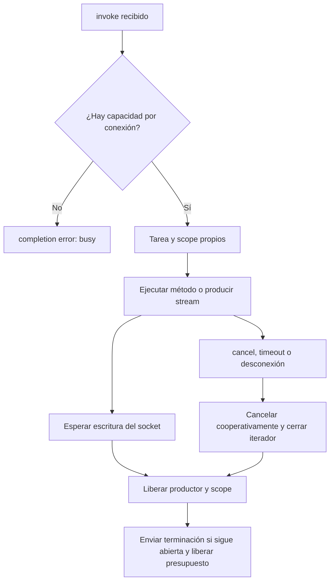

Los grupos permiten seleccionar conexiones de un mismo hub: participantes de un chat, espectadores de un tablero o clientes que siguen una operación. Son una selección de destinatarios en memoria, no un sistema de permisos ni una suscripción persistente.

El [chat con salas](/es/asynchronous/realtime/chat) muestra un caso completo. Aquí se detallan las alternativas de selección y las condiciones de ejecución.

## Seleccionar destinatarios

Dentro de un método del hub, `self.clients` expone:

| Selección | Destinatarios |
|---|---|
| `self.clients.all` | Todas las conexiones listas del mismo hub. |
| `self.clients.caller` | Solo la conexión actual. |
| `self.clients.others` | Las demás conexiones listas del mismo hub. |
| `self.clients.client(connection_id)` | Un identificador concreto del mismo hub. |
| `self.clients.clients(connection_ids)` | Varios identificadores, sin duplicados. |
| `self.clients.group(name)` | Miembros listos de un grupo del mismo hub. |

`all`, `caller` y `others` son **propiedades**. `client(...)`, `clients(...)` y `group(...)` son **métodos**. En cualquier selección, `await target.send(event, *args)` envía un evento sin esperar una respuesta de aplicación del cliente.

Por ejemplo, guarda `app/realtime/notification_hub.py` y registra `Route.hub("/realtime/notifications", NotificationHub)`:

```python
from orionis.realtime import Hub, remote


class NotificationHub(Hub):

    __slots__ = ()

    @remote
    async def announce(self, text: str) -> dict[str, int]:
        result = await self.clients.others.send(
            "announcement",
            {"text": text, "sender": self.context.connection_id},
        )
        return {"sent": result.sent, "failed": result.failed}
```

La operación notifica a los demás usuarios conectados a `NotificationHub`. Una llamada del propio emisor recibe solo su confirmación `completion`, no el evento `announcement`. El cliente maneja eventos de esta forma dentro de su listener WebSocket:

```javascript
function receiveAnnouncement(message) {
    if (message.type === "send" && message.target === "announcement") {
        const announcement = message.args[0];
        console.log(announcement.sender, announcement.text);
    }
}
```

El nombre del evento debe ser un identificador Python público de hasta 128 caracteres: `announcement` es válido; un nombre con puntos o `:` no lo es. Se admiten hasta 64 argumentos por evento, todos serializables por el codec de la conexión.

`caller` y `client(id)` también admiten `await target.invoke("method", *args, timeout=...)` para esperar un resultado del navegador. Las selecciones múltiples no lo admiten porque no existe un resultado único que correlacionar. El [protocolo](/es/asynchronous/realtime/protocol-and-streaming) muestra ambas direcciones.

## Incorporarse y salir de grupos

`await self.groups.join(name)` agrega la conexión actual; repetir la incorporación no consume otra plaza. `await self.groups.leave(name)` la retira; repetir la salida es inofensivo. El nombre debe ser una cadena no vacía tras quitar espacios, de hasta 256 caracteres; Orionis conserva el nombre original, sin normalizarlo.

Un ejemplo de salas públicas, distinto al chat cuya sala está fijada por la URL:

```python
from orionis.realtime import Hub, remote
from orionis.realtime.errors import RPCError


class RoomHub(Hub):

    __slots__ = ()

    @remote
    async def join(self, room: str) -> None:
        if room not in {"lobby", "python-help"}:
            raise RPCError("unknown_room", "Unknown public room")
        await self.groups.join(room)

    @remote
    async def leave(self, room: str) -> None:
        await self.groups.leave(room)
```

Registra `Route.hub("/realtime/rooms", RoomHub)`. El cliente debe esperar la `completion` de `join` antes de dar por efectiva la incorporación o iniciar una operación que dependa de ella; las invocaciones pueden ejecutarse concurrentemente.

Una sala privada necesita comprobar la identidad y el permiso sobre ese recurso **antes** de `join`. Aceptar cualquier nombre enviado por el cliente no demuestra autorización. También verifica permisos al publicar: pertenecer a un grupo no crea automáticamente una política de acceso.

Al desconectar, Orionis retira todas las membresías. Un grupo sin miembros desaparece. Al reconectar se obtiene un nuevo `connection_id` y deben reconstruirse las suscripciones de la aplicación.

## Difundir desde servicios de aplicación

Con el provider Realtime inicializado puedes enviar eventos desde código que no es un hub mediante la fachada pública:

```python
from app.realtime.hubs.chat_hub import ChatHub
from orionis.support.facades import Realtime


class RoomNotifier:

    async def announce(self, room: str, text: str) -> dict[str, int]:
        result = await Realtime.hub(ChatHub).group(room).send(
            "message",
            {
                "room": room,
                "author": "System",
                "text": text,
                "sender": "system",
            },
        )
        return {"sent": result.sent, "failed": result.failed}
```

Esta clase puede utilizarse desde un controlador o servicio que ya haya autorizado la operación. No expone por sí misma un endpoint público. Debe ejecutarse en el **mismo worker** que mantiene las conexiones. Un comando CLI, un worker de colas o un proceso separado normalmente tiene otro registro vacío.

La fachada utiliza el singleton `IConnectionManager` del contenedor. Como alternativa, inyecta el contrato en un servicio:

```python
from app.realtime.hubs.chat_hub import ChatHub
from orionis.realtime.contracts.manager import IConnectionManager


class RoomRefresh:

    def __init__(self, manager: IConnectionManager) -> None:
        self.manager = manager

    async def send(self, room: str) -> int:
        result = await self.manager.hub(ChatHub).group(room).send("refresh")
        return result.sent
```

`Realtime.hub(HubClass)` y `manager.hub(HubClass)` ofrecen las mismas selecciones, pero no tienen llamador: `caller` y `others` requieren el contexto de una conexión y producen error fuera de él.

## Qué significa el resultado de difusión

`send(...)` devuelve `BroadcastResult` con dos contadores:

- `sent`: destinatarios cuya escritura al transporte terminó correctamente.
- `failed`: destinatarios que no estaban disponibles o cuya entrega falló.

No son confirmaciones de lectura ni de ejecución JavaScript. Sin destinatarios, ambos son cero. Una conexión cerrada durante la difusión puede contar como fallo.

La selección toma un snapshot de identificadores y comprueba de nuevo su disponibilidad antes de enviar. Cada destinatario pertenece al namespace de una **clase de hub**. Registrar la misma clase en dos URLs comparte sus conexiones y grupos; los prefijos de URL no crean namespaces distintos.

## Configuración de límites

`config/realtime.py` configura `RealtimeConfig`. El provider valida la entidad o mapping de configuración y registra una instancia inmutable.

| Opción | Variable de entorno | Predeterminado |
|---|---|---|
| `max_message_size` | `REALTIME_MAX_MESSAGE_SIZE` | `1048576` bytes entrantes. |
| `max_concurrent_invocations` | `REALTIME_MAX_CONCURRENT_INVOCATIONS` | `16` por conexión. |
| `max_pending_client_invocations` | `REALTIME_MAX_PENDING_CLIENT_INVOCATIONS` | `32` resultados de cliente pendientes por conexión. |
| `invocation_timeout` | `REALTIME_INVOCATION_TIMEOUT` | `30.0` segundos por llamada ordinaria. |
| `client_result_timeout` | `REALTIME_CLIENT_RESULT_TIMEOUT` | `30.0` segundos para envío y resultado de `client.invoke`. |
| `broadcast_concurrency` | `REALTIME_BROADCAST_CONCURRENCY` | `32` entregas simultáneas por difusión. |
| `max_groups_per_connection` | `REALTIME_MAX_GROUPS_PER_CONNECTION` | `64` membresías por conexión. |

Los contadores deben ser enteros positivos, sin aceptar booleanos. Los plazos deben ser números finitos positivos. Ningún timeout de esta tabla limita la duración total de la conexión.

Un ejemplo de configuración por entorno:

```dotenv
REALTIME_MAX_MESSAGE_SIZE=1048576
REALTIME_MAX_CONCURRENT_INVOCATIONS=16
REALTIME_MAX_PENDING_CLIENT_INVOCATIONS=32
REALTIME_INVOCATION_TIMEOUT=30.0
REALTIME_CLIENT_RESULT_TIMEOUT=30.0
REALTIME_BROADCAST_CONCURRENCY=32
REALTIME_MAX_GROUPS_PER_CONNECTION=64
```

Las llamadas escalares usan `invocation_timeout` si el cliente omite `timeout`. Los streams no tienen un plazo predeterminado de vida: `timeout` explícito en `invoke` sí lo establece, sin superar `invocation_timeout`. Un plazo superior se rechaza con `invalid_arguments`.

También se aplican los límites WebSocket de `config/http.py`: `WEBSOCKET_MAX_MESSAGE_SIZE` y `WEBSOCKET_MAX_CONNECTIONS`, además de la política de orígenes. Elevar el límite Realtime no eleva el del transporte. Consulta [WebSocket](/es/http/websockets) para las opciones y diferencias de los adaptadores.

## Concurrencia, cancelación y limpieza



Las escrituras de una conexión se serializan y esperan al transporte: un cliente lento ejerce backpressure. Un stream no avanza al siguiente elemento antes de entregar el anterior. Los broadcasts limitan el número de entregas concurrentes y reutilizan la codificación por codec.

Un fallo de escritura marca la conexión como cerrándose y cancela su tarea propietaria. Al desconectar se cancelan las invocaciones, se resuelven con error los resultados de cliente pendientes y se libera el trabajo propio antes de `onDisconnect()`.

El cierre de la aplicación cancela sus conexiones WebSocket y espera la limpieza cooperativa durante un plazo de cinco segundos. Usa `try/finally` para recursos abiertos por generadores o métodos; no ocultes `CancelledError` ni crees tareas que sobrevivan a la conexión sin gestionarlas explícitamente.

## Workers y despliegue

El `ConnectionManager` predeterminado solo conoce conexiones del proceso/worker actual. Reiniciar el proceso pierde conexiones, grupos y resultados pendientes; no hay mensajes offline, replay ni reconexión automática del cliente.

Para pruebas de chat con un solo registro utiliza el [comando de un worker](/es/asynchronous/realtime/chat#4-ejecutar-con-un-solo-worker). La selección habitual de `orionis serve` varía entre Windows y Unix; la documentación de una aplicación no debe asumir que todas las conexiones comparten proceso.

Una afinidad de sesión puede mantener una conexión en su worker, pero no permite por sí misma difundir a conexiones de otros workers. Para distribución necesitas un backplane propio y una implementación compatible de `IConnectionManager`, junto con las garantías de entrega que tu aplicación requiera. El framework no activa Redis pub/sub por configurar Redis en otro módulo.

El registro está pensado para el event loop de la aplicación; no es un contenedor global seguro para mutaciones desde hilos. Para producción configura HTTPS/`wss:`, soporte de upgrade en el proxy y plazos de infraestructura adecuados a conexiones largas; las opciones Realtime no configuran automáticamente ese proxy.
