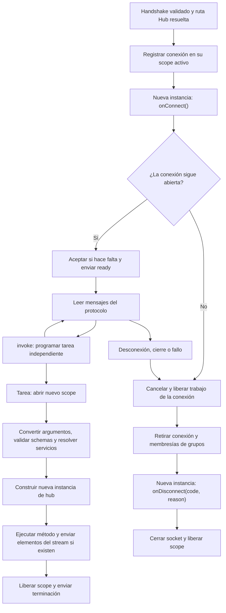

Un **Hub** agrupa operaciones que el navegador puede invocar y eventos que el servidor puede enviar a los clientes. Orionis Realtime utiliza WebSocket como transporte y añade su propio protocolo, correlación de resultados, grupos y streams.

La clase hereda de `Hub`. Solo los métodos de instancia marcados con `@remote` se exponen al cliente; un método público sin el decorador permanece interno.

## Generar un hub con el CLI

Desde la raíz del proyecto, utiliza una de estas alternativas:

```bash
python -B reactor make:realtime-hub chat
```

```bash
orionis make:realtime-hub chat
```

El único argumento es `name`, obligatorio. Con `chat` y las rutas predeterminadas se crea `app/realtime/hubs/chat_hub.py`, con este contenido exacto:

```python
from orionis.realtime import Hub, remote

class ChatHub(Hub):
    """Group explicitly exposed realtime operations."""

    @remote
    async def echo(self, message: str) -> str:
        """
        Return the message supplied by the client.

        Parameters
        ----------
        message : str
            Validated text supplied by the realtime client.

        Returns
        -------
        str
            Original client message.
        """
        return message
```

`ChatHub` hereda de `Hub`. Su única operación remota es `echo`: recibe un `str` validado y devuelve el mismo texto en una `completion`. La aceptación y el ciclo de conexión corresponden al runtime Realtime.

El generador crea los directorios que falten. Si el archivo ya existe, informa un error y lo conserva; no dispone de `--force` ni otros flags propios. Consulta `python -B reactor make:realtime-hub --help` o `orionis make:realtime-hub --help`. El capítulo de [rutas y ciclo de vida](/es/asynchronous/realtime/routing-and-lifecycle) detalla nombres, subdirectorios y rutas de salida configurables.

Llamar `chat` al componente no genera un chat completo: el stub no añade salas, difusión ni historial. El [chat con salas](/es/asynchronous/realtime/chat) amplía esta clase para implementar esas operaciones.

### Registrar la clase generada

Generar el archivo no publica un endpoint ni inicia conexiones. Añade el registro a `routes/websocket.py`:

```python
from app.realtime.hubs.chat_hub import ChatHub
from orionis.support.facades import Route

Route.hub("/realtime/echo", ChatHub).name("realtime.echo")
```

Se registra la **clase**, sin construir una instancia. La URL `/realtime/echo` permite probar el stub sin utilizar la ruta del chat completo.

Incluye el archivo en la llamada existente `app.withRouting(websocket="routes/websocket.py", ...)` de `bootstrap/app.py`, antes de `app.create()`. Conserva sus demás argumentos. [Rutas y ciclo de vida](/es/asynchronous/realtime/routing-and-lifecycle) explica los archivos, prefijos, parámetros y middleware de conexión.

| Argumento de `Route.hub` | Uso |
|---|---|
| `path` | URL WebSocket, con los convertidores habituales del router. |
| `hub` | Clase que hereda de `Hub`. |
| `protocol` | Argumento opcional y solo por nombre: `"json"` por defecto o `"msgpack"` para MessagePack binario. |

El protocolo se fija para toda la ruta; no se negocia por mensaje ni equivale al argumento `protocols` del constructor WebSocket del navegador. Orionis prepara los métodos del hub al cargar los handlers del kernel.

Con el servidor iniciado, conecta un cliente a `/realtime/echo`. Después de recibir `ready`, envía:

```json
{"type":"invoke","id":"echo-1","target":"echo","args":["Hola"]}
```

El resultado es:

```json
{"type":"completion","id":"echo-1","result":"Hola"}
```

El [cliente JavaScript](/es/asynchronous/realtime/protocol-and-streaming) muestra cómo esperar `ready` y correlacionar la respuesta.

### Personalizar un hub: aliases y valores predeterminados

Para reproducir el siguiente ejemplo, genera otro componente:

```bash
python -B reactor make:realtime-hub math
```

Su equivalente es `orionis make:realtime-hub math`. Sustituye el contenido generado en `app/realtime/hubs/math_hub.py` por:

```python
from orionis.realtime import Hub, remote


class MathHub(Hub):

    __slots__ = ()

    @remote(name="sum")
    async def add(self, first: int, second: int = 2) -> int:
        return first + second
```

Añade su ruta a `routes/websocket.py`:

```python
from app.realtime.hubs.math_hub import MathHub
from orionis.support.facades import Route

Route.hub("/realtime/math", MathHub).name("realtime.math")
```

Aquí el nombre remoto es `sum` y el nombre Python es `add`. Tras recibir `ready`, el cliente envía:

```json
{"type":"invoke","id":"sum-1","target":"sum","args":[3]}
```

La respuesta es `{"type":"completion","id":"sum-1","result":5}`: `second` conserva su valor predeterminado. Los ejemplos posteriores del cliente utilizan este `MathHub`.

## Argumentos y valores permitidos

Anota todos los parámetros remotos. Orionis separa los datos enviados por el cliente de los servicios del contenedor.

Los datos admiten tipos compatibles con `msgspec`: escalares como `str`, `int`, `float` y `bool`; colecciones tipadas; enums; schemas/estructuras; y otros tipos soportados como fechas, `UUID` o `Decimal`. La conversión y validación ocurren antes del método. No se lee un body HTTP para resolver la invocación.

Los valores predeterminados hacen opcional un argumento. Los parámetros después de `*` solo pueden enviarse mediante `kwargs`:

```python
from orionis.realtime import Hub, remote


class SearchHub(Hub):

    __slots__ = ()

    @remote
    async def search(
        self,
        term: str,
        *,
        limit: int = 10,
    ) -> dict[str, object]:
        return {"term": term, "limit": limit}
```

Con `Route.hub("/realtime/search", SearchHub)`, una llamada válida es:

```json
{"type":"invoke","id":"search-1","target":"search","args":["Orionis"],"kwargs":{"limit":5}}
```

No se permite repetir un argumento en `args` y `kwargs`, omitir uno obligatorio ni enviar nombres desconocidos. Los errores de vinculación producen `invalid_arguments`; los tipos o reglas inválidos producen `validation_error`.

## Validación con schemas

Usa schemas para validar un objeto completo, incluidas sus reglas asíncronas. Guarda, por ejemplo, `app/realtime/profile_hub.py`:

```python
from orionis.realtime import Hub, remote
from orionis.schemas import Schema
from orionis.schemas.constraints import MaxLength, MinLength
from orionis.schemas.fields import Field


class ProfileInput(Schema, forbid_unknown_fields=True):

    display_name: Field[str, MinLength(2), MaxLength(40)]


class ProfileHub(Hub):

    __slots__ = ()

    @remote
    async def preview(self, profile: ProfileInput) -> dict[str, str]:
        return {"display_name": profile.display_name}
```

Tras registrar `Route.hub("/realtime/profile", ProfileHub)`, el objeto se envía dentro de `args`:

```json
{"type":"invoke","id":"profile-1","target":"preview","args":[{"display_name":"Ada"}]}
```

Orionis convierte los datos y ejecuta también las reglas de los schemas anidados. Un fallo termina la invocación con `validation_error`; no genera el JSON HTTP 422 ni la página HTML de excepciones. El mensaje público se sanea y no incluye el detalle de cada campo. Consulta [Validación](/es/validation) para crear reglas propias.

## Inyección de dependencias

Orionis admite inyección en el **constructor del hub** y en los **métodos `@remote`**. Usa el constructor para una dependencia que utilizan varias operaciones; un parámetro del método permite declarar una dependencia que necesita esa acción.

Primero crea un servicio concreto en `app/services/message_formatter.py`:

```python
class MessageFormatter:

    __slots__ = ()

    def format(self, text: str) -> str:
        return text.strip()
```

Este servicio se puede construir sin configuración adicional: no tiene dependencias obligatorias que debas registrar. Los contratos abstractos requieren un binding a una implementación en el contenedor.

### Constructor y métodos remotos

Guarda el siguiente hub en `app/realtime/hubs/preview_hub.py`. Las dos acciones muestran las formas de inyección por separado:

```python
from app.services.message_formatter import MessageFormatter
from orionis.realtime import Hub, remote


class PreviewHub(Hub):

    __slots__ = ("_formatter",)

    def __init__(self, formatter: MessageFormatter) -> None:
        self._formatter = formatter

    @remote
    async def preview(self, text: str) -> str:
        return self._formatter.format(text)

    @remote
    async def preview_once(
        self,
        text: str,
        formatter: MessageFormatter,
    ) -> str:
        return formatter.format(text)
```

En `__init__()`, Orionis resuelve `MessageFormatter` y lo entrega al construir el hub. `preview()` utiliza esa dependencia guardada en `self._formatter`; su slot permite almacenar el atributo en esta subclase.

En `preview_once()`, Orionis identifica `text: str` como un dato del cliente y `formatter: MessageFormatter` como un servicio. Convierte y valida el texto, resuelve el servicio desde el contenedor y ejecuta el método con ambos argumentos. No necesitas instanciar ni pasar el servicio al registrar la ruta.

Añade en `routes/websocket.py`:

```python
from app.realtime.hubs.preview_hub import PreviewHub
from orionis.support.facades import Route

Route.hub("/realtime/preview", PreviewHub)
```

Con el [cliente JavaScript instalado](/es/asynchronous/realtime/javascript-client), ambas llamadas envían únicamente el texto:

```javascript
import { RealtimeClient } from "@orionis-framework/realtime-client";

const client = new RealtimeClient("/realtime/preview");

try {
    await client.connect();
    console.log(await client.invoke("preview", ["  Hola  "])); // Hola
    console.log(await client.invoke("preview_once", ["  Hola  "])); // Hola
} finally {
    await client.dispose();
}
```

El cliente **no envía `formatter`**, ni en `args` ni en `kwargs`: está excluido de los parámetros remotos. Intentar enviarlo produce `invalid_arguments`.

### Instancias, contexto y hooks

El runtime construye un hub nuevo para cada invocación. La duración y reutilización de sus servicios dependen de sus bindings: una clase concreta sin registro se autoconstruye, pero no se garantiza que la inyección del constructor y la del método reciban el mismo objeto. Un binding `scoped` comparte una instancia dentro del scope de esa invocación; otra invocación tiene un scope independiente.

`WebSocket` y `HubContext` también pueden inyectarse por tipo en constructores y métodos remotos. Ya están registrados en el scope activo. En cambio, `self.context`, `self.clients` y `self.groups` se asignan **después** de ejecutar el constructor: utiliza esos atributos dentro de los métodos y hooks, no desde `__init__()`.

Los hooks `onConnect(self)` y `onDisconnect(self, code, reason)` se llaman directamente con sus argumentos de ciclo de vida; no reciben dependencias adicionales por parámetros. Si necesitan un servicio, inyéctalo en el constructor y úsalo desde el atributo correspondiente. Cada hook recibe una instancia nueva del hub; un atributo guardado en `onConnect()` no se conserva automáticamente para las invocaciones o `onDisconnect()`.

Mantén las clases de las anotaciones importadas y disponibles al cargar el módulo: Orionis las resuelve durante la compilación. Importarlas exclusivamente dentro de `TYPE_CHECKING` puede impedirlo.

Se rechazan parámetros sin anotación, posicionales exclusivos, `*args`, `**kwargs` y uniones ambiguas entre datos y servicios. Los métodos remotos deben ser métodos de instancia ordinarios, no `staticmethod`, `classmethod` ni propiedades. Nombres y aliases deben ser identificadores Python públicos de hasta 128 caracteres, sin comenzar con `_` ni duplicarse.

## Contexto y parámetros de ruta

| Atributo | Contenido |
|---|---|
| `self.context.connection_id` | Identificador generado para esa conexión. Cambia al reconectar. |
| `self.context.socket` | Objeto `WebSocket` de la conexión. |
| `self.context.user` | Identidad del contexto de autenticación al iniciar el hub, o `None`. |
| `self.clients` | Selección de destinatarios para eventos o invocaciones. |
| `self.groups` | Operaciones `join` y `leave` de la conexión actual. |

Una ruta `Route.hub("/realtime/projects/{project_id:int}", ProjectHub)` permite consultar el parámetro así:

```python
from orionis.realtime import Hub, remote


class ProjectHub(Hub):

    __slots__ = ()

    @remote
    async def current(self) -> dict[str, int]:
        project_id = self.context.socket.routeParams()["project_id"]
        return {"project_id": project_id}
```

`project_id` ya es `int`. No se inyecta automáticamente como argumento remoto: declarar `current(self, project_id: int)` lo convertiría en un dato de la invocación del cliente.

El handshake WebSocket no aplica automáticamente las capas HTTP de sesión, CSRF o resolución de identidad. Para usuarios autenticados configura middleware WebSocket que resuelva y autorice el acceso. Compartir cookies o usar `@remote` no autentica por sí mismo; los grupos tampoco sustituyen permisos.

## Ciclo de vida e instancias

Orionis crea una instancia para `onConnect()`, una nueva para **cada invocación** y otra para `onDisconnect()`. No guardes estado compartido entre llamadas en atributos del hub. Usa `self.context.socket.state` para datos de la conexión y servicios/almacenamiento para datos persistentes.



`onConnect()` corre antes de `ready`. Puede incorporar la conexión a grupos o rechazar el handshake mediante `await self.context.socket.reject(403)`. No necesita llamar `accept()`: el runtime lo hace después si sigue pendiente. Los destinatarios de eventos solo incluyen conexiones listas; aquí todavía no puedes esperar un resultado con `self.clients.caller.invoke(...)`.

`onDisconnect(code, reason)` corre después de retirar la conexión del registro y sus grupos. Tiene un límite de cinco segundos; sus fallos se registran sin impedir el intento de cierre. Úsalo para liberar recursos propios de forma idempotente, sin enviar un último evento al cliente desconectado.

Las invocaciones pueden ejecutarse concurrentemente, cada una con su scope y una copia del contexto de autenticación de la conexión. No presupongas que terminan en orden de llegada.

## Respuestas y errores de negocio

Un método devuelve un valor serializable por el protocolo, no una respuesta HTTP como `JSONResponse`. Un schema/estructura compatible, escalar, colección o `None` viaja en `completion`. Un iterable asíncrono produce un stream.

Para un rechazo de negocio:

```python
from orionis.realtime import Hub, remote
from orionis.realtime.errors import RPCError


class OrderHub(Hub):

    __slots__ = ()

    @remote
    async def cancel(self, order_id: int) -> dict[str, int]:
        if order_id == 42:
            raise RPCError("order_closed", "This order is already closed")
        return {"cancelled": order_id}
```

Con `Route.hub("/realtime/orders", OrderHub)`, cancelar `42` devuelve código `order_closed`. El runtime conserva el código y sustituye el texto por `"Invocation failed"`; no transmite automáticamente el mensaje de `RPCError` ni el traceback. El cliente puede traducir los códigos a mensajes propios. Los fallos inesperados producen `internal_error`. Consulta la [referencia del protocolo](/es/asynchronous/realtime/protocol-and-streaming) para los demás códigos.
