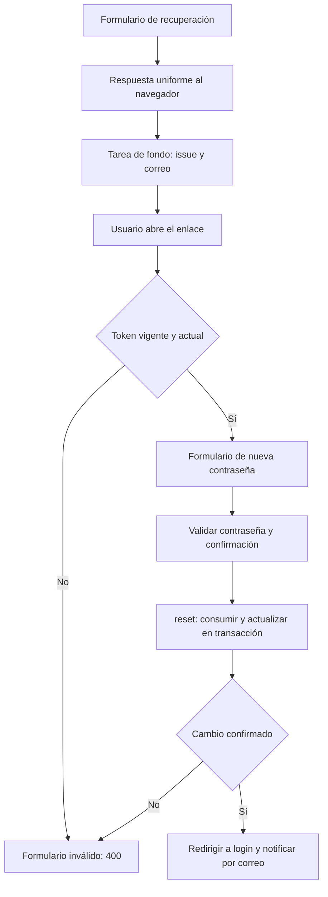

La recuperación permite cambiar una contraseña cuando el usuario ya no puede iniciar sesión. La verificación de correo confirma el acceso a la dirección de una cuenta antes de activarla. Son flujos distintos: un enlace de recuperación no es un token personal de API y verificar el correo no inicia una sesión automáticamente.

Orionis incluye rutas, controladores, schemas y plantillas para estos recorridos. Puedes utilizar esa integración o inyectar `PasswordBroker` en tus propios controladores. El acceso persistente mediante una cookie se explica en [autenticación de navegador](/es/authentication/session-authentication).

## Preparar la aplicación

Configura la conexión de base de datos, el modelo de identidad en `config/auth.py` y el servicio de [correo](/es/mail). La recuperación utiliza `email` y la contraseña del modelo configurado; el registro y la verificación predeterminados utilizan expresamente `app.models.user.User`.

El proyecto incluye migraciones para `users`, `personal_access_tokens` y `password_reset_tokens`. La última crea la tabla con un registro por dirección de correo, digest del token, identificador del usuario, huella de su contraseña y fecha de emisión. Aplica las migraciones pendientes usando una de estas alternativas:

```bash
orionis migrate
```

```bash
python -B reactor migrate
```

Los comandos aplican todas las migraciones pendientes en la conexión configurada. No se crea una cuenta ni se configura la entrega de correo al registrar rutas.

## Activar las páginas predeterminadas

En `routes/web.py`, registra una sola vez:

```python
from orionis.support.facades import Route

Route.auth()
```

El helper debe ejecutarse en el contexto de rutas WEB, que proporciona sesión y protección CSRF. Registra diez rutas:

| Método y URL | Acción | Nombre de ruta | Acceso |
| --- | --- | --- | --- |
| `GET /login` | `LoginController.index` | Sin nombre. | Invitados. |
| `POST /login` | `LoginController.login` | `login` | Invitados. |
| `GET /sign-up` | `RegisterController.index` | Sin nombre. | Invitados. |
| `POST /sign-up` | `RegisterController.register` | `register` | Invitados. |
| `GET /forgot-password` | `ForgotPasswordController.index` | Sin nombre. | Invitados. |
| `POST /forgot-password` | `ForgotPasswordController.sendResetLinkEmail` | `forgot-password` | Invitados. |
| `GET /reset-password` | `ForgotPasswordController.showResetForm` | `password.reset` | Invitados. |
| `POST /reset-password` | `ForgotPasswordController.resetPassword` | `password.update` | Invitados. |
| `GET /verify-email` | `RegisterController.verifyEmail` | `verify-email` | Cualquier visitante. |
| `POST /logout` | `LoginController.logout` | `logout` | Sesión autenticada. |

Las primeras ocho rutas utilizan `GuestMiddleware`; la última, `AuthenticateSessionMiddleware`. La verificación admite visitantes con o sin sesión para que un enlace abierto en un navegador autenticado pueda procesarse. Consulta el comportamiento de acceso en [middleware](/es/authentication/middleware).

La estructura de vistas del proyecto es:

```text
resources/views/
├── layouts/auth.html
├── auth/
│   ├── login.html
│   ├── register.html
│   ├── forgot-password.html
│   ├── reset-password.html
│   └── verify-email.html
└── emails/
    ├── reset-password.html
    └── verify-email.html
```

Conserva o adapta estas plantillas para usar los controladores incluidos. `Route.auth()` registra las rutas; no genera archivos de vistas. Los formularios POST deben incluir ``.

## Recorrido de recuperación de contraseña

1. El usuario abre `/forgot-password` y envía su dirección. `ForgotPasswordSchema` exige un email válido de hasta 255 caracteres.
2. El controlador devuelve una redirección privada al formulario con un mensaje uniforme: si existe una cuenta coincidente recibirá un enlace. La búsqueda y el envío se ejecutan mediante `BackgroundTask` después de la respuesta.
3. `PasswordBroker.issue()` normaliza la dirección, busca la identidad y comprueba el intervalo entre emisiones. Si puede emitir, persiste el digest y entrega el secreto al código de envío.
4. El correo se renderiza con `emails/reset-password.html` y las variables `user_name`, `reset_url` y `expires_minutes`. El enlace apunta a `/reset-password?email=…&token=…` y se construye a partir de `request.baseUrl`, codificando los parámetros con `urlencode()`.
5. Al abrir el enlace, el controlador comprueba el token sin consumirlo y muestra `auth/reset-password.html`. Un enlace inválido devuelve esa vista con estado `400`, sin conservar el email ni el token en el formulario.
6. El usuario envía email, token, contraseña y confirmación. El controlador vuelve a comprobar el enlace, valida `ResetPasswordSchema` y llama a `broker.reset()`.
7. Si el cambio tiene éxito, redirige a `/login` y envía una notificación de cambio en otra tarea de fondo. El usuario debe iniciar sesión con su nueva contraseña.



El flujo aplica `Cache-Control: no-store`, `Referrer-Policy: no-referrer` y `X-Robots-Tag: noindex, nofollow` a las respuestas de recuperación. Los valores de contraseña no se guardan como datos antiguos del formulario. Los errores de contraseña se presentan sin perder un enlace que todavía es válido.

`BackgroundTask` es trabajo de la respuesta en el proceso actual; no es una cola duradera. Configura y comprueba el transporte de correo. Si tu aplicación necesita reintentos persistentes de entrega, debe incorporar esa estrategia de envío.

### Configuración de PasswordBroker

| Opción en `auth.passwords` | Variable de entorno | Predeterminado |
| --- | --- | --- |
| `table` | `AUTH_PASSWORD_RESET_TABLE` | `password_reset_tokens` |
| `expiration` | `AUTH_PASSWORD_RESET_EXPIRATION` | `60` minutos. |
| `throttle` | `AUTH_PASSWORD_RESET_THROTTLE` | `60` segundos. |

`throttle` limita la emisión por dirección con un registro persistido; no es un límite general de peticiones HTTP por IP. La sustitución de un token tras ese intervalo invalida el anterior. Consumirlo no elimina el registro ni reinicia el plazo de emisión: se conserva la fecha para respetar ese intervalo.

Si el modelo utiliza una conexión ORM específica, el broker utiliza esa conexión para el registro de recuperación y su transacción. Las tablas de credenciales necesarias para la revocación deben estar disponibles en ella. Consulta todas las opciones en [configuración de guards](/es/authentication/configuration-and-guards).

## Utilizar PasswordBroker en tu propio controlador

El contenedor puede construir `PasswordBroker` e inyectarlo por constructor o método. Sus tres operaciones son asíncronas:

| Método | Resultado y propósito |
| --- | --- |
| `issue(email)` | `(identity, plain_token)` si emite; `None` si la identidad no existe o aún está en el intervalo de espera. No envía correo por sí mismo. |
| `valid(email, token)` | `bool`; comprueba el enlace sin consumirlo. |
| `reset(email, token, password)` | Identidad si confirma el cambio; `None` si no puede consumir un token válido y actual. Hash y persistencia se realizan dentro del servicio. |

El siguiente controlador es una alternativa JSON para aplicaciones que conservan las páginas de `Route.auth()` y necesitan solicitar enlaces o completar el cambio desde JavaScript. Crea `app/http/controllers/account_recovery_controller.py`:

```python
from urllib.parse import urlencode

from orionis.auth.passwords.broker import PasswordBroker
from orionis.background.task import BackgroundTask
from orionis.http import JSONResponse, Request, response
from orionis.http.default.schemas.forgot_password import ForgotPasswordSchema
from orionis.http.default.schemas.reset_password import ResetPasswordSchema
from orionis.mail.entities.content import Content
from orionis.support.facades import Mail


class AccountRecoveryController:

    def __init__(self, broker: PasswordBroker) -> None:
        self.broker = broker

    async def requestLink(
        self,
        payload: ForgotPasswordSchema,
        request: Request,
    ) -> JSONResponse:
        return response.json(
            {"message": "If an account matches, a reset link will be sent."},
            status_code=202,
            headers={"Cache-Control": "no-store"},
            background=BackgroundTask(self.sendLink, payload.email, request.baseUrl),
        )

    async def sendLink(self, email: str, base_url: str) -> None:
        issued = await self.broker.issue(email)
        if issued is None:
            return
        user, token = issued
        reset_url = base_url.rstrip("/") + "/reset-password?" + urlencode({
            "email": user.email,
            "token": token,
        })
        await Mail.to(user.email).subject("Reset your password").send(
            Content(
                view="emails.reset-password",
                data={
                    "user_name": getattr(user, "name", ""),
                    "reset_url": reset_url,
                    "expires_minutes": self.broker.settings.expiration,
                },
            ),
        )

    async def check(
        self,
        request: Request,
        broker: PasswordBroker,
    ) -> JSONResponse:
        email = request.queryParams.get("email", "")
        token = request.queryParams.get("token", "")
        valid = (
            isinstance(email, str)
            and len(email) <= 255
            and isinstance(token, str)
            and len(token) == 43
            and await broker.valid(email, token)
        )
        return response.json(
            {"valid": valid},
            headers={"Cache-Control": "no-store", "Referrer-Policy": "no-referrer"},
        )

    async def reset(self, payload: ResetPasswordSchema) -> JSONResponse:
        user = await self.broker.reset(payload.email, payload.token, payload.password)
        if user is None:
            return response.json(
                {"message": "Invalid or expired reset link"},
                status_code=400,
                headers={"Cache-Control": "no-store"},
            )
        return response.json(
            {"message": "Password updated. Sign in with your new password."},
            headers={"Cache-Control": "no-store"},
        )
```

Añade estas rutas a `routes/web.py`, junto al helper que proporciona las páginas HTML:

```python
from app.http.controllers.account_recovery_controller import AccountRecoveryController
from orionis.auth.middleware import GuestMiddleware
from orionis.support.facades import Route

Route.group(
    prefix="/account/password",
    middleware=GuestMiddleware,
    routes=[
        Route.post("/requests", [AccountRecoveryController, "requestLink"]),
        Route.get("/valid", [AccountRecoveryController, "check"]),
        Route.post("/reset", [AccountRecoveryController, "reset"]),
    ],
)
```

Estas rutas siguen perteneciendo a WEB y conservan CSRF en los POST. Un cliente JavaScript debe enviar `Accept: application/json` y el token CSRF del formulario, por ejemplo en `X-CSRF-Token`. La inyección de `ForgotPasswordSchema` y `ResetPasswordSchema` valida el payload antes de ejecutar sus acciones; consulta [validación](/es/validation) y [request](/es/http/requests).

Para completar el cambio, el payload contiene:

```json
{
  "email": "ada@example.com",
  "token": "REPLACE_WITH_THE_43_CHARACTER_RESET_TOKEN",
  "password": "NewPassword123!",
  "password_confirmation": "NewPassword123!"
}
```

Sustituye `token` por el secreto del enlace; el texto del ejemplo es un marcador y no un token válido. El schema exige exactamente 43 caracteres URL-safe, una contraseña de 8 a 1024 caracteres con mayúscula, minúscula y número, y una confirmación coincidente. El broker recibe una contraseña ya validada: no aplica esas reglas por sí mismo.

Esta alternativa devuelve JSON y utiliza el mismo broker; no incluye por sí misma el correo de confirmación posterior al cambio que envía el controlador predeterminado.

### Cómo protege y consume los enlaces

El secreto de recuperación utiliza `secrets.token_urlsafe(32)`, que produce 43 caracteres. Solo se persiste su digest SHA-256. El registro también contiene el identificador de la identidad y una huella de la contraseña almacenada: cambiar la contraseña invalida un enlace emitido anteriormente.

`valid()` no reserva un token; otra petición puede consumirlo después. `reset()` vuelve a comprobarlo y utiliza escrituras condicionales en una transacción para:

1. Marcar el token como consumido, dejando `token=None` en su fila.
2. Actualizar la contraseña únicamente si la identidad y el hash previo todavía coinciden.
3. Limpiar `remember_token` cuando el modelo incluye esa columna.
4. Revocar sus tokens personales si implementa `IAuthorizable`.

Si no puede actualizar esa identidad, la transacción no confirma el consumo. Un token consumido, vencido, sustituido, alterado o asociado a otra contraseña no permite volver a cambiarla.

Las sesiones anteriores que guardaron la huella de la contraseña dejan de resolver la identidad en su siguiente petición, porque el hash ya cambió. El broker no recorre ni elimina físicamente todos los registros del almacén de sesiones. El cambio tampoco crea una nueva sesión: el usuario inicia sesión de nuevo.

## Verificación del correo

El modelo `User` predeterminado incluye el marcador `MustVerifyEmail`. La integración de registro lo utiliza para exigir verificación:

```python
from typing import ClassVar

from database.schemas.users_v1 import USERS_V1
from orionis.auth import Authenticatable, Authorizable, MustVerifyEmail
from orionis.orm import Model
from orionis.orm.schema.table import TableDefinition


class User(Model, Authenticatable, Authorizable, MustVerifyEmail):

    table_definition: TableDefinition = USERS_V1
    casts: ClassVar[dict[str, str]] = {
        "active": "bool",
        "email_verified_at": "datetime",
    }
    hidden: ClassVar[list[str]] = ["password", "remember_token"]
    fillable: ClassVar[list[str]] = ["name", "email", "password", "active"]
```

El marcador no agrega columnas ni métodos al modelo. `users` debe incluir `active` y `email_verified_at`, como en la definición de tabla del proyecto.

### Desde el registro hasta la activación

1. `POST /sign-up` valida los datos y guarda el usuario con la contraseña generada por `Hash.make()`.
2. Si el objeto es `MustVerifyEmail`, lo crea con `active=False` y, después de confirmar la creación, prepara una tarea de fondo para enviar el correo.
3. El mensaje utiliza `emails/verify-email.html`, las variables `user_name` y `verification_url`, y un enlace `/verify-email?id=…`. El valor cifra `str(user.id)` con `Crypt` y la clave de la aplicación.
4. `GET /verify-email` descifra el identificador, busca el usuario y muestra `auth/verify-email.html` con uno de estos estados:

| Estado de la vista | Resultado |
| --- | --- |
| `verified` | Se establece `active=True` y `email_verified_at` con el momento actual. |
| `already_verified` | El usuario ya tenía fecha de verificación; se muestra esa información. |
| `invalid` | Falta el valor, no se puede descifrar o la cuenta ya no existe. |

La activación permite el acceso de sesión normal; el controlador no llama a `Auth.login()`. Si el modelo no incorpora `MustVerifyEmail`, el registro predeterminado no envía este correo ni fuerza `active=False` por verificación.

El enlace identifica la cuenta mediante un valor cifrado; no usa la tabla de recuperación ni configura un vencimiento específico. Cambiar la clave de la aplicación impide descifrar enlaces anteriores. Si necesitas un plazo de validez, reenvío controlado o vincular la comprobación a un cambio de dirección, incorpora esas reglas en tus propios controladores.

## Adaptar los controladores

`Route.auth()` permite sustituir cada componente de forma independiente mediante `login_controller=`, `register_controller=` y `forgot_password_controller=`. Los componentes que no indiques conservan su implementación predeterminada.

Por ejemplo, un controlador de recuperación puede heredar el flujo y cambiar la plantilla inicial sin volver a registrar todas las rutas. Crea `app/http/controllers/recovery_pages_controller.py`:

```python
from orionis.http import HTMLResponse, response
from orionis.http.default.controllers.forgot_password_controller import ForgotPasswordController


class RecoveryPagesController(ForgotPasswordController):

    async def index(self) -> HTMLResponse:
        rendered = await response.view("account.recover")
        rendered.setHeader("Cache-Control", "no-store")
        rendered.setHeader("Referrer-Policy", "no-referrer")
        rendered.setHeader("X-Robots-Tag", "noindex, nofollow")
        return rendered
```

En lugar de la llamada anterior a `Route.auth()`, utiliza:

```python
from app.http.controllers.recovery_pages_controller import RecoveryPagesController
from orionis.support.facades import Route

Route.auth(forgot_password_controller=RecoveryPagesController)
```

Crea `resources/views/account/recover.html` con el formulario correspondiente:

```jinja

Recover your account
Recover your account

  <form action="{{ route('forgot-password') }}" method="post">
    
    <label for="email">Email address</label>
    <input id="email" name="email" type="email" maxlength="255" required>
    <button type="submit">Send reset link</button>
  </form>

```

Si sustituyes un controlador completo, conserva las acciones esperadas por las rutas: `index/login/logout`, `index/register/verifyEmail` o `index/sendResetLinkEmail/showResetForm/resetPassword`, según el componente. No registres a la vez `Route.auth()` y una segunda copia de esas mismas rutas.

Cambiar `auth.identity.model` no cambia la referencia a `User` dentro del controlador de registro predeterminado. Para otro modelo o un ciclo de activación diferente, sustituye también el registro/verificación y sus vistas; `MustVerifyEmail` es el marcador de ese flujo, no un middleware general que proteja todas las rutas API. La emisión y revocación de credenciales API se explican en [autenticación con tokens](/es/authentication/personal-access-tokens).
