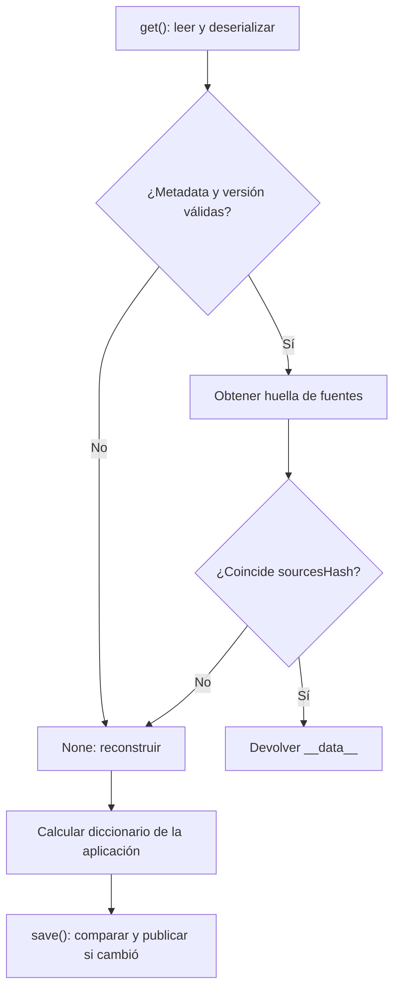

`FileBasedCache` conserva un diccionario completo y lo invalida al cambiar los metadatos de sus fuentes. Está orientado a índices y metadatos compilados, como los que necesita un componente durante su arranque o para resolver información repetidamente. Sus operaciones son **síncronas**; no utiliza los stores de `Cache` ni su TTL.

| Necesidad | API adecuada |
| --- | --- |
| Guardar valores independientes por clave, TTL o backend configurable. | `Cache` / `CacheRepository`: [referencia de API](/es/cache/api-reference). |
| Guardar un diccionario derivado de archivos y reconstruirlo al cambiar esas fuentes. | `FileBasedCache`. |
| Conservar tipos Python mediante marcadores en un artefacto JSON de confianza. | `orionis.cache.serializer.Serializer`. |

El `MsgspecSerializer` de la caché de valores es otra clase: codifica JSON común y no utiliza los marcadores de tipo de este `Serializer`. No presupongas que guardar un objeto en `Cache` preserva sus tipos exactamente igual que un artefacto.

## Un índice de archivos desde un servicio async

Guarda el siguiente servicio en `app/services/service_index.py`. Recibe la aplicación mediante DI, utiliza sus rutas configuradas y desplaza el trabajo síncrono de lectura, fingerprint y escritura a un hilo:

```python
import asyncio
from pathlib import Path
from orionis.cache import FileBasedCache
from orionis.foundation.contracts.application import IApplication


class ServiceIndex:
    def __init__(self, app: IApplication) -> None:
        bootstrap = app.path("bootstrap")
        services = app.path("app_services")
        if not isinstance(bootstrap, Path) or not isinstance(services, Path):
            raise RuntimeError("Application paths are not configured")

        self.services = services
        self.artifact = FileBasedCache(
            path=bootstrap / "cache" / "artifacts",
            filename="service-index.cache",
            monitored_dirs=[services],
        )

    async def get(self) -> dict:
        return await asyncio.to_thread(self._load_or_build)

    def _load_or_build(self) -> dict:
        cached = self.artifact.get()
        if cached is not None:
            return cached

        data = {
            "modules": sorted(
                file.relative_to(self.services).as_posix()
                for file in self.services.rglob("*.py")
            ),
        }
        self.artifact.save(data)
        return data
```

`bootstrap` y `app_services` son claves reales del registro de rutas; `app.path()` devuelve un `Path` configurado o `None` si no existe la clave. El constructor de `FileBasedCache` crea su directorio base. Todas las rutas del ejemplo proceden del registro de la aplicación.

Puedes consultar el índice desde un controlador con inyección en la acción:

```python
from app.services.service_index import ServiceIndex
from orionis.http import JSONResponse


class ServiceIndexController:
    async def show(self, index: ServiceIndex) -> JSONResponse:
        return JSONResponse(await index.get())
```

Asocia una ruta a `show` como se explica en [controladores](/es/http/controllers). El servicio anterior reconstruye un artefacto ausente o invalidado; los archivos corruptos se tratan según los errores descritos más abajo. Su creación también realiza I/O síncrono breve para preparar el directorio: si tu aplicación requiere construirlo fuera del event loop, hazlo durante su configuración o dentro de tu propio proceso de compilación.

## API completa de FileBasedCache

<a id="artifact-construction"></a>
### Constructor

```text
FileBasedCache(
    path: Path,
    filename: str,
    monitored_dirs: list[Path] | None = None,
    monitored_files: list[Path] | None = None,
) -> None
```

| Parámetro | Comportamiento |
| --- | --- |
| `path` | Directorio del artefacto; debe ser un `pathlib.Path`, o lanza `TypeError`. Se crea con padres si no existe. |
| `filename` | Nombre obligatorio, unido con `path / filename`. No tiene un valor predeterminado. |
| `monitored_dirs=None` | Lista de directorios; recorre recursivamente solo `*.py`. `None` equivale a no monitorizar directorios. |
| `monitored_files=None` | Lista de rutas explícitas, incluidas extensiones distintas de `.py`. `None` equivale a no declarar archivos. |

Las rutas monitorizadas inexistentes se omiten. Las coincidencias se resuelven a rutas absolutas, se deduplican y ordenan; se excluye el propio archivo de caché. Si ambas listas están vacías, el hash representa un conjunto vacío y los cambios de tu código no invalidan el artefacto.

`filename` se combina mediante `Path` sin la normalización ni el aislamiento de Storage. Utiliza un nombre simple controlado por tu aplicación: un nombre absoluto puede reemplazar el directorio base y un nombre con subdirectorios requiere preparar esos padres. El constructor no valida individualmente el tipo de cada ruta de las listas. Usa `Path` obtenidos de la configuración, no nombres aportados por clientes.

Para añadir un archivo de configuración concreto además de los servicios, puedes construir el artefacto así:

```python
from pathlib import Path
from orionis.cache import FileBasedCache
from orionis.foundation.contracts.application import IApplication


def configured_artifact(app: IApplication) -> FileBasedCache:
    bootstrap = app.path("bootstrap")
    services = app.path("app_services")
    config = app.path("config")
    if not all(isinstance(path, Path) for path in (bootstrap, services, config)):
        raise RuntimeError("Application paths are not configured")

    return FileBasedCache(
        path=bootstrap / "cache" / "artifacts",
        filename="configured-index.cache",
        monitored_dirs=[services],
        monitored_files=[config / "app.py"],
    )
```

<a id="artifact-get"></a>
### get() -> dict | None

Lee y deserializa el archivo en cada llamada. Devuelve el diccionario de `__data__` cuando su versión y hash coinciden; devuelve `None` si no hay contenido utilizable, falta metadata, la versión es diferente o las fuentes cambiaron. Un diccionario vacío `{}` guardado es válido: comprueba `is not None`, como hace `ServiceIndex`, en lugar de usar su valor booleano.

Solo la huella de fuentes se memoiza; el diccionario no se mantiene como una caché viva en memoria. Modificar el resultado no actualiza el archivo: debes llamar a `save()` para persistirlo. La anotación `dict | None` describe los artefactos escritos por `save()`; `get()` no valida exhaustivamente la forma de un archivo editado a mano.

<a id="artifact-save"></a>
### save(data: dict) -> tuple[int, str]

Solo admite `dict`; otro tipo genera `TypeError`. Sus valores deben poder serializarse con el `Serializer` descrito en esta página. Calcula el hash, compara el archivo existente y evita reescribir si **versión, hash y datos** son iguales.

Devuelve `(FileBasedCache.CACHE_VERSION, sources_hash)` tanto si publica como si evita la escritura; ese resultado no indica cuántas escrituras realizó. El payload contiene:

```text
__meta__:
    version: CACHE_VERSION
    generatedAt: timestamp Unix entero
    sourcesHash: hash hexadecimal
__data__:
    diccionario de la aplicación
```

`generatedAt` registra cuándo se generó el archivo; no actúa como un TTL. Los datos se serializan a un temporal hermano con sufijo aleatorio y `.tmp`, que reemplaza el destino al terminar. Si falla el staging o reemplazo con `OSError`, se intenta eliminar el temporal y se propaga el error. La publicación no coordina a varios compiladores: otro resultado puede reemplazar el tuyo.

<a id="artifact-clear"></a>
### clear() -> bool

Elimina únicamente el archivo de este artefacto. Devuelve `True` si lo eliminó y `False` si no existía; otros errores de filesystem se propagan. No limpia un store de `Cache`, no borra directorios y no reinicia la memoización interna de la huella.

Este servicio async reutiliza el ejemplo anterior para forzar una reconstrucción de sus datos:

```python
import asyncio
from app.services.service_index import ServiceIndex
from orionis.foundation.contracts.application import IApplication


async def rebuild_service_index(app: IApplication) -> dict:
    index = ServiceIndex(app)
    removed = await asyncio.to_thread(index.artifact.clear)
    data = await index.get()
    return {"removed_previous_artifact": removed, "index": data}
```

<a id="artifact-version"></a>
### CACHE_VERSION

La constante pública vale actualmente `1` y representa el **formato interno del artefacto**, no una versión del framework. `get()` compara el valor almacenado con esa constante; un formato distinto produce un miss. Utiliza la constante y el resultado de `save()` en vez de duplicar ese número en tu aplicación.

<a id="artifact-sources"></a>
## Cómo se invalidan las fuentes

El hash es SHA-1 utilizado como identificador de cambios, no como comprobación de seguridad. Combina, para cada archivo ordenado, su ruta absoluta POSIX, `st_mtime_ns` y tamaño. **No lee ni hashea su contenido**. Renombrar, añadir, eliminar o cambiar los metadatos de una fuente monitorizada puede invalidarlo; un cambio de contenido que conserve tamaño y mtime puede pasar inadvertido.

La huella se reutiliza durante 0,5 segundos por instancia, medidos con un reloj monotónico. Un cambio puede no verse durante esa ventana; no es un TTL para los datos. Una nueva instancia calcula su propia huella y `clear()` no obliga a recalcular la huella de la instancia anterior.

El directorio solo aporta archivos `*.py`; para JSON, plantillas u otros formatos decláralos en `monitored_files`. Las rutas explícitas relativas se resuelven respecto al directorio de trabajo, por lo que utilizar `app.path()` evita depender de dónde se ejecutó el comando.



No hay un snapshot atómico de fuentes y resultado. Si los archivos cambian mientras compilas, puedes calcular datos con un estado distinto al hash usado al guardarlos. Compila sobre fuentes estables o coordina esa operación cuando lo necesites. `FileBasedCache` no proporciona TTL, claves independientes, locks ni una API async: para coordinación explícita consulta [bloqueos y concurrencia](/es/cache/locks), teniendo en cuenta el alcance del backend elegido.

## Serializer: JSON enriquecido para artefactos

Importa `Serializer` desde `orionis.cache.serializer`. Sus cuatro operaciones son estáticas y síncronas. No son una API de caché por claves ni sustituyen las respuestas JSON HTTP.

<a id="serializer-dumps"></a>
### dumps(data: Any, indent: int | None = None) -> str

Transforma los tipos soportados en datos JSON con marcadores y devuelve un `str`. `indent=None` utiliza `msgspec.json` para una salida compacta; un `indent` explícito utiliza `json.dumps` con esa indentación. Un objeto no soportado genera `TypeError`. Para resultados portables utiliza números finitos y claves `str` en diccionarios: las claves no atraviesan la transformación de valores y JSON puede convertir una clave numérica en texto.

<a id="serializer-loads"></a>
### loads(raw: str | bytes) -> Any

Decodifica el JSON con `msgspec.json` y reconstruye los marcadores recursivamente. Devuelve el objeto restaurado: puede ser un diccionario, una colección o un valor simple. JSON inválido propaga `msgspec.DecodeError`; un marcador desconocido genera `ValueError`. Un marcador incompleto o un valor incompatible también puede generar `KeyError`, `TypeError`, `ValueError` u otros errores del conversor.

<a id="serializer-types"></a>
### Tipos soportados y ejemplo completo

| Tipo original | Restauración |
| --- | --- |
| `str`, `int`, `float`, `bool`, `None` | Valores JSON simples. |
| `dict`, `list` | Contenedores con valores procesados recursivamente. |
| `bytes` | Base64, restaurado como `bytes`. |
| `Path` y sus variantes de plataforma | Ruta reconstruida con `Path`. |
| `datetime`, `date`, `time` | Representación ISO; conserva el valor de fecha/hora y su offset cuando existe. |
| `timedelta` | Días, segundos y microsegundos. |
| `Decimal`, `UUID`, `complex` | Se restauran sus tipos y valores. |
| `tuple`, `set`, `frozenset` | Marcadores que conservan el tipo de colección y procesan sus elementos. |
| `enum.Enum` | Referencia importable a la clase y su valor. |
| `type` | Referencia importable al tipo. |
| `MISSING` | Se restaura el sentinel del framework. |

Guarda el siguiente código en un módulo importable, como `app/services/artifact_values.py`. La enumeración está en el nivel superior del módulo para poder reconstruir su referencia:

```python
from datetime import UTC, date, datetime, time, timedelta
from decimal import Decimal
from enum import Enum
from pathlib import Path
from uuid import UUID
from orionis.cache.serializer import Serializer
from orionis.foundation.contracts.application import IApplication
from orionis.support.types.sentinel import MISSING


class ArtifactKind(Enum):
    INDEX = "index"


def serializer_roundtrip(app: IApplication) -> dict:
    services = app.path("app_services")
    if not isinstance(services, Path):
        raise RuntimeError("Services path is not configured")

    original = {
        "text": "service index",
        "count": 3,
        "ratio": 0.5,
        "ready": True,
        "optional": None,
        "list": [1, {"enabled": True}],
        "bytes": b"\x00\xff",
        "path": services,
        "datetime": datetime(2026, 1, 2, 12, 30, tzinfo=UTC),
        "date": date(2026, 1, 2),
        "time": time(12, 30),
        "duration": timedelta(days=1, seconds=30, microseconds=5),
        "price": Decimal("12.50"),
        "uuid": UUID("12345678-1234-5678-1234-567812345678"),
        "complex": complex(2, 3),
        "tuple": (1, "a"),
        "set": {1, 2},
        "frozenset": frozenset({3, 4}),
        "kind": ArtifactKind.INDEX,
        "type": Path,
        "missing": MISSING,
    }
    encoded = Serializer.dumps(original, indent=2)
    restored = Serializer.loads(encoded.encode("utf-8"))
    assert restored == original
    assert restored["missing"] is MISSING
    return restored
```

No es un serializador general de instancias arbitrarias, modelos o dataclasses. Algunos subtipos admitidos —como dict/list y tuple— se reconstruyen como el contenedor base, no como tu clase personalizada. No presupongas soporte para cualquier subtipo de un primitivo solo porque el tipo base esté en la tabla.

Los tipos y enums se resuelven por módulo y nombre de clase. Usa clases importables de nivel superior y valores de enum compatibles con JSON; clases locales o anidadas no tienen la resolución necesaria de forma general. Las funciones, closures, bytearrays y objetos de usuario no tienen un conversor público configurable en esta API.

<a id="serializer-dumptofile"></a>
### dumpToFile(data: Any, file_path: Path) -> None

Escribe JSON enriquecido compacto mediante un temporal hermano `<nombre>.<16 hex>.tmp` y reemplazo. No crea el directorio padre ni devuelve un booleano. Un `OSError` durante escritura/reemplazo intenta eliminar el temporal y se propaga; errores de serialización también se propagan. Cada escritor utiliza un temporal diferente, pero dos resultados pueden reemplazarse: no hay un bloqueo de compilación.

<a id="serializer-loadfromfile"></a>
### loadFromFile(file_path: Path) -> Any

Lee y restaura el archivo. Devuelve `None` ante cualquier `OSError` al leer —incluye archivo ausente, directorio o permisos insuficientes— o si está vacío. Ese `None` también puede ser el valor `null` legítimamente guardado: la API no distingue esos casos. JSON inválido y errores de reconstrucción no se absorben.

Este servicio prepara los padres con una ruta de aplicación y ejecuta el I/O síncrono en un hilo:

```python
import asyncio
from pathlib import Path
from orionis.cache.serializer import Serializer
from orionis.foundation.contracts.application import IApplication


async def save_artifact_metadata(app: IApplication) -> dict:
    bootstrap = app.path("bootstrap")
    if not isinstance(bootstrap, Path):
        raise RuntimeError("Bootstrap path is not configured")
    target = bootstrap / "cache" / "artifacts" / "metadata.cache"

    def write_and_read() -> dict:
        target.parent.mkdir(parents=True, exist_ok=True)
        Serializer.dumpToFile({"modules": ("billing", "catalog")}, target)
        return Serializer.loadFromFile(target)

    return await asyncio.to_thread(write_and_read)
```

## Formato de confianza, errores y ciclo de vida

Los marcadores reservados son `__type__` y `__value__`. Un diccionario que contenga `__type__` se interpreta como un objeto tipado al deserializarlo; no uses esos nombres para mapas de negocio que deban volver intactos.

La reconstrucción de tipos/enums puede importar módulos por nombre. Utiliza este formato solo con artefactos de tu aplicación que estén bajo tu control; no deserialices cuerpos HTTP ni archivos modificables por clientes. No incluye firma, cifrado ni un hash que autentique el contenido.

`FileBasedCache.get()` y `save()` llaman al mismo deserializador. Un archivo truncado, metadata con forma incorrecta, tag desconocido o módulo que ya no existe puede propagar errores; no se convierte siempre en un miss. Decide si un artefacto dañado debe hacer fallar tu compilación o si tu aplicación lo elimina con `clear()` y lo reconstruye, registrando primero el error. No captures indiscriminadamente todos los fallos de tu propio compilador como si fueran datos inválidos.

Las operaciones cierran sus archivos al terminar; `FileBasedCache` y `Serializer` no requieren `close()` ni ofrecen contextos de archivo. Las lecturas/escrituras siguen siendo bloqueantes: usa `asyncio.to_thread` desde componentes async cuando el coste importe. Cancelar esa espera no detiene una escritura ya iniciada en el hilo, y el reemplazo puede completarse después de la cancelación. La publicación con temporal evita mezclar dos escrituras en el mismo staging; no garantiza durabilidad tras un corte del proceso ni consistencia del cálculo con otras operaciones.
