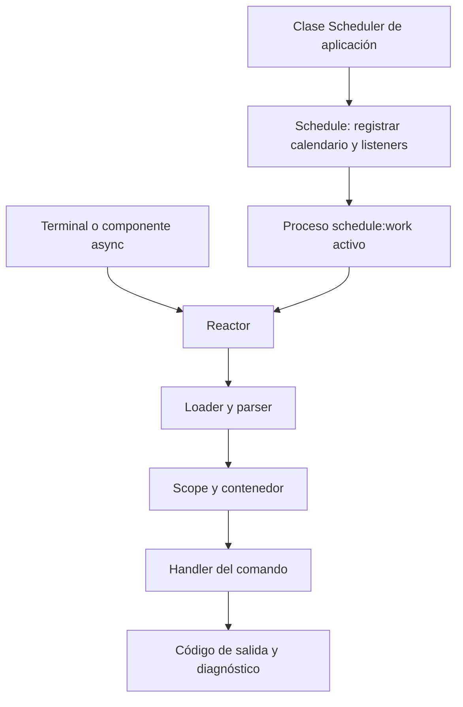

La consola de Orionis permite exponer operaciones de tu aplicación como comandos, con argumentos tipados, ayuda, salida interactiva e inyección de dependencias. **Reactor** los ejecuta. El **scheduler** decide cuándo ejecutar comandos programados mediante la fachada pública **`Schedule`**.

`Scheduler` es el nombre habitual de la clase de tu aplicación que extiende `BaseScheduler`; no es el nombre de la fachada exportada. Su configuración pertenece a `config/scheduler.py`. `config/queue.py` configura [Queues](/es/asynchronous/queues), cuyo almacenamiento de jobs y workers tiene un ciclo de vida distinto.

## Ejecutar el CLI

Sitúate en la raíz del proyecto y utiliza una alternativa con las dependencias del proyecto disponibles:

```shell
orionis list
```

```shell
python -B reactor list
```

Si utilizas uv para seleccionar el entorno del proyecto:

```shell
uv run orionis list
uv run python -B reactor list
```

El ejecutable `orionis` importa `bootstrap.app` desde el directorio actual y llama a la aplicación, sin necesitar un archivo `reactor`. La segunda alternativa utiliza ese archivo local. Ambas acceden al mismo registro y ciclo de ejecución; el comando directo también desactiva la escritura de bytecode en su proceso y configura esa preferencia para intérpretes hijos.

<a id="cli-syntax"></a>

## Sintaxis, ayuda y códigos de salida

```text
orionis <firma> [argumentos] [opciones]
python -B reactor <firma> [argumentos] [opciones]
```

Sin firma, o con `-h`/`--help` en esa posición, se muestra la lista. Para la ayuda de una operación añade `--help` después de su firma:

```shell
orionis make:console-command --help
python -B reactor make:console-command --help
```

Los posicionales siguen el orden declarado; las opciones usan los flags de cada comando. Las abreviaturas de opciones largas están desactivadas. No hay un conjunto universal de flags como `--quiet` o `--force`: consulta la ayuda del comando concreto.

Un código `0` normalmente indica que el flujo terminó correctamente; un comando puede devolver otro entero para comunicar un resultado de negocio. Los errores del parser normalmente producen `2`; una excepción gestionada por Reactor, `1`. Algunos comandos incluidos capturan sus propios errores sin devolver un código no cero: se documentan esas diferencias en [el catálogo](/es/console/built-in-commands).

## Crear y ejecutar tu primer comando

Genera el archivo y abre `app/console/commands/greet_command.py`:

```shell
orionis make:console-command greet --signature app:greet
```

```shell
python -B reactor make:console-command greet --signature app:greet
```

Sustituye el cuerpo sin implementar por este módulo completo:

```python
from typing import ClassVar
from orionis.console import Argument
from orionis.console.base import BaseCommand


class GreetCommand(BaseCommand):
    signature = "app:greet"
    description = "Print a greeting."
    timestamps = False
    arguments: ClassVar[list[Argument]] = [
        Argument(name_or_flags="name", type_=str),
    ]

    async def handle(self) -> int:
        self.writeLine(f"Hello, {self.getArgument('name')}!")
        return 0
```

```shell
orionis app:greet Ada
python -B reactor app:greet Ada
```

El loader descubre la clase por la ruta configurada. El parser entrega `name`, Reactor construye el comando y `handle()` escribe `Hello, Ada!`. Consulta [creación e inyección](/es/console/creating-commands) para constructor, servicios, convenciones y manejo de errores.

## Del comando a la programación



Un comando se puede ejecutar manualmente, por `await Reactor.call(...)` o desde una tarea programada. Configurar un calendario no inicia un proceso consumidor por sí solo. El CLI nativo `schedule:work` mantiene el scheduler activo; `schedule:list` permite inspeccionarlo. No existe un comando nativo `schedule:run`.

Los eventos de tareas pertenecen al scheduler: una ejecución manual de Reactor no dispara automáticamente esos listeners. Las diferencias entre retorno no cero, excepción, ejecución perdida y límite de instancias se explican en [eventos](/es/console/scheduler-listeners).

## Recorrido de las guías

| Necesidad | Documentación |
| --- | --- |
| Generar y organizar comandos | [Crear comandos e inyectar servicios](/es/console/creating-commands) |
| Declarar y leer entradas CLI | [Argumentos y opciones](/es/console/commands-and-arguments) |
| Registrar una clase/método en rutas | [Comandos por rutas](/es/console/command-routing) |
| Escribir mensajes y tablas | [Texto, tablas y salida](/es/console/console-output) |
| Solicitar datos al operador | [Preguntas y entrada interactiva](/es/console/interactive-input) |
| Mostrar avance y gestionar esperas | [Progreso](/es/console/progress-and-debugging) |
| Ejecutar y consultar comandos desde código | [Fachada Reactor](/es/console/output-and-programmatic-execution) |
| Configurar descubrimiento e invalidación | [Caché de comandos](/es/console/command-cache) |
| Crear el scheduler de aplicación | [Programar tareas](/es/console/task-scheduling) |
| Programar un comando con argumentos | [Schedule.command()](/es/console/scheduler-execution#schedule-command) |
| Persistir calendarios | [Configuración del scheduler](/es/console/scheduler-configuration) |
| Elegir cada frecuencia disponible | [Frecuencias y calendario](/es/console/scheduler-frequencies) |
| Reaccionar a resultados y errores | [Listeners y eventos](/es/console/scheduler-listeners) |
| Controlar Schedule mediante API | [Ejecución y API del scheduler](/es/console/scheduler-execution) |
| Consultar todas las operaciones incluidas | [Catálogo de comandos](/es/console/built-in-commands) |
| Revisar contratos y herramientas de integración | [Referencia técnica](/es/console/api-reference) |
